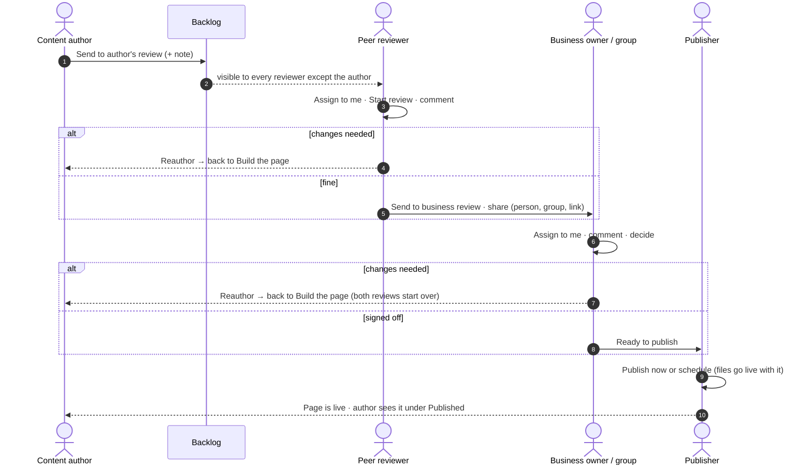

# HSBC Unified Content Platform — product specification

Reverse-engineered from the working prototype (`ucp-next`, October 2026).
Acceptance criteria are written as Gherkin scenarios (`Given / When / Then`) so they can be read
by the business and turned into automated acceptance tests later.

## 1. Product in one sentence

**One platform where every HSBC market builds, reviews, approves and publishes web content
with the same HSBC components, the same four-eyes workflow and a full audit trail.**

## 2. How this specification is organised

**One source of truth: the epic pages in [`epics/`](epics/).** Everything about an epic and its
stories is written there, and only there. This README and the roadmap only point to them.

```
docs/spec/
├── README.md     this page: overview, epics list, how to create them in Jira
├── ROADMAP.md    what is built, what comes next, build order
└── epics/        one page per Jira Epic (EP-01 … EP-19), one per screen — the source of truth
    └── img/      screenshots of every view and state, used on the epic pages
```

Every epic page reads top to bottom:

```
# EP-04 · Page builder · Building the page
Epic · Business benefit · Scope · The view (screenshots + what is on screen) · list of stories

## US-04.14 · Saving: autosave, Save button, ⌘S and a 'not saved' warning   ← one Jira Story
Business benefit                           two sentences: what the bank gains
User story                                 As a … / I want … / So that …
Persona · Depends on                       stories that must exist first ("is blocked by")
Acceptance criteria                        Scenario 1, Scenario 2, … (Given / When / Then)
```

Story names follow one pattern — **Area: what it does** (e.g. `Saving: autosave, Save button, ⌘S and a 'not saved' warning`) —
so a Jira list is readable on its own. Stories inside an epic are listed **in build order**. Related requirements are merged into one story
(one goal for one persona); a story is split only when the persona changes.

## 3. Who uses it (personas)

| Persona | Role in UCP | Typical demo account | Main goal |
|---|---|---|---|
| Content author | Author | `content.author`, `elin.llewelyn` | Build pages and send them for review |
| Peer reviewer | Reviewer | `rachel.hughes`, `aisha.khan` | Check pages before the business sees them |
| Business owner | Reviewer (Review only) | `david.clarke`, `maria.santos` | Sign off or send back |
| Publisher | Publisher | `jordan.mensah`, `michael.osei` | Put approved pages live, now or scheduled |
| Site admin | Site admin | `super.admin`, `priya.kaur` | People, permissions, templates, models; can act on behalf |
| Viewer | Viewer | `tunde.boateng` | Read only |
| Guest reviewer | — (review link) | any e-mail | Comment and decide without a UCP account |

## 4. The content lifecycle (the spine of the product)

```
Build the page → Preview → Waiting for author's review assignment (Backlog)
→ Assigned to reviewer → In author's review → Reviewed
→ Waiting for business review assignment → In business review
→ Ready to publish → (Scheduled) → Published
            ↑                                    │
            └──────────── Reauthor ──────────────┘
```

Four-eyes rules: the author never reviews their own page; the peer reviewer never does the
business review; only the assigned person decides; site admins may act, visibly "on behalf of".

### 4.1 Who hands the page to whom

The author does **not** click through the flow. The author requests the next step, the page
travels through other people, and it comes back to the author at the end (or earlier, with
comments, through "Reauthor"). Full story: [EP-04 · Review workflow](epics/EP-04-review-workflow.md) — stories US-04.22 to US-04.26.



| Step | Who acts | What the author sees meanwhile |
|---|---|---|
| Build the page | author (and co-authors) | the builder |
| Waiting for author's review assignment | any reviewer except the author | "Waiting for a reviewer to take it" |
| Assigned / In author's review | the assigned peer reviewer | "Remind" |
| Waiting for business review / In business review | a business owner or an invited group | "Remind" |
| Ready to publish / Scheduled | a publisher | "Waiting for a publisher" |
| Published | — | the page under "Published"; Edit starts a new version |

**Site admin is the exception, not the flow.** A site admin sees every action on every step
("Reviewed for …", "Sign off for …", take their own page from the Backlog) so the platform can be
demoed end to end and urgent pages can be unblocked. Each such step is written to the audit log
as "on behalf of". Ordinary users never see buttons for someone else's step (stories marked "site admin only").

## 5. Epics — one per screen, in the order you move through the app

Each epic is one screen (or one part of the page builder): it starts with screenshots of the view and what is on it,
then the stories for everything on that screen. The page builder is split into six epics because most of the work happens there.

| # | Epic | Stories |
|---|---|---|
| EP-01 | [Sign-in & global navigation](epics/EP-01-sign-in-and-navigation.md) | 12 |
| EP-02 | [Dashboard](epics/EP-02-dashboard.md) | 10 |
| EP-03 | [Pages](epics/EP-03-pages.md) | 19 |
| EP-04 | [Page builder · Building the page](epics/EP-04-page-builder-building.md) | 19 |
| EP-05 | [Page builder · Design patterns](epics/EP-05-page-builder-design-patterns.md) | 7 |
| EP-06 | [Page builder · Page settings, linked content & collaboration](epics/EP-06-page-builder-settings-content-collaboration.md) | 14 |
| EP-07 | [Page builder · Quality checks & AI](epics/EP-07-page-builder-quality-and-ai.md) | 9 |
| EP-08 | [Page builder · Review workflow](epics/EP-08-page-builder-review-workflow.md) | 24 |
| EP-09 | [Page builder · Publishing](epics/EP-09-page-builder-publishing.md) | 9 |
| EP-10 | [Review link (guest reviewers)](epics/EP-10-review-link.md) | 8 |
| EP-11 | [My tasks](epics/EP-11-my-tasks.md) | 11 |
| EP-12 | [Assets](epics/EP-12-assets.md) | 12 |
| EP-13 | [Content entities](epics/EP-13-content-entities.md) | 15 |
| EP-14 | [Content models](epics/EP-14-content-models.md) | 15 |
| EP-15 | [Templates](epics/EP-15-templates.md) | 11 |
| EP-16 | [API & delivery](epics/EP-16-api-and-delivery.md) | 13 |
| EP-17 | [Users & roles](epics/EP-17-users-and-roles.md) | 10 |
| EP-18 | [Audit log](epics/EP-18-audit-log.md) | 11 |
| EP-19 | [Why UCP](epics/EP-19-why-ucp.md) | 3 |

**19 epics · 232 stories · 866 scenarios.**

## 6. Creating the epics and stories in Jira

Copy everything from the epic pages; nothing has to be invented.

**Epics** (create the 19 epics first)

| Jira field | Value |
|---|---|
| Issue type | **Epic** |
| Epic name / Summary | e.g. `EP-04 · Page builder · Building the page` |
| Team | **WPB Digital Browser: Tools** |
| Description | the epic's **Business benefit** and **Scope** |

**Stories** (same settings for all 232)

| Jira field | Value |
|---|---|
| Issue type | **Story** |
| Story type | **Functional** |
| Sprint | **TBD** |
| Team | **WPB Digital Browser: Tools** |
| Epic Link | the epic the story is under, e.g. `EP-04 · Page builder · Building the page` |
| Summary | story ID and name, e.g. `US-04.14 · Saving: autosave, Save button, ⌘S and a 'not saved' warning` |
| Description | **Business benefit**, then **User story**, then **Acceptance criteria** |
| Acceptance criteria | **only** the acceptance criteria (Background, if any, and Scenario 1, 2, …) |

- Create the stories in the order they appear on the epic page.
- Record every **Depends on** as an issue link "is blocked by".
- Keep the story ID at the start of the Summary, so a Jira ticket always matches its section on the epic page.

## 7. Glossary

| Term | Meaning |
|---|---|
| Market | A country site (UK, Hong Kong…), grouped into instances (EMEA, APAC, NA) |
| Environment | Development, Test, Staging, Production |
| Component (block) | An HSBC building block such as Masthead, Key facts, Rates table |
| Design pattern | Several components saved together and added in one click |
| Template | The components a new page starts with; can be limited to markets |
| Content model / entity | A content type (e.g. Rate) and one item of it (e.g. ISA rates 2026) |
| Token | `{{alias.field}}` in text, replaced with the entity's value |
| Backlog | Pages sent for review that nobody has taken yet |
| Four eyes | The rule that a different person checks each step |
| Review link | A link that lets people without UCP comment and, if invited, decide |

## 8. Where the behaviour lives in the code

| Area | Files |
|---|---|
| Workflow & permissions | `lib/ucp/perms.ts`, `lib/server/ucp.ts`, `app/api/repo/[...op]/route.ts`, `app/api/ucp/[...op]/route.ts` |
| Page builder | `components/builder/*`, `lib/blocks/*`, `lib/ai/*`, `lib/ucp/insights.ts`, `lib/ucp/tokens.ts` |
| Pages | `components/explorer/*`, `components/pages/*` |
| Tasks & review | `components/tasks/*`, `components/review/*`, `app/review/[token]` |
| Library | `components/templates/*`, `components/assets/*`, `components/models/*`, `components/entities/*` |
| Repository | `lib/repo/*` (mock, Sling, ContentLIBRE adapters; KV shared state on Cloudflare) |
| Tests | `tests/e2e/*` (Playwright, 19 tests) |

See [ROADMAP.md](ROADMAP.md) for what is built, what is a stand-in and what comes next.
