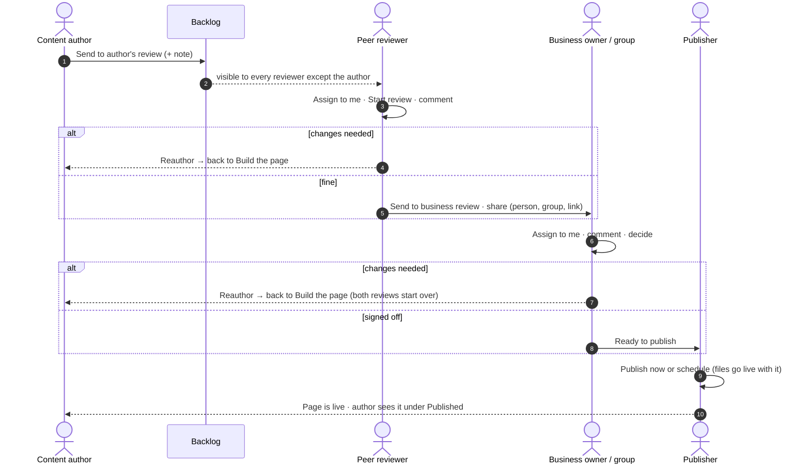

# HSBC Unified Content Platform — product specification

Reverse-engineered from the working prototype (`ucp-next`, October 2026).
Behaviour is written in Gherkin (`Given / When / Then`) so it can be read by the business
and turned into automated acceptance tests later.

## 1. Product in one sentence

**One platform where every HSBC market builds, reviews, approves and publishes web content
with the same HSBC components, the same four-eyes workflow and a full audit trail.**

## 2. Hierarchy

```
Product  ─ HSBC Unified Content Platform
 └─ Epic        (9)    EP-<nn> · name, one page in epics/ = one Jira Epic, e.g. "EP-04 · Review workflow"
     └─ Story   (87)   Rule: US-<epic>.<nn> · name = one Jira Story
         │              As a <persona> / I want … / So that …
         └─ Scenario (236) acceptance criteria (Given / When / Then)
```

Every story has the same shape, in this order:

```gherkin
  # Business benefit: <two sentences: what the bank gains — time, risk, compliance, cost, trust>.
  @admin @depends:US-03.02        ← optional tags: site-admin story, stories it needs first
  Rule: US-03.04 · Never lose my work      ← ID (epic.order) and name
    As a content author                       ← user story
    I want …
    So that …

    Scenario: …                               ← acceptance criteria
```

Inside each epic, stories are listed **in build order** (the last number of the ID is that order).
`@depends:` names every story that has to exist first, also in other epics. Readable epic pages are in [`epics/`](epics/) (one `EP-nn-….md` per epic);
the Gherkin sources they are generated from are in `epics/gherkin/`. The sources keep the `.feature` extension and the `Feature:` keyword only because Gherkin tools require them — in this
project that line always names an epic (`Feature: EP-03 · Page builder`), with the epic's `# Business benefit:`
above it. A Background that only some stories need sits inside those stories.
Old three-part IDs (before the Epic → Story layout) map to the new ones in [tools/id-mapping.txt](tools/id-mapping.txt). The whole picture —
benefits, dependencies and build waves for the product — is in **[STORY-MAP.md](STORY-MAP.md)**.

Related requirements are merged into one story (one goal for one persona); a story is split only
when the persona changes. Site-admin-only stories are tagged `@admin`, planned ones `@status:next`.

Tags: `@epic:<name>` and `@status:done | next | later` on every epic, `@mock` where the
prototype uses a stand-in (SSO, AI), `@admin` / `@status:next` on individual stories.

## 3. Who uses it (personas)

| Persona | Role in UCP | Typical demo account | Main goal |
|---|---|---|---|
| Content author | Author | `content.author`, `elin.llewelyn` | Build pages and send them for review |
| Peer reviewer | Reviewer | `rachel.hughes`, `aisha.khan` | Check pages before the business sees them |
| Business owner | Reviewer (Review only) | `david.clarke`, `maria.santos` | Sign off or send back |
| Publisher | Publisher | `jordan.mensah`, `michael.osei` | Put approved pages live, now or scheduled |
| Site admin | Site admin | `super.admin`, `priya.kaur` | People, permissions, templates, models; can act on behalf |
| Viewer | Viewer | `tunde.boateng` | Read only |
| Guest reviewer | — (review link) | any e-mail | Comment and decide without a UCP account |

## 4. The content lifecycle (the spine of the product)

```
Build the page → Preview → Waiting for author's review assignment (Backlog)
→ Assigned to reviewer → In author's review → Reviewed
→ Waiting for business review assignment → In business review
→ Ready to publish → (Scheduled) → Published
            ↑                                    │
            └──────────── Reauthor ──────────────┘
```

Four-eyes rules: the author never reviews their own page; the peer reviewer never does the
business review; only the assigned person decides; site admins may act, visibly "on behalf of".

### 4.1 Who hands the page to whom

The author does **not** click through the flow. The author requests the next step, the page
travels through other people, and it comes back to the author at the end (or earlier, with
comments, through "Reauthor"). Full story: [EP-04 · Review workflow](epics/EP-04-review-workflow.md) — stories US-04.22 to US-04.26.



| Step | Who acts | What the author sees meanwhile |
|---|---|---|
| Build the page | author (and co-authors) | the builder |
| Waiting for author's review assignment | any reviewer except the author | "Waiting for a reviewer to take it" |
| Assigned / In author's review | the assigned peer reviewer | "Remind" |
| Waiting for business review / In business review | a business owner or an invited group | "Remind" |
| Ready to publish / Scheduled | a publisher | "Waiting for a publisher" |
| Published | — | the page under "Published"; Edit starts a new version |

**Site admin is the exception, not the flow.** A site admin sees every action on every step
("Reviewed for …", "Sign off for …", take their own page from the Backlog) so the platform can be
demoed end to end and urgent pages can be unblocked. Each such step is written to the audit log
as "on behalf of". Ordinary users never see buttons for someone else's step (stories tagged `@admin`).

## 5. Epics

| # | Epic (file) | Stories | What it covers |
|---|---|---|---|
| EP-01 | [Access & navigation](epics/EP-01-access-and-navigation.md) | 9 | Who you are, where you are, what you may do |
| EP-02 | [Pages](epics/EP-02-pages.md) | 8 | The site tree and safe page operations |
| EP-03 | [Page builder](epics/EP-03-page-builder.md) | 20 | Making a page |
| EP-04 | [Review workflow](epics/EP-04-review-workflow.md) | 26 | Four-eyes approval |
| EP-05 | [Publishing](epics/EP-05-publishing.md) | 6 | Going live safely |
| EP-06 | [Content library](epics/EP-06-content-library.md) | 10 | Reusable building blocks and content |
| EP-07 | [Translations](epics/EP-07-translations.md) | 2 | Language versions through the same workflow |
| EP-08 | [Governance](epics/EP-08-governance.md) | 3 | Proof and overview |
| EP-09 | [Delivery API](epics/EP-09-delivery-api.md) | 3 | Content for every channel |

## 6. Glossary

| Term | Meaning |
|---|---|
| Market | A country site (UK, Hong Kong…), grouped into instances (EMEA, APAC, NA) |
| Environment | Development, Test, Staging, Production |
| Component (block) | An HSBC building block such as Masthead, Key facts, Rates table |
| Design pattern | Several components saved together and added in one click |
| Template | The components a new page starts with; can be limited to markets |
| Content model / entity | A content type (e.g. Rate) and one item of it (e.g. ISA rates 2026) |
| Token | `{{alias.field}}` in text, replaced with the entity's value |
| Backlog | Pages sent for review that nobody has taken yet |
| Four eyes | The rule that a different person checks each step |
| Review link | A link that lets people without UCP comment and, if invited, decide |

## 7. Where the truth lives in the code

| Area | Files |
|---|---|
| Workflow & permissions | `lib/ucp/perms.ts`, `lib/server/ucp.ts`, `app/api/repo/[...op]/route.ts`, `app/api/ucp/[...op]/route.ts` |
| Page builder | `components/builder/*`, `lib/blocks/*`, `lib/ai/*`, `lib/ucp/insights.ts`, `lib/ucp/tokens.ts` |
| Pages | `components/explorer/*`, `components/pages/*` |
| Tasks & review | `components/tasks/*`, `components/review/*`, `app/review/[token]` |
| Library | `components/templates/*`, `components/assets/*`, `components/models/*`, `components/entities/*` |
| Repository | `lib/repo/*` (mock, Sling, ContentLIBRE adapters; KV shared state on Cloudflare) |
| Tests | `tests/e2e/*` (Playwright, 19 tests) |

See [ROADMAP.md](ROADMAP.md) for what is built, what is a stand-in and what comes next.
