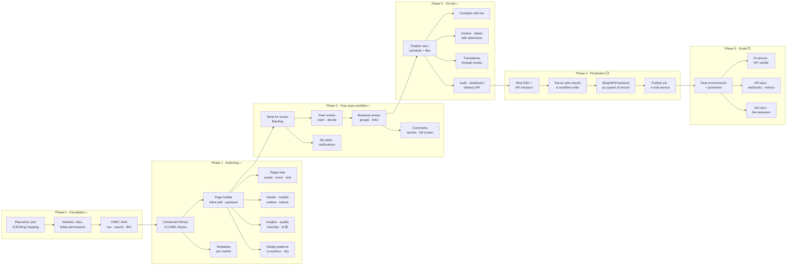
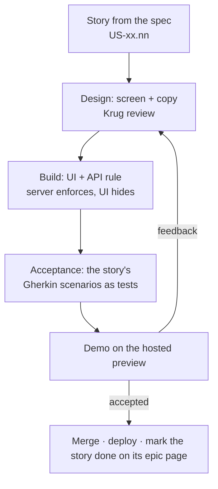

# Roadmap

Reverse roadmap: first what the prototype already proves (in the order it was built),
then what is a stand-in, then what has to happen to make it production-ready.

Legend: ✅ built · 🟡 built as a stand-in (mock) · ⬜ not built

## How I would build it — the flow

Each box is a release that can be demoed on its own. Arrows are hard dependencies:
nothing on the right is worth building before the box on its left works.

**Why this order**

1. **Foundation first** — every later screen reads permissions and the repository; changing them later means rewriting everything.
2. **Authoring before workflow** — a review needs something to review; the builder is also where the most UX risk sits, so it gets feedback earliest.
3. **Workflow before publishing** — the bank's main rule is four eyes; publishing without it would be a demo nobody can approve.
4. **Production readiness as one block** — SSO, server checks and the real backend are invisible to users but are the gate for any pilot with real content.
5. **Scale last** — environments, AI and integrations multiply value only once one market runs on the platform.

## Each phase as a sprint flow

## Phase 0 — Foundation ✅

| Item | Status |
|---|---|
| Next.js 16 app, HSBC shell (top bar, side menu, ⌘K palette, search) | ✅ |
| Markets in 3 instances, 4 environments | ✅ (environments are labels only — see Phase 5) |
| Repository port with JCR/Sling mapping; mock, Sling and ContentLIBRE adapters | ✅ / 🟡 ContentLIBRE pages only |
| Shared demo state on Cloudflare KV, deploy to Workers behind Basic Auth | ✅ |
| Roles and folder-level permissions, Users & roles screen | ✅ |
| Sign-in | 🟡 SSO stand-in (pick an account) |

## Phase 1 — Authoring ✅

| Item | Status |
|---|---|
| Page builder: 13 HSBC components, inline editing, Configure, rich text, device widths, autosave, ⌘S | ✅ |
| Pages: tree, search, create from template, rename, move with relinking, copy, duplicate, lock | ✅ |
| Templates with market visibility | ✅ |
| Assets with accessibility panel and publish status | ✅ |
| Content models (versions, breaking-change guard) and entities with tokens | ✅ |
| Page insights, quality checklist in preview | ✅ |
| Design patterns (create, markets, archive/delete) | ✅ |
| Several authors per page, Jira link | ✅ |
| AI assistant (component and page level, plan → run → undo) | 🟡 deterministic planner, no model call |

## Phase 2 — Four-eyes workflow ✅

| Item | Status |
|---|---|
| Backlog, Assign to me, Back to backlog, peer review, Reviewed → next step | ✅ |
| Business review: claim, groups, share by link/e-mail, sign-off, reauthor | ✅ |
| Review links for guests with invite-only decisions | ✅ |
| Comments on text/image/component, resolve with undo, pin, full-screen feedback | ✅ |
| My tasks with stage tabs, three people per page, admin reassign, reminders | ✅ |
| Notifications bell | ✅ |
| E-mail sending (invites, review links, reminders) | 🟡 opens the user's mail app / nothing is sent |

## Phase 3 — Publishing & governance ✅

| Item | Status |
|---|---|
| Publish now / schedule, files published with the page, bulk publish, fanfare | ✅ |
| Compare authoring version with live | ✅ |
| Archive (restorable) and delete with reference check | ✅ |
| Translations in 4 steps, always through review | ✅ (🟡 glossary instead of MT) |
| Audit log with CSV export; dashboard | ✅ |
| Delivery API (pages, preview, models, assets, markets, templates) | ✅ |
| Scheduled publishing | 🟡 runs when someone opens a CMS screen, not as a job |

## Phase 4 — Production readiness (next) ⬜

Ordered by risk. Each item should become stories (marked "planned, not built yet") on the matching epic page.

| # | Item | Why |
|---|---|---|
| 1 | Real SSO (Entra ID / SAML), secure cookies | Anyone can sign in as anyone today |
| 2 | Session check on every `/api/*` call | APIs without a session act as a default user |
| 3 | Server-side permission checks on uploads, asset writes and audit writes | Today only the UI hides them; audit can be deleted |
| 4 | Workflow order enforced on every status change | A direct API call can skip stages |
| 5 | Permission filtering on search and page reads | Search shows pages people cannot read |
| 6 | Real Sling/AEM backend as the system of record | Mock data resets; KV is last-writer-wins |
| 7 | Background job for scheduled publishing | Must not depend on someone opening a screen |
| 8 | E-mail service for invites, review links and reminders | Nothing is sent today |

## Phase 5 — Scale (later) ⬜

| Item | Notes |
|---|---|
| Real environments with promotion dev → test → stage → prod | Today one data set for all |
| AI service (UCP_AI_URL) for free prompts and machine translation, vendor integration | Planner stays as the safe default |
| Forms service UI and form picker | Today a form id field only |
| Delivery API keys, webhooks, `/v1/content/{model}`, binary renditions | Documented, not served |
| Jira two-way sync (status of the ticket on the page) | Today a link only |
| Real-time co-editing presence for several authors | Today authors are assigned, edits are last-save-wins |
| Delivery and usage metrics on the dashboard | Today fixed demo numbers |

## Issues found while walking the mock (October 2026)

Found by clicking through every screen for the epics; nothing here is fixed yet. Security first.

**Security & server-side rules**
- Version restore has no permission check — anyone signed in can restore a page version (`versions/restore`).
- Asset writes are not checked on the server — a Viewer can upload and delete files; "remove it from pages first" is UI-only.
- Non-admins can read the whole audit log through `/api/repo/node`; "My activity" filters only on screen.
- Delivery API has no authentication — `/v1/preview/pages` gives drafts to anonymous callers with public caching and CORS `*`.
- Four-eyes gap on group review links — a guest decision checks group membership, not who did the peer review.
- Changing a role does not change permissions (grants are set only at invite); "Site admin" role passes every check; nothing stops removing the last site admin.
- Locked components can still be deleted, hidden or changed through ⋯ More and Configure.
- ⌘S on a read-only page reports "Saved" without saving.
- Template editing: the screen allows market-level Manage, the server needs global Manage (403 after editing).

**Workflow & publishing**
- Opening "Share for business review" creates a link and an audit line; non-admins cannot reopen the dialog.
- Every status change by an editor re-saves the components (extra version and audit line).
- "Assign automatically" excludes the admin who clicks it instead of the page's author.
- Publish refusal text differs (dialog "Needs review first" vs server "Needs approval first"); schedule minimum 5 min (UI) vs 1 min (server).
- After scheduling, reopening the dialog has no "Scheduled for" banner until reload.
- "Last modified by" on new pages is whoever signed in last on the server; Published tab counts rely on it.
- Ready-to-publish pages get made-up due dates.
- The "Review is already done" modal is never opened (dead code).

**Page builder**
- The Button popover (label + URL) can never open; links are only editable in Configure.
- "Hide on mobile" is stored but never applied; hidden components still show in Preview.
- Esc while typing throws the text change away although the hint says "Esc when done".
- ⌘⇧F leaves the preview without the "Does everything look right?" check.
- Deleting a component has no confirmation and no undo.
- Typing `{{` in formatted text leaves stray braces after inserting a token.
- "Polish it" is understood as "translate to Polish" by the AI planner.
- "Send translated pages straight to review" is ignored (always review).
- Page insights computes "info" findings but never shows them.
- Component toolbar is cut off on a 390 px phone.

**Pages, dashboard & navigation**
- Unknown market or environment silently shows UK / Production; unknown sections show a bare 404 without the shell.
- Dashboard review counts disagree (shortcut 7 vs tile 14); the failed tile shows the same count in every environment.
- Breadcrumbs show URL segments instead of folder titles; the copy preview says "-copy" when it will be "-copy-2".
- Non-owners are offered "Unlock" and "Rename" on locked pages and only get an error afterwards.

**Assets, models, entities, templates, API**
- Replacing an asset renames it and resets it to "Not published" (live pages then fail to republish).
- PDFs ask for alt text; "Needs attention" double-counts; folders cannot be renamed or deleted.
- A label-only rename of a model field is flagged as a breaking change; deleting a model hides its entities.
- An entity can be moved into a draft model; seed references break the "fields in common" rule.
- "Blank page" template has 9 blocks; stray test data ("jdn" template, "new pattern", "uyiyuiy" patterns) is in the library.
- Preview JSON `_links.self` points to the public route (404 for drafts); unknown `?market=` returns an empty list.

## Build order across epics

Stories in the same wave can be built in parallel once the earlier waves are done (from the **Depends on** of each story on the epic pages).

**Wave 1** — US-01.01 Sign-in: company SSO login with return to the requested page · US-01.04 Market switcher: change instance and market without losing the current screen · US-01.05 Environment indicator: always show dev / test / stage / prod and whether it reaches customers · US-01.06 Command palette (⌘K): find a page or jump to any section from the keyboard · US-01.08 Global search: find pages, assets, people, templates and models from the top bar · US-01.09 Side menu: full, collapsed rail, tablet rail and phone drawer · US-01.12 Loading and error states: skeleton while loading, clear error with a way out · US-02.06 Content activity chart: pages published, created and updated over the last 30 days · US-03.07 Page actions: show only permitted actions and confirm each with its impact · US-03.12 Archive pages: take pages offline and out of lists, with restore · US-12.01 Asset library: browse files by folder with counts and a breadcrumb · US-14.01 Models overview: list content models with search, filters and sorting · US-17.01 Permissions model: role defaults and the permission each workflow step needs · US-19.01 Why UCP: see the platform's benefits for developers, content authors and customers

**Wave 2** — US-01.02 Hosted demo: password gate and sign-in as any demo persona · US-01.03 Account menu: see who I am signed in as and sign out · US-01.07 Command palette in the page builder: ask AI or add a component · US-02.01 Dashboard header: which market and environment I am working in · US-03.01 Pages list: browse the folder tree and search all pages of the market · US-03.09 Page lock: lock a page so only I or a site admin can change, move or delete it · US-03.11 Read-only access: see and open every page, change only where I have Edit · US-12.02 Asset library: find by name, filter by type and switch between grid and list · US-12.03 Asset details: see a file's facts, status and the pages that use it · US-12.04 Asset folders: create a new folder · US-12.05 Asset upload: upload files with the button or by drag and drop, never overwriting · US-14.02 Model tree: browse content models by category · US-14.03 Model detail: see a model's fields, usage and entities · US-14.04 Model creation: create a content model in three steps · US-14.12 Model map: see and edit the connections between models · US-15.01 Template library: browse folders, search and switch between grid and list · US-16.09 API & delivery screen: header and usage tiles · US-17.02 People list: browse and find a person by name, team or role · US-18.01 Audit trail: every change recorded with who, what, when and request id · US-19.02 Why UCP: show the benefits of one audience with a link I can share · US-19.03 Why UCP: mark planned benefits and link to the roadmap

**Wave 3** — US-02.02 Dashboard shortcuts: "What do you want to do?" · US-02.07 Pages by section: page count per top-level folder, one click to the folder · US-02.09 Latest activity: the last five things that happened in the market · US-02.10 Recently edited: the pages changed most recently in the market · US-03.02 Folder tree and breadcrumbs: open, close and jump between folders · US-03.04 Row actions menu (⋯): open, rename, move, duplicate, archive or delete one item · US-03.10 Page lock override: site admin unlocks or changes a page locked by someone else · US-03.18 Translate pages: 4-step flow (languages, how, where, check) to create language copies · US-12.06 Asset replace: swap a file for a new version without breaking pages · US-12.07 Asset actions: move a file to another folder and copy its id · US-12.08 Asset delete: delete unused files after confirmation · US-12.09 Asset accessibility: alt text per language and document accessibility details · US-12.11 Asset publishing: publish files and block pages that still use draft files · US-13.01 Entity tree: browse entities by content model and folder · US-14.05 Field editor: add, edit, reorder, duplicate and remove fields · US-14.13 Model folders: organise models in categories · US-14.14 Model actions: duplicate or delete a model · US-14.15 Content models: read-only documentation view for non-admins · US-15.04 New folder: group templates in a new folder · US-15.05 Templates (admin): create, duplicate and delete page templates · US-16.12 API explorer, All endpoints tab: every endpoint with what it returns and its auth · US-17.03 User profile: select a person and share a direct link to them · US-17.06 Invite user: add a person with a role, team and generated sign-in id · US-18.02 Today's KPIs: events, publishes, permission changes and failures · US-18.03 Type tabs: All, Content, Publishing, Permissions and System with counts · US-18.04 Search: find events by person, page, action, path or request id · US-18.05 Person and period filters: one person's events, today or the last two days · US-18.07 Event list: events grouped by day with time, person, action and type · US-18.11 My activity: non-admins see only their own audit entries

**Wave 4** — US-03.05 Rename: change a page or folder title without changing its address · US-03.06 Duplicate: make a draft copy of a page in the same folder · US-12.10 Asset smart views: find unused files and files missing accessibility info · US-12.12 Asset library: read-only access for people without Edit · US-13.02 Entity list: search, filter by model and status, and sort · US-13.03 Entity creation: create an entity from a published content model · US-13.10 Entity folders: group the entities of a model in folders · US-13.15 Content entities: read-only view without Edit · US-14.06 Field editor: validation rules for each field type · US-14.07 Model editor: edit model information and save a draft · US-15.06 Template editor: see the template as a page inside the HSBC menu and footer · US-15.10 Template markets (admin): limit a template to selected local markets · US-17.04 Permissions grid: grant and remove permissions per folder, explicit or inherited (site admin) · US-17.05 Role: change a person's role from the profile card · US-17.07 Remove access: take all access away from a person after confirmation · US-17.08 Recent activity: a person's last actions with a link to the full audit log · US-17.09 My access: non-admins see only their own profile and permissions, read-only · US-18.06 Shareable filters: filters kept in the URL, result counter and clear filters · US-18.08 Event links: open the page, person or section an event is about · US-18.09 Load older events: show the latest 100 and page back in steps of 100

**Wave 5** — US-13.04 Entity editor: fill in a form generated from the model's fields · US-13.09 Entity actions: duplicate an entity as a new draft · US-13.11 Entity actions: move an entity to another folder or content model · US-13.12 Entity actions: delete an entity, never one that pages still use · US-14.08 Model publishing: review the changes and confirm breaking ones · US-14.10 Model editor: warn before leaving with unsaved changes · US-14.11 Model editor: diagram, form preview, configuration and JSON schema · US-15.02 Template library: see what each template contains and where it can be used, read-only for non-admins · US-15.07 Template editor: add, select, move and remove blocks with automatic save · US-15.08 Template editor: preview, device widths and panel toggles · US-15.09 Template settings: name, description, folder and usage · US-17.10 Access control: only site admins can change users and permissions, enforced by the server · US-18.10 Export CSV: download the filtered events for auditors

**Wave 6** — US-03.03 New page / new folder: create from a market-approved template · US-13.05 Entity editor: validation that blocks saving and publishing invalid values · US-14.09 Model versions: compare snapshots and restore one into the draft · US-15.11 Template editor (read-only): look at a template without changing it

**Wave 7** — US-03.08 Move & copy pages: relink referring pages and never overwrite an existing page · US-04.01 Page builder screen: top bar, hint bar and a 1:1 canvas of the page · US-06.01 Right rail: icons with badges, one panel at a time, resizable panel · US-06.13 Co-authors: join or leave the authors of a page at Build the page · US-13.06 Entity editor: save changes as a draft without affecting live pages · US-15.03 Use template: start a new page from a template

**Wave 8** — US-04.02 Left rail and side panels: open, close and resize the component library and design patterns · US-04.05 Canvas: hover outline with the component name and click to select · US-04.16 Device preview: desktop, tablet, mobile widths and full-screen preview · US-06.06 Entities panel: see the content entities a page uses, their status and where to edit them · US-06.14 Co-authors (admin): site admin adds or removes other people as authors · US-07.01 Page insights verdict: can this page go out, with must fix, should fix and passed · US-07.06 Page AI: ask for a page-wide change from the AI panel or the command palette · US-13.08 Entity editor: warn before leaving with unsaved changes

**Wave 9** — US-04.03 Component library: find HSBC components and add them below the selected one · US-04.06 Component toolbar: edit, pattern, AI, move up/down, delete and ⋯ More menu · US-04.19 Builder on phone and tablet: the right rendition, bottom rail and full-screen panels · US-06.07 Linked content: link an entity and use its fields as {{tokens}} in the page

**Wave 10** — US-03.13 Permanent delete: show linking pages, linked content, files and folder contents before deleting · US-04.04 Empty page: start from a starter layout or add components one by one · US-04.07 Inline editing: type and format text directly on the page · US-04.09 List fields: edit, add, reorder and remove the items of tiles, tables, facts and FAQs · US-04.10 Configure panel: content, layout, behaviour and metadata of the selected component · US-04.12 ⋯ More menu: duplicate, copy and paste, version history and delete a component · US-05.01 Design patterns library: add a saved group of components in one click · US-06.08 Content picker: browse folder, entity and field and preview what the text will show · US-06.10 Linked content checks: stop inheriting, flag unlinked tokens, protect entities in use · US-07.05 Component AI: suggest changes to one component with before/after and Apply · US-08.01 Workflow stepper: nine steps with the next action between them · US-13.07 Entity publishing: one publish updates every page that shows the entity · US-13.13 Entity editor: see on which pages an entity is used · US-13.14 Entity editor: copy page tokens for each field

**Wave 11** — US-04.08 Rich text formatting: formatting bar, safe links and clean pasting · US-04.11 Image field: pick a picture from the asset library or upload a new one · US-04.13 Hidden and locked components: keep a component off the live site or protect it from edits · US-04.14 Saving: autosave, Save button, ⌘S and a 'not saved' warning · US-05.02 Adding a pattern: where the components land and what comes with them · US-05.03 Create a design pattern: pick the components on the page · US-06.09 Content while typing: type {{ or use the content icon to insert a token at the caret · US-07.02 Page insights checks: content, accessibility, compliance and search findings

**Wave 12** — US-04.15 Keyboard shortcuts: Esc, Enter, ⌘ Enter, ⌘S and ⌘⇧F in the builder · US-05.04 Save design pattern: name, describe and choose the markets of the picked components · US-06.03 Page settings: page title, meta description with counter, URL, template, JCR path and dates · US-06.11 Version history: see every saved version with who, when, status and block count · US-07.03 Page insights fixes: one-click fixes and Show on page · US-07.04 Quality checklist: floating checks for the page and each element in the author's full-screen preview · US-07.07 Page AI: plan page-wide changes, run only the ticked ones, undo any · US-08.02 Send for review: put the page in the shared review Backlog with a note and due date

**Wave 13** — US-03.19 Translation review: every translated page goes through both reviews before going live · US-05.05 Pattern markets: choose which local markets see a pattern · US-05.06 Remove design pattern: archive first, permanent delete only on purpose · US-06.04 Jira link: attach a Jira ticket to a page and open it from the builder and My tasks · US-06.05 Translate this page: create translated drafts of one page in other languages · US-07.08 Page AI: follow-up requests and earlier tasks in the same session · US-08.03 Pre-send check: 'Does everything look right?' with insights and required-field check · US-08.04 Read-only in review: lock editing during review and reopen as a draft on purpose · US-08.06 Backlog claim: reviewer assigns a review to themselves or puts it back · US-08.15 Comments panel: write, browse and expand the page's comment thread · US-11.01 My tasks: one task per page in stage tabs with people and due dates

**Wave 14** — US-01.10 Notifications: bell alerts when a page is handed to me · US-02.03 Dashboard tiles: pages, waiting reviews and the live share of the site · US-02.08 Your tasks on the dashboard: my next five tasks with due dates · US-04.17 Leaving the preview: 'Does everything look right?' before the page goes to review · US-04.18 Read-only builder: veiled editing panels with the reason and a way back to editing · US-05.07 Design-system patterns: site admin archives or deletes built-in patterns · US-06.02 Right rail on a page I cannot change: panels open, editing panels veiled · US-08.05 Waiting line: who has the page now, under the status chips · US-08.08 Peer review decision: start the review, mark Reviewed, then business review or Reauthor · US-08.20 Workflow notifications: the bell tells each person when a page needs them · US-11.02 Stage tabs: counts, new badges and the All overview · US-11.03 Task columns: who has the page at every step · US-11.04 My tasks (author): follow my own pages and who has them · US-11.05 My tasks (reviewer / publisher): the next action for my step on each row · US-11.08 Search, Only assigned to me, sorting and market filter · US-11.11 My tasks on a phone: people, due date and actions under the title

**Wave 15** — US-01.11 Notification actions: overdue items highlighted, click opens the page · US-02.05 Content by status: how the market's pages split across the workflow · US-07.09 AI permissions: no AI changes for users who cannot edit the page · US-08.07 Review reminders: author reminds the reviewer, at most every 15 minutes · US-08.10 Review admin: site admin reassigns the peer reviewer or acts on their behalf · US-08.11 Business review claim: business owner takes a page waiting for business review · US-08.12 Share for business review: give access to a person, a review group or a link · US-08.16 Targeted comments: comment on a specific text, image or component · US-11.06 My tasks (admin): all tasks, split by assignee, with reviewer reassign · US-11.09 New for you: red dots until I have seen a task

**Wave 16** — US-06.12 Version history: restore or comment on any saved version · US-08.13 Business sign-off: sign off or Reauthor, also from full screen · US-08.17 Comment handling: jump to the commented part, resolve with undo, pin, delete own · US-08.19 Review & feedback: full-screen page with floating comments · US-10.01 Review links: open a shared review page without a UCP login · US-11.07 Assign dialog: site admin picks, changes or removes the peer reviewer

**Wave 17** — US-03.14 Restore from the list: put selected pages back to their last saved version · US-08.09 Workflow guardrails: steps happen in order and every step leaves a version · US-08.14 Business review admin: fixed reviewers, site admin can sign off on behalf · US-08.18 Comments on versions: talk about one saved version of the page · US-09.01 Ready to publish step: the Publish button only for publishers · US-10.02 Review screen layout: the page as customers see it, with a floating panel

**Wave 18** — US-09.02 Publish dialog step 1: choose which images and files go live with the page · US-10.03 Guest review link: read the page and comment without a UCP account

**Wave 19** — US-09.03 Publish now: put a signed-off page live together with its unpublished files · US-10.04 Picking a target: comment on a text, an image or a whole component · US-10.05 Guest identity: name and e-mail, remembered, fixed for e-mailed links · US-10.06 Comment list on the link: open first, resolved last, with stage and target

**Wave 20** — US-02.04 Delivery health tile: uptime of the environment, or failed publishes that need action · US-03.15 Bulk publish: publish several pages at once with a result per page · US-03.16 Compare with live: side-by-side draft vs live page with a list of differences · US-08.21 End-to-end hand-off: author → peer reviewer → business → publisher, one person per step · US-09.04 Publish fanfare: confetti and a 'Published!' card when a page goes live · US-09.05 Scheduled publish: go live at a chosen date and time, with cancel and reschedule · US-09.07 Published step: the page is live and Edit starts a new version · US-09.08 Waiting for publisher: author sees the hand-over to a publisher at Ready to publish · US-10.07 Guest decision: invited guests sign off or Reauthor through the link · US-11.10 Published tab: the latest live pages and who published them · US-16.01 Delivery API: public published pages only, separate preview endpoint for drafts

**Wave 21** — US-03.17 Compare older version: compare any saved version with the live page · US-08.22 Reauthor loop: any reviewer sends the page back to the author with comments · US-08.23 Four-eyes rule: author, peer reviewer and business reviewer must be different people · US-09.06 Scheduled pages go live on their own at the chosen time · US-09.09 Publish request: author asks for a publish date and is told when the page is live · US-16.02 Delivery API: choose the market and filter pages by status · US-16.03 Page JSON: resolved tokens, image renditions, form references and SEO meta · US-16.04 Delivery API: list content models and get the JSON Schema of each · US-16.05 Delivery API: markets, templates and asset renditions · US-16.06 Delivery API: standard errors, caching and CORS headers · US-16.07 Delivery API: API keys for public endpoints and author tokens for preview

**Wave 22** — US-08.24 Admin walk-through: site admin performs any step, recorded as 'on behalf of' · US-10.08 Signed-in reviewer on a link: decide only when it is your review · US-16.08 Delivery API: content items per model and webhooks · US-16.10 API explorer, Pages tab: find a page and see its address and JSON · US-16.11 API explorer, Models tab: find a model and see its JSON Schema

**Wave 23** — US-16.13 API explorer: Copy URL, Try it and Copy JSON

