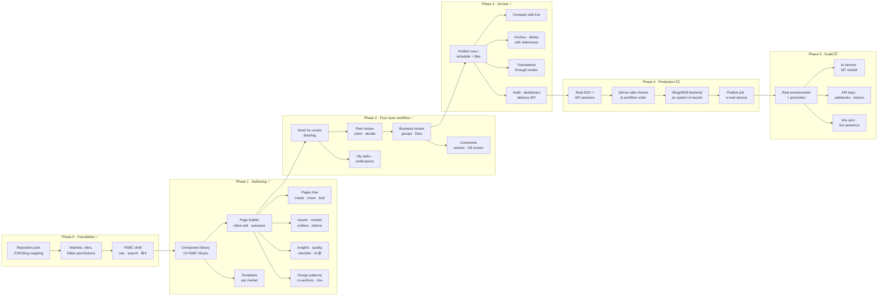
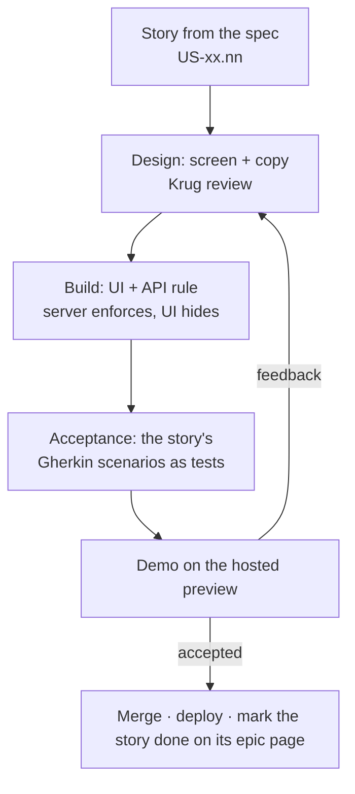

# Roadmap

Reverse roadmap: first what the prototype already proves (in the order it was built),
then what is a stand-in, then what has to happen to make it production-ready.

Legend: ✅ built · 🟡 built as a stand-in (mock) · ⬜ not built

## How I would build it — the flow

Each box is a release that can be demoed on its own. Arrows are hard dependencies:
nothing on the right is worth building before the box on its left works.

**Why this order**

1. **Foundation first** — every later screen reads permissions and the repository; changing them later means rewriting everything.
2. **Authoring before workflow** — a review needs something to review; the builder is also where the most UX risk sits, so it gets feedback earliest.
3. **Workflow before publishing** — the bank's main rule is four eyes; publishing without it would be a demo nobody can approve.
4. **Production readiness as one block** — SSO, server checks and the real backend are invisible to users but are the gate for any pilot with real content.
5. **Scale last** — environments, AI and integrations multiply value only once one market runs on the platform.

## Each phase as a sprint flow

## Phase 0 — Foundation ✅

| Item | Status |
|---|---|
| Next.js 16 app, HSBC shell (top bar, side menu, ⌘K palette, search) | ✅ |
| Markets in 3 instances, 4 environments | ✅ (environments are labels only — see Phase 5) |
| Repository port with JCR/Sling mapping; mock, Sling and ContentLIBRE adapters | ✅ / 🟡 ContentLIBRE pages only |
| Shared demo state on Cloudflare KV, deploy to Workers behind Basic Auth | ✅ |
| Roles and folder-level permissions, Users & roles screen | ✅ |
| Sign-in | 🟡 SSO stand-in (pick an account) |

## Phase 1 — Authoring ✅

| Item | Status |
|---|---|
| Page builder: 13 HSBC components, inline editing, Configure, rich text, device widths, autosave, ⌘S | ✅ |
| Pages: tree, search, create from template, rename, move with relinking, copy, duplicate, lock | ✅ |
| Templates with market visibility | ✅ |
| Assets with accessibility panel and publish status | ✅ |
| Content models (versions, breaking-change guard) and entities with tokens | ✅ |
| Page insights, quality checklist in preview | ✅ |
| Design patterns (create, markets, archive/delete) | ✅ |
| Several authors per page, Jira link | ✅ |
| AI assistant (component and page level, plan → run → undo) | 🟡 deterministic planner, no model call |

## Phase 2 — Four-eyes workflow ✅

| Item | Status |
|---|---|
| Backlog, Assign to me, Back to backlog, peer review, Reviewed → next step | ✅ |
| Business review: claim, groups, share by link/e-mail, sign-off, reauthor | ✅ |
| Review links for guests with invite-only decisions | ✅ |
| Comments on text/image/component, resolve with undo, pin, full-screen feedback | ✅ |
| My tasks with stage tabs, three people per page, admin reassign, reminders | ✅ |
| Notifications bell | ✅ |
| E-mail sending (invites, review links, reminders) | 🟡 opens the user's mail app / nothing is sent |

## Phase 3 — Publishing & governance ✅

| Item | Status |
|---|---|
| Publish now / schedule, files published with the page, bulk publish, fanfare | ✅ |
| Compare authoring version with live | ✅ |
| Archive (restorable) and delete with reference check | ✅ |
| Translations in 4 steps, always through review | ✅ (🟡 glossary instead of MT) |
| Audit log with CSV export; dashboard | ✅ |
| Delivery API (pages, preview, models, assets, markets, templates) | ✅ |
| Scheduled publishing | 🟡 runs when someone opens a CMS screen, not as a job |

## Phase 4 — Production readiness (next) ⬜

Ordered by risk. Each item should become stories (marked "planned, not built yet") on the matching epic page.

| # | Item | Why |
|---|---|---|
| 1 | Real SSO (Entra ID / SAML), secure cookies | Anyone can sign in as anyone today |
| 2 | Session check on every `/api/*` call | APIs without a session act as a default user |
| 3 | Server-side permission checks on uploads, asset writes and audit writes | Today only the UI hides them; audit can be deleted |
| 4 | Workflow order enforced on every status change | A direct API call can skip stages |
| 5 | Permission filtering on search and page reads | Search shows pages people cannot read |
| 6 | Real Sling/AEM backend as the system of record | Mock data resets; KV is last-writer-wins |
| 7 | Background job for scheduled publishing | Must not depend on someone opening a screen |
| 8 | E-mail service for invites, review links and reminders | Nothing is sent today |

## Phase 5 — Scale (later) ⬜

| Item | Notes |
|---|---|
| Real environments with promotion dev → test → stage → prod | Today one data set for all |
| AI service (UCP_AI_URL) for free prompts and machine translation, vendor integration | Planner stays as the safe default |
| Forms service UI and form picker | Today a form id field only |
| Delivery API keys, webhooks, `/v1/content/{model}`, binary renditions | Documented, not served |
| Jira two-way sync (status of the ticket on the page) | Today a link only |
| Real-time co-editing presence for several authors | Today authors are assigned, edits are last-save-wins |
| Delivery and usage metrics on the dashboard | Today fixed demo numbers |

## Known inconsistencies found while documenting

| Where | Finding |
|---|---|
| Builder translate dialog | "Send translated pages straight to review" is ignored — translations always go to review (intended, remove the checkbox) |
| Builder | "Review is already done" dialog is never opened (dead code) |
| Publish dialog | UI needs 5 minutes ahead, server publishes immediately under 1 minute |
| ⌘S | Two handlers; one does not check Edit/read-only |
| Version restore | No server-side Edit/lock check |
| Model delete | Does not check entities that use the model |
| Entities from draft models | Blocked in the UI only |

## Build order across epics

Stories in the same wave can be built in parallel once the earlier waves are done (from the **Depends on** of each story on the epic pages).

**Wave 1** — US-01.01 Sign in with the company account · US-01.04 Switch between markets · US-01.05 Always know which environment I am in · US-01.06 Reach any screen quickly on any device · US-01.07 Give each role and workflow step the right permissions · US-02.03 Know what an action will change before it happens · US-02.07 Archive pages instead of deleting them · US-03.19 Link a page to its Jira ticket · US-06.01 Build and maintain page templates · US-06.04 Upload and replace files safely · US-06.08 Define and evolve content models

**Wave 2** — US-01.03 Try the private demo as any person · US-01.08 Manage people and their permissions · US-02.01 Find any page in the market · US-02.05 Lock a page while I work on it · US-06.02 Limit a template to some markets · US-06.05 Make files accessible · US-06.07 Approve files for live use · US-06.09 Create reusable content items from a model · US-08.01 Search and export a full audit trail

**Wave 3** — US-01.09 Only site admins can change access · US-02.06 Override someone else's lock · US-03.15 Show shared content from one place · US-06.03 Pick the right template for my market · US-06.06 Find the right file · US-07.01 Create translated copies of pages in a few steps · US-08.02 See my own activity

**Wave 4** — US-02.02 Create pages and folders from on-brand templates · US-02.08 See everything affected before deleting permanently · US-03.16 Keep page text and linked content consistent · US-06.10 Update a fact everywhere at once

**Wave 5** — US-02.04 Move and copy pages without breaking or overwriting anything · US-03.01 Add on-brand components from the library · US-03.17 Build a page together with other authors

**Wave 6** — US-03.02 Edit text where it is shown · US-03.03 Arrange and configure every component the same way · US-03.05 Check the page on every device width · US-03.06 Reuse a section in one click · US-03.18 Assign other people as authors

**Wave 7** — US-03.04 Never lose my work · US-03.07 Save my own design pattern · US-03.10 See and fix what blocks publishing · US-03.11 Check any element while previewing · US-03.12 Improve one component with AI

**Wave 8** — US-03.08 Remove my patterns safely · US-03.13 Let AI plan page-wide changes that I approve · US-03.20 Go back to any earlier version · US-04.01 Request a review from the shared Backlog

**Wave 9** — US-03.09 Remove built-in design-system patterns · US-03.14 Keep AI within page permissions · US-04.02 Check the page before handing it over · US-04.03 Keep the page stable while it is being reviewed · US-04.04 Take a review from the Backlog, or give it back · US-04.16 See what needs me, by stage · US-07.02 Review every language version before it goes live

**Wave 10** — US-04.05 Review the page and decide what happens next · US-04.06 Nudge a reviewer who is taking long · US-04.17 Follow my own pages as an author · US-04.18 Pick up and finish work as a reviewer or publisher · US-04.20 Be told when a page is handed to me · US-08.03 See what needs attention

**Wave 11** — US-04.07 Steer reviews as a site admin · US-04.08 Take the business review · US-04.14 Comment on exactly what I mean · US-04.19 Oversee everything as a site admin · US-04.21 Act on a notification in one click

**Wave 12** — US-04.09 Sign off the page or send it back to the author · US-04.10 Share the page with the right business reviewers · US-04.15 Work through the feedback

**Wave 13** — US-04.11 Sign off on behalf of the business reviewer as a site admin · US-04.12 Read and comment through a link · US-05.01 Publish a signed-off page now, together with its files

**Wave 14** — US-01.02 Open a review link without an account · US-04.13 Decide through the link, only if invited · US-04.22 Hand the page over step by step · US-05.02 Publish later at a chosen time · US-05.03 Publish several pages in one go · US-05.04 Hand a signed-off page over to the publisher · US-05.05 See what will change before publishing · US-09.01 Get only approved content, and preview drafts separately

**Wave 15** — US-04.23 Get the page back when someone asks for changes · US-04.24 Nobody approves their own work · US-04.26 Ask for publishing and hear when the page is live · US-05.06 Check an older version against live · US-09.02 Render pages straight from the JSON

**Wave 16** — US-04.25 Walk the whole flow as a site admin, on record · US-09.03 Explore and try the API in the CMS
