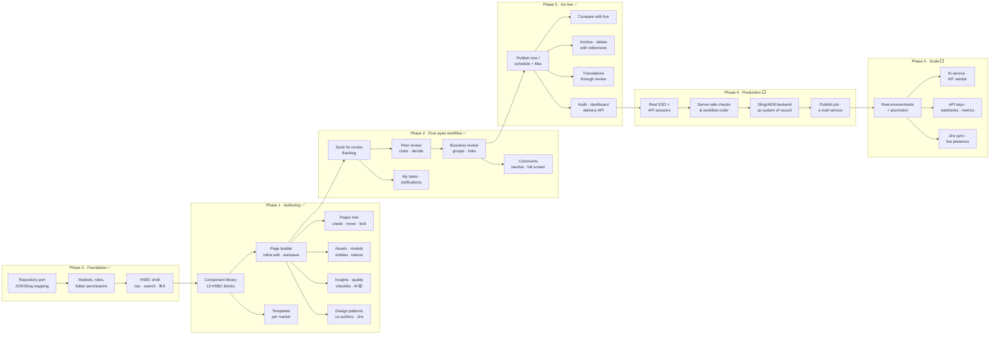
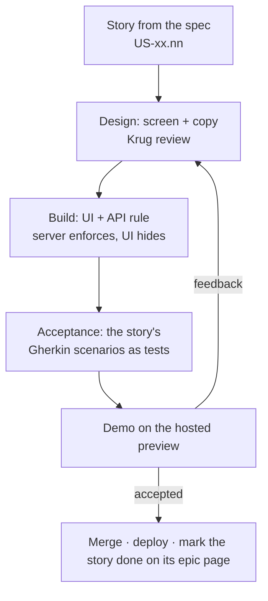

# Roadmap

Reverse roadmap: first what the prototype already proves (in the order it was built),
then what is a stand-in, then what has to happen to make it production-ready.

Legend: ✅ built · 🟡 built as a stand-in (mock) · ⬜ not built

## How I would build it — the flow

Each box is a release that can be demoed on its own. Arrows are hard dependencies:
nothing on the right is worth building before the box on its left works.

**Why this order**

1. **Foundation first** — every later screen reads permissions and the repository; changing them later means rewriting everything.
2. **Authoring before workflow** — a review needs something to review; the builder is also where the most UX risk sits, so it gets feedback earliest.
3. **Workflow before publishing** — the bank's main rule is four eyes; publishing without it would be a demo nobody can approve.
4. **Production readiness as one block** — SSO, server checks and the real backend are invisible to users but are the gate for any pilot with real content.
5. **Scale last** — environments, AI and integrations multiply value only once one market runs on the platform.

## Each phase as a sprint flow

## Phase 0 — Foundation ✅

| Item | Status |
|---|---|
| Next.js 16 app, HSBC shell (top bar, side menu, ⌘K palette, search) | ✅ |
| Markets in 3 instances, 4 environments | ✅ (environments are labels only — see Phase 5) |
| Repository port with JCR/Sling mapping; mock, Sling and ContentLIBRE adapters | ✅ / 🟡 ContentLIBRE pages only |
| Shared demo state on Cloudflare KV, deploy to Workers behind Basic Auth | ✅ |
| Roles and folder-level permissions, Users & roles screen | ✅ |
| Sign-in | 🟡 SSO stand-in (pick an account) |

## Phase 1 — Authoring ✅

| Item | Status |
|---|---|
| Page builder: 13 HSBC components, inline editing, Configure, rich text, device widths, autosave, ⌘S | ✅ |
| Pages: tree, search, create from template, rename, move with relinking, copy, duplicate, lock | ✅ |
| Templates with market visibility | ✅ |
| Assets with accessibility panel and publish status | ✅ |
| Content models (versions, breaking-change guard) and entities with tokens | ✅ |
| Page insights, quality checklist in preview | ✅ |
| Design patterns (create, markets, archive/delete) | ✅ |
| Several authors per page, Jira link | ✅ |
| AI assistant (component and page level, plan → run → undo) | 🟡 deterministic planner, no model call |

## Phase 2 — Four-eyes workflow ✅

| Item | Status |
|---|---|
| Backlog, Assign to me, Back to backlog, peer review, Reviewed → next step | ✅ |
| Business review: claim, groups, share by link/e-mail, sign-off, reauthor | ✅ |
| Review links for guests with invite-only decisions | ✅ |
| Comments on text/image/component, resolve with undo, pin, full-screen feedback | ✅ |
| My tasks with stage tabs, three people per page, admin reassign, reminders | ✅ |
| Notifications bell | ✅ |
| E-mail sending (invites, review links, reminders) | 🟡 opens the user's mail app / nothing is sent |

## Phase 3 — Publishing & governance ✅

| Item | Status |
|---|---|
| Publish now / schedule, files published with the page, bulk publish, fanfare | ✅ |
| Compare authoring version with live | ✅ |
| Archive (restorable) and delete with reference check | ✅ |
| Translations in 4 steps, always through review | ✅ (🟡 glossary instead of MT) |
| Audit log with CSV export; dashboard | ✅ |
| Delivery API (pages, preview, models, assets, markets, templates) | ✅ |
| Scheduled publishing | 🟡 runs when someone opens a CMS screen, not as a job |

## Phase 4 — Production readiness (next) ⬜

Ordered by risk. Each item should become stories (marked "planned, not built yet") on the matching epic page.

| # | Item | Why |
|---|---|---|
| 1 | Real SSO (Entra ID / SAML), secure cookies | Anyone can sign in as anyone today |
| 2 | Session check on every `/api/*` call | APIs without a session act as a default user |
| 3 | Server-side permission checks on uploads, asset writes and audit writes | Today only the UI hides them; audit can be deleted |
| 4 | Workflow order enforced on every status change | A direct API call can skip stages |
| 5 | Permission filtering on search and page reads | Search shows pages people cannot read |
| 6 | Real Sling/AEM backend as the system of record | Mock data resets; KV is last-writer-wins |
| 7 | Background job for scheduled publishing | Must not depend on someone opening a screen |
| 8 | E-mail service for invites, review links and reminders | Nothing is sent today |

## Phase 5 — Scale (later) ⬜

| Item | Notes |
|---|---|
| Real environments with promotion dev → test → stage → prod | Today one data set for all |
| AI service (UCP_AI_URL) for free prompts and machine translation, vendor integration | Planner stays as the safe default |
| Forms service UI and form picker | Today a form id field only |
| Delivery API keys, webhooks, `/v1/content/{model}`, binary renditions | Documented, not served |
| Jira two-way sync (status of the ticket on the page) | Today a link only |
| Real-time co-editing presence for several authors | Today authors are assigned, edits are last-save-wins |
| Delivery and usage metrics on the dashboard | Today fixed demo numbers |

## Known inconsistencies found while documenting

| Where | Finding |
|---|---|
| Builder translate dialog | "Send translated pages straight to review" is ignored — translations always go to review (intended, remove the checkbox) |
| Builder | "Review is already done" dialog is never opened (dead code) |
| Publish dialog | UI needs 5 minutes ahead, server publishes immediately under 1 minute |
| ⌘S | Two handlers; one does not check Edit/read-only |
| Version restore | No server-side Edit/lock check |
| Model delete | Does not check entities that use the model |
| Entities from draft models | Blocked in the UI only |

## Build order across epics

Stories in the same wave can be built in parallel once the earlier waves are done (from the **Depends on** of each story on the epic pages).

**Wave 1** — US-01.01 Sign-in: company SSO login with return to the requested page · US-01.04 Market switcher: change instance and market without losing the current screen · US-01.05 Environment indicator: always show dev / test / stage / prod and whether it reaches customers · US-01.06 Navigation: command palette (⌘K), global search and responsive side menu · US-01.07 Permissions model: role defaults and the permission each workflow step needs · US-02.03 Page actions: show only permitted actions and confirm each with its impact · US-02.07 Archive pages: take pages offline and out of lists, with restore · US-03.19 Jira link: attach a Jira ticket to a page and open it from the builder and My tasks · US-06.01 Templates (admin): create, edit, duplicate and delete page templates · US-06.04 Asset upload: upload and replace files without overwriting or breaking pages · US-06.08 Content models (admin): define fields, publish and change models safely with versions

**Wave 2** — US-01.03 Hosted demo: password gate and sign-in as any demo persona · US-01.08 Users & roles: invite people and grant permissions per folder (site admin) · US-02.01 Pages list: browse the folder tree and search all pages of the market · US-02.05 Page lock: lock a page so only I or a site admin can change, move or delete it · US-06.02 Template markets (admin): limit a template to selected local markets · US-06.05 Asset accessibility: alt text per language and document accessibility details · US-06.07 Asset publishing: publish files and block pages that still use draft files · US-06.09 Content entities: create and edit content items from published models · US-08.01 Audit log (admin): every change with who, when and request ID, searchable and exportable

**Wave 3** — US-01.09 Access control: only site admins can change users and permissions, enforced by the server · US-02.06 Page lock override: site admin unlocks or changes a page locked by someone else · US-03.15 Linked content: link an entity and use its fields as {{tokens}} in the page · US-06.03 Template library: browse templates and see contents and allowed markets · US-06.06 Asset library: browse by folder and type, find unused files and missing alt text · US-07.01 Translate pages: 4-step flow (languages, how, where, check) to create language copies · US-08.02 My activity: non-admins see only their own audit entries

**Wave 4** — US-02.02 New page / new folder: create from a market-approved template · US-02.08 Permanent delete: show linking pages, linked content, files and folder contents before deleting · US-03.16 Linked content checks: stop inheriting, flag unlinked tokens, protect entities in use · US-06.10 Entity publishing: one publish updates every page that shows the entity

**Wave 5** — US-02.04 Move & copy pages: relink referring pages and never overwrite an existing page · US-03.01 Component library: find HSBC components and add them below the selected one · US-03.17 Co-authors: join or leave the authors of a page at Build the page

**Wave 6** — US-03.02 Inline editing: type and format text directly on the page · US-03.03 Component toolbar & Configure panel: move, lock, hide and set every property the same way · US-03.05 Device preview: desktop, tablet, mobile widths and full-screen preview · US-03.06 Design patterns library: add a saved group of components in one click · US-03.18 Co-authors (admin): site admin adds or removes other people as authors

**Wave 7** — US-03.04 Saving: autosave, Save button, ⌘S and a 'not saved' warning · US-03.07 Create design pattern: save selected components as a named pattern for all or some markets · US-03.10 Page insights: content, accessibility, compliance and SEO findings with one-click fixes · US-03.11 Quality checklist: floating checks per element in the author's full-screen preview · US-03.12 Component AI: suggest changes to one component with before/after and Apply

**Wave 8** — US-03.08 Remove design pattern: archive first, permanent delete only on purpose · US-03.13 Page AI: plan page-wide changes, run only the ticked ones, undo any · US-03.20 Version history: restore or comment on any saved version · US-04.01 Send for review: put the page in the shared review Backlog with a note and due date

**Wave 9** — US-03.09 Design-system patterns: site admin archives or deletes built-in patterns · US-03.14 AI permissions: no AI changes for users who can only read the page · US-04.02 Pre-send check: 'Does everything look right?' with insights and required-field check · US-04.03 Read-only in review: lock editing during review and reopen as a draft on purpose · US-04.04 Backlog claim: reviewer assigns a review to themselves or puts it back · US-04.16 My tasks: one task per page in stage tabs with people and due dates · US-07.02 Translation review: every translated page goes through both reviews before going live

**Wave 10** — US-04.05 Peer review decision: mark Reviewed, then send to business review or Reauthor · US-04.06 Review reminders: author reminds the reviewer, at most every 15 minutes · US-04.17 My tasks (author): follow my own pages and who has them · US-04.18 My tasks (reviewer / publisher): the next action for my step on each row · US-04.20 Notifications: bell alerts when a page is handed to me · US-08.03 Dashboard: waiting reviews, live share, failed publishes, my tasks and recent activity

**Wave 11** — US-04.07 Review admin: site admin reassigns the peer reviewer or acts on their behalf · US-04.08 Business review claim: business owner takes a page waiting for business review · US-04.14 Targeted comments: comment on a specific text, image or component · US-04.19 My tasks (admin): all tasks, split by assignee, with reviewer reassign · US-04.21 Notification actions: overdue items highlighted, click opens the page

**Wave 12** — US-04.09 Business sign-off: sign off or Reauthor, also from full screen · US-04.10 Share for business review: give access to a person, a review group or a link · US-04.15 Comment handling: jump to the commented part, resolve with undo, pin, delete own

**Wave 13** — US-04.11 Business review admin: fixed reviewers, site admin can sign off on behalf · US-04.12 Guest review link: read the page and comment without a UCP account · US-05.01 Publish now: put a signed-off page live together with its unpublished files

**Wave 14** — US-01.02 Review links: open a shared review page without a UCP login · US-04.13 Guest decision: invited guests sign off or Reauthor through the link · US-04.22 End-to-end hand-off: author → peer reviewer → business → publisher, one person per step · US-05.02 Scheduled publish: go live at a chosen date and time, with cancel · US-05.03 Bulk publish: publish several pages at once with a result per page · US-05.04 Waiting for publisher: author sees the hand-over to a publisher at Ready to publish · US-05.05 Compare with live: side-by-side draft vs live page with a list of differences · US-09.01 Delivery API: public published pages only, separate preview endpoint for drafts

**Wave 15** — US-04.23 Reauthor loop: any reviewer sends the page back to the author with comments · US-04.24 Four-eyes rule: author, peer reviewer and business reviewer must be different people · US-04.26 Publish request: author asks for a publish date and is told when the page is live · US-05.06 Compare older version: compare any saved version with the live page · US-09.02 Page JSON: resolved tokens, image renditions, form references, SEO meta and model schemas

**Wave 16** — US-04.25 Admin walk-through: site admin performs any step, recorded as 'on behalf of' · US-09.03 API explorer: page URLs, JSON, model schemas and endpoint list inside the CMS
