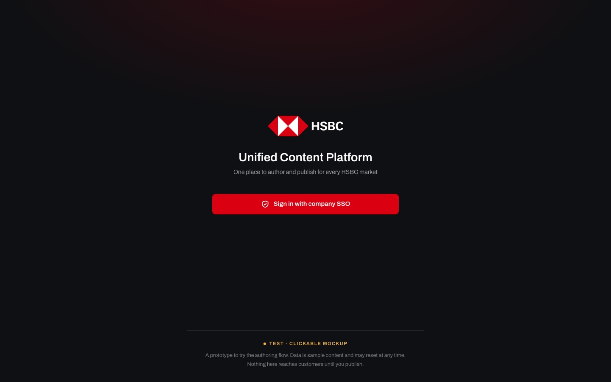
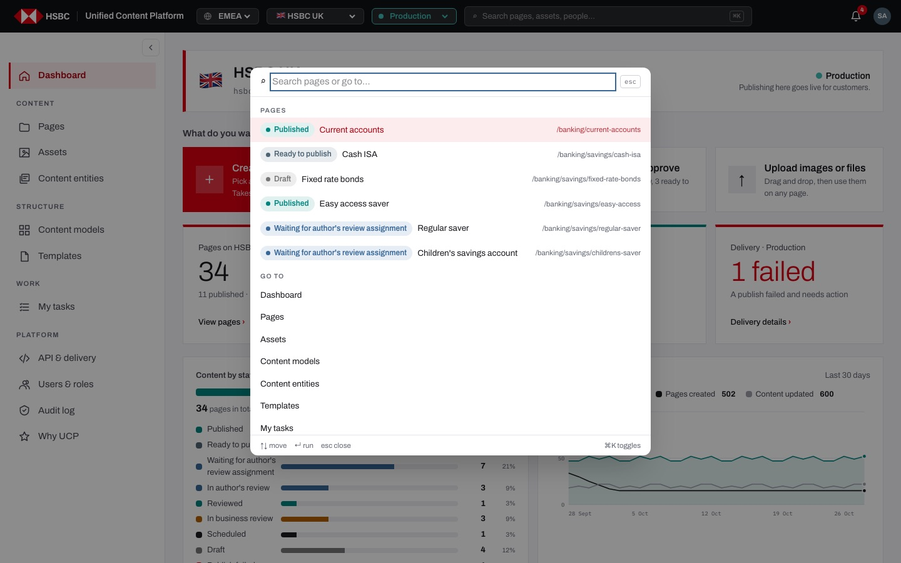
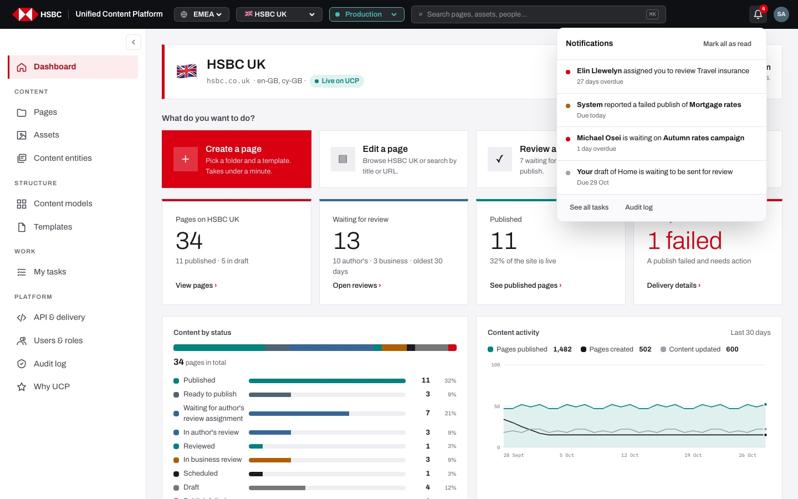
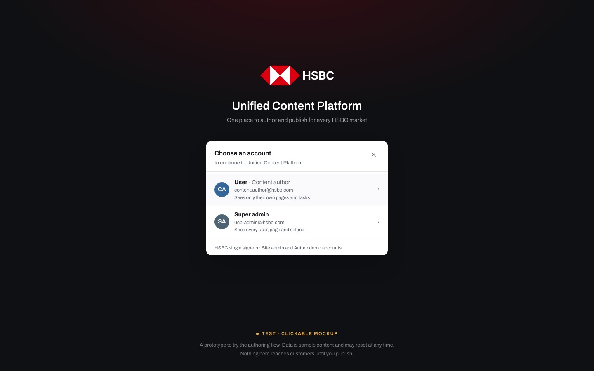
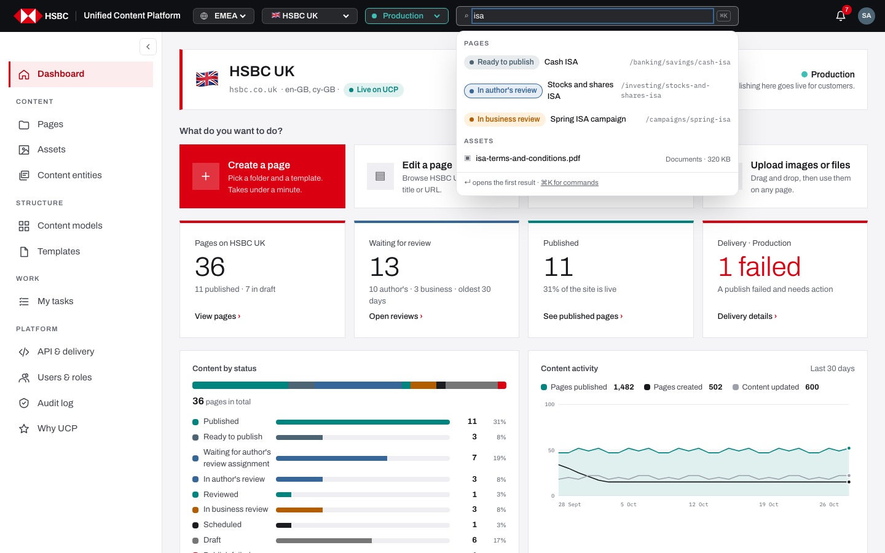
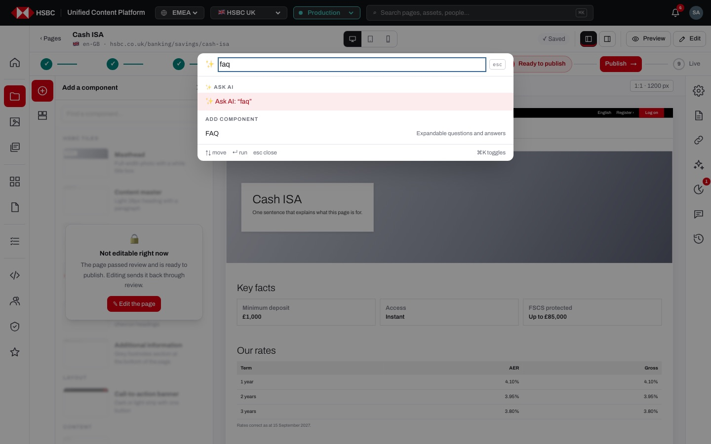
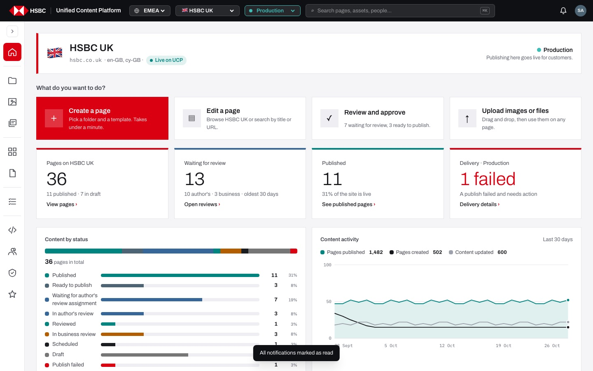
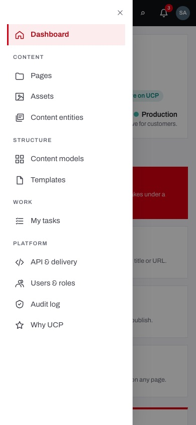

# EP-01 · Sign-in & global navigation

**Epic:** EP-01 · Sign-in & global navigation

**Business benefit:** Every change on a customer-facing page is tied to a named, signed-in person working in a clearly labelled market and environment, which removes anonymous edits and wrong-market or wrong-environment mistakes. One shell for every market and section keeps authors moving quickly, so the bank gets more content out with the same team.

**Scope:** The sign-in screen (company SSO stand-in and the demo account list), sign-out, and the frame around every CMS screen: top bar (instance, market, environment, global search, ⌘K command palette, notifications, account menu), the side menu in its desktop, rail, tablet and phone forms, and the shared loading and error states.

**The view:**





- **Sign-in screen** (`/login`) · HSBC logo, "Unified Content Platform", one button "Sign in with company SSO" that opens the account picker (stand-in for the identity provider), and a footer "Test · Clickable mockup". `/login?demo=1` also lists every demo person with role and team.
- **Top bar** (on every CMS screen) · logo (back to the dashboard) · instance switcher (EMEA / APAC / NA) · market switcher · environment switcher with its colour · global search with the ⌘K button · notifications bell · account avatar.
- **Command palette** (⌘K / Ctrl+K) · search pages and jump to any section; in the page builder it also offers "Ask AI" prompts and "Add component".
- **Side menu** · Dashboard, then the groups Content (Pages, Assets, Content entities), Structure (Content models, Templates), Work (My tasks) and Platform (API & delivery, Users & roles, Audit log, Why UCP). Full width on desktop with a collapse button, an icon rail on tablets and in the page builder, a drawer behind ☰ on phones.
- **Loading and error states** · grey skeleton while a section loads; an error card with "Try again" and "Go to dashboard" when it fails.


*The SSO stand-in: "Choose an account" with the plain User (Content author) and the Super admin.*


*Global search for "isa": results grouped into Pages and Assets, Enter opens the first one.*


*In the page builder the palette offers "Ask AI" with the typed text and matching components to add.*


*Desktop side menu collapsed to the icon rail; the choice is remembered in this browser.*


*On a phone the menu opens as a drawer from ☰ in the top bar.*

**Stories (12):**

1. [US-01.01 · Sign-in: company SSO login with return to the requested page](#us-0101--sign-in-company-sso-login-with-return-to-the-requested-page)
2. [US-01.02 · Hosted demo: password gate and sign-in as any demo persona](#us-0102--hosted-demo-password-gate-and-sign-in-as-any-demo-persona)
3. [US-01.03 · Account menu: see who I am signed in as and sign out](#us-0103--account-menu-see-who-i-am-signed-in-as-and-sign-out)
4. [US-01.04 · Market switcher: change instance and market without losing the current screen](#us-0104--market-switcher-change-instance-and-market-without-losing-the-current-screen)
5. [US-01.05 · Environment indicator: always show dev / test / stage / prod and whether it reaches customers](#us-0105--environment-indicator-always-show-dev--test--stage--prod-and-whether-it-reaches-customers)
6. [US-01.06 · Command palette (⌘K): find a page or jump to any section from the keyboard](#us-0106--command-palette-k-find-a-page-or-jump-to-any-section-from-the-keyboard)
7. [US-01.07 · Command palette in the page builder: ask AI or add a component](#us-0107--command-palette-in-the-page-builder-ask-ai-or-add-a-component)
8. [US-01.08 · Global search: find pages, assets, people, templates and models from the top bar](#us-0108--global-search-find-pages-assets-people-templates-and-models-from-the-top-bar)
9. [US-01.09 · Side menu: full, collapsed rail, tablet rail and phone drawer](#us-0109--side-menu-full-collapsed-rail-tablet-rail-and-phone-drawer)
10. [US-01.10 · Notifications: bell alerts when a page is handed to me](#us-0110--notifications-bell-alerts-when-a-page-is-handed-to-me)
11. [US-01.11 · Notification actions: overdue items highlighted, click opens the page](#us-0111--notification-actions-overdue-items-highlighted-click-opens-the-page)
12. [US-01.12 · Loading and error states: skeleton while loading, clear error with a way out](#us-0112--loading-and-error-states-skeleton-while-loading-clear-error-with-a-way-out)

---

## US-01.01 · Sign-in: company SSO login with return to the requested page

**Business benefit:** Only identified staff can reach the CMS, which closes the door to anonymous changes on customer-facing pages. Every action is tied to a named person, giving auditors a reliable trail.

**User story:**

As a content author  
I want to sign in with my company account and land where I was going  
So that UCP knows who I am and only signed-in people reach the CMS  
Note: the prototype uses an SSO stand-in (pick an account, no password). Real SSO is on the roadmap.  

**Persona:** content author · **Depends on:** — · **Note:** runs on a stand-in (mock) today

**Acceptance criteria:**

**Scenario 1 · Opening a screen without a session**

```gherkin
Given I am not signed in
When I open "/uk/prod/pages"
Then I am sent to "/login?next=/uk/prod/pages"
```

**Scenario 2 · Sign in with company SSO**

```gherkin
Given I am on "/login?next=/uk/prod/pages"
When I click "Sign in with company SSO"
Then the "Choose an account" panel lists "User · Content author" and "Super admin"
When I choose "Super admin"
Then the row says "Signing in…"
And I am on "/uk/prod/pages"
And the audit log says "signed in (SSO stand-in)"
```

**Scenario 3 · Closing the account picker**

```gherkin
Given the "Choose an account" panel is open
When I click "✕"
Then I see the "Sign in with company SSO" button again
```

**Scenario 4 · Only internal addresses are followed** *(one run per row of the table)*

```gherkin
Given the login link says "next=<next>"
When I sign in
Then I am on "/uk/prod/dashboard"

Examples:
  | next                 |
  | //evil.example       |
  | https://evil.example |
  | /login               |
```

**Scenario 5 · Sign-in fails**

```gherkin
Given the account I choose is not known to UCP
When I choose it
Then I see the error "Unknown user" under the panel
And I stay on the login screen
```

**Scenario 6 · Session length**

```gherkin
Then a session lasts 12 hours
```

---

## US-01.02 · Hosted demo: password gate and sign-in as any demo persona

**Business benefit:** Stakeholders can evaluate every role before the bank commits to a rollout, reducing the risk of a costly wrong choice. The demo stays private, so unfinished screens and sample data are never exposed publicly.

**User story:**

As a business owner  
I want the hosted demo kept behind a password and to try it as any demo person  
So that I can evaluate every role without exposing the demo to the public  
Note: the prototype uses an SSO stand-in (pick an account, no password). Real SSO is on the roadmap.  

**Persona:** business owner · **Depends on:** US-01.01 · **Note:** runs on a stand-in (mock) today

**Acceptance criteria:**

**Scenario 1 · The hosted demo is behind a password**

```gherkin
Given the demo password is configured
When I open any address of the demo without it
Then the browser asks for a user name and password
And search engines are told not to index the demo
```

**Scenario 2 · Demo accounts**

```gherkin
When I open "/login?demo=1"
Then every demo person other than "Super admin" and "Content author" is listed with their role and team
And the list includes "Jordan Mensah · Publisher · Savings & Mortgages" and "Tunde Boateng · Viewer · Marketing"
When I click "Sign in →" next to "Rachel Hughes"
Then I am signed in as Rachel Hughes
```

**Scenario 3 · The demo says what it is**

```gherkin
When I open the login screen
Then the footer says "Test · Clickable mockup"
And "Nothing here reaches customers until you publish."
```

---

## US-01.03 · Account menu: see who I am signed in as and sign out

**Business benefit:** People always know which identity and role their changes are recorded under, which prevents work being done under the wrong account. A clear sign-out protects shared and unattended machines from misuse.

**User story:**

As a content author  
I want to see my name, e-mail and role in the top bar and sign out from there  
So that I know whose name my changes carry and can leave a shared computer safely  

**Persona:** content author · **Depends on:** US-01.01

**Acceptance criteria:**

**Scenario 1 · Who I am**

```gherkin
Given I am signed in as "Super admin"
When I click my initials "SA" in the top bar
Then the menu shows "Super admin", "ucp-admin@hsbc.com" and "Site admin · UCP platform team"
And it says "Signed in with company SSO"
```

**Scenario 2 · Sign out**

```gherkin
When I click "Sign out" in the account menu
Then the button says "Signing out…"
And I am on the login screen
When I open "/uk/prod/dashboard" again
Then I am sent to "/login?next=/uk/prod/dashboard"
```

**Scenario 3 · Sign-out fails**

```gherkin
Given the server cannot be reached
When I click "Sign out"
Then I see "Could not sign out. Try again."
And I stay signed in
```

**Scenario 4 · Closing the menu**

```gherkin
Given the account menu is open
When I press Esc or click anywhere outside it
Then the menu closes
```

---

## US-01.04 · Market switcher: change instance and market without losing the current screen

**Business benefit:** One platform serves every market, so the bank runs and pays for a single CMS instead of one per country. Authors working across markets make fewer wrong-market edits.

**User story:**

As a content author  
I want to pick an instance and market and switch market without losing my place  
So that I can work across several countries on one platform without confusion  

**Persona:** content author · **Depends on:** —

**Acceptance criteria:**

**Scenario 1 · Instances** *(one run per row of the table)*

```gherkin
When I choose the instance "<instance>"
Then the market list shows <markets>
And I am taken to the first market of that instance on the same screen

Examples:
  | instance | markets                                                  |
  | EMEA     | HSBC UK, HSBC France, HSBC Germany, HSBC UAE             |
  | APAC     | HSBC Hong Kong, HSBC Singapore                           |
  | NA       | HSBC Mexico                                              |
```

**Scenario 2 · Switching market keeps my place**

```gherkin
Given I am on Pages in the UK
When I switch to "HSBC France"
Then I am on "/fr/prod/pages"
```

**Scenario 3 · Instance names**

```gherkin
When I hover over the instance switcher showing "EMEA"
Then I see "Europe, Middle East and Africa"
```

**Scenario 4 · Small screens get one grouped list**

```gherkin
Given my screen is narrower than 1100 px
Then there is no separate instance switcher
And the market list is grouped under "EMEA", "APAC" and "NA"
```

---

## US-01.05 · Environment indicator: always show dev / test / stage / prod and whether it reaches customers

**Business benefit:** Constant visibility of the environment prevents accidental publication to customers, a costly and reputationally damaging incident. Teams can test freely in staging with confidence.

**User story:**

As a publisher  
I want the environment and its consequences always visible  
So that I never publish to customers by mistake  

**Persona:** publisher · **Depends on:** —

**Acceptance criteria:**

**Scenario 1 · Each environment has its own colour** *(one run per row of the table)*

```gherkin
When I choose "<environment>" in the environment switcher
Then the switcher is outlined in <colour>
And I stay on the same screen in that environment

Examples:
  | environment | colour |
  | Development | grey   |
  | Test        | blue   |
  | Staging     | amber  |
  | Production  | teal   |
```

**Scenario 2 · Environment note** *(one run per row of the table)*

```gherkin
When I choose "<environment>"
Then the dashboard says "<note>"

Examples:
  | environment | note                                              |
  | Production  | Publishing here goes live for customers.          |
  | Staging     | Nothing in this environment reaches customers.    |
```

**Scenario 3 · Publishing names the environment**

```gherkin
Given I am in "Staging"
When I open the publish dialog
Then it says "Goes live on Staging."
```

---

## US-01.06 · Command palette (⌘K): find a page or jump to any section from the keyboard

**Business benefit:** Authors spend less time hunting through menus, which raises daily output at no extra cost. Full keyboard support also makes the CMS usable for staff who rely on assistive technology.

**User story:**

As a content author  
I want a command palette that finds pages and opens any section  
So that every page and section is a couple of keystrokes away  

**Persona:** content author · **Depends on:** —

**Acceptance criteria:**

**Scenario 1 · Opening and closing**

```gherkin
When I press ⌘ K (or Ctrl K), or click "⌘K" in the top search
Then the command palette opens with the cursor in "Search pages or go to…"
And it lists 6 pages under "Pages" and every section under "Go to"
When I press ⌘ K again, press Esc or click outside it
Then it closes
```

**Scenario 2 · Filtering and running**

```gherkin
When I type "aud"
Then "Pages" lists pages whose title or URL contains "aud"
And "Go to" lists "Audit log"
When I move with ↑ ↓ and press Enter
Then the highlighted item runs
```

**Scenario 3 · Nothing matches**

```gherkin
When I type "qqqzz"
Then I see "Nothing matches “qqqzz”."
```

**Scenario 4 · Keyboard and focus**

```gherkin
Given I opened the palette from the "⌘K" button
Then Tab stays inside the palette
And Home and End jump to the first and last item
When I press Esc
Then focus returns to the "⌘K" button
```

---

## US-01.07 · Command palette in the page builder: ask AI or add a component

**Business benefit:** Authors reach AI help and components without leaving the keyboard, which shortens the time to build each page. Common AI checks such as accessibility and compliance are one keystroke away, so they get run more often.

**User story:**

As a content author  
I want the command palette in the page builder to offer AI prompts and components  
So that I can start an AI task or add a block without hunting through panels  

**Persona:** content author · **Depends on:** US-01.06

**Acceptance criteria:**

**Background** (applies to every scenario below)

```gherkin
Given I am editing "Cash ISA" in the page builder
```

**Scenario 1 · Suggested AI tasks**

```gherkin
When I press ⌘ K
Then the input says "What would you like to do? Search pages, components or ask AI…"
And "✨ Ask AI" lists "Improve this page", "Create a new section", "Translate page", "Create mobile version", "Find unused components", "Check accessibility", "Check content compliance", "Optimise SEO" and "Design a landing page"
And the sections of "Go to" are not listed until I type
```

**Scenario 2 · Free AI prompt and components**

```gherkin
When I type "faq"
Then I see "✨ Ask AI: “faq”"
And "Add component" lists "FAQ · Expandable questions and answers"
When I choose "FAQ"
Then an FAQ component is added to the page
```

**Scenario 3 · Starting an AI task**

```gherkin
When I choose "✨ Check accessibility"
Then the palette closes and the AI assistant starts "Check accessibility" on the page
```

**Scenario 4 · Going elsewhere from the builder**

```gherkin
When I type "audit"
Then "Go to" lists "Audit log"
```

---

## US-01.08 · Global search: find pages, assets, people, templates and models from the top bar

**Business benefit:** One search box across all content types cuts the time spent locating material, which matters most for authors working across several sections. Finding existing assets and templates first also reduces duplicates the bank would otherwise store and maintain.

**User story:**

As a content author  
I want one search box that looks through pages, assets, people, templates and models of my market  
So that I find what I need without knowing which section it lives in  

**Persona:** content author · **Depends on:** —

**Acceptance criteria:**

**Scenario 1 · Grouped results**

```gherkin
When I type "isa" into "Search pages, assets, people…"
Then results appear grouped under "Pages", "Assets", "People", "Templates" and "Models"
And each page shows its status, title and URL
And I see at most 8 pages, 5 assets, 4 people, 3 templates and 3 models
```

**Scenario 2 · Opening a result** *(one run per row of the table)*

```gherkin
When I click a result in "<group>"
Then I am taken to <where>

Examples:
  | group     | where                                     |
  | Pages     | the page in the page builder              |
  | Assets    | Assets, in the asset's folder             |
  | People    | Users & roles with that person open       |
  | Templates | the template                              |
  | Models    | Content models with that model open       |
```

**Scenario 3 · Enter opens the first result**

```gherkin
Given "isa" shows "Cash ISA" first
When I press Enter
Then "Cash ISA" opens in the page builder
And the search box is cleared
```

**Scenario 4 · No results and closing**

```gherkin
When I type "zzqqxx"
Then I see "No results for “zzqqxx”."
When I press Esc or click outside the results
Then the results close
```

**Scenario 5 · On a phone**

```gherkin
Given my screen is narrower than 768 px
Then the search box is replaced by a "⌕" button
And the button opens the command palette
```

---

## US-01.09 · Side menu: full, collapsed rail, tablet rail and phone drawer

**Business benefit:** The same navigation works on laptops, tablets and phones, so work does not stall away from the desk. Giving the page builder the full width makes editing faster on smaller laptops.

**User story:**

As a content author  
I want a side menu that fits my screen and that I can collapse  
So that I always reach every section and still have room to work  

**Persona:** content author · **Depends on:** —

**Acceptance criteria:**

**Scenario 1 · Sections**

```gherkin
Then the menu shows "Dashboard"
And under "Content": "Pages", "Assets", "Content entities"
And under "Structure": "Content models", "Templates"
And under "Work": "My tasks"
And under "Platform": "API & delivery", "Users & roles", "Audit log", "Why UCP"
And the section I am in is highlighted
```

**Scenario 2 · Screen sizes** *(one run per row of the table)*

```gherkin
Given my screen is <width>
Then the side menu is <behaviour>

Examples:
  | width                 | behaviour                                                |
  | 1100 px or wider      | full, with a button to collapse it to icons              |
  | 768 to 1099 px        | icons only, with no collapse button                      |
  | narrower than 768 px  | hidden behind ☰ and opens as a drawer                    |
```

**Scenario 3 · Collapse is remembered**

```gherkin
Given my screen is 1440 px wide
When I click "Collapse menu"
Then the menu shrinks to icons with their names as tooltips
And it is still collapsed after I reload the page
When I click "Expand menu"
Then the full menu is back
```

**Scenario 4 · The page builder gets the room**

```gherkin
When I open a page in the page builder
Then the menu shows icons only and "Pages" is highlighted
```

**Scenario 5 · Phone drawer**

```gherkin
Given my screen is narrower than 768 px
When I tap "☰"
Then the menu opens over the content
When I tap "Pages", "✕" or the dark area next to it
Then the drawer closes
```

---

## US-01.10 · Notifications: bell alerts when a page is handed to me

**Business benefit:** People learn immediately when it is their turn, which removes idle time between hand-offs. Faster hand-offs shorten time to market for every page.

**User story:**

As anyone in the content team  
I want a notification when it is my turn on a page  
So that I don't have to keep checking My tasks  

**Persona:** anyone in the content team · **Depends on:** US-11.01

**Acceptance criteria:**

**Scenario 1 · The bell polls and shows unread items**

```gherkin
Given I am signed in
Then the bell checks for news every 60 seconds
And shows a badge with the number of unread items
And the panel lists up to 4 of my tasks and the 3 latest actions of other people
When I click "Mark all as read"
Then the badge disappears and I see "All notifications marked as read"
And read items stay read in this browser
```

**Scenario 2 · What I am told** *(one run per row of the table)*

```gherkin
Given <event>
Then my bell shows "<message>"

Examples:
  | event                                    | message                                                                |
  | the author reminds me about a review     | Reminder: Content Author is waiting for your review of Cash ISA       |
  | I was assigned a review                  | Super Admin assigned you to review Cash ISA                           |
  | the author's review of my page is done   | finished the author's review of Cash ISA · send it to business review |
  | the page reached business review         | sent to business review: Cash ISA · business sign-off needed          |
  | the business signed off a page I publish | finished the business review of Cash ISA · ready to publish           |
  | my draft has not been sent               | Your draft of Cash ISA is waiting to be sent for review               |
  | a publish failed                         | System reported a failed publish of Mortgage rates                    |
```

**Scenario 3 · Nothing new**

```gherkin
Given there is nothing for me
When I open the bell
Then I see "Nothing new."
```

---

## US-01.11 · Notification actions: overdue items highlighted, click opens the page

**Business benefit:** Overdue items stand out, so service levels and regulatory deadlines are met more reliably. One-click access cuts the time from notice to action.

**User story:**

As anyone in the content team  
I want urgent items to stand out and to open the page from the notification  
So that overdue work is handled first  

**Persona:** anyone in the content team · **Depends on:** US-01.10

**Acceptance criteria:**

**Scenario 1 · Urgency colours** *(one run per row of the table)*

```gherkin
Given a task of mine is <state>
Then its notification shows "<when>" with a <colour> dot

Examples:
  | state                       | when              | colour |
  | overdue by 27 days          | 27 days overdue   | red    |
  | due today                   | Due today         | amber  |
  | due later                   | Due 29 Oct        | grey   |
```

**Scenario 2 · Clicking a notification opens the page**

```gherkin
When I click a notification about "Cash ISA"
Then the page opens in the page builder
And a notification that is not about a page opens My tasks
```

**Scenario 3 · Shortcuts**

```gherkin
When I click "See all tasks" or "Audit log" at the bottom of the panel
Then that section opens
```

---

## US-01.12 · Loading and error states: skeleton while loading, clear error with a way out

**Business benefit:** Authors are never left with a blank screen, which cuts support calls and lost time when something is slow or fails. A request id on every error lets support find the cause quickly.

**User story:**

As a content author  
I want to see that a section is loading and, if it fails, what happened and what I can do  
So that I can carry on or give support what they need  

**Persona:** content author · **Depends on:** —

**Acceptance criteria:**

**Scenario 1 · Loading**

```gherkin
When I open a section that takes a moment, for example Pages
Then grey placeholder rows are shown in the shape of the screen
And screen readers hear "Loading pages…"
```

**Scenario 2 · A section fails to load**

```gherkin
Given the dashboard cannot be loaded
Then I see "Something went wrong loading the dashboard" with the reason
And "Request id … · quote it if you contact support"
When I click "Try again"
Then the dashboard loads again
When I click "Go to dashboard"
Then I am on the dashboard of the same market and environment
```

**Scenario 3 · An address that does not exist**

```gherkin
When I open "/uk/prod/nonsense" or a page path that does not exist
Then I see "404 · This page could not be found."
```
