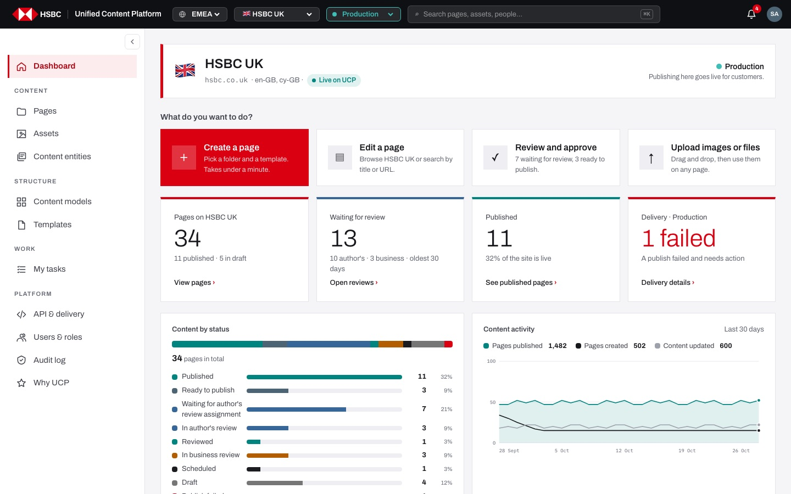
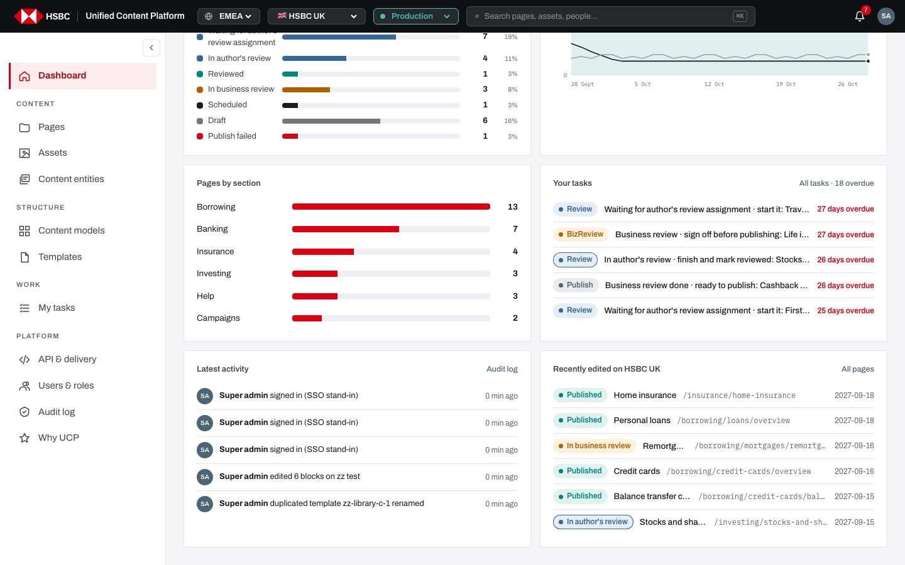

# EP-02 · Dashboard

**Epic:** EP-02 · Dashboard

**Business benefit:** Waiting reviews, failed publishes and overdue tasks are visible the moment people sign in, so content reaches customers on time and incidents are handled before customers notice. Managers see throughput and the state of each market without asking for manual reports.

**Scope:** The landing screen of a market and environment (`/<market>/<env>/dashboard`): the market header, the "What do you want to do?" shortcuts, the four headline tiles, the status, activity and section charts, and the "Your tasks", "Latest activity" and "Recently edited" lists, including where each link leads.

**The view:**



- **Market header** · flag, market name, web domain, languages and the market's status on UCP; on the right the environment with its colour and whether publishing here reaches customers.
- **What do you want to do?** · four shortcuts: "Create a page" (red, primary), "Edit a page", "Review and approve", "Upload images or files".
- **Headline tiles** · Pages on the market, Waiting for review, Published, Delivery health of the environment; each tile is a link.
- **Content by status** · one bar split by status plus a row per status with count and share.
- **Content activity** · line chart of the last 30 days: pages published, created and updated.
- **Pages by section** · page count per top-level folder, each row opens that folder.
- **Your tasks** · my next 5 tasks with due or overdue state, and "All tasks · N overdue".
- **Latest activity** · the last 5 audit lines with person and time, and "Audit log".
- **Recently edited on <market>** · the 6 most recently changed pages, and "All pages".


*Lower half: status breakdown, pages by section, my tasks with overdue days in red, latest activity and recently edited pages.*

**Stories (10):**

1. [US-02.01 · Dashboard header: which market and environment I am working in](#us-0201--dashboard-header-which-market-and-environment-i-am-working-in)
2. [US-02.02 · Dashboard shortcuts: "What do you want to do?"](#us-0202--dashboard-shortcuts-what-do-you-want-to-do)
3. [US-02.03 · Dashboard tiles: pages, waiting reviews and the live share of the site](#us-0203--dashboard-tiles-pages-waiting-reviews-and-the-live-share-of-the-site)
4. [US-02.04 · Delivery health tile: uptime of the environment, or failed publishes that need action](#us-0204--delivery-health-tile-uptime-of-the-environment-or-failed-publishes-that-need-action)
5. [US-02.05 · Content by status: how the market's pages split across the workflow](#us-0205--content-by-status-how-the-markets-pages-split-across-the-workflow)
6. [US-02.06 · Content activity chart: pages published, created and updated over the last 30 days](#us-0206--content-activity-chart-pages-published-created-and-updated-over-the-last-30-days)
7. [US-02.07 · Pages by section: page count per top-level folder, one click to the folder](#us-0207--pages-by-section-page-count-per-top-level-folder-one-click-to-the-folder)
8. [US-02.08 · Your tasks on the dashboard: my next five tasks with due dates](#us-0208--your-tasks-on-the-dashboard-my-next-five-tasks-with-due-dates)
9. [US-02.09 · Latest activity: the last five things that happened in the market](#us-0209--latest-activity-the-last-five-things-that-happened-in-the-market)
10. [US-02.10 · Recently edited: the pages changed most recently in the market](#us-0210--recently-edited-the-pages-changed-most-recently-in-the-market)

---

## US-02.01 · Dashboard header: which market and environment I am working in

**Business benefit:** Authors confirm the market, its languages and the environment before they act, which prevents content being prepared for the wrong country or published by mistake. The market's migration status is visible to everyone, which sets expectations during the rollout.

**User story:**

As a content author  
I want the dashboard to open with the market, its domain, languages, status and the environment  
So that I know exactly where my work will land before I start  

**Persona:** content author · **Depends on:** US-01.04, US-01.05

**Acceptance criteria:**

**Scenario 1 · Market details**

```gherkin
When I open "/uk/prod/dashboard"
Then the header shows "🇬🇧", "HSBC UK", "hsbc.co.uk", "en-GB, cy-GB" and the status "Live on UCP"
And on the right "Production" with "Publishing here goes live for customers."
```

**Scenario 2 · Market status** *(one run per row of the table)*

```gherkin
When I open the dashboard of "<market>"
Then the status pill says "<status>"

Examples:
  | market         | status      |
  | HSBC UK        | Live on UCP |
  | HSBC Hong Kong | Validating  |
  | HSBC Singapore | Pilot       |
  | HSBC Germany   | On AEM      |
```

**Scenario 3 · Non-production environment**

```gherkin
When I open "/uk/stage/dashboard"
Then the header shows "Staging" in amber with "Nothing in this environment reaches customers."
```

---

## US-02.02 · Dashboard shortcuts: "What do you want to do?"

**Business benefit:** New and occasional authors start the four most common jobs in one click, which cuts training effort and support requests. Faster starts mean more content delivered by the same team.

**User story:**

As a content author  
I want the four most common jobs as large shortcuts on the dashboard  
So that I can start work without learning the menu first  

**Persona:** content author · **Depends on:** US-02.01

**Acceptance criteria:**

**Scenario 1 · Shortcuts and where they lead** *(one run per row of the table)*

```gherkin
When I click "<shortcut>"
Then <result>

Examples:
  | shortcut               | result                                                   |
  | Create a page          | Pages opens with the "New page" dialog already open      |
  | Edit a page            | Pages opens at the top of the market                     |
  | Review and approve     | My tasks opens                                           |
  | Upload images or files | Assets opens                                             |
```

**Scenario 2 · Live counts in the text**

```gherkin
Given 7 pages wait for an author's review assignment and 3 are ready to publish
Then "Review and approve" says "7 waiting for review, 3 ready to publish."
And "Edit a page" says "Browse HSBC UK or search by title or URL."
```

---

## US-02.03 · Dashboard tiles: pages, waiting reviews and the live share of the site

**Business benefit:** Waiting reviews are spotted early, so content reaches customers on time. Managers get a quick view of throughput without manual reporting.

**User story:**

As a content author  
I want headline tiles for the number of pages, the reviews waiting and how much of the site is live  
So that I see at a glance where work stands and what to do next  

**Persona:** content author · **Depends on:** US-18.01, US-11.01

**Acceptance criteria:**

**Scenario 1 · Dashboard tiles**

```gherkin
When I open the dashboard of "HSBC UK"
Then "Pages on HSBC UK" shows 37 with "11 published · 7 in draft"
And "Waiting for review" shows 14 with "11 author's · 3 business · oldest 30 days"
And "Published" shows 11 with "30% of the site is live"
```

**Scenario 2 · Nothing waiting**

```gherkin
Given no page waits for review
Then the "Waiting for review" tile shows 0 and says "Nothing waiting. Nice."
```

**Scenario 3 · Tiles are links** *(one run per row of the table)*

```gherkin
When I click the tile "<tile>"
Then <section> opens

Examples:
  | tile                | section  |
  | Pages on HSBC UK    | Pages    |
  | Waiting for review  | My tasks |
  | Published           | Pages    |
```

---

## US-02.04 · Delivery health tile: uptime of the environment, or failed publishes that need action

**Business benefit:** A failed publish is flagged in red on the first screen people see, so customers are not left with outdated rates or terms. When all is well, the uptime figure gives reassurance without opening monitoring tools.

**User story:**

As a publisher  
I want the dashboard to tell me whether delivery in this environment is healthy or a publish failed  
So that I fix failures before customers notice  

**Persona:** publisher · **Depends on:** US-09.03 · **Note:** runs on a stand-in (mock) today

**Acceptance criteria:**

**Scenario 1 · A publish failed**

```gherkin
Given one page of the market has the status "Publish failed"
Then the tile "Delivery · Production" shows "1 failed" in red
And says "A publish failed and needs action"
```

**Scenario 2 · Healthy delivery** *(one run per row of the table)*

```gherkin
Given no publish failed
When I open the dashboard in "<environment>"
Then the tile shows "<uptime>" and "Uptime · <response> typical response"

Examples:
  | environment | uptime | response |
  | Production  | 99.98% | 84 ms    |
  | Staging     | 99.9%  | 96 ms    |
  | Test        | 98.7%  | 140 ms   |
  | Development | 97.2%  | 210 ms   |
```

**Scenario 3 · Details**

```gherkin
When I click "Delivery details"
Then API & delivery opens
```

---

## US-02.05 · Content by status: how the market's pages split across the workflow

**Business benefit:** Bottlenecks in the review workflow become visible as a share of the whole site, which helps managers move reviewers where they are needed. Trends can be discussed from the same figures everyone sees, without extra reporting work.

**User story:**

As a business owner  
I want to see how many pages are in each workflow status  
So that I spot where content is piling up  

**Persona:** business owner · **Depends on:** US-02.03

**Acceptance criteria:**

**Scenario 1 · Breakdown**

```gherkin
When I open the dashboard of "HSBC UK"
Then "Content by status" shows a bar split by status and "37 pages in total"
And a row per status with its count and share, for example "Published 11 30%"
And the possible rows are "Published", "Ready to publish", "Waiting for author's review assignment", "In author's review", "Reviewed", "In business review", "Scheduled", "Draft" and "Publish failed"
```

**Scenario 2 · Empty statuses are left out**

```gherkin
Given every page of "HSBC Germany" is a draft
Then the only row is "Draft 9 100%"
```

**Scenario 3 · Hover**

```gherkin
When I hover over a part of the bar
Then I see its status and count, for example "Published: 11"
```

---

## US-02.06 · Content activity chart: pages published, created and updated over the last 30 days

**Business benefit:** Leaders can see whether output is rising or falling without commissioning a report. It gives an early signal when publishing slows, before campaign deadlines are missed.

**User story:**

As a business owner  
I want a 30-day chart of pages published, created and updated  
So that I can follow the team's output over time  

**Persona:** business owner · **Depends on:** — · **Note:** runs on a stand-in (mock) today

**Acceptance criteria:**

**Scenario 1 · Chart**

```gherkin
When I open the dashboard
Then "Content activity" says "Last 30 days"
And the legend shows "Pages published", "Pages created" and "Content updated" with their 30-day totals
And the x-axis shows five dates ending today
```

**Scenario 2 · Day details**

```gherkin
When I hover over a day
Then I see for example "Day 1: 47 published · 34 created · 18 updated"
And the points of that day are highlighted
```

---

## US-02.07 · Pages by section: page count per top-level folder, one click to the folder

**Business benefit:** Section owners see the size of their area at a glance, which helps plan reviews and clean-ups. Going straight to the folder saves navigation time.

**User story:**

As a content author  
I want to see how many pages each section of the site has and open it  
So that I can jump straight to the area I work on  

**Persona:** content author · **Depends on:** US-03.01

**Acceptance criteria:**

**Scenario 1 · Sections by size**

```gherkin
When I open the dashboard of "HSBC UK"
Then "Pages by section" lists the top-level folders, largest first: "Borrowing 13", "Banking 7", "Insurance 4", "Investing 3", "Help 3", "Campaigns 2"
And each has a bar relative to the largest section
And pages in sub-folders count towards their section
```

**Scenario 2 · Open a section**

```gherkin
When I click "Banking"
Then Pages opens in the folder "/banking"
```

---

## US-02.08 · Your tasks on the dashboard: my next five tasks with due dates

**Business benefit:** Each person sees their most urgent work first, so reviews and sign-offs are not forgotten. Overdue items in red help the bank meet its service levels for content changes.

**User story:**

As a reviewer  
I want my next tasks on the dashboard with how overdue they are  
So that I start the day with the most urgent work  

**Persona:** reviewer · **Depends on:** US-11.01

**Acceptance criteria:**

**Scenario 1 · Task list**

```gherkin
When I open the dashboard
Then "Your tasks" lists up to 5 of my tasks, earliest due first
And each row shows the task kind ("Review", "BizReview", "Publish", …), what to do and the page, for example "Waiting for author's review assignment · start it: Travel insurance"
```

**Scenario 2 · Due state** *(one run per row of the table)*

```gherkin
Given a task is <state>
Then its row says "<text>" in <colour>

Examples:
  | state          | text              | colour |
  | 27 days late   | 27 days overdue   | red    |
  | due today      | Due today         | amber  |
  | due on 29 Oct  | Due 29 Oct        | grey   |
```

**Scenario 3 · Links**

```gherkin
When I click a task
Then its page opens in the page builder
When I click "All tasks · 18 overdue"
Then My tasks opens
```

**Scenario 4 · Nothing to do**

```gherkin
Given no task is waiting on me
Then I see "Nothing is waiting on you."
And the link says "All tasks"
```

---

## US-02.09 · Latest activity: the last five things that happened in the market

**Business benefit:** Teams see who changed what without asking around, which reduces duplicated or conflicting work. It also gives a quick route into the full audit trail when questions arise.

**User story:**

As a content author  
I want the latest actions in my market on the dashboard  
So that I know what colleagues have just done  

**Persona:** content author · **Depends on:** US-18.01

**Acceptance criteria:**

**Scenario 1 · Activity lines**

```gherkin
When I open the dashboard
Then "Latest activity" shows the 5 newest audit lines I may see
And each shows the person's avatar and name, what they did and when, for example "Super admin signed in (SSO stand-in) · 0 min ago"
And times older than a day show the date
```

**Scenario 2 · Full log**

```gherkin
When I click "Audit log"
Then the Audit log opens
```

---

## US-02.10 · Recently edited: the pages changed most recently in the market

**Business benefit:** Authors get back to the pages they were working on in one click, which saves time every day. Recent edits by colleagues are visible, reducing the risk of overlapping changes.

**User story:**

As a content author  
I want the most recently changed pages of my market on the dashboard  
So that I can pick up where I or my team left off  

**Persona:** content author · **Depends on:** US-03.01

**Acceptance criteria:**

**Scenario 1 · List**

```gherkin
When I open the dashboard of "HSBC UK"
Then "Recently edited on HSBC UK" lists the 6 most recently changed pages
And each row shows its status, title, URL and date of the last change
```

**Scenario 2 · Links**

```gherkin
When I click "Home insurance"
Then it opens in the page builder
When I click "All pages"
Then Pages opens
```
