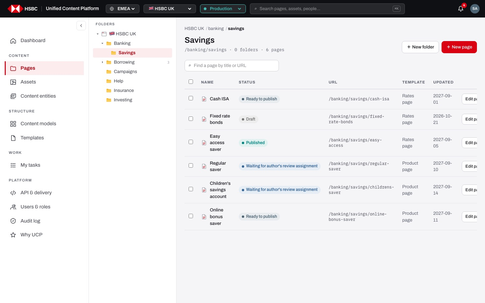
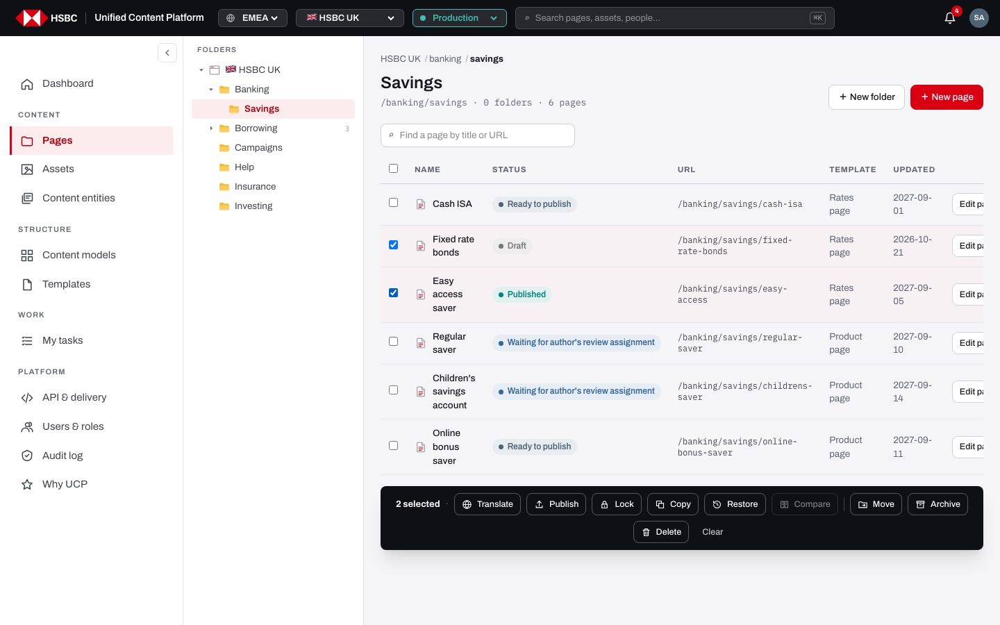
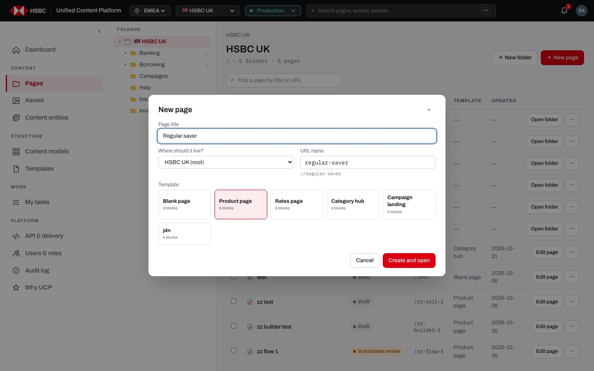
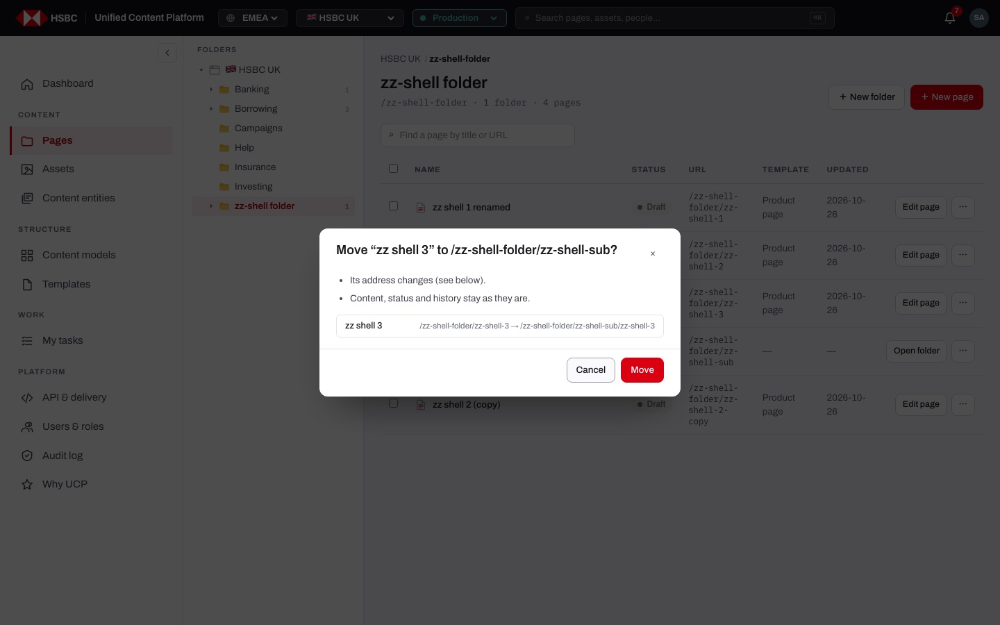
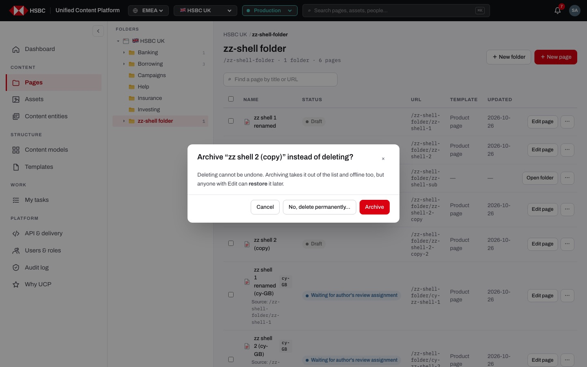
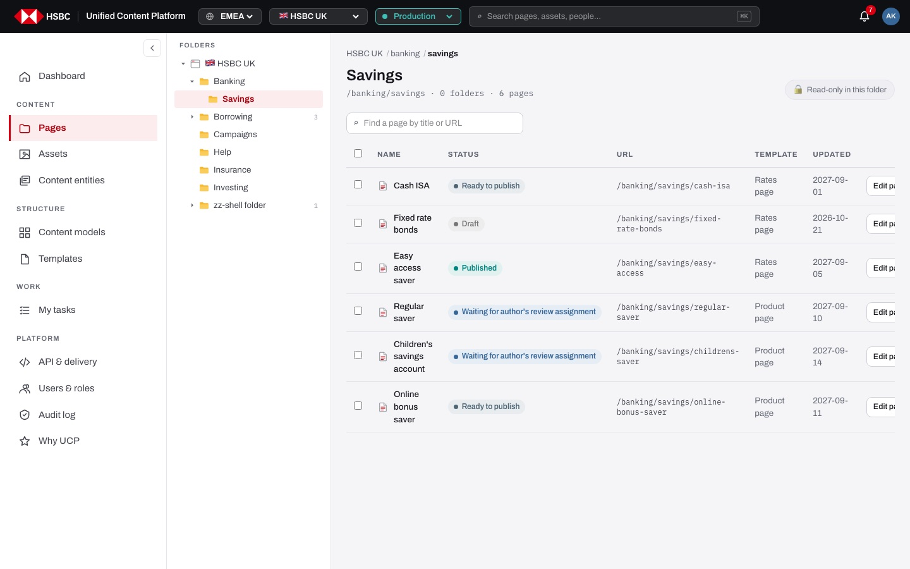
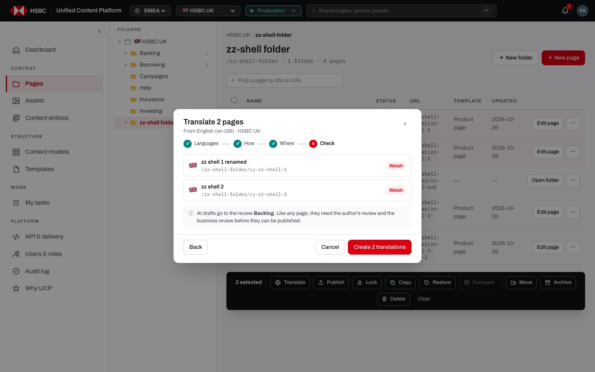
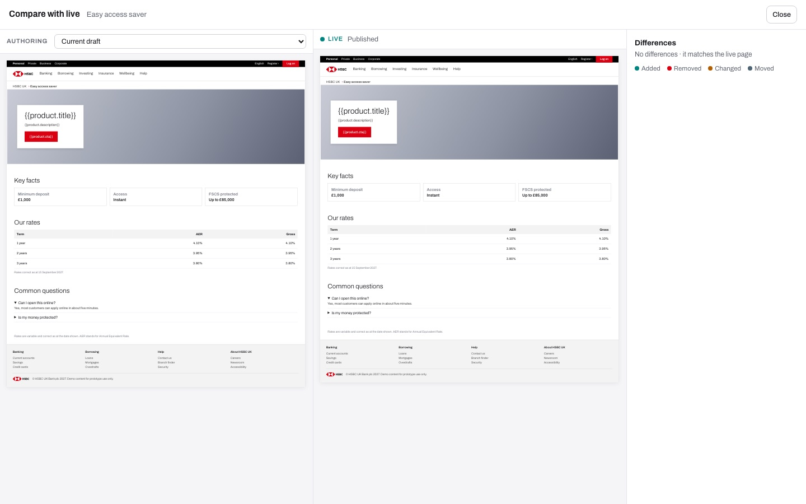

# EP-03 · Pages

**Epic:** EP-03 · Pages

**Business benefit:** Authors find, create and reorganise the pages of a market in one place, with every risky action explained before it happens, so broken links, lost pages and accidental take-downs of live content become rare. Bulk actions such as publish, translate, copy and move let a small team handle whole product launches and language versions without manual repetition.

**Scope:** The page explorer of a market (`/<market>/<env>/pages/...`): folder tree, breadcrumbs, search, the page table with paging, the New page and New folder dialogs, the row ⋯ menu, the selection bar with its bulk actions and confirmations, the archive, read-only folders, the four-step translation flow and the side-by-side Compare with live.

**The view:**




- **Folder tree** (left) · the market root with its flag and every folder; folders open and close with ▸ / ▾, the path to the current folder opens by itself, closed folders show how many sub-folders they hold.
- **Header** · breadcrumbs from the market down to the current folder, the folder title, its path with the number of folders and pages, and "＋ New folder" / "＋ New page" (or "Read-only in this folder").
- **Search** · "Find a page by title or URL" searches every folder of the market.
- **Page table** · checkbox, Name (lock icon, locale, "Source:" link for translations), Status, URL, Template, Updated, and per row "Edit page" / "Open folder" plus the ⋯ menu; 50 rows at a time with "Show N more".
- **Archive** (bottom) · "Archive · N" with every archived item of the folder, who archived it and when, "Restore" and "Delete permanently".
- **Selection bar** (appears when rows are ticked) · Translate, Publish, Lock / Unlock, Copy, Restore, Compare, Move, Archive, Delete and Clear.
- **Dialogs** · New page, New folder, Rename, Move, Copy, Translate (Languages · How · Where · Check), Publish, and confirmations that spell out the impact.
- **Compare with live** · full-screen: authoring version, live page and a list of differences.


*New page: title, folder, URL name generated from the title, and the templates allowed in this market.*


*Every move is confirmed with the old and new address of each page.*


*Delete always offers Archive first; permanent delete is the secondary choice.*


*Without Edit on a folder there is no New page or New folder, only "Read-only in this folder".*


*Last step of the translation flow: every page to be created, by language and address, before "Create 2 translations".*


*Compare with live: authoring version on the left, live page in the middle, differences on the right.*

**Stories (19):**

1. [US-03.01 · Pages list: browse the folder tree and search all pages of the market](#us-0301--pages-list-browse-the-folder-tree-and-search-all-pages-of-the-market)
2. [US-03.02 · Folder tree and breadcrumbs: open, close and jump between folders](#us-0302--folder-tree-and-breadcrumbs-open-close-and-jump-between-folders)
3. [US-03.03 · New page / new folder: create from a market-approved template](#us-0303--new-page--new-folder-create-from-a-market-approved-template)
4. [US-03.04 · Row actions menu (⋯): open, rename, move, duplicate, archive or delete one item](#us-0304--row-actions-menu--open-rename-move-duplicate-archive-or-delete-one-item)
5. [US-03.05 · Rename: change a page or folder title without changing its address](#us-0305--rename-change-a-page-or-folder-title-without-changing-its-address)
6. [US-03.06 · Duplicate: make a draft copy of a page in the same folder](#us-0306--duplicate-make-a-draft-copy-of-a-page-in-the-same-folder)
7. [US-03.07 · Page actions: show only permitted actions and confirm each with its impact](#us-0307--page-actions-show-only-permitted-actions-and-confirm-each-with-its-impact)
8. [US-03.08 · Move & copy pages: relink referring pages and never overwrite an existing page](#us-0308--move--copy-pages-relink-referring-pages-and-never-overwrite-an-existing-page)
9. [US-03.09 · Page lock: lock a page so only I or a site admin can change, move or delete it](#us-0309--page-lock-lock-a-page-so-only-i-or-a-site-admin-can-change-move-or-delete-it)
10. [US-03.10 · Page lock override: site admin unlocks or changes a page locked by someone else](#us-0310--page-lock-override-site-admin-unlocks-or-changes-a-page-locked-by-someone-else)
11. [US-03.11 · Read-only access: see and open every page, change only where I have Edit](#us-0311--read-only-access-see-and-open-every-page-change-only-where-i-have-edit)
12. [US-03.12 · Archive pages: take pages offline and out of lists, with restore](#us-0312--archive-pages-take-pages-offline-and-out-of-lists-with-restore)
13. [US-03.13 · Permanent delete: show linking pages, linked content, files and folder contents before deleting](#us-0313--permanent-delete-show-linking-pages-linked-content-files-and-folder-contents-before-deleting)
14. [US-03.14 · Restore from the list: put selected pages back to their last saved version](#us-0314--restore-from-the-list-put-selected-pages-back-to-their-last-saved-version)
15. [US-03.15 · Bulk publish: publish several pages at once with a result per page](#us-0315--bulk-publish-publish-several-pages-at-once-with-a-result-per-page)
16. [US-03.16 · Compare with live: side-by-side draft vs live page with a list of differences](#us-0316--compare-with-live-side-by-side-draft-vs-live-page-with-a-list-of-differences)
17. [US-03.17 · Compare older version: compare any saved version with the live page](#us-0317--compare-older-version-compare-any-saved-version-with-the-live-page)
18. [US-03.18 · Translate pages: 4-step flow (languages, how, where, check) to create language copies](#us-0318--translate-pages-4-step-flow-languages-how-where-check-to-create-language-copies)
19. [US-03.19 · Translation review: every translated page goes through both reviews before going live](#us-0319--translation-review-every-translated-page-goes-through-both-reviews-before-going-live)

---

## US-03.01 · Pages list: browse the folder tree and search all pages of the market

**Business benefit:** Authors find the right page in seconds, which saves time on every task across all markets. Fewer duplicate pages get created because existing ones are easy to find.

**User story:**

As a content author  
I want to browse the folder tree and search the whole market  
So that I quickly find the page I need to work on  

**Persona:** content author · **Depends on:** US-17.01

**Acceptance criteria:**

**Background** (applies to every scenario below)

```gherkin
Given I am signed in to the "HSBC UK" market in "Production"
```

**Scenario 1 · Browsing folders**

```gherkin
When I open Pages in "/banking/savings"
Then I see the folder tree on the left and the pages of the current folder in a table
And the header says "Savings" and "/banking/savings · 0 folders · 6 pages"
And the table shows Name, Status, URL, Template and Updated
And translated pages show their locale and a "Source:" link
And locked pages show a lock icon with "Locked by <name>"
```

**Scenario 2 · Opening rows**

```gherkin
When I click a page name or "Edit page"
Then the page opens in the page builder
When I click a folder name or "Open folder"
Then Pages opens that folder
```

**Scenario 3 · Search across the market**

```gherkin
When I type "isa" into "Find a page by title or URL"
Then the title says "Search results for “isa”" and "3 pages match"
And pages from every folder that match are listed
When I type "zzzqqq"
Then I see "No pages match."
```

**Scenario 4 · Long folders load in parts**

```gherkin
Given a folder has 120 pages
Then 50 are shown with "Showing 50 of 120" and "Show 50 more"
When I click "Show 50 more"
Then 100 are shown
And a new search or another folder starts again at 50
```

**Scenario 5 · Empty folder**

```gherkin
Given I have Edit on an empty folder
Then I see "This folder is empty. New page."
And "New page" opens the New page dialog
```

---

## US-03.02 · Folder tree and breadcrumbs: open, close and jump between folders

**Business benefit:** Large markets with deep folder structures stay easy to navigate, which saves authors time on every visit. Remembering which folders each person keeps open makes the tree feel like their own workspace.

**User story:**

As a content author  
I want a collapsible folder tree that remembers what I opened and breadcrumbs to go up  
So that I move around a large site without losing my way  

**Persona:** content author · **Depends on:** US-03.01

**Acceptance criteria:**

**Scenario 1 · The tree**

```gherkin
When I open Pages in "HSBC UK"
Then the tree starts with "🇬🇧 HSBC UK" and lists the top-level folders
And the folder I am in is highlighted
And the folders above the current one are open
And a closed folder shows how many sub-folders it has, for example "Borrowing 3"
```

**Scenario 2 · Opening and closing folders is remembered**

```gherkin
When I click "▸" next to "Borrowing"
Then its sub-folders appear and the arrow becomes "▾"
When I reload Pages
Then "Borrowing" is still open
```

**Scenario 3 · Breadcrumbs**

```gherkin
Given I am in "/banking/savings"
Then the breadcrumbs say "HSBC UK / banking / savings"
When I click "banking"
Then Pages opens the folder "/banking"
When I click "HSBC UK"
Then Pages opens the top of the market
```

**Scenario 4 · On a phone**

```gherkin
Given my screen is narrower than 768 px
Then the tree is folded under "📁 Folders" above the table
```

---

## US-03.03 · New page / new folder: create from a market-approved template

**Business benefit:** Every new page starts on-brand and market-appropriate, reducing rework and brand-compliance findings in review. Folder permissions keep teams from cluttering areas they do not own.

**User story:**

As a content author  
I want to create folders and new pages from a template allowed in my market, where I have Edit  
So that the site structure stays tidy and every page starts on-brand  

**Persona:** content author · **Depends on:** US-03.01, US-15.02

**Acceptance criteria:**

**Background** (applies to every scenario below)

```gherkin
Given I am signed in to the "HSBC UK" market in "Production"
```

**Scenario 1 · Creating a page**

```gherkin
Given I am in "/banking/savings"
When I click "＋ New page"
Then "Where should it live?" is set to "/banking/savings" and "Product page" is chosen
When I enter the title "Easy saver plus"
Then the URL name becomes "easy-saver-plus" and the address "/banking/savings/easy-saver-plus"
When I choose the "Product page" template and click "Create and open"
Then the page builder opens with the template's components
And the masthead heading says "Easy saver plus"
And I am the first author of the page
```

**Scenario 2 · The name is already taken**

```gherkin
Given "/banking/savings/regular-saver" exists
When I create the page "Regular saver" in "/banking/savings"
Then the dialog says "A page with that name already exists." with the address and the request id
And nothing is created
```

**Scenario 3 · Templates limited to other markets are not offered**

```gherkin
Given a template is limited to Hong Kong
When I click "＋ New page" in the UK market
Then that template is not in the template list
And each template card shows its number of blocks
```

**Scenario 4 · Starting from the dashboard or the template library**

```gherkin
When I click "Create a page" on the dashboard
Then Pages opens with the New page dialog open
When I click "Use template" on "Campaign landing"
Then the New page dialog opens with "Campaign landing" chosen
```

**Scenario 5 · Creating a folder**

```gherkin
When I click "＋ New folder", enter "Insurance extras" and press Enter or click "Create folder"
Then I see "Folder “Insurance extras” created"
And the folder appears in the tree and in the table
```

**Scenario 6 · A title is required**

```gherkin
Given the title is empty
Then "Create and open" and "Create folder" are disabled
```

**Scenario 7 · Read-only folder**

```gherkin
Given I don't have Edit on "Banking"
Then the folder shows "🔒 Read-only in this folder"
And there is no "New page" or "New folder"
```

---

## US-03.04 · Row actions menu (⋯): open, rename, move, duplicate, archive or delete one item

**Business benefit:** Everyday actions on a single page are one click away, which keeps routine maintenance quick. Showing only what the person may do avoids confusing permission errors.

**User story:**

As a content author  
I want a ⋯ menu on each row with the actions for that page or folder  
So that I can act on one item without selecting it first  

**Persona:** content author · **Depends on:** US-03.01

**Acceptance criteria:**

**Scenario 1 · Menu for a page and for a folder** *(one run per row of the table)*

```gherkin
Given I have Edit on the folder
When I click "⋯" on a <item>
Then the menu offers <actions>

Examples:
  | item   | actions                                                              |
  | page   | Open in builder, Rename, Move to…, Duplicate, Archive, Delete        |
  | folder | Open folder, Rename, Move to…, Archive, Delete                        |
```

**Scenario 2 · Without Edit**

```gherkin
Given I don't have Edit on the folder
When I click "⋯" on "Cash ISA"
Then the menu offers "Open in builder" and says "Read-only for you"
```

**Scenario 3 · Closing the menu**

```gherkin
When I click anywhere outside the menu
Then it closes
```

---

## US-03.05 · Rename: change a page or folder title without changing its address

**Business benefit:** Titles can be corrected without breaking links or bookmarks, so customers are never sent to a missing page. Authors fix wording quickly instead of rebuilding pages.

**User story:**

As a content author  
I want to rename a page or folder while its URL stays the same  
So that I can fix a title without breaking links  

**Persona:** content author · **Depends on:** US-03.04

**Acceptance criteria:**

**Scenario 1 · Rename**

```gherkin
When I choose "Rename" for "Fixed rate bonds"
Then the dialog "Rename “Fixed rate bonds”" shows the current title
And says "The URL /banking/savings/fixed-rate-bonds stays the same."
When I enter "Fixed rate bonds 2027" and press Enter or click "Rename"
Then I see "Renamed to “Fixed rate bonds 2027”"
```

**Scenario 2 · Empty title**

```gherkin
When I clear the title
Then "Rename" is disabled
```

**Scenario 3 · Locked by someone else**

```gherkin
Given "Super admin" locked the page
When I rename it
Then the dialog says "Locked by Super admin. Ask them or a site admin to unlock it in Pages"
```

---

## US-03.06 · Duplicate: make a draft copy of a page in the same folder

**Business benefit:** Similar products and campaigns start from an approved page instead of from scratch, which shortens build time. The copy is always a draft, so nothing unreviewed reaches customers.

**User story:**

As a content author  
I want to duplicate a page next to the original  
So that I can build a similar page quickly  

**Persona:** content author · **Depends on:** US-03.04

**Acceptance criteria:**

**Scenario 1 · Duplicate**

```gherkin
When I choose "Duplicate" for "Cash ISA"
Then I am asked "Duplicate “Cash ISA”?"
And told "A copy called “Cash ISA (copy)” appears in the same folder." and "It starts as a draft; the original does not change."
When I click "Duplicate"
Then I see "Duplicated “Cash ISA”"
And "Cash ISA (copy)" is in the list as "Draft" at "/banking/savings/cash-isa-copy" with the same components
```

**Scenario 2 · A copy already exists**

```gherkin
Given "cash-isa-copy" already exists
When I duplicate "Cash ISA" again
Then the new copy is at "cash-isa-copy-2"
```

---

## US-03.07 · Page actions: show only permitted actions and confirm each with its impact

**Business benefit:** Clear impact warnings prevent accidental changes to live pages and the customer complaints they cause. Showing only allowed actions also reduces support requests and permission errors.

**User story:**

As a content author  
I want to see only the actions I may take and a confirmation that explains their impact  
So that I never change pages by accident  

**Persona:** content author · **Depends on:** —

**Acceptance criteria:**

**Background** (applies to every scenario below)

```gherkin
Given I am signed in with Edit on the "Banking" folder
```

**Scenario 1 · Confirmation with impact** *(one run per row of the table)*

```gherkin
When I choose "<action>" for "Cash ISA"
Then a confirmation explains "<impact>"

Examples:
  | action    | impact                                                                  |
  | Move      | the address changes and old bookmarks of live pages break               |
  | Copy      | copies are created as drafts with the same components                   |
  | Duplicate | a copy called "Cash ISA (copy)" appears in the same folder as a draft   |
  | Lock      | only you and site admins can change, move or delete it                  |
  | Restore   | each page goes back to its last saved version; the current one is kept  |
```

**Scenario 2 · Selection bar**

```gherkin
When I tick several pages, or "Select all" in the table header
Then a dark bar shows "N selected"
And offers Translate, Publish, Lock, Copy, Restore, Compare, Move, Archive and Delete with icons
And without Edit on every selected item only Translate and Publish are offered
When I click "Clear"
Then nothing is selected and the bar disappears
```

**Scenario 3 · Folders in the selection**

```gherkin
Given I selected only folders
Then Translate, Publish, Lock, Copy, Restore and Compare are disabled
And Move, Archive and Delete still work on the folders
```

---

## US-03.08 · Move & copy pages: relink referring pages and never overwrite an existing page

**Business benefit:** Reorganising the site no longer produces broken links that harm customer experience and search ranking. Colleagues' pages are never overwritten, avoiding lost work and rework.

**User story:**

As a content author  
I want moves to update the links that point to a page and copies never to replace an existing page  
So that reorganising the site never breaks links or someone else's work  

**Persona:** content author · **Depends on:** US-03.07, US-03.03

**Acceptance criteria:**

**Background** (applies to every scenario below)

```gherkin
Given I am signed in with Edit on the "Banking" folder
```

**Scenario 1 · Move dialog and confirmation**

```gherkin
When I choose "Move to…" for "Fixed rate bonds" and pick "/banking"
Then the dialog lists "/banking/savings/fixed-rate-bonds → /banking/fixed-rate-bonds"
When I click "Move here"
Then I am asked "Move “Fixed rate bonds” to /banking?"
And told "Its address changes (see below)." and "Content, status and history stay as they are."
When I click "Move"
Then I see "Moved 1 item to /banking"
```

**Scenario 2 · Live pages get a warning**

```gherkin
Given "Easy access saver" is live
When I move it
Then the confirmation says "1 live page gets a new address for customers · old bookmarks and search results stop working."
```

**Scenario 3 · Pages that link here are updated**

```gherkin
Given 2 pages link to "Cash ISA"
When I move "Cash ISA" to "Savings"
Then the dialog says "2 pages link here" with the list of pages
And "Update their links to the new address" is ticked
And the confirmation says "Links on 2 pages are updated to the new address."
And after moving, their links point to the new address
But if I untick it, the confirmation warns "Links on 2 pages will stop working (you chose not to update them)."
```

**Scenario 4 · A folder cannot move into itself**

```gherkin
When I move "Banking"
Then "Banking" and "Banking/Savings" are not offered as destinations
And the confirmation says the addresses of every page inside change too
```

**Scenario 5 · Moving to the same folder**

```gherkin
When I move pages to the folder they are already in
Then I see "They are already in that folder"
```

**Scenario 6 · Copying into the same folder**

```gherkin
When I select "Cash ISA", click "Copy" and keep its own folder
Then the dialog shows "/banking/savings/cash-isa → /banking/savings/cash-isa-copy"
When I click "Copy here" and confirm "Copy"
Then the copy is called "cash-isa-copy" and titled "Cash ISA (copy)"
And I see "Copied 1 page to /banking/savings"
```

**Scenario 7 · Folders are not copied**

```gherkin
When I copy a selection that contains a folder
Then only the pages are copied
And if there are no pages I see "Folders are not copied · pick pages"
```

---

## US-03.09 · Page lock: lock a page so only I or a site admin can change, move or delete it

**Business benefit:** Locks prevent conflicting edits on sensitive pages while they are being prepared. Reviews and publishing continue, so the lock never delays time-critical releases.

**User story:**

As a content author  
I want a page I locked to be changeable only by me or a site admin  
So that nobody edits, moves or deletes it while it is mine  

**Persona:** content author · **Depends on:** US-03.07

**Acceptance criteria:**

**Background** (applies to every scenario below)

```gherkin
Given I am signed in with Edit on the "Banking" folder
```

**Scenario 1 · Locking pages**

```gherkin
When I select 2 pages and click "Lock"
Then I am asked "Lock 2 pages?"
And told "Others can still open them; reviews and publishing go on." and "Unlock any time from here."
When I click "Lock"
Then I see "Locked 2 pages"
And each shows a lock icon "Locked by <my name>"
And when every selected page is locked the button says "Unlock"
```

**Scenario 2 · Someone else tries to edit a locked page**

```gherkin
Given "rachel.hughes" locked "Cash ISA"
When I edit, rename, move or delete it
Then I see "Locked by Rachel Hughes" and "Ask them or a site admin to unlock it in Pages"
But reviews and publishing of the page still go on
```

**Scenario 3 · Archiving someone else's locked page**

```gherkin
When I archive "Cash ISA" locked by "rachel.hughes"
Then I see "Cash ISA is locked by Rachel Hughes"
```

**Scenario 4 · Unlocking someone else's lock**

```gherkin
When I try to unlock "Cash ISA" locked by "rachel.hughes"
Then I see "Cash ISA is locked by Rachel Hughes. Only they or a site admin can unlock it"
```

---

## US-03.10 · Page lock override: site admin unlocks or changes a page locked by someone else

**Business benefit:** Work is never blocked by an absent colleague, which protects deadlines for campaigns and regulatory updates. Keeping the override with site admins keeps it controlled and accountable.

**User story:**

As a site admin  
I want to change or unlock a page that someone else locked  
So that work is not blocked when the person who locked it is unavailable  

**Persona:** site admin · **Depends on:** US-03.09 · **Note:** site admin only

**Acceptance criteria:**

**Scenario 1 · A site admin unlocks someone else's lock**

```gherkin
Given "rachel.hughes" locked "Cash ISA"
And I am a site admin
When I select "Cash ISA", click "Unlock" and confirm "Unlock"
Then I see "Unlocked 1 page"
And the page can be changed, moved or deleted again by everyone with Edit
```

---

## US-03.11 · Read-only access: see and open every page, change only where I have Edit

**Business benefit:** Reviewers, publishers and other teams can see the whole market without risking changes outside their remit. Permission rules are visible in the screen itself, which reduces access requests and support tickets.

**User story:**

As a reviewer  
I want to browse every folder of my market and see clearly where I cannot change anything  
So that I can review and publish without accidentally editing other teams' pages  

**Persona:** reviewer · **Depends on:** US-17.01, US-03.07

**Acceptance criteria:**

**Background** (applies to every scenario below)

```gherkin
Given I am signed in as "anna.kowalczyk" with Edit only on "Borrowing"
```

**Scenario 1 · Read-only folder**

```gherkin
When I open "/banking/savings"
Then I see "🔒 Read-only in this folder" instead of "New folder" and "New page"
And hovering it says "You don't have Edit on this folder. Ask a site admin."
```

**Scenario 2 · Row menu and selection bar**

```gherkin
When I open "⋯" on "Cash ISA"
Then I see "Open in builder" and "Read-only for you"
When I tick "Cash ISA"
Then the bar offers "Translate" and "Publish"
And says "Lock, copy, restore, move, archive and delete need Edit on every selected item"
```

**Scenario 3 · Archive**

```gherkin
Given a folder I cannot edit has archived pages
Then each archived page says "Needs Edit to restore"
```

---

## US-03.12 · Archive pages: take pages offline and out of lists, with restore

**Business benefit:** Making archive the default removes the risk of permanently losing content that may be needed again or for record-keeping. Restoring is quick, saving the cost of rebuilding pages.

**User story:**

As a content author  
I want to archive pages I no longer need and restore them later  
So that nothing is lost by mistake  

**Persona:** content author · **Depends on:** —

**Acceptance criteria:**

**Background** (applies to every scenario below)

```gherkin
Given I am signed in with Edit on the folder
```

**Scenario 1 · Delete always offers Archive first**

```gherkin
When I choose "Delete" for "Old offer"
Then I am asked "Archive “Old offer” instead of deleting?"
And told "Deleting cannot be undone."
And "Archive" is the main button and "No, delete permanently…" the alternative
```

**Scenario 2 · Archiving a page**

```gherkin
When I choose "Archive" for "Old offer" and confirm "Archive"
Then I see "Archived 1 item · restore from Archive"
And it leaves the page list, My tasks and search
And if it was live it goes offline and the message adds "1 taken offline"
And it appears in "Archive · 1" at the bottom of the folder with "archived by <name> · <date>" and "was live" if it was
```

**Scenario 3 · Restoring from the archive**

```gherkin
When I click "Restore" on "Old offer" in the archive
Then I see "Restored “Old offer” · back in the list as a draft"
And it is back in the list as a draft
```

**Scenario 4 · Locked pages cannot be archived by others**

```gherkin
Given another person locked "Old offer"
When I archive it
Then I see "Old offer is locked by <their name>"
```

---

## US-03.13 · Permanent delete: show linking pages, linked content, files and folder contents before deleting

**Business benefit:** Showing every affected link and file before deletion prevents broken customer journeys and orphaned documents. Permanent deletion becomes a deliberate, documented decision.

**User story:**

As a content author  
I want to see links, linked content, files and pages inside before I delete for good  
So that broken links are visible before they happen  

**Persona:** content author · **Depends on:** US-03.12, US-12.05, US-06.07

**Acceptance criteria:**

**Background** (applies to every scenario below)

```gherkin
Given I am signed in with Edit on the folder
```

**Scenario 1 · References are checked**

```gherkin
Given 3 pages link to "Old offer"
And it shows the entity "ISA rates 2026" that is also on 2 other pages
And it uses the file "offer.pdf" that no other page uses
When I choose "No, delete permanently…"
Then I am asked "Delete page “Old offer”?" with "This cannot be undone."
And I see "3 pages link here" with the list of pages
And "Linked content" says the entity is not deleted and is "also on 2 other pages"
And "Files used only here" lets me tick "offer.pdf" to delete it too
When I click "Delete page"
Then I see "Deleted 1 item and 1 file"
```

**Scenario 2 · Deleting a folder deletes the pages inside**

```gherkin
When I delete the folder "Campaigns 2025" with 4 pages, 1 of them live
Then I see "Everything inside this folder is deleted too: 4 pages" and "1 live page goes offline"
And "Delete folder" stays disabled until I type "delete"
```

**Scenario 3 · Delete from the archive**

```gherkin
When I click "Delete permanently" on an archived page
Then I go straight to the permanent delete confirmation
```

---

## US-03.14 · Restore from the list: put selected pages back to their last saved version

**Business benefit:** A bad change can be undone on several pages at once without opening each one, which shortens incident recovery. The current state is kept as a version, so the undo itself can be undone.

**User story:**

As a content author  
I want to restore selected pages to their last saved version from the page list  
So that I can quickly undo a change that went wrong  

**Persona:** content author · **Depends on:** US-06.12, US-03.07

**Acceptance criteria:**

**Scenario 1 · Restore**

```gherkin
Given "Cash ISA" and "Fixed rate bonds" have saved versions
When I select both and click "Restore"
Then I am asked "Restore 2 pages?"
And each page is listed with "version from <date and time>" and the version note
And told what is there now is kept in Version history
When I click "Restore"
Then I see "Restored 2 pages"
```

**Scenario 2 · Some pages have no version**

```gherkin
Given only "Cash ISA" has a saved version
When I restore "Cash ISA" and "Fixed rate bonds"
Then the confirmation says "1 page has no saved version and stays as it is."
```

**Scenario 3 · No versions at all**

```gherkin
Given none of the selected pages has a saved version
When I click "Restore"
Then I see "No saved versions to go back to"
```

---

## US-03.15 · Bulk publish: publish several pages at once with a result per page

**Business benefit:** Related pages of a launch go live together, so customers never see half of a product release. Per-page results cut the time spent finding out what was held back and why.

**User story:**

As a publisher  
I want to publish a selection of pages at once and see the result for each  
So that a release of related pages goes live together and I know which ones were held back and why  

**Persona:** publisher · **Depends on:** US-09.03

**Acceptance criteria:**

**Background** (applies to every scenario below)

```gherkin
Given I am signed in as "jordan.mensah" with Publish on the folder
```

**Scenario 1 · Bulk publish from the page list**

```gherkin
Given I selected 3 pages in Pages and 1 of them is still in review
When I click "Publish" in the selection bar
Then the dialog "Publish 3 pages" says "Goes live on Production." and "2 of 3 can be published. The others are skipped:"
When I publish now with "Publish now (2)"
Then the 2 ready pages go live
And "Publishing results" shows a tick for each and the reason for the third
```

**Scenario 2 · Reasons a page is skipped** *(one run per row of the table)*

```gherkin
Given a selected page is "<status>"
Then it is listed with "<reason>"

Examples:
  | status                                 | reason                       |
  | Draft                                  | Needs review first           |
  | Waiting for author's review assignment | Still in author's review     |
  | Reviewed                               | Business review comes next   |
  | In business review                     | Still in business review     |
  | Published                              | Already live                 |
```

**Scenario 3 · Nothing can be published**

```gherkin
Given every selected page is a draft
Then the button says "Publish now (0)" and is disabled
```

---

## US-03.16 · Compare with live: side-by-side draft vs live page with a list of differences

**Business benefit:** Publishers catch unintended changes before customers see them, lowering the risk of wrong rates or terms going live. A clear list of differences makes sign-off faster and easier to evidence.

**User story:**

As a publisher  
I want to see the authoring version next to the live page, with every difference listed  
So that I know exactly what will change for customers when I publish  

**Persona:** publisher · **Depends on:** US-09.03, US-06.12

**Acceptance criteria:**

**Background** (applies to every scenario below)

```gherkin
Given the page "Easy access saver" was published before and has been edited since
```

**Scenario 1 · Compare is offered only for one page that has been live**

```gherkin
When I select "Easy access saver" alone in Pages
Then the "Compare" button is enabled with "Compare an authoring version with the live page"
But it is disabled with "Not published yet · nothing to compare" for a page that was never live, such as "Fixed rate bonds"
And it asks to "Pick one page to compare" when several pages are selected
```

**Scenario 2 · Side by side with the differences**

```gherkin
When I click "Compare"
Then "Compare with live" opens full screen with the page title
And I see the authoring version on the left and the live page with "Published <date> by <name>" in the middle
And both sides scroll together
And the sidebar lists each component as "Added", "Removed", "Changed" or "Moved", with the changed fields as before → after
And a changed page title is listed too
```

**Scenario 3 · Nothing changed**

```gherkin
Given the draft matches the live page
Then the sidebar says "No differences · it matches the live page"
```

**Scenario 4 · Jump to a difference and close**

```gherkin
When I click a difference in the sidebar
Then it flashes on both sides
When I click "Close" or press Esc
Then I am back in Pages
```

---

## US-03.17 · Compare older version: compare any saved version with the live page

**Business benefit:** The bank can quickly establish when a change was made and what customers were shown at the time. This supports complaint handling and regulatory enquiries without costly investigation.

**User story:**

As a content author  
I want to compare any saved version of my page with the live page  
So that I can find when a change was made and what customers still see  

**Persona:** content author · **Depends on:** US-03.16

**Acceptance criteria:**

**Background** (applies to every scenario below)

```gherkin
Given the page "Easy access saver" was published before and has been edited since
```

**Scenario 1 · Pick an older authoring version**

```gherkin
When I choose a saved version (date · person · note) instead of "Current draft" in the authoring dropdown
Then the left side shows that version and the differences are recalculated
And the sidebar counts the differences "between this version and live"
```

---

## US-03.18 · Translate pages: 4-step flow (languages, how, where, check) to create language copies

**Business benefit:** Pages reach every language of a market far faster than copying them by hand, shortening time to market. Wider language coverage improves access for customers and supports local language requirements.

**User story:**

As a content author  
I want to choose the languages, how the text is translated and where the copies go, then check and create them in one flow  
So that I can offer pages in every language of my market without copying them by hand  

**Persona:** content author · **Depends on:** US-03.01

**Acceptance criteria:**

**Background** (applies to every scenario below)

```gherkin
Given I selected "Cash ISA" and "Fixed rate bonds" in the UK market
```

**Scenario 1 · Four steps**

```gherkin
When I click "Translate"
Then the dialog "Translate 2 pages" says "From English (en-GB) · HSBC UK"
And I go through "Languages", "How", "Where" and "Check" with "Next: how to translate", "Next: where to put them" and "Next: check"
And "Back" returns to the previous step and a finished step can be clicked
```

**Scenario 2 · Languages**

```gherkin
Then "Languages of HSBC UK" shows Welsh (cy-GB) already ticked
And "Other markets" lists the languages of the other markets, such as "French · fr-FR · France"
And I see "1 language × 2 pages = 2 translations"
And a language every selected page already has is disabled with "already translated"
And a language some pages have shows "1 of 2 done"
But with no language ticked I see "Pick at least one language." and cannot go on
```

**Scenario 3 · How**

```gherkin
Then I can choose "AI draft now" or "Send to the translation vendor"
And "AI draft now" says rates, product names, links and regulatory wording stay as they are
```

**Scenario 4 · Where**

```gherkin
Then I can put each translation next to its source page, shown as "/banking/savings/cash-isa → …/cy-cash-isa"
And I can instead choose "In one folder" and pick the folder
```

**Scenario 5 · Check and create**

```gherkin
Given "cy-cash-isa" already exists
Then the check step lists every translation with its language and address
And marks "cy-cash-isa" "already exists · skipped"
And says the drafts go to the review Backlog and need both reviews
When I click "Create 1 translation"
Then "Translations created" says "1 new page · waiting in the review Backlog"
And "Open the first one" opens it in the page builder
And it shows "cy-GB" and "Source: /banking/savings/fixed-rate-bonds" in the page list
```

---

## US-03.19 · Translation review: every translated page goes through both reviews before going live

**Business benefit:** Translations get the same checks as originals, so no unverified wording about products or terms reaches customers. This keeps the bank compliant in every language it publishes.

**User story:**

As a business owner  
I want every translated page to go through the same author's review and business review as the original  
So that no unchecked translation reaches customers  

**Persona:** business owner · **Depends on:** US-03.18, US-08.02

**Acceptance criteria:**

**Scenario 1 · Translations always go through the workflow**

```gherkin
Given I created translations of "Cash ISA" and "Fixed rate bonds"
Then every translated page is created at "Waiting for author's review assignment"
And it needs the author's review and the business review before it can be published
```
