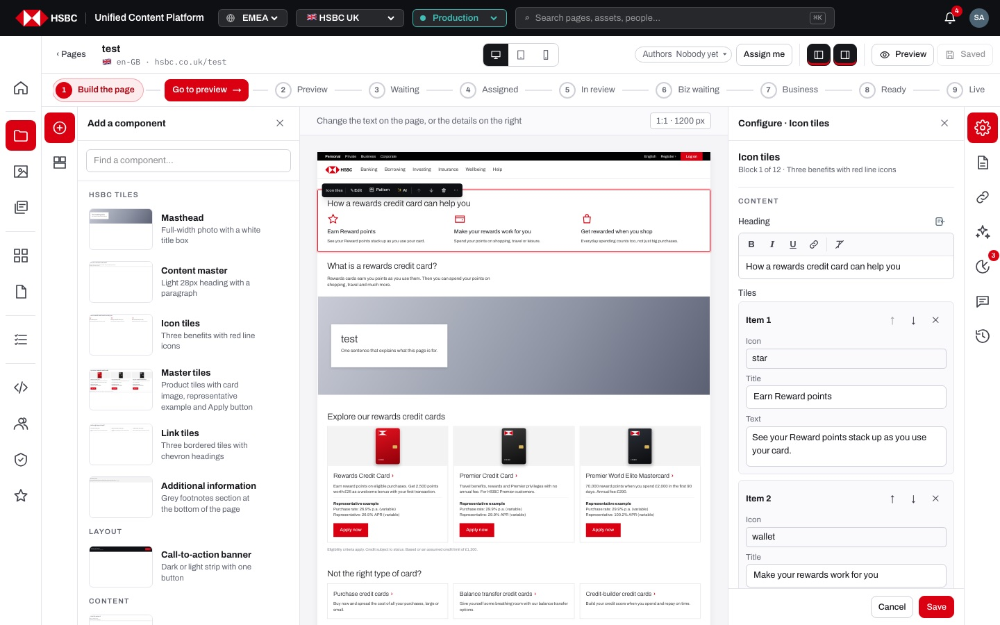
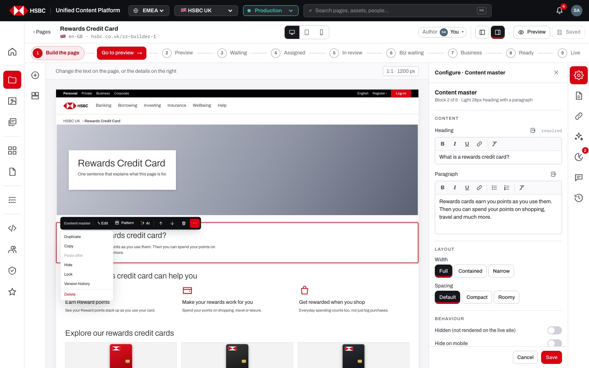
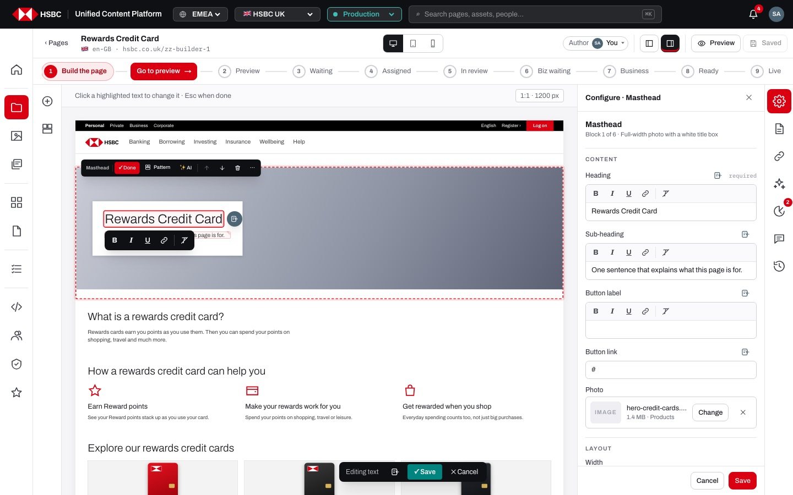
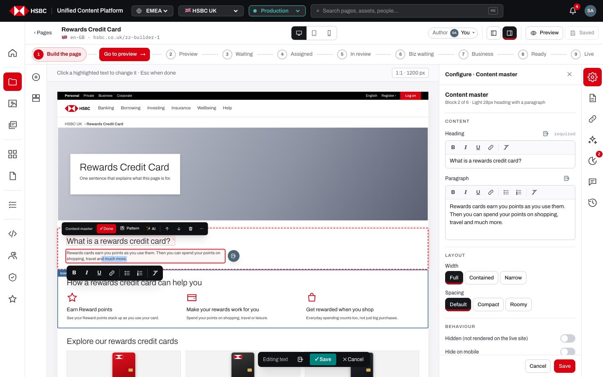
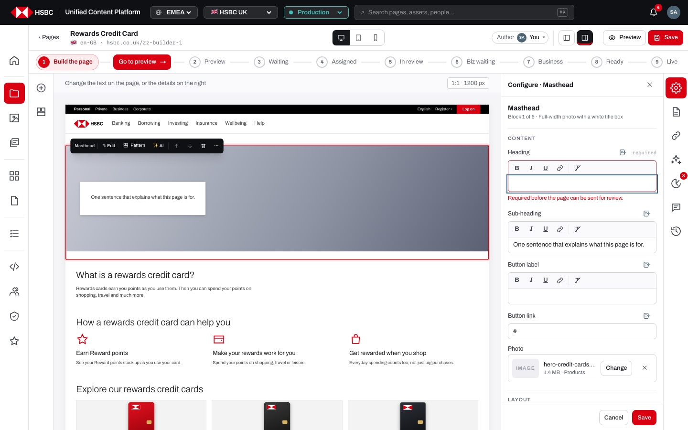
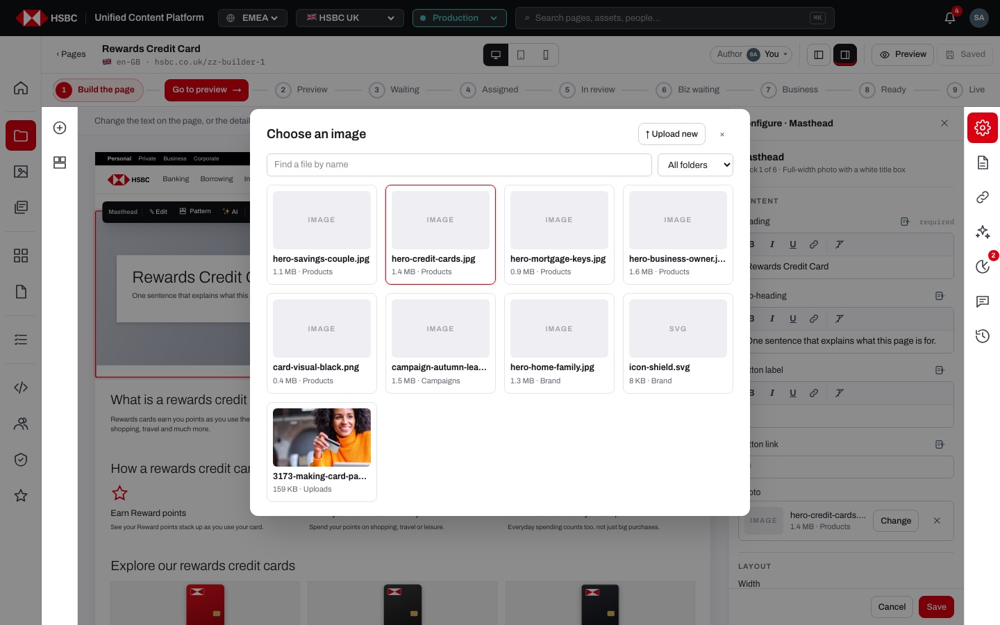
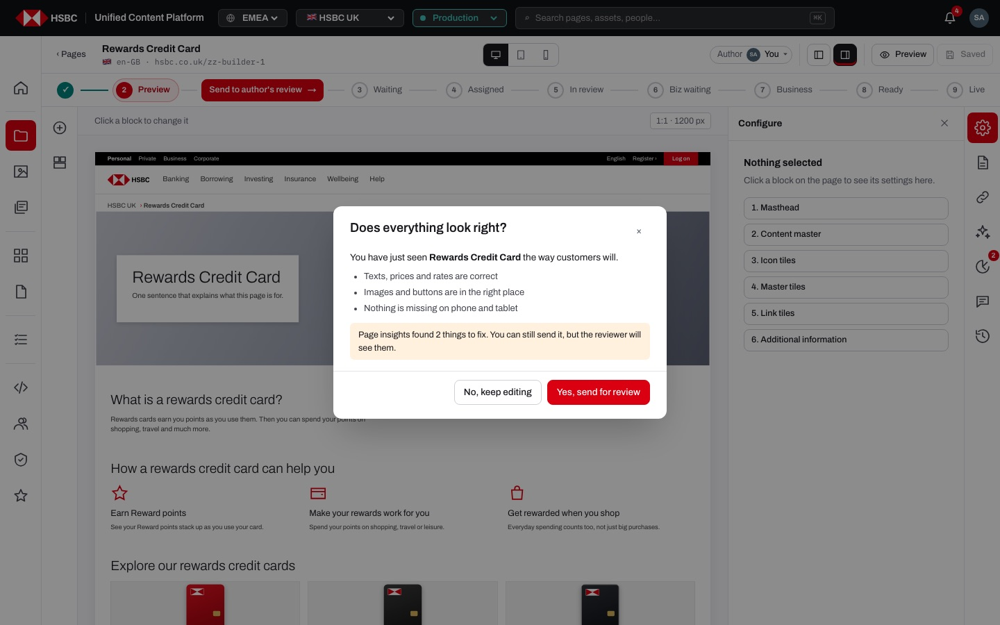
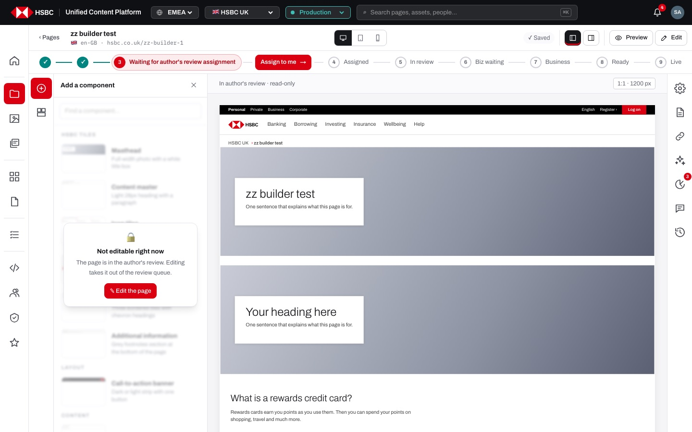

# EP-04 · Page builder · Building the page

**Epic:** EP-04 · Page builder · Building the page

**Business benefit:** Authors build and change bank web pages themselves, directly on a 1:1 rendering of the page and only from approved HSBC components, so a new product or rate page no longer needs a developer or an agency ticket. Brand, accessibility and compliance rules are built into the components, the required fields and the read-only states, so fewer errors reach review and customers.

**Scope:** The page builder screen (`/<market>/<env>/page/<path>`) while a page is being built: the top bar, the workflow stepper row (as a view element; its review stories live in EP-08), the hint bar, the left rail with the component library, the canvas with selection, inline editing, the component toolbar and its ⋯ More menu, the Configure panel with the image picker, empty-page starter layouts, saving, keyboard shortcuts, device widths and full-screen preview, the read-only veil and the phone and tablet layouts. Design patterns are in EP-05; page settings, entities, version history and co-authors in EP-06; insights and AI in EP-07.

**The view:**



- **Top bar** · "‹ Pages" back to the page's folder, the page title (with its Jira chip when linked) and the flag, locale and live URL; in the centre the device switcher (desktop / tablet / mobile); on the right the save status, the Authors chip, the two panel toggles (Components panel, Page settings panel), "Preview" and the "Save" / "Saved" button, or "🔒 Read-only" / "Edit" when the page cannot be changed right now.
- **Workflow stepper** · the nine steps from "Build the page" to "Published" with the current one highlighted and the next action (e.g. "Go to preview") on the line between two steps; the review stories for it are in EP-08.
- **Hint bar** · one line that says what a click does right now ("Click a block to change it", "Click a highlighted text to change it · Esc when done", "In author's review · read-only" …) and the "1:1 · 1200 px" label of the width the page is drawn at.
- **Left rail** · two tiles, "Add a component" (the component library with search and live thumbnails, in groups) and "Design patterns" (EP-05); the panel opens next to the rail, can be closed with ✕ and resized by dragging its edge.
- **Canvas** · the page drawn exactly as on the site (header, breadcrumbs, components, footer) and scaled down to fit; hover outlines a component with its name, a click selects it and shows the component toolbar, a click on a text edits it in place.
- **Right rail** · Configure (the selected component's Content, Layout, Behaviour and Metadata with Cancel / Save) plus Page settings, Entities, AI assistant, Page insights, Comments and Version history (EP-06 and EP-07).


*The selected component gets its toolbar (✎ Edit, Pattern, ✨ AI, move up, move down, delete, ⋯ More) and opens Configure on the right.*


*Editing a one-line text in place: the formatting bar under the text, the content icon next to it and the "Editing text · ✓ Save · ✕ Cancel" bar at the bottom.*


*Long text gets the full formatting bar: bold, italic, underline, link, bullet list, numbered list and clear formatting.*


*Configure shows every property of the component; an empty required field turns red with "Required before the page can be sent for review."*


*The image field opens the asset library with search, a folder filter and "↑ Upload new".*


*Leaving the full-screen preview of a draft asks whether the page is right before it is sent for review.*


*When the page cannot be changed, editing panels are blurred with the reason and "✎ Edit the page"; the top bar shows "Edit".*

**Stories (19):**

1. [US-04.01 · Page builder screen: top bar, hint bar and a 1:1 canvas of the page](#us-0401--page-builder-screen-top-bar-hint-bar-and-a-11-canvas-of-the-page)
2. [US-04.02 · Left rail and side panels: open, close and resize the component library and design patterns](#us-0402--left-rail-and-side-panels-open-close-and-resize-the-component-library-and-design-patterns)
3. [US-04.03 · Component library: find HSBC components and add them below the selected one](#us-0403--component-library-find-hsbc-components-and-add-them-below-the-selected-one)
4. [US-04.04 · Empty page: start from a starter layout or add components one by one](#us-0404--empty-page-start-from-a-starter-layout-or-add-components-one-by-one)
5. [US-04.05 · Canvas: hover outline with the component name and click to select](#us-0405--canvas-hover-outline-with-the-component-name-and-click-to-select)
6. [US-04.06 · Component toolbar: edit, pattern, AI, move up/down, delete and ⋯ More menu](#us-0406--component-toolbar-edit-pattern-ai-move-updown-delete-and--more-menu)
7. [US-04.07 · Inline editing: type and format text directly on the page](#us-0407--inline-editing-type-and-format-text-directly-on-the-page)
8. [US-04.08 · Rich text formatting: formatting bar, safe links and clean pasting](#us-0408--rich-text-formatting-formatting-bar-safe-links-and-clean-pasting)
9. [US-04.09 · List fields: edit, add, reorder and remove the items of tiles, tables, facts and FAQs](#us-0409--list-fields-edit-add-reorder-and-remove-the-items-of-tiles-tables-facts-and-faqs)
10. [US-04.10 · Configure panel: content, layout, behaviour and metadata of the selected component](#us-0410--configure-panel-content-layout-behaviour-and-metadata-of-the-selected-component)
11. [US-04.11 · Image field: pick a picture from the asset library or upload a new one](#us-0411--image-field-pick-a-picture-from-the-asset-library-or-upload-a-new-one)
12. [US-04.12 · ⋯ More menu: duplicate, copy and paste, version history and delete a component](#us-0412---more-menu-duplicate-copy-and-paste-version-history-and-delete-a-component)
13. [US-04.13 · Hidden and locked components: keep a component off the live site or protect it from edits](#us-0413--hidden-and-locked-components-keep-a-component-off-the-live-site-or-protect-it-from-edits)
14. [US-04.14 · Saving: autosave, Save button, ⌘S and a 'not saved' warning](#us-0414--saving-autosave-save-button-s-and-a-not-saved-warning)
15. [US-04.15 · Keyboard shortcuts: Esc, Enter, ⌘ Enter, ⌘S and ⌘⇧F in the builder](#us-0415--keyboard-shortcuts-esc-enter--enter-s-and-f-in-the-builder)
16. [US-04.16 · Device preview: desktop, tablet, mobile widths and full-screen preview](#us-0416--device-preview-desktop-tablet-mobile-widths-and-full-screen-preview)
17. [US-04.17 · Leaving the preview: 'Does everything look right?' before the page goes to review](#us-0417--leaving-the-preview-does-everything-look-right-before-the-page-goes-to-review)
18. [US-04.18 · Read-only builder: veiled editing panels with the reason and a way back to editing](#us-0418--read-only-builder-veiled-editing-panels-with-the-reason-and-a-way-back-to-editing)
19. [US-04.19 · Builder on phone and tablet: the right rendition, bottom rail and full-screen panels](#us-0419--builder-on-phone-and-tablet-the-right-rendition-bottom-rail-and-full-screen-panels)

---

## US-04.01 · Page builder screen: top bar, hint bar and a 1:1 canvas of the page

**Business benefit:** Authors always see which page, market and live address they are changing, which prevents edits landing on the wrong page or market. Working on a true-to-size rendering removes the guesswork between the editing screen and what customers see.

**User story:**

As a content author  
I want to open a page in the builder and see it drawn exactly like the live page, with its title, address and what a click does  
So that I always know what I am changing and how it will look  

**Persona:** content author · **Depends on:** US-03.03

**Acceptance criteria:**

**Background** (applies to every scenario below)

```gherkin
Given I am signed in with Edit on the UK pages
And the draft page "Rewards Credit Card" exists at "/content/uk/rewards-credit-card"
```

**Scenario 1 · Opening a page in the builder**

```gherkin
When I open "Rewards Credit Card" from Pages
Then the top bar shows "‹ Pages", the title "Rewards Credit Card" and "en-GB · hsbc.co.uk/rewards-credit-card"
And the canvas shows the page with the site header, breadcrumbs, its components and the site footer
And the hint bar says "Click a block to change it"
And the label at the end of the hint bar says "1:1 · 1200 px"
```

**Scenario 2 · Going back to the folder**

```gherkin
Given the page is in the folder "/content/uk/credit-cards"
When I click "‹ Pages"
Then the Pages list opens on the folder "credit-cards"
```

**Scenario 3 · The page always fits the canvas**

```gherkin
Given the canvas is narrower than 1200 px because both side panels are open
Then the page is still drawn at 1200 px and scaled down to fit
And the canvas never scrolls sideways
```

**Scenario 4 · The hint bar follows what I do** *(one run per row of the table)*

```gherkin
When I am "<doing>"
Then the hint bar says "<hint>"

Examples:
  | doing                                  | hint                                                     |
  | nothing selected                       | Click a block to change it                               |
  | a component selected                   | Change the text on the page, or the details on the right |
  | editing a text on the page             | Click a highlighted text to change it · Esc when done     |
  | looking at a page in author's review   | In author's review · read-only                           |
```

---

## US-04.02 · Left rail and side panels: open, close and resize the component library and design patterns

**Business benefit:** Authors keep the page as large as possible and open the library only when they need it, which makes building faster on laptop screens. Remembered panel widths mean less fiddling every time a page is opened.

**User story:**

As a content author  
I want a left rail with the component library and design patterns that I can open, close and resize  
So that I have the tools I need without losing sight of the page  

**Persona:** content author · **Depends on:** US-04.01

**Acceptance criteria:**

**Background** (applies to every scenario below)

```gherkin
Given I am signed in with Edit on the page "Rewards Credit Card"
And the page is at "Build the page"
```

**Scenario 1 · The library is open when the builder opens**

```gherkin
When I open the page in the builder
Then the left rail shows the tiles "Add a component" and "Design patterns"
And the panel "Add a component" is open next to the rail
```

**Scenario 2 · Switching and closing panels**

```gherkin
When I click the "Design patterns" tile
Then the panel title changes to "Add a design pattern"
When I click the highlighted "Design patterns" tile again
Then the panel closes
And the same happens with the panel's ✕ or the "Components panel" button in the top bar
```

**Scenario 3 · Clicking the empty rail toggles the panel**

```gherkin
Given the panel is closed
When I click the empty part of the left rail
Then the panel opens again on the tile I used last
```

**Scenario 4 · Resizing a panel**

```gherkin
When I drag the edge of the left panel
Then the panel gets wider or narrower between 260 px and 560 px
And the page is scaled again to fit the space that is left
And the next time I open a page in this browser the panel has the same width
```

---

## US-04.03 · Component library: find HSBC components and add them below the selected one

**Business benefit:** Pages are built only from approved components, so brand and compliance quality is built in rather than checked later. Authors produce pages without developer help, lowering cost and time to market.

**User story:**

As a content author  
I want to find components in the library and add them where I need them  
So that every page is built only from approved HSBC components  

**Persona:** content author · **Depends on:** US-04.02

**Acceptance criteria:**

**Background** (applies to every scenario below)

```gherkin
Given I am signed in with Edit on the page "Cash ISA"
And the page is at "Build the page"
```

**Scenario 1 · Adding a component**

```gherkin
Given the "Key facts" component is selected
When I click "Add" on "Rates table" in the component library
Then the rates table is added below "Key facts"
And the new rates table is selected
And I see "Rates table added · click ✎ Edit to fill it in"
```

**Scenario 2 · Adding with nothing selected**

```gherkin
Given no component is selected
When I click "FAQ" in the component library
Then the FAQ is added at the end of the page with its sample questions
```

**Scenario 3 · Finding a component**

```gherkin
When I type "faq" into "Find a component…"
Then only "FAQ" is listed
When I type "zzz"
Then I see "Nothing matches “zzz”."
```

**Scenario 4 · The library shows what each component looks like**

```gherkin
When I open "Add a component"
Then the components are grouped under "HSBC tiles", "Layout", "Content", "Data" and "Conversion"
And each one shows a live thumbnail, its name and a one-line description
And hovering a component shows "Add"
```

**Scenario 5 · An empty page offers starter layouts**

```gherkin
Given the page has no components
Then I see "How do you want to start this page?" with 3 layouts
```

**Scenario 6 · People without Edit can look but not add**

```gherkin
Given I only have Read on the page
When I open "Add a component"
Then the panel is veiled with "Not editable right now"
And I cannot add any component
```

---

## US-04.04 · Empty page: start from a starter layout or add components one by one

**Business benefit:** A blank page becomes a complete, on-brand structure in one click, which shortens the first draft of a new page from hours to minutes. Starting from proven layouts makes pages of the same kind look alike across the site.

**User story:**

As a content author  
I want an empty page to offer me ready-made layouts  
So that I do not have to assemble a common page structure by hand  

**Persona:** content author · **Depends on:** US-04.03

**Acceptance criteria:**

**Background** (applies to every scenario below)

```gherkin
Given I am signed in with Edit on the UK pages
And I created the page "Premier Banking" from the template "Blank page"
```

**Scenario 1 · The empty page invites me to start**

```gherkin
When I open "Premier Banking" in the builder
Then the canvas shows "How do you want to start this page?"
And "Pick a layout, or add components one by one from the left."
And the layouts "Product page", "Rates page" and "Category hub" with the components each one contains
```

**Scenario 2 · Starting from a layout**

```gherkin
When I click "Product page"
Then Masthead, Content master, Icon tiles, Master tiles, Link tiles and Additional information are added in that order
And the masthead heading is "Premier Banking", the page title
And the page saves itself shortly after
```

**Scenario 3 · Starting from one component**

```gherkin
When I click "Masthead" in the component library instead
Then only the masthead is on the page
And the starter layouts are gone
```

---

## US-04.05 · Canvas: hover outline with the component name and click to select

**Business benefit:** Authors see at a glance where one component ends and the next begins, which avoids changing the wrong part of a page. Selecting with one click keeps building quick for people who are not web specialists.

**User story:**

As a content author  
I want each component to show its outline and name when I point at it and to be selected with one click  
So that I always know which component I am about to change  

**Persona:** content author · **Depends on:** US-04.01

**Acceptance criteria:**

**Background** (applies to every scenario below)

```gherkin
Given I am signed in with Edit on the page "Rewards Credit Card"
And the page is at "Build the page"
```

**Scenario 1 · Hovering a component**

```gherkin
When I move the pointer over the "Icon tiles" component
Then it gets a thin outline
And a tag with the name "Icon tiles" appears on its corner
```

**Scenario 2 · Selecting a component**

```gherkin
When I click an empty part of the "Icon tiles" component
Then it gets a red outline and the component toolbar
And Configure opens on the right with "Configure · Icon tiles"
And the hint bar says "Change the text on the page, or the details on the right"
```

**Scenario 3 · Selecting nothing**

```gherkin
Given "Icon tiles" is selected
When I click the canvas outside the page components
Then nothing is selected and the toolbar disappears
```

**Scenario 4 · The tag tells me about hidden and locked components**

```gherkin
Given the "Disclaimer" component is hidden and locked
When I move the pointer over it
Then its tag says "Disclaimer · 🔒 locked · hidden"
```

**Scenario 5 · Links on the page do not navigate while building**

```gherkin
When I click a link or a button inside a component
Then the builder stays on the page
And the click selects or edits the component instead
```

---

## US-04.06 · Component toolbar: edit, pattern, AI, move up/down, delete and ⋯ More menu

**Business benefit:** One consistent way to configure all components shortens training for new authors. Locking components protects mandatory content such as disclaimers from accidental edits.

**User story:**

As a content author  
I want the same toolbar on every component and a Configure panel with all its properties  
So that I can move, protect and fine-tune any component without learning each one  

**Persona:** content author · **Depends on:** US-04.05

**Acceptance criteria:**

**Background** (applies to every scenario below)

```gherkin
Given I am signed in with Edit on the page "Cash ISA"
And the page is at "Build the page"
```

**Scenario 1 · Component toolbar**

```gherkin
When I select a component
Then I see its name, "✎ Edit", "Pattern", "✨ AI", move up, move down, delete and "⋯ More"
And "⋯ More" offers Duplicate, Copy, Paste after, Hide, Lock, Version history and Delete
```

**Scenario 2 · Moving a component**

```gherkin
Given "Rates table" is the third of six components
When I click move up
Then "Rates table" is the second component
And move up is disabled on the first component and move down on the last one
```

**Scenario 3 · Deleting a component**

```gherkin
When I click delete on the toolbar of "FAQ"
Then the FAQ is removed from the page straight away
And nothing is selected
```

**Scenario 4 · Edit, Pattern and AI from the toolbar**

```gherkin
When I click "✎ Edit"
Then the first text of the component is ready to type in and the button says "✓ Done"
When I click "Pattern"
Then a new design pattern starts with this component as number 1
When I click "✨ AI"
Then "✨ What would you like to change?" opens for this component only
```

**Scenario 5 · Locked component**

```gherkin
Given the "Disclaimer" component is locked
When I click its text
Then I see "This block is locked. Unlock it from ⋯ More."
```

**Scenario 6 · Configure panel**

```gherkin
When I click a component
Then Configure opens with Content, Layout, Behaviour and Metadata
And required fields are marked "required"
And Cancel puts back the values from when Configure opened
```

---

## US-04.07 · Inline editing: type and format text directly on the page

**Business benefit:** Authors see exactly what customers will see, which reduces review rounds caused by layout surprises. Restricting link formats also blocks unsafe links from reaching customers.

**User story:**

As a content author  
I want to type and format text directly on the page  
So that I see the result as customers will while I write  

**Persona:** content author · **Depends on:** US-04.06

**Acceptance criteria:**

**Background** (applies to every scenario below)

```gherkin
Given I am signed in with Edit on the page "Cash ISA"
And the page is at "Build the page"
```

**Scenario 1 · Editing a heading in place**

```gherkin
When I click the masthead heading
Then I can type straight away with the caret where I clicked
And the bar "Editing text · ✓ Save · ✕ Cancel" appears at the bottom of the canvas
When I press Enter
Then the heading is saved and I see "Saved"
```

**Scenario 2 · Long text needs ⌘ Enter**

```gherkin
When I edit a paragraph and press Enter
Then a new paragraph starts
When I press ⌘ Enter
Then the paragraph is saved
```

**Scenario 3 · Changing a button**

```gherkin
When I click the label of a button such as "Apply now"
Then I edit the label in place like any other text
And I change where the button goes in Configure under "Button link"
```

**Scenario 4 · Formatting**

```gherkin
When I edit a paragraph
Then I can make text bold, italic, underlined, a link, a bullet list or a numbered list
And links must start with https, mailto, tel, / or #
```

**Scenario 5 · Double-click and ✎ Edit go straight into the text**

```gherkin
When I double-click a component outside its texts
Then its first text is ready to type in
And the same happens when I click "✎ Edit" on the toolbar
```

**Scenario 6 · Cancelling and finishing**

```gherkin
Given I changed the heading "Cash ISA" to "Cash ISA 2027"
When I click "✕ Cancel" or press Esc
Then the heading is "Cash ISA" again
When I change it again and click outside the text
Then "Cash ISA 2027" is kept
```

**Scenario 7 · Content from an entity while typing**

```gherkin
When I click the content icon next to the text or in the editing bar
Then "Choose content" opens so the text can show a field of an entity
```

---

## US-04.08 · Rich text formatting: formatting bar, safe links and clean pasting

**Business benefit:** Authors can structure copy with emphasis, lists and links without HTML knowledge, which makes product information easier for customers to scan. Only safe markup and safe link types are stored, so pasted content cannot break the page or send customers to harmful addresses.

**User story:**

As a content author  
I want a small formatting bar on the text I edit, on the page and in Configure  
So that I can format copy correctly and safely without writing code  

**Persona:** content author · **Depends on:** US-04.07

**Acceptance criteria:**

**Background** (applies to every scenario below)

```gherkin
Given I am signed in with Edit on the page "Rewards Credit Card"
And the page is at "Build the page"
```

**Scenario 1 · Formatting bar for one-line and long text** *(one run per row of the table)*

```gherkin
When I edit the "<text>" on the page
Then the formatting bar under it offers "<buttons>"

Examples:
  | text                     | buttons                                                                             |
  | masthead heading         | Bold (⌘B), Italic (⌘I), Underline (⌘U), Link, Clear formatting                       |
  | content master paragraph | Bold (⌘B), Italic (⌘I), Underline (⌘U), Link, Bullet list, Numbered list, Clear formatting |
```

**Scenario 2 · Adding a link**

```gherkin
Given I selected the words "much more" in a paragraph
When I click "Link"
Then a field "https://www.hsbc.co.uk/…" with "Add" and "Cancel" replaces the buttons
When I type "/credit-cards/rewards" and press Enter
Then "much more" becomes a link to "/credit-cards/rewards"
```

**Scenario 3 · Allowed and blocked link addresses** *(one run per row of the table)*

```gherkin
When I add a link to "<typed>"
Then the link goes to "<stored>"

Examples:
  | typed                     | stored                            |
  | https://www.hsbc.co.uk/x  | https://www.hsbc.co.uk/x          |
  | mailto:help@hsbc.co.uk    | mailto:help@hsbc.co.uk            |
  | tel:03457404404           | tel:03457404404                   |
  | www.hsbc.co.uk/savings    | https://www.hsbc.co.uk/savings    |
  | javascript:alert(1)       | no link is made                   |
```

**Scenario 4 · Removing a link and clearing formatting**

```gherkin
Given the caret is inside a link
Then the link button says "Remove link"
When I click it the text stays and the link is gone
When I click "Clear formatting"
Then bold, italic, underline, links and the list are removed from the selection
```

**Scenario 5 · Pasting from Word or a web page**

```gherkin
When I paste text with fonts, colours, headings and scripts into a paragraph
Then only paragraphs, bold, italic, underline, links and lists are kept
And headings become normal paragraphs
And scripts and styles are dropped
```

**Scenario 6 · The same bar in Configure**

```gherkin
When I click into "Paragraph" in Configure
Then the same formatting bar is above the field
And the text in the field looks as it will on the page
```

---

## US-04.09 · List fields: edit, add, reorder and remove the items of tiles, tables, facts and FAQs

**Business benefit:** Rates tables, key facts and FAQs are kept as structured items, so they stay consistent and easy to update when rates or rules change. Authors reorder and extend these lists in seconds without breaking the layout.

**User story:**

As a content author  
I want to manage the items of list components one by one  
So that tables, tiles and FAQs stay well-formed whatever I change  

**Persona:** content author · **Depends on:** US-04.06

**Acceptance criteria:**

**Background** (applies to every scenario below)

```gherkin
Given I am signed in with Edit on the page "Fixed Rate Saver"
And the "Rates table" component is selected
```

**Scenario 1 · Items in Configure**

```gherkin
When I look at "Rows" in Configure
Then each row is a card "Item 1", "Item 2", "Item 3" with the fields "Term", "AER" and "Gross"
And each card has move up "↑", move down "↓" and remove "✕"
```

**Scenario 2 · Adding, moving and removing an item**

```gherkin
When I click "＋ Add item"
Then an empty "Item 4" is added at the end
When I click "↑" on "Item 4"
Then it becomes "Item 3"
When I click "✕" on it
Then the rates table has three rows again
```

**Scenario 3 · Editing a cell on the page**

```gherkin
When I click the AER "4.10%" in the table on the page
Then I edit that one cell in place
And pressing Enter saves only that cell
```

**Scenario 4 · Separators cannot break a list**

```gherkin
When I type "Instant | easy" into a cell
Then the cell is saved as "Instant / easy"
And the table keeps the same number of columns
```

---

## US-04.10 · Configure panel: content, layout, behaviour and metadata of the selected component

**Business benefit:** Every component is configured in the same panel with the same sections, so authors learn one way of working for the whole library. Required fields are flagged where they are filled in, so incomplete pages are caught before they reach a reviewer.

**User story:**

As a content author  
I want all properties of the selected component in one panel with Cancel and Save  
So that I can set content, width, spacing and behaviour precisely and undo a round of changes  

**Persona:** content author · **Depends on:** US-04.06

**Acceptance criteria:**

**Background** (applies to every scenario below)

```gherkin
Given I am signed in with Edit on the page "Rewards Credit Card"
And the page is at "Build the page"
```

**Scenario 1 · What Configure shows**

```gherkin
When I click the "Masthead" component
Then the right panel is titled "Configure · Masthead"
And it says "Block 1 of 6 · Full-width photo with a white title box"
And it has the sections "Content", "Layout", "Behaviour" and "Metadata"
```

**Scenario 2 · Sections and their settings**

```gherkin
Then "Layout" offers Width "Full", "Contained", "Narrow" and Spacing "Default", "Compact", "Roomy"
And "Behaviour" offers "Hidden (not rendered on the live site)", "Hide on mobile", "Locked (no edits until unlocked)" and "Targeting enabled (Adobe Target segment)"
And "Metadata" shows the node "jcr:content/root/<id>" and the sling:resourceType "hsbc/components/mast"
```

**Scenario 3 · Required fields**

```gherkin
When I clear the "Heading" of the masthead
Then the field gets a red border
And I see "Required before the page can be sent for review."
```

**Scenario 4 · Changes show on the page as I type**

```gherkin
When I change "Sub-heading" in Configure
Then the masthead on the page shows the new sub-heading straight away
```

**Scenario 5 · Save and Cancel**

```gherkin
Given I changed the width to "Narrow" and the heading
When I click "Cancel"
Then the masthead has the width and heading it had when Configure opened
And the panel closes
When I change it again and click "Save"
Then I see "Component updated · Save the page when you're done"
```

**Scenario 6 · Nothing selected**

```gherkin
Given no component is selected
When I open Configure from the right rail
Then I see "Nothing selected" and "Click a block on the page to see its settings here."
And a list of the first eight components of the page, each opening its Configure
```

---

## US-04.11 · Image field: pick a picture from the asset library or upload a new one

**Business benefit:** Pages only use pictures that are in the bank's asset library, with their names, sizes and alt texts, so licensing and accessibility stay under control. Authors can still add a missing picture without leaving the page, which keeps the build moving.

**User story:**

As a content author  
I want to choose a component's picture from the asset library or upload one  
So that the page uses approved images and I never leave the builder  

**Persona:** content author · **Depends on:** US-04.10

**Acceptance criteria:**

**Background** (applies to every scenario below)

```gherkin
Given I am signed in with Edit on the page "Rewards Credit Card"
And the "Masthead" component is open in Configure
```

**Scenario 1 · The image field**

```gherkin
Then "Photo" shows a thumbnail, the file name "hero-credit-cards.jpg", "1.4 MB · Products", "Change" and "✕"
When I click "✕"
Then the field says "No image chosen" and the button says "Choose image"
```

**Scenario 2 · Picking from the library**

```gherkin
When I click "Change"
Then "Choose an image" opens with the images and SVGs of the market, the current one highlighted
When I type "mortgage" into "Find a file by name" and choose the folder "Products"
Then only "hero-mortgage-keys.jpg" is listed
When I click it
Then the dialog closes and the masthead shows the new picture
```

**Scenario 3 · Uploading a new picture**

```gherkin
When I click "↑ Upload new" and choose "premier-lounge.jpg"
Then the button says "Uploading…"
And the picture is stored in the folder "Uploads" and becomes the masthead photo
```

**Scenario 4 · Nothing found**

```gherkin
When I search for "zzz"
Then I see "No images match. Upload one."
```

**Scenario 5 · Upload error**

```gherkin
Given the upload is refused by the server
Then I see the reason with the request id above the list
And the masthead photo does not change
```

---

## US-04.12 · ⋯ More menu: duplicate, copy and paste, version history and delete a component

**Business benefit:** Authors reuse a finished component instead of rebuilding it, which saves time and keeps repeated sections identical. Less-used actions sit in one menu, so the toolbar stays simple for everyday work.

**User story:**

As a content author  
I want duplicate, copy, paste, version history and delete in one menu on every component  
So that I can reuse and tidy components quickly  

**Persona:** content author · **Depends on:** US-04.06

**Acceptance criteria:**

**Background** (applies to every scenario below)

```gherkin
Given I am signed in with Edit on the page "Rewards Credit Card"
And the "Icon tiles" component is selected
```

**Scenario 1 · The menu**

```gherkin
When I click "⋯"
Then I see "Duplicate", "Copy", "Paste after", "Hide", "Lock", "Version history" and "Delete"
And "Paste after" is disabled while nothing has been copied
```

**Scenario 2 · Duplicate**

```gherkin
When I choose "Duplicate"
Then an identical "Icon tiles" is added right below it
```

**Scenario 3 · Copy and paste after**

```gherkin
When I choose "Copy"
Then I see "Copied"
When I select "Link tiles" and choose "⋯" → "Paste after"
Then a copy of the icon tiles is added below "Link tiles"
```

**Scenario 4 · Version history**

```gherkin
When I choose "Version history"
Then the right panel shows "Version history" of the page
```

**Scenario 5 · Delete**

```gherkin
When I choose "Delete"
Then the icon tiles are removed from the page
And nothing is selected
```

---

## US-04.13 · Hidden and locked components: keep a component off the live site or protect it from edits

**Business benefit:** Seasonal or not-yet-approved sections can be prepared on the page and marked as not for the live site, which lets teams get ahead of launches. Locking mandatory content such as disclaimers protects the bank from accidental changes to regulated text.

**User story:**

As a content author  
I want to hide a component from the live site and lock a component against edits  
So that I can prepare content early and protect text that must not change  

**Persona:** content author · **Depends on:** US-04.12

**Acceptance criteria:**

**Background** (applies to every scenario below)

```gherkin
Given I am signed in with Edit on the page "Cash ISA"
And the page is at "Build the page"
```

**Scenario 1 · Hiding and showing**

```gherkin
Given the "Rates table" component is selected
When I choose "⋯" → "Hide"
Then its tag and toolbar say "Rates table · hidden"
And the menu item now says "Show"
And the same switch is "Hidden (not rendered on the live site)" in Configure
```

**Scenario 2 · Authors still see hidden components**

```gherkin
Given the "Rates table" component is hidden
Then it stays on the canvas, faded, with a "Hidden" label in its corner
And I can still select, edit and show it again
```

**Scenario 3 · Locking**

```gherkin
Given the "Disclaimer" component is selected
When I choose "⋯" → "Lock"
Then its name on the toolbar shows "🔒"
And "✎ Edit", "✨ AI", move up, move down and delete on the toolbar are disabled
And clicking its text says "This block is locked. Unlock it from ⋯ More."
```

**Scenario 4 · Unlocking**

```gherkin
Given the "Disclaimer" component is locked
When I choose "⋯" → "Unlock"
Then I can edit, move and delete it again
```

**Scenario 5 · Patterns do not copy page decisions**

```gherkin
Given the "Disclaimer" component is hidden and locked
When I save it in a design pattern
Then pages that add the pattern get a disclaimer that is neither hidden nor locked
```

---

## US-04.14 · Saving: autosave, Save button, ⌘S and a 'not saved' warning

**Business benefit:** Authors never redo work after a closed tab or a lost connection. Fewer lost edits also mean fewer errors slipping into reviewed pages.

**User story:**

As a content author  
I want the page to save itself, to save on demand and to tell me when saving fails  
So that no edit is ever lost  

**Persona:** content author · **Depends on:** US-04.07

**Acceptance criteria:**

**Background** (applies to every scenario below)

```gherkin
Given I am signed in with Edit on the page "Cash ISA"
And the page is at "Build the page"
```

**Scenario 1 · Autosave**

```gherkin
When I change a component and stop for about a second
Then the page saves itself and the button next to "Preview" says "Saved"
But while I am still typing in a text on the page it waits until I finish that text
```

**Scenario 2 · Save button and shortcut**

```gherkin
Then a red "Save" button sits next to "Preview" while there are unsaved changes
And it says "Saving…" while it saves and a greyed-out "Saved" when everything is saved
And ⌘ S (Ctrl S) saves at once
```

**Scenario 3 · Save failed**

```gherkin
Given the server cannot be reached
When the page tries to save
Then I see "Not saved · Retry" in the top bar
And a message with the reason and the request id
When the connection is back and I click "Not saved · Retry"
Then the page is saved and I see "Saved"
```

**Scenario 4 · Pages that are not a draft show a status instead**

```gherkin
Given the page is in author's review
Then the top bar shows "✓ Saved" instead of the Save button
```

---

## US-04.15 · Keyboard shortcuts: Esc, Enter, ⌘ Enter, ⌘S and ⌘⇧F in the builder

**Business benefit:** Experienced authors build pages faster when the common steps never need the mouse. Predictable keys also make the builder usable for people who rely on the keyboard.

**User story:**

As a content author  
I want consistent keyboard shortcuts while I build  
So that I can work quickly and always step back safely  

**Persona:** content author · **Depends on:** US-04.07, US-04.14

**Acceptance criteria:**

**Background** (applies to every scenario below)

```gherkin
Given I am signed in with Edit on the page "Cash ISA"
And the page is at "Build the page"
```

**Scenario 1 · Esc steps back one level at a time** *(one run per row of the table)*

```gherkin
Given "<state>"
When I press Esc
Then "<result>"

Examples:
  | state                                         | result                                          |
  | I am typing in a text on the page             | the text goes back to how it was before I typed |
  | the ✨ AI or ⋯ More menu of a component is open | the menu closes and the component stays selected |
  | the component is in edit mode                 | it goes back to selected                        |
  | a component is selected                       | nothing is selected                             |
  | the page is shown full screen in Preview      | the builder comes back                          |
```

**Scenario 2 · Saving a text with the keyboard** *(one run per row of the table)*

```gherkin
When I edit "<text>" and press "<keys>"
Then the text is saved

Examples:
  | text                        | keys      |
  | a heading or a button label | Enter     |
  | a paragraph, list or answer | ⌘ Enter   |
```

**Scenario 3 · Page shortcuts** *(one run per row of the table)*

```gherkin
When I press "<keys>"
Then "<result>"

Examples:
  | keys      | result                                            |
  | ⌘ S       | the page is saved at once                         |
  | ⌘ ⇧ F     | the page is shown full screen as visitors see it  |
  | ⌘ B       | the selected text in the edited text becomes bold |
  | ⌘ K       | the command palette opens                         |
```

---

## US-04.16 · Device preview: desktop, tablet, mobile widths and full-screen preview

**Business benefit:** Problems on mobile and tablet are caught before review, when they are cheapest to fix. Customers get a consistent experience on every device, which protects trust and conversion.

**User story:**

As a content author  
I want to preview the page at desktop, tablet and mobile width and full screen  
So that it works for every customer before I send it for review  

**Persona:** content author · **Depends on:** US-04.01

**Acceptance criteria:**

**Background** (applies to every scenario below)

```gherkin
Given I am signed in with Edit on the page "Cash ISA"
And the page is at "Build the page"
```

**Scenario 1 · Device preview** *(one run per row of the table)*

```gherkin
When I choose "<device>"
Then the page is drawn at <width> px and the label says "1:1 · <width> px"
And I can keep editing the page at that width

Examples:
  | device  | width |
  | desktop | 1200  |
  | tablet  | 768   |
  | mobile  | 390   |
```

**Scenario 2 · Full-screen preview**

```gherkin
When I click "Preview" or press ⌘ ⇧ F
Then the top bar, the stepper, the side menu and the panels disappear and the page fills the screen
And for a few seconds I see "Preview · this is what visitors see · press Esc to go back to editing"
And Esc goes back to editing with the panels as they were
```

**Scenario 3 · Nothing can be changed in the preview**

```gherkin
Given I was editing the heading when I opened the preview
Then the heading is saved first
And clicking texts in the preview does not edit them
```

---

## US-04.17 · Leaving the preview: 'Does everything look right?' before the page goes to review

**Business benefit:** Authors confirm the page with their own eyes before it uses a reviewer's time, which cuts review rounds spent on obvious mistakes. Known insight problems are shown at that moment, so they are fixed or knowingly passed on.

**User story:**

As a content author  
I want to be asked whether the page looks right when I leave the full-screen preview  
So that I either send it for review straight away or go back and fix it  

**Persona:** content author · **Depends on:** US-04.16, US-08.03

**Acceptance criteria:**

**Background** (applies to every scenario below)

```gherkin
Given I am signed in with Edit on the draft page "Rewards Credit Card"
And I opened it full screen with "Go to preview"
```

**Scenario 1 · The question**

```gherkin
When I press Esc
Then "Does everything look right?" opens with "You have just seen Rewards Credit Card the way customers will."
And the checks "Texts, prices and rates are correct", "Images and buttons are in the right place" and "Nothing is missing on phone and tablet"
And the buttons "No, keep editing" and "Yes, send for review"
```

**Scenario 2 · Insights are mentioned**

```gherkin
Given Page insights found 2 things to fix
Then the question also says "Page insights found 2 things to fix. You can still send it, but the reviewer will see them."
```

**Scenario 3 · Keep editing**

```gherkin
When I click "No, keep editing"
Then I am back on "Build the page"
And the first component with an empty required field (or else the first component) is open for editing
```

**Scenario 4 · Send it**

```gherkin
When I click "Yes, send for review"
Then the "Send page for review" dialog opens
```

**Scenario 5 · Closing the question**

```gherkin
When I close the question with ×
Then the stepper shows "Preview" as the current step
And "Send to author's review" is the next action
And changing the page afterwards takes it back to "Build the page"
```

---

## US-04.18 · Read-only builder: veiled editing panels with the reason and a way back to editing

**Business benefit:** Pages in review, ready to publish, live, locked by a colleague or outside a person's permissions cannot be changed by accident, which protects approved and regulated content. Everyone still sees the page and why it is closed, and people allowed to change it get one clear way back to editing.

**User story:**

As a content author  
I want the builder to show me when and why a page cannot be changed, and how to change it anyway when I may  
So that I never break a review or someone else's work without meaning to  

**Persona:** content author · **Depends on:** US-08.04, US-03.09

**Acceptance criteria:**

**Scenario 1 · Why the page cannot be changed** *(one run per row of the table)*

```gherkin
Given the page "Cash ISA" is "<situation>"
When I open "Add a component" in the builder
Then the panel is blurred with "Not editable right now" and "<reason>"

Examples:
  | situation                          | reason                                                                                         |
  | in author's review with Rachel     | The page is in the author's review with Rachel Hughes. Editing takes it out of the review queue. |
  | in business review                 | The page is in business review. Editing takes it out of the review queue.                     |
  | ready to publish                   | The page passed review and is ready to publish. Editing sends it back through review.         |
  | published                          | The page is live. Click Edit to change it; the live version stays online until you publish again. |
  | locked in Pages by Jordan Mensah   | Locked by Jordan Mensah. Ask them or a site admin to unlock it in Pages.                       |
  | in a folder where I only have Read | You don't have Edit on this folder. Ask a site admin to grant it.                             |
```

**Scenario 2 · Reopening a page in review**

```gherkin
Given the page is in author's review and I have Edit
Then the top bar shows "Edit" instead of "Save"
When I click "Edit" or "✎ Edit the page" on the veil
Then I am asked "Reopen this page for editing? It will leave the review queue."
When I confirm
Then I see "Reopened for editing" and the page is at "Build the page" again
```

**Scenario 3 · Editing a live page**

```gherkin
Given the page is published
When I click "Edit"
Then I see "Editing · the live version stays online until you publish again"
And no question is asked
```

**Scenario 4 · No Edit permission**

```gherkin
Given I only have Read on the folder
Then the top bar shows "🔒 Read-only" and no "Edit"
And the page is shown as visitors see it
And the veil has no "✎ Edit the page" button
And the component library says "Read-only: you can look, but not add."
```

---

## US-04.19 · Builder on phone and tablet: the right rendition, bottom rail and full-screen panels

**Business benefit:** Authors and approvers can make an urgent correction or check a page from a phone or tablet, which shortens reaction time outside the office. The page is still shown 1:1 at the width of the device, so what they check is what customers on that device will see.

**User story:**

As a content author  
I want the builder to adapt to my phone or tablet  
So that I can check and fix a page when I am away from my desk  

**Persona:** content author · **Depends on:** US-04.16

**Acceptance criteria:**

**Scenario 1 · Phone (390 px wide screen)**

```gherkin
Given I am signed in with Edit on a phone
When I open the page "Cash ISA" in the builder
Then the page is drawn at the mobile width with "1:1 · 390 px"
And the left panel is closed and the device switcher and panel toggles are not shown
And the rail tiles sit in a bar at the bottom of the screen
And the stepper shows only the current step and its next action
```

**Scenario 2 · Selecting on a phone**

```gherkin
Given I am on a phone
When I tap a component
Then it is selected without opening Configure, so the page stays visible
And its toolbar has an extra "⚙ Configure" button that opens the panel full screen
```

**Scenario 3 · Tablet**

```gherkin
Given I am signed in on a tablet
When I open the page in the builder
Then the page is drawn at the tablet width with "1:1 · 768 px"
And the side panels float over the page instead of pushing it aside
```
