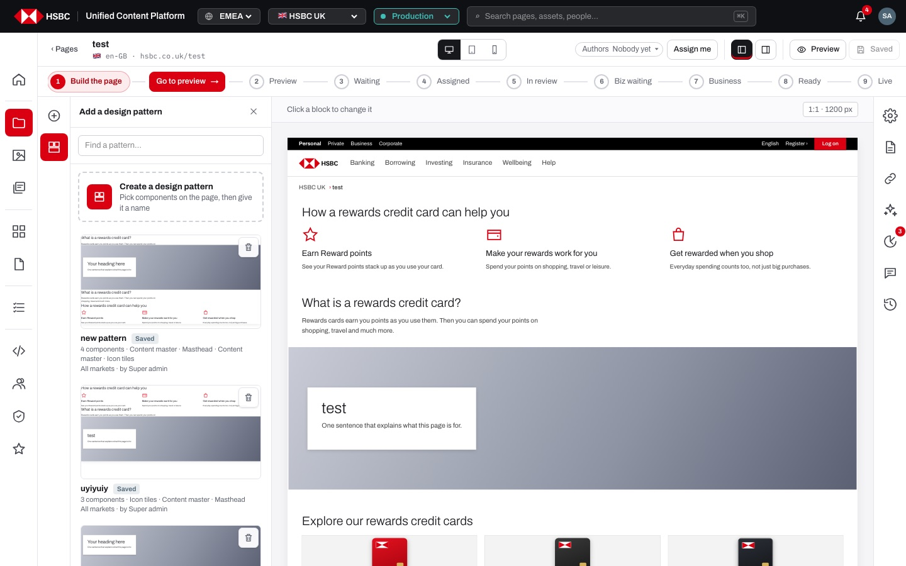
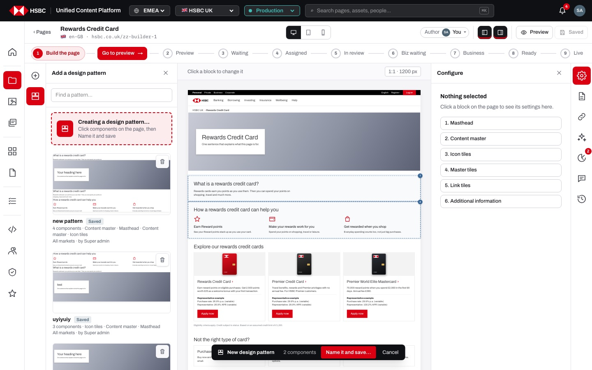
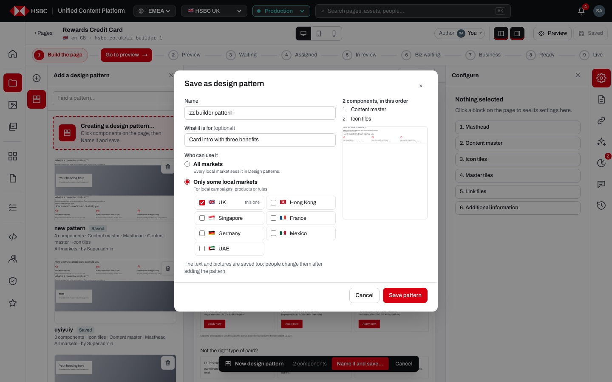
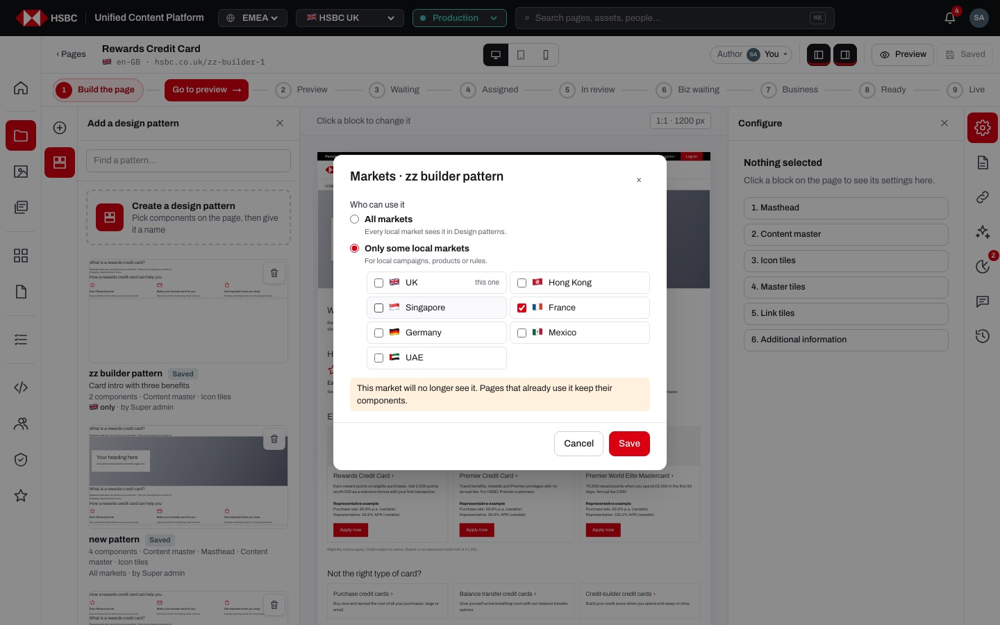
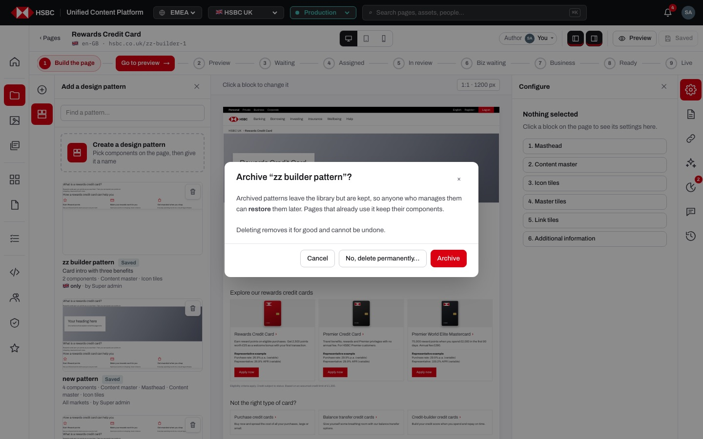

# EP-05 · Page builder · Design patterns

**Epic:** EP-05 · Page builder · Design patterns

**Business benefit:** Proven page sections, such as a product introduction or a rates-and-FAQ block, are saved once and added to any page in one click, so teams stop rebuilding the same sections and pages across markets look and read the same. Market targeting, archiving and site-admin rules keep the shared library relevant and safe, without ever changing pages that already use a pattern.

**Scope:** The "Design patterns" tile in the left rail of the page builder: the pattern library with live thumbnails, labels and search, adding a pattern to a page, creating a pattern from components on the page (the "Create a design pattern" card, the toolbar "Pattern" button, Shift / ⌘-click, the numbered selection and its bar), the "Save as design pattern" dialog, the Markets dialog, archive, restore and permanent delete, and the rules for the design system's own patterns and for which markets see a pattern.

**The view:**



- **Left rail tile "Design patterns"** · opens the panel "Add a design pattern" next to the rail (the other tile is "Add a component", EP-04).
- **Search** · "Find a pattern…" filters by name, description and the components a pattern contains.
- **Create a design pattern card** · a dashed card at the top (only for people with Edit); while picking it reads "Creating a design pattern…".
- **Pattern cards** · a live thumbnail of the components stacked, the name with a "Design system" or "Saved" label, "Add" on hover, the description, "N components · names", the markets that see it ("All markets" or "🇬🇧 only") and who saved it; people who may manage the pattern get "Markets" and a bin on hover.
- **Archived · N** · a closed section at the bottom with archived patterns, each with "Restore" and "Delete" for the people who manage it.
- **Canvas while creating** · picked components get a dashed outline and a number badge; the dark bar "New design pattern · N components · Name it and save… · Cancel" sits at the bottom of the canvas.


*While creating a pattern, picked components are numbered in page order and the bar at the bottom counts them.*


*Name, what it is for, who can use it (all markets or only some), and a preview of the components in order.*


*Changing the markets of a pattern warns when the current market will no longer see it.*


*Removing a pattern archives it by default; deleting for good is the second choice.*

**Stories (7):**

1. [US-05.01 · Design patterns library: add a saved group of components in one click](#us-0501--design-patterns-library-add-a-saved-group-of-components-in-one-click)
2. [US-05.02 · Adding a pattern: where the components land and what comes with them](#us-0502--adding-a-pattern-where-the-components-land-and-what-comes-with-them)
3. [US-05.03 · Create a design pattern: pick the components on the page](#us-0503--create-a-design-pattern-pick-the-components-on-the-page)
4. [US-05.04 · Save design pattern: name, describe and choose the markets of the picked components](#us-0504--save-design-pattern-name-describe-and-choose-the-markets-of-the-picked-components)
5. [US-05.05 · Pattern markets: choose which local markets see a pattern](#us-0505--pattern-markets-choose-which-local-markets-see-a-pattern)
6. [US-05.06 · Remove design pattern: archive first, permanent delete only on purpose](#us-0506--remove-design-pattern-archive-first-permanent-delete-only-on-purpose)
7. [US-05.07 · Design-system patterns: site admin archives or deletes built-in patterns](#us-0507--design-system-patterns-site-admin-archives-or-deletes-built-in-patterns)

---

## US-05.01 · Design patterns library: add a saved group of components in one click

**Business benefit:** Common sections look identical across pages, strengthening brand consistency for customers. Adding a whole section in one click saves authors significant build time.

**User story:**

As a content author  
I want to pick a design pattern from its own library and add all its components at once  
So that common sections look the same on every page  

**Persona:** content author · **Depends on:** US-04.03

**Acceptance criteria:**

**Background** (applies to every scenario below)

```gherkin
Given I am signed in with Edit on the page
```

**Scenario 1 · Opening the pattern library**

```gherkin
When I click the "Design patterns" tile in the left rail
Then the panel "Add a design pattern" shows the patterns with live thumbnails
And design-system patterns are labelled "Design system" and mine "Saved"
```

**Scenario 2 · Adding a pattern**

```gherkin
When I click "Product introduction"
Then Masthead, Content master and Icon tiles are added below the selected component
And I see "Product introduction added · 3 components"
```

**Scenario 3 · What a pattern card tells me**

```gherkin
When I look at the card "Rates and questions"
Then I see its description "Key facts, rates table and FAQ"
And "3 components · Key facts · Rates table · FAQ"
And "All markets"
And a saved pattern also says who saved it, e.g. "by Rachel Hughes"
```

**Scenario 4 · Finding a pattern**

```gherkin
When I type "faq" into "Find a pattern…"
Then only "Rates and questions" is listed, because it contains the FAQ component
When I type "zzz"
Then I see "Nothing matches “zzz”."
```

---

## US-05.02 · Adding a pattern: where the components land and what comes with them

**Business benefit:** A whole section arrives with its approved structure and sample copy, so authors only adapt the wording instead of building from scratch. Pages own their copy of the components, so later changes to the pattern never alter a page that is in review or live.

**User story:**

As a content author  
I want a pattern's components to land where I need them, with their saved text and pictures, as normal components of my page  
So that I can adapt the section freely without affecting other pages  

**Persona:** content author · **Depends on:** US-05.01

**Acceptance criteria:**

**Background** (applies to every scenario below)

```gherkin
Given I am signed in with Edit on the page "Cash ISA"
And the page is at "Build the page"
And the "Design patterns" panel is open
```

**Scenario 1 · Below the selected component or at the end**

```gherkin
Given "Key facts" is selected
When I click "Apply section"
Then Call-to-action banner, Form and Disclaimer are added right below "Key facts"
When nothing is selected and I add a pattern
Then its components are added at the end of the page
```

**Scenario 2 · The new section is brought into view**

```gherkin
When I add "Choose a product"
Then the canvas scrolls to its first component
And its last component is selected
```

**Scenario 3 · Text and pictures come with the pattern**

```gherkin
Given the pattern "ISA season promotion" was saved with the heading "Make the most of your ISA allowance"
When I add it
Then the masthead on my page has that heading
And I can change it like any other text on my page
```

**Scenario 4 · Pages keep their own copy**

```gherkin
Given "Cash ISA" already uses "Product introduction"
When a site admin archives or deletes "Product introduction"
Then "Cash ISA" keeps all its components unchanged
```

**Scenario 5 · People without Edit cannot add**

```gherkin
Given I only have Read on the page
When I open "Design patterns"
Then the panel is veiled with "Not editable right now"
And I cannot add a pattern
```

---

## US-05.03 · Create a design pattern: pick the components on the page

**Business benefit:** Authors turn a section that already works on a real page into a reusable pattern without any design-system or developer involvement. Picking directly on the page makes it obvious what will be saved, which avoids patterns with missing or wrong parts.

**User story:**

As a content author  
I want to pick the components of a new pattern by clicking them on the page  
So that I save exactly the section I see, in the right order  

**Persona:** content author · **Depends on:** US-05.01, US-04.06

**Acceptance criteria:**

**Background** (applies to every scenario below)

```gherkin
Given I am signed in with Edit on the page "Rewards Credit Card"
And the page is at "Build the page"
```

**Scenario 1 · Starting from the card**

```gherkin
When I click "Create a design pattern" in the Design patterns panel
Then the card says "Creating a design pattern…" and "Click components on the page, then Name it and save"
And the bar at the bottom of the canvas says "New design pattern · Click the components to put in it"
And clicking a component now picks it instead of editing it
```

**Scenario 2 · Numbered selection in page order**

```gherkin
When I click "Icon tiles" and then "Content master"
Then "Content master" gets the number 1 and "Icon tiles" the number 2, because that is their order on the page
And the bar says "2 components"
When I click "Icon tiles" again
Then it is no longer picked
```

**Scenario 3 · A pattern needs two components**

```gherkin
Given I picked one component
Then the bar says "1 component · pick at least one more"
And "Name it and save…" is disabled
```

**Scenario 4 · Starting from a component's toolbar**

```gherkin
Given "Content master" is selected
When I click "Pattern" on its toolbar
Then "Content master" is number 1
And I see "Click the other components to put in the pattern"
```

**Scenario 5 · Shift-click or ⌘-click**

```gherkin
Given "Content master" is selected
When I Shift-click "Icon tiles"
Then both are picked as 1 and 2 and the bar says "2 components"
And ⌘-click or Ctrl-click does the same
```

**Scenario 6 · Cancelling**

```gherkin
When I click "Cancel" on the bar
Then the numbers and the bar disappear
And clicking components selects and edits them again
```

---

## US-05.04 · Save design pattern: name, describe and choose the markets of the picked components

**Business benefit:** Proven sections are reused instead of rebuilt, spreading good practice across teams and markets. Market targeting stops a pattern from appearing where it does not fit local rules.

**User story:**

As a content author  
I want to save components already on the page as a named pattern, for all or only some markets  
So that I and my colleagues can reuse a section that works  

**Persona:** content author · **Depends on:** US-05.03

**Acceptance criteria:**

**Background** (applies to every scenario below)

```gherkin
Given I am signed in with Edit on the page
```

**Scenario 1 · Creating a pattern**

```gherkin
When I click "Create a design pattern"
And I click the "Content master" and "Icon tiles" components
Then they get the numbers 1 and 2
And the bar says "New design pattern · 2 components"
When I click "Name it and save…" and enter "Savings intro"
And I click "Save pattern"
Then I see "Saved · Savings intro is in Design patterns"
And "Savings intro" is in the pattern library, labelled "Saved"
```

**Scenario 2 · The save dialog**

```gherkin
When I click "Name it and save…"
Then "Save as design pattern" opens with "Name", "What it is for (optional)" and "Who can use it"
And it lists "2 components, in this order" with a preview of them
And it says "The text and pictures are saved too; people change them after adding the pattern."
And "Save pattern" is disabled until the pattern has a name
```

**Scenario 3 · Starting from a component**

```gherkin
When I click "Pattern" on the toolbar of a component
Then the new pattern starts with that component
```

**Scenario 4 · A pattern needs two components**

```gherkin
Given I picked one component
Then "Name it and save…" is disabled and the bar says "pick at least one more"
```

**Scenario 5 · Names are unique**

```gherkin
When I save a pattern called "Product introduction"
Then I see "A pattern with this name already exists"
And the dialog stays open so I can choose another name
```

**Scenario 6 · UK-only pattern**

```gherkin
When I save a pattern for "Only some local markets" with only "UK" ticked
Then UK pages see it
And Hong Kong pages do not
```

**Scenario 7 · Saving for other markets only**

```gherkin
Given I am working on a UK page
When I save a pattern for "Only some local markets" with only "France" ticked
Then I see "Saved · <name> is in Design patterns (not shown in this market)"
```

**Scenario 8 · Changing the markets later**

```gherkin
When I click "Markets" on my pattern and untick the current market
Then I am warned "This market will no longer see it. Pages that already use it keep their components."
```

**Scenario 9 · The audit log records it**

```gherkin
When I save "Savings intro" with 2 components
Then the audit log of the market shows "saved the design pattern Savings intro (2 components)"
```

---

## US-05.05 · Pattern markets: choose which local markets see a pattern

**Business benefit:** Local campaigns and products that only exist in one market stay out of other markets' libraries, so authors are not tempted to reuse content that breaks local rules. One shared library still serves all markets, so global sections are maintained once.

**User story:**

As a content author  
I want to change which local markets see a pattern I manage  
So that every market only sees patterns that fit its products and rules  

**Persona:** content author · **Depends on:** US-05.04

**Acceptance criteria:**

**Background** (applies to every scenario below)

```gherkin
Given I am signed in with Edit on a UK page
And I saved the pattern "Savings intro" for all markets
```

**Scenario 1 · Opening the Markets dialog**

```gherkin
When I hover "Savings intro" and click "Markets"
Then "Markets · Savings intro" opens with "Who can use it"
And the choices "All markets" (Every local market sees it in Design patterns.) and "Only some local markets" (For local campaigns, products or rules.)
```

**Scenario 2 · Limiting to some markets**

```gherkin
When I choose "Only some local markets"
Then UK is ticked and marked "this one"
And I can tick UK, Hong Kong, Singapore, France, Germany, Mexico and UAE
And the last ticked market cannot be unticked
When I tick "France" and click "Save"
Then I see "Savings intro: only 2 markets"
And the card says "🇬🇧 🇫🇷 only"
```

**Scenario 3 · The current market drops out**

```gherkin
When I untick "UK" so that only "France" is left
Then I am warned "This market will no longer see it. Pages that already use it keep their components."
When I click "Save"
Then "Savings intro" disappears from the UK library
And French pages still see it
```

**Scenario 4 · Back to all markets**

```gherkin
When I choose "All markets" and click "Save"
Then I see "Savings intro: all markets"
And the card says "All markets"
```

**Scenario 5 · Which markets see which pattern** *(one run per row of the table)*

```gherkin
Given the pattern "<pattern>" is for "<markets>"
When an author opens Design patterns on a "<market>" page
Then the pattern is "<seen>"

Examples:
  | pattern               | markets     | market    | seen     |
  | ISA season promotion  | UK          | UK        | listed   |
  | ISA season promotion  | UK          | France    | not listed |
  | Product introduction  | all markets | Hong Kong | listed   |
```

---

## US-05.06 · Remove design pattern: archive first, permanent delete only on purpose

**Business benefit:** The pattern library stays tidy without risking pages that already use a pattern. Two-step removal prevents losing valuable shared work by mistake.

**User story:**

As a content author  
I want to archive my own patterns first and delete them for good only on purpose  
So that a pattern is never lost by mistake and pages that use it are not affected  

**Persona:** content author · **Depends on:** US-05.04

**Acceptance criteria:**

**Background** (applies to every scenario below)

```gherkin
Given I am signed in with Edit on the page
```

**Scenario 1 · Archive and restore**

```gherkin
When I click the bin on my pattern
Then "Archive “Savings intro”?" explains that archived patterns can be restored and pages keep their components
And it offers "Cancel", "No, delete permanently…" and "Archive"
When I choose "Archive"
Then I see "Savings intro archived · restore it from Archived at the bottom"
And it moves to "Archived · 1" with "Archived by <me> · <date>"
When I click "Restore"
Then I see "Savings intro restored" and it is back in the library
```

**Scenario 2 · Delete for good**

```gherkin
Given my pattern is archived
When I click "Delete" and type "delete"
Then it is gone for good
And pages that use it keep their components
```

**Scenario 3 · Deleting needs the word "delete"**

```gherkin
When I choose "No, delete permanently…" in the archive question
Then "Delete “Savings intro” permanently?" says "It cannot be restored afterwards."
And "Delete permanently" stays disabled until I type "delete"
When I type "delete" and click "Delete permanently"
Then I see "Savings intro deleted"
```

**Scenario 4 · Who may remove a pattern** *(one run per row of the table)*

```gherkin
Given the pattern "<pattern>"
When "<who>" removes it
Then <outcome>

Examples:
  | pattern               | who            | outcome                                                   |
  | saved by me           | me             | it is archived                                            |
  | saved by someone else | me             | there is no bin on it                                     |
  | Product introduction  | content.author | there is no bin on it                                     |
```

**Scenario 5 · The server refuses what the screen does not offer**

```gherkin
Given the pattern was saved by someone else
When I try to archive it through the API
Then I get "Only the person who saved it (or a site admin) can change it"
When I try to delete a pattern that is not archived
Then I get "Archive the pattern first; only archived patterns can be deleted"
```

---

## US-05.07 · Design-system patterns: site admin archives or deletes built-in patterns

**Business benefit:** Outdated design-system sections can be retired centrally, so new pages do not reuse superseded designs. Restricting this to site admins protects the shared library from accidental removal.

**User story:**

As a site admin  
I want to remove built-in design-system patterns that ordinary authors cannot touch  
So that the shared pattern library stays current  

**Persona:** site admin · **Depends on:** US-05.06 · **Note:** site admin only

**Acceptance criteria:**

**Background** (applies to every scenario below)

```gherkin
Given I am signed in with Edit on the page
```

**Scenario 1 · A site admin removes a design-system pattern** *(one run per row of the table)*

```gherkin
Given the pattern "<pattern>"
When "<who>" removes it
Then <outcome>

Examples:
  | pattern               | who            | outcome                                                   |
  | Product introduction  | super.admin    | it is archived                                            |
```

**Scenario 2 · Site admins manage every pattern**

```gherkin
Given I am a site admin
When I hover any pattern, built-in or saved by anyone
Then I see "Markets" and the bin on it
```

**Scenario 3 · Limiting a design-system pattern to some markets**

```gherkin
Given I am a site admin
When I set "Apply section" to "Only some local markets" with only "UK"
Then only UK authors see "Apply section"
```

**Scenario 4 · Deleting a design-system pattern**

```gherkin
Given I archived "Choose a product"
When I delete it and type "delete"
Then "Choose a product" no longer appears in any market
And pages that use it keep their components
```

**Scenario 5 · Authors cannot change design-system patterns**

```gherkin
Given I am signed in as "content.author"
When I try to archive "Product introduction" through the API
Then I get "Only a site admin can change design-system patterns"
```
