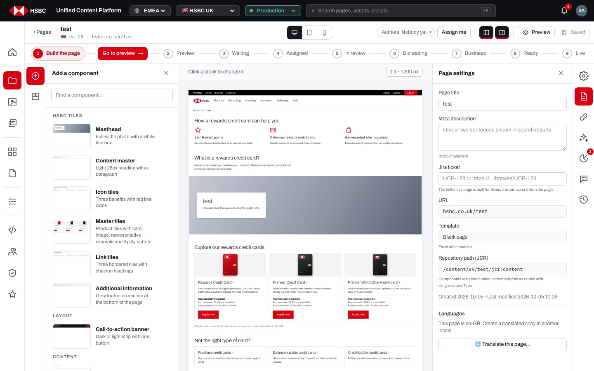
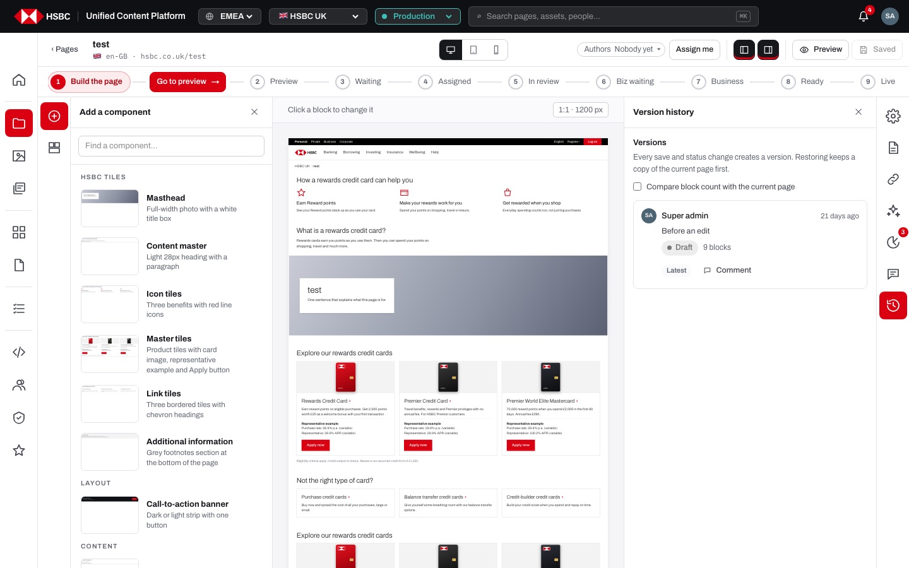
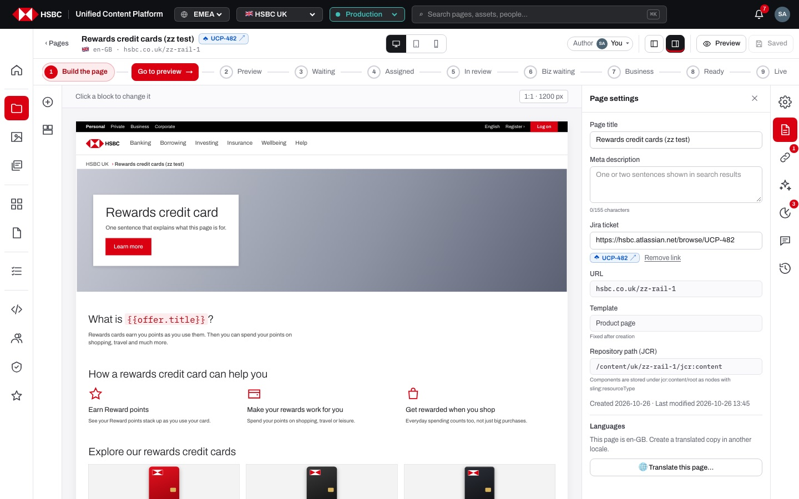
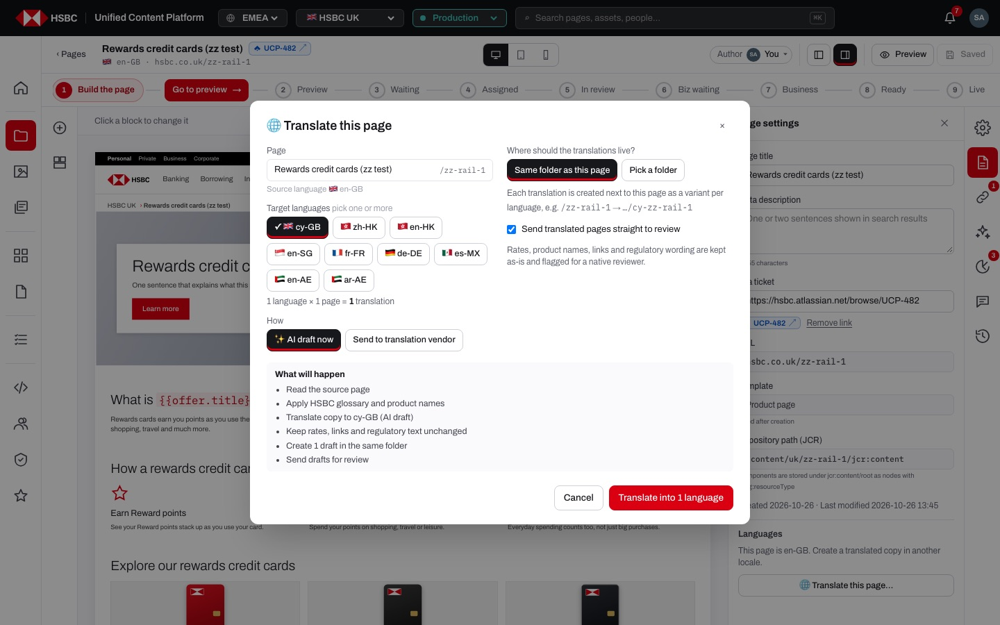
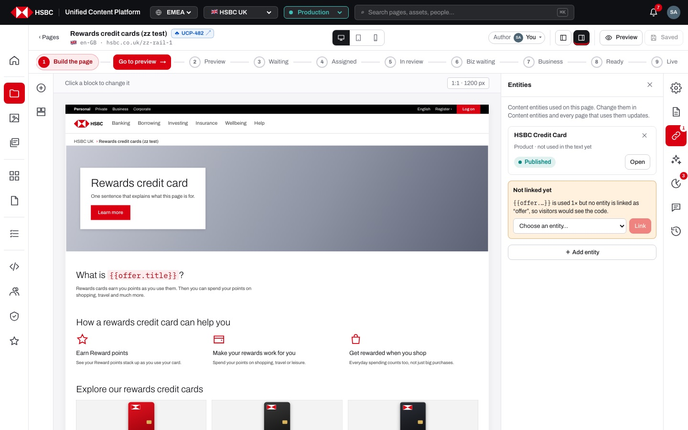
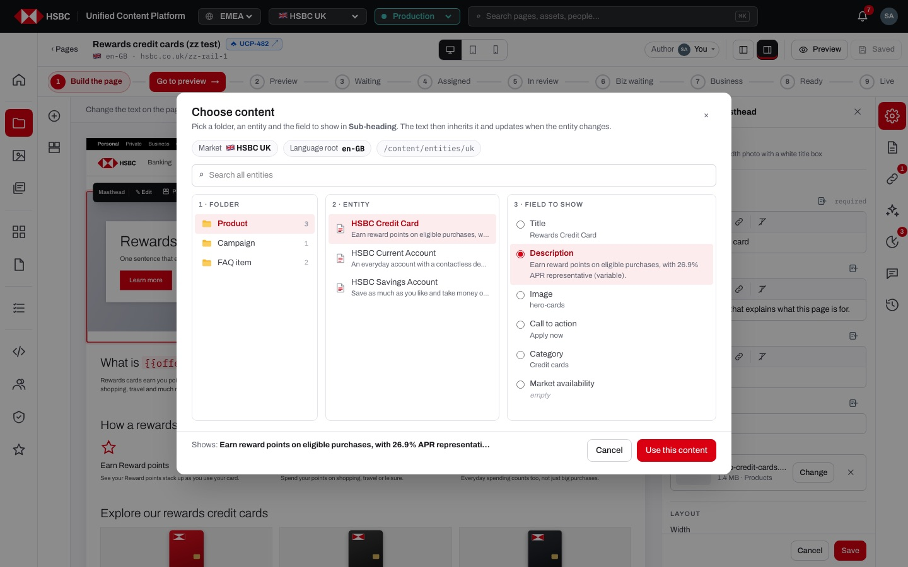
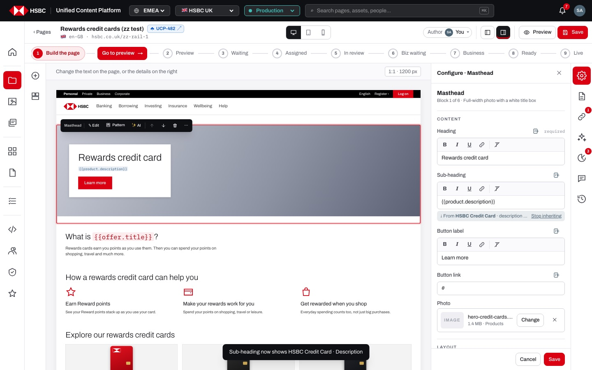
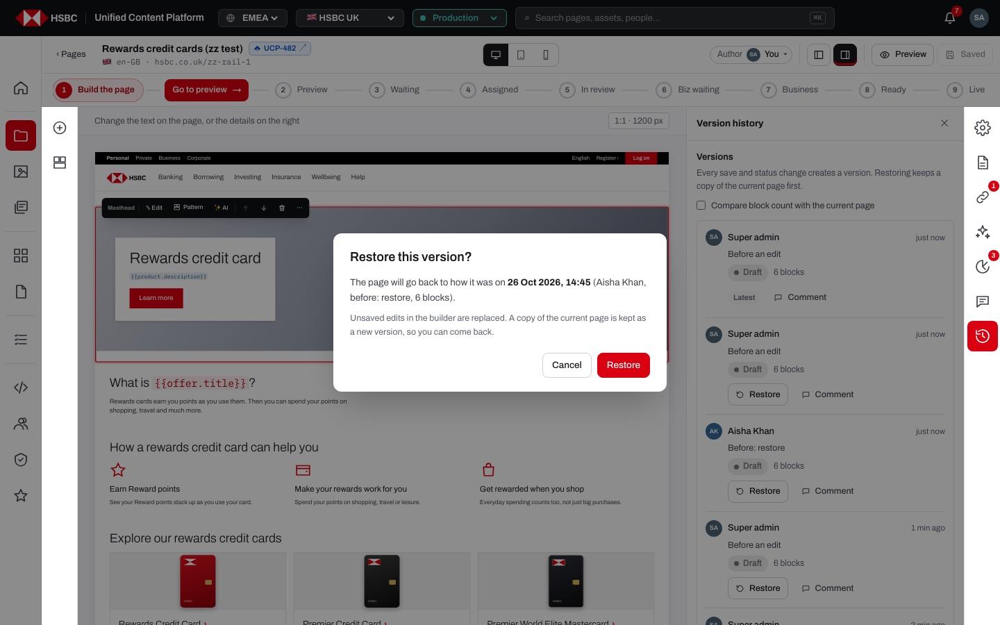
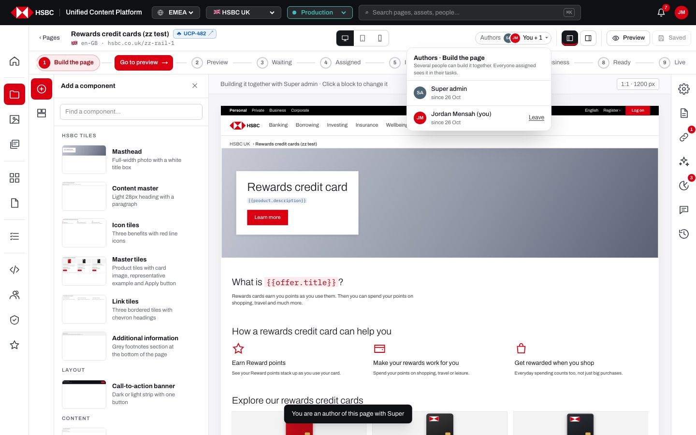

# EP-06 · Page builder · Page settings, linked content & collaboration

**Epic:** EP-06 · Page builder · Page settings, linked content & collaboration

**Business benefit:** Everything authors need around the page itself (search metadata, the Jira request behind it, shared content, its history and who is building it) sits next to the canvas, so pages are finished without switching tools. The bank gets traceable, consistent pages whose shared figures are maintained once and whose every change can be reviewed and reversed.

**Scope:** The page builder's right rail and its panels other than Configure, Insights, AI and Comments: Page settings (title, meta description, Jira ticket, URL, template, JCR path, dates, Translate this page), Entities and the content picker for {{tokens}}, Version history, and the co-authors chip in the top bar. It also covers how the right rail itself works (icons, badges, one panel at a time, resizing, read-only veil).

**The view:**




- **Top bar** · page title with its Jira chip (for example "UCP-482 ↗"), the Authors chip ("Author · You", "You + 1") with "Assign me", and the "Page settings panel" toggle that opens or closes the right panel.
- **Hint bar** · above the canvas; at Build the page it also says who is building the page ("Super admin is building this page · Assign me to work on it with them", "Building it together with …").
- **Right rail** · a 52 px column of seven icons: Component settings (Configure), Page settings, Entities, AI assistant, Page insights, Comments, Version history. Badges show linked entities, open AI tasks, must-fix insights and open comments. Only one panel is open at a time; clicking the active icon (or the empty rail) closes it.
- **Right panel** · opens to the left of the rail with a title and ✕. Its left edge can be dragged between 260 and 560 px (remembered per browser); Version history and Comments are at least 400 px wide.
- **Page settings** · Page title, Meta description with a "0/155 characters" counter, Jira ticket, URL, Template ("Fixed after creation"), Repository path (JCR), Created / Last modified, and "🌐 Translate this page…".
- **Entities** · the content entities linked to the page, with model, use count, status and Open; a "Not linked yet" box for tokens without an entity; "＋ Add entity".
- **Version history** · every saved version with who, when, what happened, status and block count, "Compare block count with the current page", Restore and Comment.


*Page settings with the Jira ticket linked: the chip "UCP-482 ↗" shows in the field and next to the page title.*


*"🌐 Translate this page" for one page: target languages, AI draft or translation vendor, destination folder and what will happen.*


*Entities: a linked entity with status and Open, and a "Not linked yet" box offering to link {{offer.…}}.*


*Choose content: Folder → Entity → Field to show, with a preview of what the text will show.*


*After "Use this content" the field holds {{product.description}} and says "From HSBC Credit Card · description" with "Stop inheriting".*


*Restoring an older version asks first and keeps a copy of the current page.*


*The Authors chip opened: two authors building the page together, with Leave for yourself.*

**Stories (14):**

1. [US-06.01 · Right rail: icons with badges, one panel at a time, resizable panel](#us-0601--right-rail-icons-with-badges-one-panel-at-a-time-resizable-panel)
2. [US-06.02 · Right rail on a page I cannot change: panels open, editing panels veiled](#us-0602--right-rail-on-a-page-i-cannot-change-panels-open-editing-panels-veiled)
3. [US-06.03 · Page settings: page title, meta description with counter, URL, template, JCR path and dates](#us-0603--page-settings-page-title-meta-description-with-counter-url-template-jcr-path-and-dates)
4. [US-06.04 · Jira link: attach a Jira ticket to a page and open it from the builder and My tasks](#us-0604--jira-link-attach-a-jira-ticket-to-a-page-and-open-it-from-the-builder-and-my-tasks)
5. [US-06.05 · Translate this page: create translated drafts of one page in other languages](#us-0605--translate-this-page-create-translated-drafts-of-one-page-in-other-languages)
6. [US-06.06 · Entities panel: see the content entities a page uses, their status and where to edit them](#us-0606--entities-panel-see-the-content-entities-a-page-uses-their-status-and-where-to-edit-them)
7. [US-06.07 · Linked content: link an entity and use its fields as {{tokens}} in the page](#us-0607--linked-content-link-an-entity-and-use-its-fields-as-tokens-in-the-page)
8. [US-06.08 · Content picker: browse folder, entity and field and preview what the text will show](#us-0608--content-picker-browse-folder-entity-and-field-and-preview-what-the-text-will-show)
9. [US-06.09 · Content while typing: type {{ or use the content icon to insert a token at the caret](#us-0609--content-while-typing-type--or-use-the-content-icon-to-insert-a-token-at-the-caret)
10. [US-06.10 · Linked content checks: stop inheriting, flag unlinked tokens, protect entities in use](#us-0610--linked-content-checks-stop-inheriting-flag-unlinked-tokens-protect-entities-in-use)
11. [US-06.11 · Version history: see every saved version with who, when, status and block count](#us-0611--version-history-see-every-saved-version-with-who-when-status-and-block-count)
12. [US-06.12 · Version history: restore or comment on any saved version](#us-0612--version-history-restore-or-comment-on-any-saved-version)
13. [US-06.13 · Co-authors: join or leave the authors of a page at Build the page](#us-0613--co-authors-join-or-leave-the-authors-of-a-page-at-build-the-page)
14. [US-06.14 · Co-authors (admin): site admin adds or removes other people as authors](#us-0614--co-authors-admin-site-admin-adds-or-removes-other-people-as-authors)

---

## US-06.01 · Right rail: icons with badges, one panel at a time, resizable panel

**Business benefit:** Authors reach settings, shared content, checks, AI, comments and history from one fixed place, so they spend less time hunting for tools. The page stays visible while a panel is open, which cuts errors from working blind.

**User story:**

As a content author  
I want a rail of panel icons on the right of the builder that opens one panel at a time  
So that page-level tools are always one click away without hiding the page  

**Persona:** content author · **Depends on:** US-03.03

**Acceptance criteria:**

**Background** (applies to every scenario below)

```gherkin
Given I am signed in with Edit on the page "Rewards credit cards"
And the page is at "Build the page"
```

**Scenario 1 · The rail and its icons**

```gherkin
When I open the page in the builder
Then the right rail shows the icons "Component settings", "Page settings", "Entities", "AI assistant", "Page insights", "Comments" and "Version history"
And no right panel is open yet
```

**Scenario 2 · One panel at a time**

```gherkin
When I click "Page settings" in the rail
Then the panel "Page settings" opens next to the rail and its icon is highlighted
When I click "Entities"
Then "Entities" replaces "Page settings" in the same panel
When I click "Entities" again, or the ✕ in the panel header, or the empty part of the rail
Then the panel closes
```

**Scenario 3 · Badges** *(one run per row of the table)*

```gherkin
Given <situation>
Then the "<icon>" icon shows the badge "<badge>"

Examples:
  | situation                                     | icon            | badge |
  | 1 content entity is linked to the page        | Entities        | 1     |
  | Page insights has 3 findings under "Must fix"  | Page insights   | 3     |
  | the page has 2 open (unresolved) comments     | Comments        | 2     |
  | 1 AI task is waiting for me to run its plan   | AI assistant    | 1     |
```

**Scenario 4 · Resizing the panel**

```gherkin
When I drag the left edge of the panel ("Drag to resize")
Then the panel gets wider or narrower, never below 260 px or above 560 px
And the width is remembered the next time I open the builder in this browser
And "Version history" and "Comments" are always at least 400 px wide
```

**Scenario 5 · Top bar toggle**

```gherkin
Given no component is selected
When I click "Page settings panel" in the top bar
Then the panel opens on "Page settings"
Given a component is selected
When I click "Page settings panel"
Then the panel opens on "Configure" for that component
```

**Scenario 6 · Preview and phones**

```gherkin
When I switch to Preview
Then the rails and panels are hidden
When I open the builder on a phone
Then the rail sits at the bottom of the screen with the left-panel icons first
And a right panel covers the page and closes the left panel
```

---

## US-06.02 · Right rail on a page I cannot change: panels open, editing panels veiled

**Business benefit:** Reviewers and viewers can still inspect settings, shared content, findings and history without being able to change anything, which keeps access control intact. They are told why and how to get back to editing, which cuts support requests.

**User story:**

As a business owner  
I want the panels of a page I may only read, or that is in review or live, to open but not let me change it  
So that I can see everything about the page without breaking the workflow or permissions  

**Persona:** business owner · **Depends on:** US-06.01, US-08.04

**Acceptance criteria:**

**Scenario 1 · No Edit on the folder**

```gherkin
Given I am signed in as "aisha.khan" with Read and Review but no Edit on the page
When I open the page
Then I see the page as visitors see it, with the right rail still available
And the hint bar says the page is being built by its authors
When I open "Component settings" or "AI assistant"
Then the panel content is blurred with "🔒 Not editable right now" and "You don't have Edit on this folder. Ask a site admin to grant it."
And the Entities panel lists the entities without "＋ Add entity", ✕ or "Link"
```

**Scenario 2 · Page in review or live**

```gherkin
Given the page is "In author's review"
When I open "Component settings" or "AI assistant"
Then I see "Not editable right now" with "The page is in the author's review. Editing takes it out of the review queue."
And the button "✎ Edit the page" takes the page back to editing
And Page settings, Entities, Page insights, Comments and Version history stay open without the veil
```

**Scenario 3 · Locked by someone else**

```gherkin
Given "Jordan Mensah" locked the page in Pages
And I am not a site admin
When I open "Component settings"
Then the veil says "Locked by Jordan Mensah. Ask them or a site admin to unlock it in Pages."
```

---

## US-06.03 · Page settings: page title, meta description with counter, URL, template, JCR path and dates

**Business benefit:** Search titles and descriptions are written where the page is built, which improves how HSBC pages appear in search results. Technical facts such as the URL and repository path are visible to authors, reducing questions to developers.

**User story:**

As a content author  
I want to edit the page title and meta description and see the page's URL, template, repository path and dates  
So that the page is described correctly in search and I know exactly what I am editing  

**Persona:** content author · **Depends on:** US-06.01, US-04.14

**Acceptance criteria:**

**Background** (applies to every scenario below)

```gherkin
Given I am signed in with Edit on the page "Rewards credit cards" at "/content/uk/rewards-credit-cards"
And I open "Page settings" in the right rail
```

**Scenario 1 · Page title**

```gherkin
When I change "Page title" to "Rewards credit cards"
Then the title in the top bar and the breadcrumb on the page change as I type
And the page is saved automatically a moment later
```

**Scenario 2 · Meta description counter** *(one run per row of the table)*

```gherkin
When I type <n> characters into "Meta description"
Then the counter under the field says "<n>/155 characters" in <colour>

Examples:
  | n   | colour |
  | 0   | grey   |
  | 155 | grey   |
  | 160 | red    |
```

**Scenario 3 · Page facts**

```gherkin
Then I see "URL" as "hsbc.co.uk/rewards-credit-cards"
And "Template" as "Product page" with "Fixed after creation"
And "Repository path (JCR)" as "/content/uk/rewards-credit-cards/jcr:content" with "Components are stored under jcr:content/root as nodes with sling:resourceType"
And "Created <date> · Last modified <date and time>"
```

**Scenario 4 · An empty description is flagged**

```gherkin
Given "Meta description" is empty
Then the field shows "One or two sentences shown in search results"
And Page insights lists "No page description" under "Should fix"
```

---

## US-06.04 · Jira link: attach a Jira ticket to a page and open it from the builder and My tasks

**Business benefit:** Every page change is traceable to the business request behind it, which supports audit and change management. Reviewers reach the context in one click, speeding up approval.

**User story:**

As a content author  
I want to link the page to its Jira ticket and open it in one click  
So that the work is traceable to the request behind it  

**Persona:** content author · **Depends on:** US-06.03

**Acceptance criteria:**

**Scenario 1 · Linking a ticket** *(one run per row of the table)*

```gherkin
When I enter "<input>" into "Jira ticket" in Page settings and click "Save" (or press Enter)
Then <outcome>

Examples:
  | input                                 | outcome                                                                                |
  | ucp-482                               | I see "Jira ticket linked" and the chip "UCP-482 ↗" links to https://hsbc.atlassian.net/browse/UCP-482 |
  | https://jira.example.com/browse/MKT-7 | the chip "MKT-7 ↗" links to that address                                                |
  | not a link                            | I see "Paste a Jira link (https://…) or a ticket key like UCP-123" and nothing is saved  |
  | http://jira.example.com/browse/MKT-7  | I see "Paste a Jira link (https://…) or a ticket key like UCP-123" and nothing is saved  |
```

**Scenario 2 · Opening the ticket**

```gherkin
Given the page is linked to "UCP-482"
When I click the Jira chip next to the page title, in Page settings or in My tasks
Then the ticket opens in a new tab
```

**Scenario 3 · Removing the link**

```gherkin
Given the page is linked to "UCP-482"
When I click "Remove link" under the chip in Page settings
Then I see "Jira link removed"
And the chip disappears from the top bar
And the field says "The ticket this page is built for. Everyone can open it from the page."
```

**Scenario 4 · Who may link a ticket**

```gherkin
Given I have neither Edit nor Review on the page and I am not a site admin
When I try to link a Jira ticket
Then I see "Only people working on this page can link a Jira ticket"
And the audit log records every link and removal, e.g. "linked Rewards credit cards to Jira UCP-482"
```

---

## US-06.05 · Translate this page: create translated drafts of one page in other languages

**Business benefit:** Local-language versions of a page start from the approved source in minutes instead of being rebuilt by hand, shortening time to market in multilingual markets. Rates, product names and regulatory wording are kept as they are, reducing translation risk.

**User story:**

As a content author  
I want to create translated copies of the page I am building in one or more languages  
So that every market language gets the same page without rebuilding it  

**Persona:** content author · **Depends on:** US-06.03 · **Note:** runs on a stand-in (mock) today

**Acceptance criteria:**

**Background** (applies to every scenario below)

```gherkin
Given I am signed in with Edit on the page "Rewards credit cards" in the market "HSBC UK" (en-GB)
And I click "🌐 Translate this page…" under "Languages" in Page settings
```

**Scenario 1 · The dialog**

```gherkin
Then the dialog "🌐 Translate this page" shows the page, its path and "Source language 🇬🇧 en-GB"
And "Target languages" lists the market's other locale and the locales of other HSBC markets, with "cy-GB" ticked
And it says "1 language × 1 page = 1 translation"
And "How" offers "✨ AI draft now" and "Send to translation vendor"
And "Where should the translations live?" offers "Same folder as this page" and "Pick a folder"
And "What will happen" lists the steps, e.g. "Keep rates, links and regulatory text unchanged"
```

**Scenario 2 · Nothing chosen**

```gherkin
When I untick every target language
Then the button says "Translate into … languages" and is disabled
```

**Scenario 3 · Creating the translations**

```gherkin
When I tick "cy-GB" and click "Translate into 1 language"
Then I see "✓ Translations created" with every step ticked
And "Created 1 page. Each draft links back to “Rewards credit cards”."
And the new page "/cy-rewards-credit-cards" is listed next to the source page
And "Open the first draft" opens it in the builder
```

**Scenario 4 · A translation that already exists**

```gherkin
Given "/cy-rewards-credit-cards" already exists
When I translate the page into "cy-GB" again
Then that page is listed with "already existed · skipped" and is not overwritten
```

**Scenario 5 · Another folder**

```gherkin
When I choose "Pick a folder" and enter "/content/uk/borrowing" as "Folder path"
Then the translations are created in that folder
And "What will happen" says "Create 1 draft in the chosen folder"
```

---

## US-06.06 · Entities panel: see the content entities a page uses, their status and where to edit them

**Business benefit:** Authors see at a glance which shared product data a page depends on and whether it is published, so outdated or draft figures are spotted before review. One click takes them to the place where that content is maintained.

**User story:**

As a content author  
I want a list of the content entities linked to the page with their model, use count and status  
So that I know which shared content the page relies on and can open it  

**Persona:** content author · **Depends on:** US-06.01, US-13.03

**Acceptance criteria:**

**Scenario 1 · No entities yet**

```gherkin
Given no entity is linked to the page
When I open "Entities" in the right rail
Then I see "Content entities used on this page. Change them in Content entities and every page that uses them updates."
And "No entities on this page" with "Add one to reuse its text here."
```

**Scenario 2 · A linked entity**

```gherkin
Given "HSBC Credit Card" of the model "Product" is linked and used once in the text
Then the row shows "HSBC Credit Card", "Product · used 1× in the text" and the status "Published"
And the Entities icon in the rail shows the badge "1"
When I click "Open"
Then Content entities opens on "HSBC Credit Card"
```

**Scenario 3 · Status** *(one run per row of the table)*

```gherkin
Given the linked entity is <state>
Then its row shows the status "<status>"

Examples:
  | state                                   | status    |
  | published                               | Published |
  | never published                         | Draft     |
  | published with unpublished changes      | Modified  |
```

**Scenario 4 · Reading only**

```gherkin
Given I have no Edit on the page, or the page is in review, approved or live
Then the list has no "＋ Add entity", no ✕ and no "Link"
And an empty list says "Nothing on this page comes from content entities."
```

---

## US-06.07 · Linked content: link an entity and use its fields as {{tokens}} in the page

**Business benefit:** Rates and product details are maintained once and update everywhere, cutting maintenance effort. It removes the risk of customers seeing outdated or conflicting figures on different pages.

**User story:**

As a content author  
I want to link an entity to the page and use its fields in text and component fields  
So that a change to the content appears on every page that uses it  

**Persona:** content author · **Depends on:** US-06.06, US-13.03

**Acceptance criteria:**

**Background** (applies to every scenario below)

```gherkin
Given I am signed in with Edit on the page "Rewards credit cards" at "Build the page"
And the entity "HSBC Credit Card" of the model "Product" exists
```

**Scenario 1 · Linking an entity to the page**

```gherkin
When I open "Entities" in the right rail and click "＋ Add entity"
Then "Entity" lists the entities that are not linked yet, grouped by model, with "(draft)" after drafts
When I choose "HSBC Credit Card" and click "Add"
Then it is linked with the alias "product"
And I see "Added HSBC Credit Card · use {{product.title}} in text"
And the audit log says "linked 1 content entity to" the page
```

**Scenario 2 · Aliases are unique**

```gherkin
Given "HSBC Credit Card" is already linked as "product"
When I add "HSBC Savings Account" of the same model
Then it is linked as "product2"
```

**Scenario 3 · Choosing content for a component field**

```gherkin
Given the "Masthead" is selected and Configure is open
When I click "Choose content from an entity" next to "Sub-heading"
And I choose the folder "Product", the entity "HSBC Credit Card" and the field "Description"
And I click "Use this content"
Then the field holds "{{product.description}}"
And I see "Sub-heading now shows HSBC Credit Card · Description"
And the field says "⤓ From HSBC Credit Card · description · “Earn reward points on eligible purchases”"
And Preview shows the entity's description, not the token
```

**Scenario 4 · An entity chosen in the picker is linked automatically**

```gherkin
Given "HSBC Current Account" is not linked to the page
When I use one of its fields through "Choose content"
Then it is added to the Entities panel with a new alias before the token is inserted
```

---

## US-06.08 · Content picker: browse folder, entity and field and preview what the text will show

**Business benefit:** Authors find the right approved content quickly instead of copying text by hand, so pages reuse the bank's single source of truth. Seeing the exact value before using it prevents wrong figures from being linked.

**User story:**

As a content author  
I want a three-column picker of folders, entities and fields with search and a preview  
So that I can pick exactly the shared content a text should show  

**Persona:** content author · **Depends on:** US-06.07

**Acceptance criteria:**

**Background** (applies to every scenario below)

```gherkin
Given I clicked "Choose content from an entity" next to the "Heading" field
```

**Scenario 1 · Layout**

```gherkin
Then the dialog "Choose content" says "Pick a folder, an entity and the field to show in Heading. The text then inherits it and updates when the entity changes."
And it shows the chips "Market 🇬🇧 HSBC UK", "Language root en-GB" and "/content/entities/uk"
And the columns "1 · Folder", "2 · Entity" and "3 · Field to show"
And the first model with entities is open, e.g. "Product 3"
And "3 · Field to show" says "Choose an entity to see its fields."
```

**Scenario 2 · Folders, entities and fields**

```gherkin
When I click the folder "Product"
Then "2 · Entity" lists its entities with a short description, and "Draft" or "Modified" on unpublished ones
When I click "HSBC Credit Card"
Then "3 · Field to show" lists "Title" and the model's fields with their current values, or "empty"
And the first field is chosen
When I choose "Description"
Then the footer says "Shows: Earn reward points on eligible purchases, with 26.9% APR representati…"
```

**Scenario 3 · Search** *(one run per row of the table)*

```gherkin
When I type "<query>" into "Search all entities"
Then "2 · Entity · search results" shows <result>

Examples:
  | query   | result                     |
  | savings | "HSBC Savings Account"     |
  | zzzz    | "Nothing matches."         |
```

**Scenario 4 · Use or cancel**

```gherkin
Given no entity and field are chosen
Then "Use this content" is disabled
When I click "Cancel" or ✕
Then nothing changes
```

**Scenario 5 · No entities in the market**

```gherkin
Given the market has no content entities
Then "1 · Folder" says "No entities yet. Create them in Content entities."
```

---

## US-06.09 · Content while typing: type {{ or use the content icon to insert a token at the caret

**Business benefit:** Shared figures can be dropped into a sentence without leaving the text, so authors reuse approved content instead of retyping it. Fewer copied numbers means fewer outdated rates on live pages.

**User story:**

As a content author  
I want to insert an entity field into the text I am typing on the page  
So that one sentence can mix my words with shared content  

**Persona:** content author · **Depends on:** US-06.08, US-04.07

**Acceptance criteria:**

**Background** (applies to every scenario below)

```gherkin
Given I am editing the heading "What is a card? " on the page
```

**Scenario 1 · Typing {{**

```gherkin
When I type "{{"
Then "Choose content" opens
When I choose "HSBC Credit Card" and "Title" and click "Use this content"
Then "{{product.title}}" is inserted where I typed "{{"
And I see "Inserted HSBC Credit Card · Title. Click outside or ✓ Save."
```

**Scenario 2 · The content icon**

```gherkin
When I click the round content icon next to the text, or the content icon in the "Editing text" bar
Then "Choose content" opens for "this text"
And the chosen token is inserted at the caret
```

**Scenario 3 · Tokens while editing**

```gherkin
Given the heading contains "{{product.title}}"
Then on the canvas the token is shown as code while I build the page
And in Preview it shows "Rewards Credit Card"
```

**Scenario 4 · Cancelling the picker**

```gherkin
When I type "{{" and then click "Cancel" in "Choose content"
Then the "{{" I typed stays in the text and I can keep typing
```

---

## US-06.10 · Linked content checks: stop inheriting, flag unlinked tokens, protect entities in use

**Business benefit:** Broken or missing shared content is flagged before it reaches customers, protecting accuracy of regulated information. Authors can still detach content deliberately, with a clear trace.

**User story:**

As a content author  
I want to detach a field on purpose and be warned about tokens and entities that do not match  
So that the page never shows broken or missing shared content  

**Persona:** content author · **Depends on:** US-06.07

**Acceptance criteria:**

**Background** (applies to every scenario below)

```gherkin
Given the entity "HSBC Credit Card" is linked to the page as "product"
```

**Scenario 1 · Stop inheriting**

```gherkin
Given the "Sub-heading" field holds "{{product.description}}"
When I click "Stop inheriting" under the field in Configure
Then the token is replaced by the entity's current text
And the field no longer follows changes to the entity
```

**Scenario 2 · Tokens for entities that are not linked**

```gherkin
Given the heading contains "{{offer.title}}" but no entity is linked as "offer"
Then Entities shows "Not linked yet" with "{{offer.…}} is used 1× but no entity is linked as “offer”, so visitors would see the code."
And Page insights reports "Broken content link in Content master" under "Must fix"
And a field holding only that token says "Not linked to an entity on this page"
When I choose an entity in "Choose an entity…" and click "Link"
Then I see "Linked “offer” to <entity>" and the warning disappears
```

**Scenario 3 · An entity in use cannot be removed**

```gherkin
Given "{{product.…}}" is used 2 times in the text
Then the entity shows "used 2× in the text" and has no remove button
```

**Scenario 4 · Removing an unused entity**

```gherkin
Given the entity is "not used in the text yet"
When I click ✕ "Remove from this page"
Then I see "Removed HSBC Credit Card from this page"
```

**Scenario 5 · Only editors change links**

```gherkin
Given I have no Edit on the page
When the page tries to save its linked entities
Then I see "You don't have Edit on this page"
```

---

## US-06.11 · Version history: see every saved version with who, when, status and block count

**Business benefit:** A complete, readable trail of every save and status change supports audit and regulatory record-keeping. Authors and reviewers can see at a glance what changed and when, which shortens investigations.

**User story:**

As a content author  
I want a list of every version of the page with who made it, when, why, its status and size  
So that I can understand how the page got to where it is  

**Persona:** content author · **Depends on:** US-06.01, US-04.14

**Acceptance criteria:**

**Background** (applies to every scenario below)

```gherkin
Given the page "Rewards credit cards" has been saved several times
And I open "Version history" in the right rail
```

**Scenario 1 · The list**

```gherkin
Then I see "Versions" and "Every save and status change creates a version. Restoring keeps a copy of the current page first."
And each version shows the person's avatar and name, a relative time such as "2 min ago" (full date on hover)
And what happened, e.g. "Before an edit" or "Before: restore"
And the status pill and the block count, e.g. "Draft · 6 blocks"
And the newest version is marked "Latest" instead of "Restore"
```

**Scenario 2 · Compare block count**

```gherkin
Given the page now has 7 blocks
When I tick "Compare block count with the current page"
Then I see "The page now has 7 blocks. Each version shows how its block count differs."
And a version with 6 blocks shows "-1 vs now", one with 7 shows "same as now"
```

**Scenario 3 · No versions yet**

```gherkin
Given the page has never been saved after it was created
Then I see "No versions yet — every save and status change creates one."
```

---

## US-06.12 · Version history: restore or comment on any saved version

**Business benefit:** Any mistake can be reversed quickly, limiting the impact of an incorrect change. A full version history supports audit and regulatory record-keeping.

**User story:**

As a content author  
I want to restore an earlier version or comment on it  
So that any change can be reversed and discussed  

**Persona:** content author · **Depends on:** US-06.11, US-08.16

**Acceptance criteria:**

**Scenario 1 · Restoring a version**

```gherkin
When I click "Restore" on an earlier version
Then I see "Restore this version?" with "The page will go back to how it was on <date> (<person>, <what happened>, <n> blocks)."
And "Unsaved edits in the builder are replaced. A copy of the current page is kept as a new version, so you can come back."
When I click "Restore"
Then the page goes back to that version and the builder reloads ("Version restored · reloading")
And the version before the restore is kept as "Before: restore"
And the audit log says "restored version <id> of" the page
```

**Scenario 2 · Changing my mind**

```gherkin
When I click "Restore" and then "Cancel"
Then nothing changes
```

**Scenario 3 · Commenting on a version**

```gherkin
When I click "Comment" on a version
Then the Comments panel opens with the comment box focused
And the comment says "About the version from <date> · <person>"
And ✕ removes that reference before I post
```

---

## US-06.13 · Co-authors: join or leave the authors of a page at Build the page

**Business benefit:** Larger pages are delivered faster because several authors can share the work. Clear ownership means reviewers and managers always know who is responsible.

**User story:**

As a content author  
I want to join or leave the authors of a page while it is being built  
So that we can share the work and everyone sees who is responsible  

**Persona:** content author · **Depends on:** US-03.03

**Acceptance criteria:**

**Scenario 1 · Joining as an author**

```gherkin
Given "Super admin" created the page and is its only author
And I am signed in as "jordan.mensah" with Edit
Then the Authors chip in the top bar shows "Author" with "Super admin"
And the hint says "Super admin is building this page · Assign me to work on it with them"
When I click "Assign me"
Then I see "You are an author of this page with Super"
And the Authors chip shows "Authors" and "You + 1"
And the hint says "Building it together with Super admin · Click a block to change it"
```

**Scenario 2 · The authors list**

```gherkin
When I click the Authors chip
Then "Authors · Build the page" says "Several people can build it together. Everyone assigned sees it in their tasks."
And it lists every author with "since <date>" and "(you)" after my own name
And "Assign me too" is offered while I am not an author
```

**Scenario 3 · Leaving**

```gherkin
When I click "Leave" next to my name in the Authors list
Then I see "You are no longer an author of this page"
And the audit log says "left <page> (no longer an author)"
```

**Scenario 4 · Authors are fixed after the first stage**

```gherkin
Given the page was sent for review
Then the Authors chip is no longer shown in the top bar
When anyone changes the authors
Then they see "Authors can only change while the page is at Build the page"
```

**Scenario 5 · Only people with Edit can join**

```gherkin
Given I have Read and Review but no Edit on the page
Then there is no "Assign me" button
And the hint says "Super admin is building this page" without the invitation
```

**Scenario 6 · Co-authors in My tasks**

```gherkin
Given the page has 2 authors
Then My tasks shows the second one under the Content author as "+ Name"
```

---

## US-06.14 · Co-authors (admin): site admin adds or removes other people as authors

**Business benefit:** Managers can hand out work deliberately and keep delivery on schedule. Every assignment is logged and limited to people with Edit, keeping access controlled.

**User story:**

As a site admin  
I want to add or remove other people as authors of a page  
So that work is handed out deliberately and nobody is assigned behind their back  

**Persona:** site admin · **Depends on:** US-06.13 · **Note:** site admin only

**Acceptance criteria:**

**Scenario 1 · A site admin adds an author**

```gherkin
Given I am signed in as "super.admin"
When I choose "Rachel Hughes" in "Add a person…" in the Authors list and click "Add"
Then I see "Rachel Hughes can now build this page too"
And she is listed with a ✕ "Remove Rachel Hughes"
And the audit log says "assigned Rachel Hughes as an author of" the page
```

**Scenario 2 · The person must be able to edit**

```gherkin
When I add "Aisha Khan", who has Review but no Edit on the page
Then I see "Aisha Khan doesn't have Edit on this page"
And she is not added
```

**Scenario 3 · Removing an author**

```gherkin
When I click ✕ next to "Rachel Hughes"
Then I see "Removed from the authors"
And the audit log says "removed Rachel Hughes from the authors of" the page
```

**Scenario 4 · Only site admins assign other people**

```gherkin
Given I am not a site admin
Then the Authors list has no "Add a person…" and no ✕ next to other people
When I still try to add or remove "Rachel Hughes" as an author
Then I see "Only a site admin can assign other people"
```
