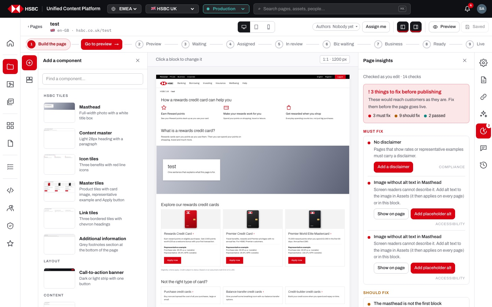
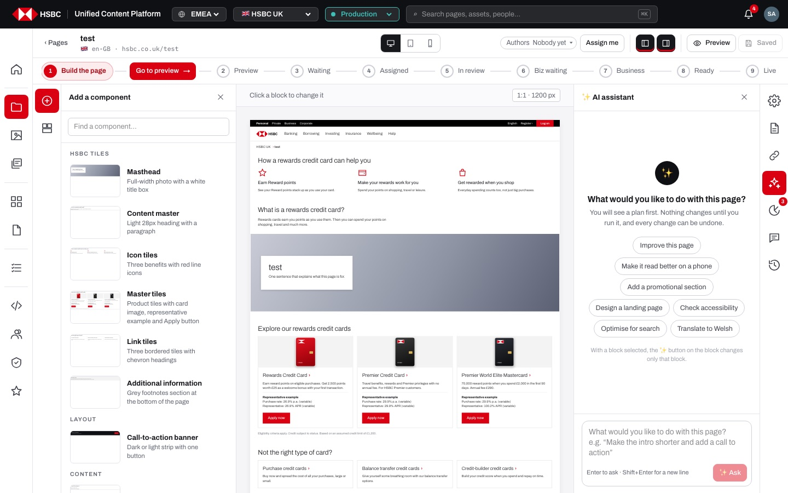
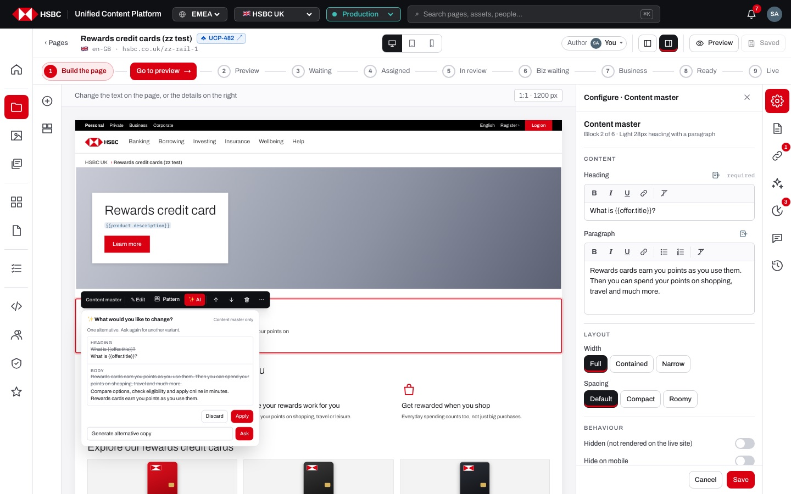
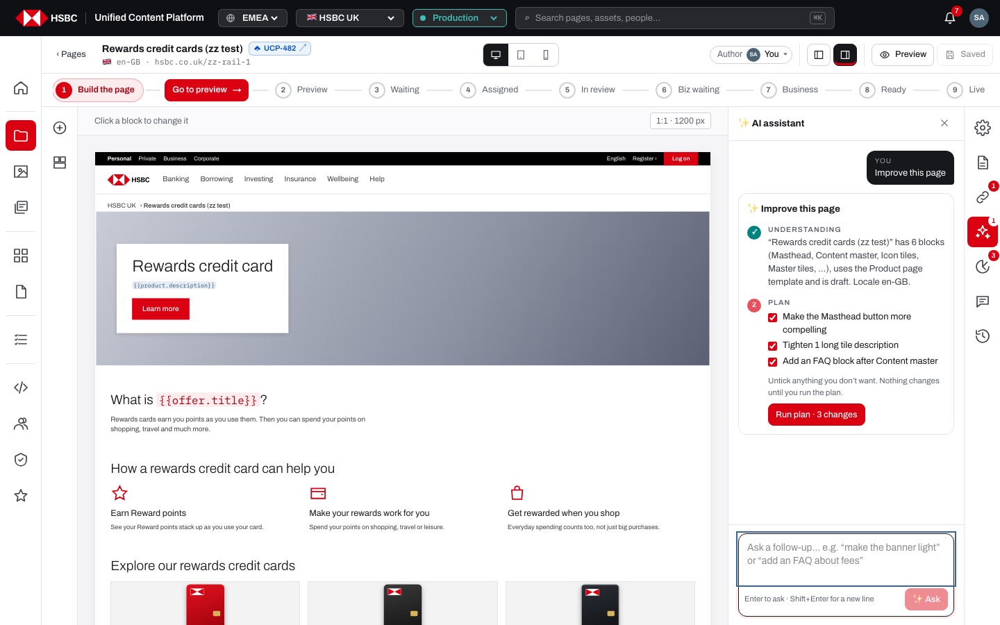
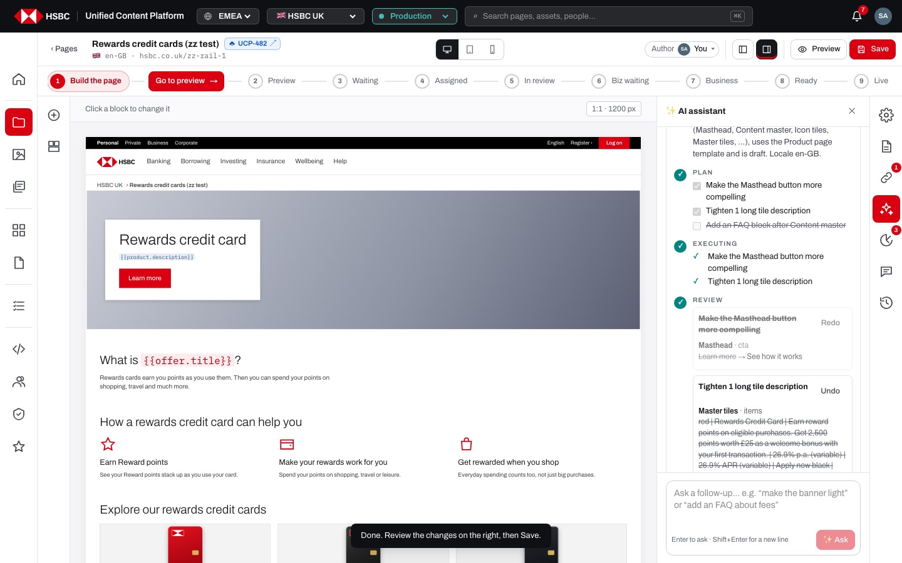
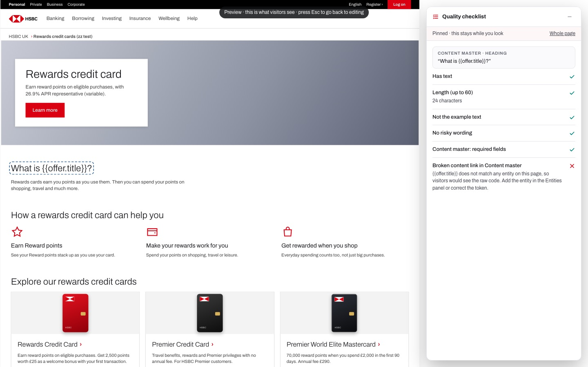

# EP-07 · Page builder · Quality checks & AI

**Epic:** EP-07 · Page builder · Quality checks & AI

**Business benefit:** Machine-checkable mistakes in content, compliance, accessibility and search are caught while the page is being built, so reviewers spend their time on substance and fewer flawed pages reach customers. AI help speeds up routine rewrites and page-wide fixes while every change stays visible, optional and reversible, keeping accountability with the author.

**Scope:** Page insights in the right rail (verdict, Must fix / Should fix / Checks passed, one-click fixes, Show on page, rail badge), the floating Quality checklist in the author's full-screen preview, the component ✨ AI popover, the page AI assistant panel (stages, plan, run, review, undo) and its ✨ entry in the command palette, and the read-only rules for AI. The AI runs on a deterministic offline stand-in (lib/ai/mock.ts, lib/ai/planner.ts) until the AI service is connected.

**The view:**




- **Right rail · Page insights** · "Checked as you edit · N checks", a verdict box ("! 3 things to fix before publishing", "Ready for review", "Ready to publish") with must-fix / should-fix / passed counts, the lists "Must fix" and "Should fix" with an area label (Content, Compliance, Accessibility, Search), "Show on page" and one-click fix buttons, and "Checks passed" folded away. The rail icon shows the number of must-fix findings.
- **Right rail · AI assistant** · an empty state "What would you like to do with this page?" with example prompts; each request becomes a task card with the stages Understanding, Plan, Executing, Review and Done; a prompt box at the bottom ("Enter to ask · Shift+Enter for a new line"). Earlier tasks stay above with "Earlier in this session".
- **Component toolbar · ✨ AI** · a popover "✨ What would you like to change?" scoped to the selected component ("Content master only"), with four suggestions, a before/after list and Apply / Discard.
- **Full-screen preview · Quality checklist** · a floating card on the right that checks the whole page, or the text, picture or component under the pointer; a click pins it.
- **Command palette (⌘K)** · in the builder, a "✨ Ask AI" section that starts an AI task.


*The ✨ AI popover on one component: the old text struck through above the suggestion, with Discard and Apply.*


*Page AI: the plan for "Improve this page" with every change ticked and "Run plan · 3 changes".*


*After the run: each change with its before → after, one already undone (Redo), and "Undo all".*


*The Quality checklist pinned on a heading: its own checks plus the broken content link Page insights found there.*

**Stories (9):**

1. [US-07.01 · Page insights verdict: can this page go out, with must fix, should fix and passed](#us-0701--page-insights-verdict-can-this-page-go-out-with-must-fix-should-fix-and-passed)
2. [US-07.02 · Page insights checks: content, accessibility, compliance and search findings](#us-0702--page-insights-checks-content-accessibility-compliance-and-search-findings)
3. [US-07.03 · Page insights fixes: one-click fixes and Show on page](#us-0703--page-insights-fixes-one-click-fixes-and-show-on-page)
4. [US-07.04 · Quality checklist: floating checks for the page and each element in the author's full-screen preview](#us-0704--quality-checklist-floating-checks-for-the-page-and-each-element-in-the-authors-full-screen-preview)
5. [US-07.05 · Component AI: suggest changes to one component with before/after and Apply](#us-0705--component-ai-suggest-changes-to-one-component-with-beforeafter-and-apply)
6. [US-07.06 · Page AI: ask for a page-wide change from the AI panel or the command palette](#us-0706--page-ai-ask-for-a-page-wide-change-from-the-ai-panel-or-the-command-palette)
7. [US-07.07 · Page AI: plan page-wide changes, run only the ticked ones, undo any](#us-0707--page-ai-plan-page-wide-changes-run-only-the-ticked-ones-undo-any)
8. [US-07.08 · Page AI: follow-up requests and earlier tasks in the same session](#us-0708--page-ai-follow-up-requests-and-earlier-tasks-in-the-same-session)
9. [US-07.09 · AI permissions: no AI changes for users who cannot edit the page](#us-0709--ai-permissions-no-ai-changes-for-users-who-cannot-edit-the-page)

---

## US-07.01 · Page insights verdict: can this page go out, with must fix, should fix and passed

**Business benefit:** Authors get a clear yes or no on whether the page is ready before they send it, which cuts review rounds. Managers can trust that pages entering review have already passed the bank's automatic checks.

**User story:**

As a content author  
I want a verdict at the top of Page insights with findings grouped by how serious they are  
So that I know at a glance whether the page can go to review and what to do first  

**Persona:** content author · **Depends on:** US-06.01

**Acceptance criteria:**

**Background** (applies to every scenario below)

```gherkin
Given I am signed in with Edit on the page "Rewards credit cards"
And I open "Page insights" in the right rail
```

**Scenario 1 · Verdict** *(one run per row of the table)*

```gherkin
Given the page has <must> must-fix and <should> should-fix findings and is <state>
Then the verdict says "<verdict>"

Examples:
  | must | should | state     | verdict                                         |
  | 3    | 2      | a draft   | ! 3 things to fix before publishing             |
  | 1    | 0      | live      | ! 1 thing to fix before the next publish        |
  | 0    | 2      | a draft   | Ready for review                                |
  | 0    | 2      | live      | Live, with suggestions                          |
  | 0    | 0      | a draft   | ✓ Ready to publish                              |
  | 0    | 0      | live      | ✓ Live and looking good                         |
```

**Scenario 2 · What the verdict explains**

```gherkin
Given a required field is empty
Then the verdict text says "Required content is missing, so the page cannot be sent for review yet."
Given only other must-fix findings exist
Then it says "These would reach customers as they are. Fix them before the page goes live."
Given only should-fix findings exist
Then it says "2 suggestions would make the page clearer or safer. They do not block publishing."
```

**Scenario 3 · Groups and counts**

```gherkin
Then the panel says "Checked as you edit · 9 checks" ("Checked against the live page" when live)
And the verdict shows "3 must fix", "2 should fix" and "4 passed"
And findings are listed under "Must fix" and "Should fix", each with its area: Content, Compliance, Accessibility or Search
And "Checks passed" is folded with its count and opens to show the passed checks by area
```

**Scenario 4 · Rail badge and hand-off**

```gherkin
Given the page has 3 must-fix findings
Then the "Page insights" icon in the rail shows "3"
And the badge updates as I edit, without opening the panel
And "Does everything look right?" after Preview says "Page insights found 3 things to fix. You can still send it, but the reviewer will see them."
```

---

## US-07.02 · Page insights checks: content, accessibility, compliance and search findings

**Business benefit:** Automatic checks catch accessibility, compliance and SEO issues before review, reducing regulatory and reputational risk. Reviewers spend their time on substance rather than mechanical mistakes.

**User story:**

As a content author  
I want the page checked against HSBC content, accessibility, compliance and search rules as I edit  
So that the page reaches review without mistakes a machine can find  

**Persona:** content author · **Depends on:** US-07.01, US-04.07

**Acceptance criteria:**

**Scenario 1 · Checks** *(one run per row of the table)*

```gherkin
Given <situation>
Then Page insights reports "<finding>" under "<level>"

Examples:
  | situation                                                 | finding                                            | level      |
  | the page has no components                                | The page is empty                                  | Must fix   |
  | a required field of the Masthead is empty                 | Masthead: “Heading” is empty                       | Must fix   |
  | the Masthead image has no alt text and is not decorative  | Image without alt text in Masthead                 | Must fix   |
  | the text uses {{offer.title}} but no "offer" is linked     | Broken content link in Content master              | Must fix   |
  | the page shows Rates or Master tiles but no Disclaimer    | No disclaimer                                      | Must fix   |
  | the page title is empty                                   | The page has no title                              | Must fix   |
  | the page has no Masthead                                  | No masthead at the top                             | Should fix |
  | the Masthead is not the first component                   | The masthead is not the first block                | Should fix |
  | a heading is 70 characters long                           | Heading too long in Content master (70 characters) | Should fix |
  | two components have the same heading                      | Duplicate heading “…”                              | Should fix |
  | a paragraph is longer than 180 characters                 | Long paragraph in Rich text (… characters)         | Should fix |
  | the Masthead button says "Learn more"                     | Vague button label “Learn more” in Masthead        | Should fix |
  | a form has no heading                                     | The form has no heading                            | Should fix |
  | the text says "guaranteed"                                | Wording needs legal review in Rich text            | Should fix |
  | a "rates" or "campaign" template page has no disclaimer   | No disclaimer                                      | Should fix |
  | the page title has fewer than 10 characters               | Title is very short (7 characters)                 | Should fix |
  | the page title has more than 60 characters                | Title is long (… characters)                       | Should fix |
  | the meta description is missing                           | No page description                                | Should fix |
```

**Scenario 2 · Content from the asset library counts**

```gherkin
Given the Masthead image has alt text in Assets
Then "Image in Masthead has alt text" is under "Checks passed" with "From the asset library: “…”"
Given the image is marked decorative in Assets
Then "Image in Masthead is decorative" is under "Checks passed"
```

**Scenario 3 · Every finding explains itself**

```gherkin
Then every finding has a one-line explanation, e.g. "Over 60 characters wraps to three lines on phones. Keep the first clause: “…”."
```

---

## US-07.03 · Page insights fixes: one-click fixes and Show on page

**Business benefit:** Common mistakes are corrected in one click with HSBC-approved wording, saving authoring time. Jumping straight to the affected component means problems are fixed in context rather than searched for.

**User story:**

As a content author  
I want to fix a finding in one click or jump to the component it is about  
So that I can clear the findings quickly and see what changed  

**Persona:** content author · **Depends on:** US-07.02

**Acceptance criteria:**

**Background** (applies to every scenario below)

```gherkin
Given I am signed in with Edit on the page "Rewards credit cards" at "Build the page"
And I open "Page insights" in the right rail
```

**Scenario 1 · One-click fixes** *(one run per row of the table)*

```gherkin
Given the finding "<finding>"
When I click "<fix>"
Then <result>
And I see "Fixed: <fix>" and the page is saved automatically

Examples:
  | finding                                   | fix                         | result                                                          |
  | Vague button label “Learn more” in Masthead | Rename to “Apply now”     | the Masthead button says "Apply now"                             |
  | Vague button label “Click here” in Call-to-action banner | Rename to “Apply now” | the banner button says "Apply now"                  |
  | Vague button label “Learn more” in Master tiles | Rename to “See the details” | that tile's button says "See the details"            |
  | No disclaimer                             | Add a disclaimer            | a Disclaimer is added at the bottom of the page                  |
  | Heading too long in Content master        | Shorten heading             | the heading is cut to its first clause                           |
  | Image without alt text in Masthead        | Add placeholder alt         | the alt text is set to the Masthead heading                      |
  | The masthead is not the first block       | Move to top                 | the Masthead moves to the top                                    |
  | No masthead at the top                    | Add a masthead              | a Masthead with the page title is added at the top              |
  | The form has no heading                   | Add “Apply online”          | the form heading says "Apply online"                             |
```

**Scenario 2 · Show on page**

```gherkin
When I click "Show on page" on "Broken content link in Content master"
Then the Content master is selected and scrolled into the middle of the canvas
And Page insights stays open
```

**Scenario 3 · Findings without a fix**

```gherkin
Given the finding "No page description"
Then it has neither "Show on page" nor a fix button, only the explanation "Add one in Page settings (about 150 characters)."
```

**Scenario 4 · Read-only**

```gherkin
Given I have no Edit on the page
When I click a fix button
Then I see "Read-only: ask a site admin for Edit" and nothing changes
```

---

## US-07.04 · Quality checklist: floating checks for the page and each element in the author's full-screen preview

**Business benefit:** Authors verify each element in the context customers see, catching issues earlier and more cheaply. A consistent checklist raises the baseline quality of every page.

**User story:**

As a content author  
I want a quality checklist that follows my pointer in full-screen preview  
So that I can check the whole page and each element as customers will see it  

**Persona:** content author · **Depends on:** US-04.16, US-07.02, US-12.09

**Acceptance criteria:**

**Background** (applies to every scenario below)

```gherkin
Given I have Edit on the page and it is at "Build the page"
And I clicked "Preview" (full screen)
```

**Scenario 1 · Whole page**

```gherkin
Given I am not pointing at anything
Then the floating "Quality checklist" says "Point at a text, a picture or a component to check it."
And it checks "Title tag" (with its length), "Meta description", "Canonical URL", "Page type", "One main heading (masthead)", "Required fields filled" and "Page insights"
And each check has a tick, an exclamation mark or a cross
And "To look at" lists up to 8 must-fix and should-fix findings
```

**Scenario 2 · A text** *(one run per row of the table)*

```gherkin
When I point at <element>
Then the checklist header says "<header>"
And it shows the checks <checks>

Examples:
  | element                | header                     | checks                                                                                                                      |
  | a heading              | Content master · Heading   | "Has text", "Length (up to 60)", "Not the example text", "No risky wording"                                                  |
  | a paragraph            | Rich text · Body           | "Has text", "Length (up to 180)", "Not the example text", "No risky wording"                                                 |
  | the Masthead button    | Masthead · Button label    | "Has text", "Length (up to 180)", "Not the example text", "Button says what happens", "No risky wording", "Button has a link" |
```

**Scenario 3 · Pictures and components**

```gherkin
When I point at the Masthead photo
Then the checklist shows "Alt text" with the alt text, "Marked decorative", "No photo chosen" or "No alt text · add it in Assets"
When I point at another part of a component
Then it shows "Whole component" with "<Component>: required fields"
And any finding Page insights has for that element is added, e.g. "Broken content link in Content master"
```

**Scenario 4 · Pinning**

```gherkin
When I click a heading
Then the checklist stays on it with "Pinned · this stays while you look"
And the heading keeps an outline while I move the pointer elsewhere
When I click the same heading again, or "Whole page"
Then the checklist follows the pointer again
And I can fold the checklist with its toggle and open it again
```

**Scenario 5 · Only for the author's draft**

```gherkin
Given the page is in review, approved or live, or I have no Edit
When I open the full-screen preview
Then there is no Quality checklist
```

---

## US-07.05 · Component AI: suggest changes to one component with before/after and Apply

**Business benefit:** AI speeds up copy improvements while the author keeps full control over every change. Showing before and after prevents unreviewed AI text from reaching customers.

**User story:**

As a content author  
I want AI to suggest changes to the selected component only, shown before and after  
So that I can accept or reject each suggestion knowing exactly what changes  
Note: the prototype uses a deterministic offline stand-in (lib/ai/mock.ts).  

**Persona:** content author · **Depends on:** US-04.06 · **Note:** runs on a stand-in (mock) today

**Acceptance criteria:**

**Background** (applies to every scenario below)

```gherkin
Given I am signed in with Edit on the page at "Build the page"
And the "Content master" component is selected
```

**Scenario 1 · Suggestions**

```gherkin
When I click "✨ AI" in the component toolbar
Then I see "✨ What would you like to change?" with "Content master only"
And the suggestions "“Make this more concise”", "“Make the CTA more compelling”", "“Generate alternative copy”" and "“Translate to German”"
And a box "Ask AI…" with "Ask"
```

**Scenario 2 · Before and after**

```gherkin
When I choose "Make this more concise"
Then I see "Kept the first sentence of each long text. Review before applying."
And for each changed field its name, the old text struck through and the new text
When I click "Apply"
Then the component changes, I see "AI changes applied" and the popover closes
When I choose a suggestion and click "Discard" instead
Then nothing changes and the suggestions are shown again
```

**Scenario 3 · What the stand-in can do** *(one run per row of the table)*

```gherkin
When I ask "<prompt>" for a component that <has>
Then I see "<note>"

Examples:
  | prompt                        | has                           | note                                                                                      |
  | Make the CTA more compelling  | has no button                 | This block has no button.                                                                 |
  | Make the CTA more compelling  | has the button "Apply now"    | Action-led button labels. Check the tone against the HSBC voice guide.                    |
  | Make this more concise        | has no text over 60 characters | Nothing here is long enough to shorten.                                                  |
  | Generate alternative copy     | has a heading                 | One alternative. Ask again for another variant.                                           |
  | Translate to German           | has no glossary phrases       | Translation needs the AI service (UCP_AI_URL). The mock only knows a few demo phrases.    |
  | make it funny                 | anything                      | This prompt needs the AI service (not connected in the mock). Try one of the suggestions above. |
```

**Scenario 4 · Locked components**

```gherkin
Given the component is locked
Then "✨ AI" in its toolbar is disabled
```

---

## US-07.06 · Page AI: ask for a page-wide change from the AI panel or the command palette

**Business benefit:** Authors can start common page-wide jobs such as accessibility or SEO fixes from ready-made prompts, so even occasional users get value without prompt-writing skills. Starting from the palette keeps the work flowing without hunting through menus.

**User story:**

As a content author  
I want to ask the page AI for a change by picking an example, typing a request or using the command palette  
So that I can start page-wide work in one step  
Note: the prototype uses a deterministic offline planner (lib/ai/planner.ts).  

**Persona:** content author · **Depends on:** US-06.01 · **Note:** runs on a stand-in (mock) today

**Acceptance criteria:**

**Background** (applies to every scenario below)

```gherkin
Given I am signed in with Edit on the page at "Build the page"
```

**Scenario 1 · Empty panel**

```gherkin
When I open "AI assistant" in the right rail
Then I see "What would you like to do with this page?"
And "You will see a plan first. Nothing changes until you run it, and every change can be undone."
And the examples "Improve this page", "Make it read better on a phone", "Add a promotional section", "Design a landing page", "Check accessibility", "Optimise for search" and "Translate to Welsh", each explaining itself on hover
And "With a block selected, the ✨ button on the block changes only that block."
```

**Scenario 2 · Asking**

```gherkin
When I click an example, or type a request and press Enter or "✨ Ask"
Then a new task starts with my request shown as "You"
And Shift+Enter adds a new line instead of asking
And "✨ Ask" is disabled while the box is empty
```

**Scenario 3 · From the command palette**

```gherkin
Given no component is selected
When I press ⌘K in the builder and type "accessib"
Then the palette shows "✨ Check accessibility" under "✨ Ask AI"
When I choose it
Then the AI assistant panel opens and starts the task "Check accessibility"
Given a component is selected
When I choose an "✨ Ask AI" entry in the palette
Then the component's ✨ AI popover opens with that request instead
```

---

## US-07.07 · Page AI: plan page-wide changes, run only the ticked ones, undo any

**Business benefit:** Page-wide changes such as accessibility or SEO fixes take minutes instead of hours. Approval and undo for each change keep accountability with the author and limit the risk of AI errors.

**User story:**

As a content author  
I want the page AI to show its plan first and change nothing until I run the changes I ticked  
So that I work faster on whole pages and can undo anything  
Note: the prototype uses a deterministic offline planner (lib/ai/planner.ts).  

**Persona:** content author · **Depends on:** US-07.06, US-04.14 · **Note:** runs on a stand-in (mock) today

**Acceptance criteria:**

**Scenario 1 · Understanding and plan**

```gherkin
When I ask the page AI "Create mobile version"
Then the task card "✨ Create mobile version" shows "Understanding" with what it read, e.g. "“Rewards credit cards” has 6 blocks (Masthead, Content master, Icon tiles, Master tiles, …), uses the Product page template and is draft. Locale en-GB."
And after a moment "Plan" lists every change with a checkbox, all ticked
And "Untick anything you don’t want. Nothing changes until you run the plan."
```

**Scenario 2 · Run, review, undo**

```gherkin
When I untick one of 4 changes and click "Run plan · 3 changes"
Then "Executing" ticks off the 3 changes one by one
And I see "Done. Review the changes on the right, then Save."
And "Review" shows each change with the component, the field and "before → after"
And each change has "Undo" (then "Redo") and there is "Undo all"
And "Done" says "Applied 3 of 3 changes · Save the page to keep them" with "Save page"
And the audit log says "AI: Create mobile version (3 changes) on" the page
```

**Scenario 3 · Undo and redo**

```gherkin
When I click "Undo" on one change
Then only that change is reverted and "Done" says "Applied 2 of 3 changes"
When I click "Redo"
Then it is applied again
When I click "Undo all"
Then every change is reverted and I see "Changes undone"
```

**Scenario 4 · Nothing ticked**

```gherkin
When I untick every change
Then the button says "Nothing selected" and is disabled
```

**Scenario 5 · What the planner understands** *(one run per row of the table)*

```gherkin
When I ask "<prompt>"
Then the plan <does>

Examples:
  | prompt                                                        | does                                                                                     |
  | Design a landing page for Premier Banking                     | lays out a 7-block campaign page when the page is empty, or adds 3 sections above the small print |
  | Translate to Welsh                                            | translates the text fields to Welsh (cy-GB) with the glossary, marking the rest "(cy)"    |
  | Check accessibility                                           | adds alt text, a page heading (h1), missing headings and descriptive link labels         |
  | Optimise SEO                                                  | writes a meta description of up to 155 characters, aligns the h1, adds an FAQ, fills empty links |
  | Create a promotional section for the new Premier Banking offer | adds a Rich text block and a Call-to-action banner after the masthead                   |
  | Improve this page                                             | shortens long text, fixes vague buttons and adds a missing FAQ, banner or Additional information |
  | Create mobile version                                         | hides heavy blocks on mobile, shortens headings and adds a call-to-action banner         |
  | Write me a poem                                               | starts with "This request needs the AI service (not connected) — here is what I can do offline" |
```

**Scenario 6 · The page already follows the patterns**

```gherkin
When I ask "Improve this page" on a page with nothing to improve
Then the plan says "Page already follows HSBC content patterns — nothing to change"
```

**Scenario 7 · Page settings changes**

```gherkin
When I run "Optimise SEO"
Then the meta description is written into Page settings
And the plan note says "The meta description is a page setting: it is applied to Page settings and saved with the page."
```

---

## US-07.08 · Page AI: follow-up requests and earlier tasks in the same session

**Business benefit:** Authors can refine a page step by step in one conversation, which mirrors how content is really improved and saves repeated set-up. Keeping earlier tasks visible gives a clear record of what AI changed during the session.

**User story:**

As a content author  
I want to ask follow-up requests and still see what earlier AI tasks did  
So that I can build on previous changes without losing track  

**Persona:** content author · **Depends on:** US-07.07 · **Note:** runs on a stand-in (mock) today

**Acceptance criteria:**

**Scenario 1 · Follow-ups**

```gherkin
Given I ran "Create mobile version"
Then the prompt box says "Ask a follow-up… e.g. “make the banner light” or “add an FAQ about fees”"
When I ask "Check accessibility"
Then a new task card is added below the earlier one
And the earlier card is dimmed
```

**Scenario 2 · Earlier in this session**

```gherkin
Given I asked 2 earlier requests in this session
Then "Earlier in this session" at the top lists each request with how many of its changes are applied, e.g. "0/4 applied"
```

**Scenario 3 · Badge for open tasks**

```gherkin
Given a task is waiting for me to run its plan
Then the "AI assistant" icon in the rail shows "1"
And the badge disappears when the task is done
```

**Scenario 4 · Tasks belong to the session**

```gherkin
When I reload the builder
Then the AI panel starts empty again
```

---

## US-07.09 · AI permissions: no AI changes for users who cannot edit the page

**Business benefit:** AI cannot become a loophole around the bank's access controls, which protects content integrity. This gives risk and compliance teams confidence to approve AI use.

**User story:**

As a business owner  
I want AI to refuse to plan changes for people who may only read a page, or while the page is in review or live  
So that AI never becomes a way around permissions or the workflow  
Note: the prototype uses a deterministic offline planner (lib/ai/planner.ts, lib/ai/mock.ts).  

**Persona:** business owner · **Depends on:** US-07.07, US-06.02 · **Note:** runs on a stand-in (mock) today

**Acceptance criteria:**

**Scenario 1 · Viewer**

```gherkin
Given I am signed in as "aisha.khan" with only Read and Review on the page
When I open "AI assistant"
Then the panel is blurred with "🔒 Not editable right now" and "You don't have Edit on this folder. Ask a site admin to grant it."
When I ask the AI from the command palette
Then nothing is planned and I see "Read-only: you don't have Edit on this folder. Ask a site admin to grant it."
```

**Scenario 2 · Page in review or live**

```gherkin
Given the page is "In business review"
When I open "AI assistant"
Then the panel is veiled with "The page is in business review. Editing takes it out of the review queue."
And "✎ Edit the page" is the only way to get AI changes, by taking the page back to editing
And the component ✨ AI is not offered because the page is shown read-only
```
