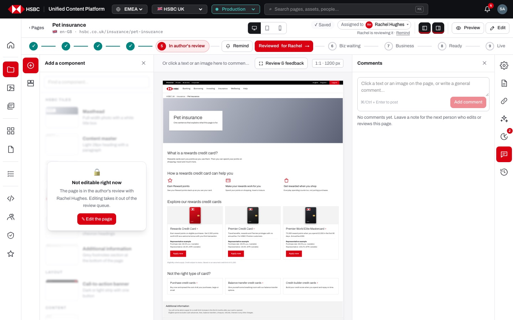
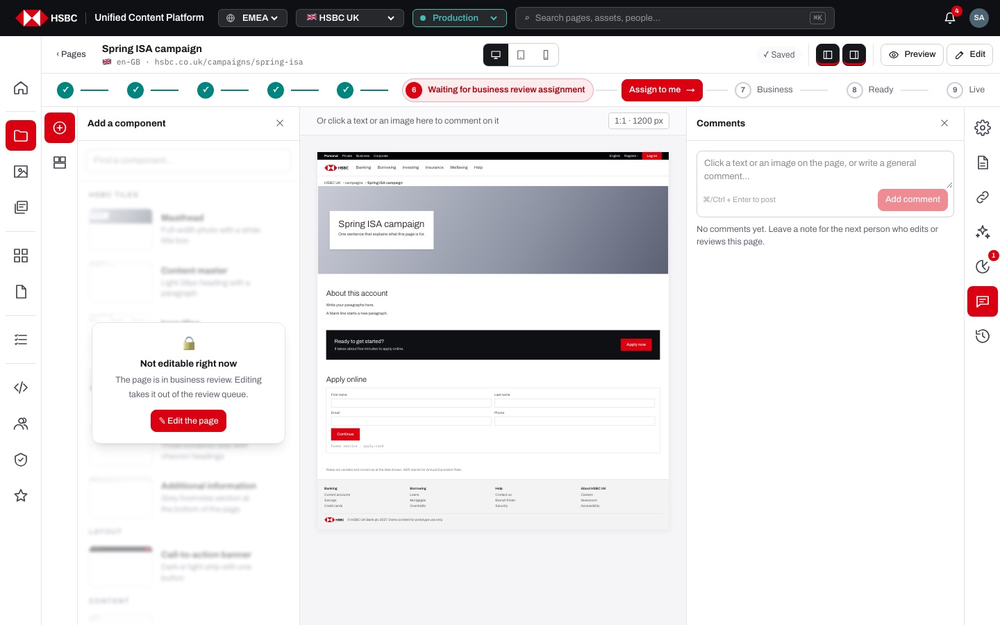
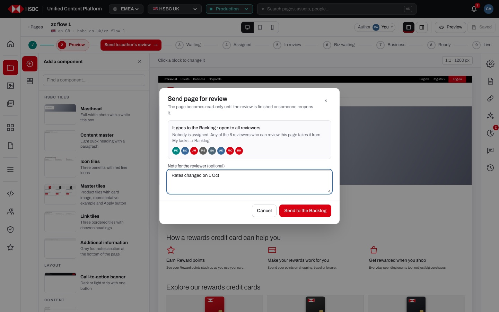
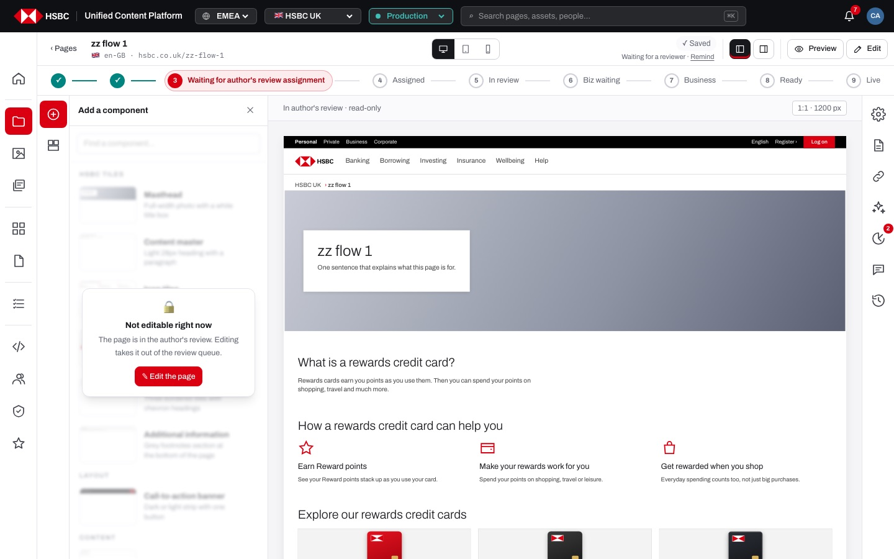
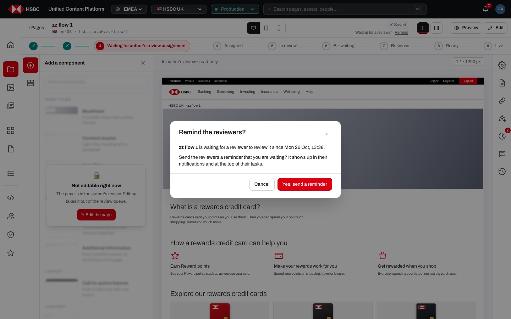
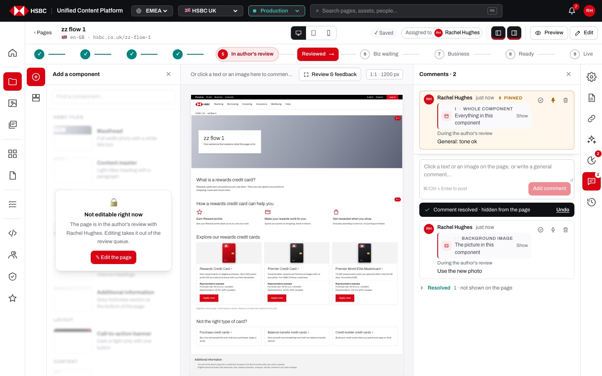
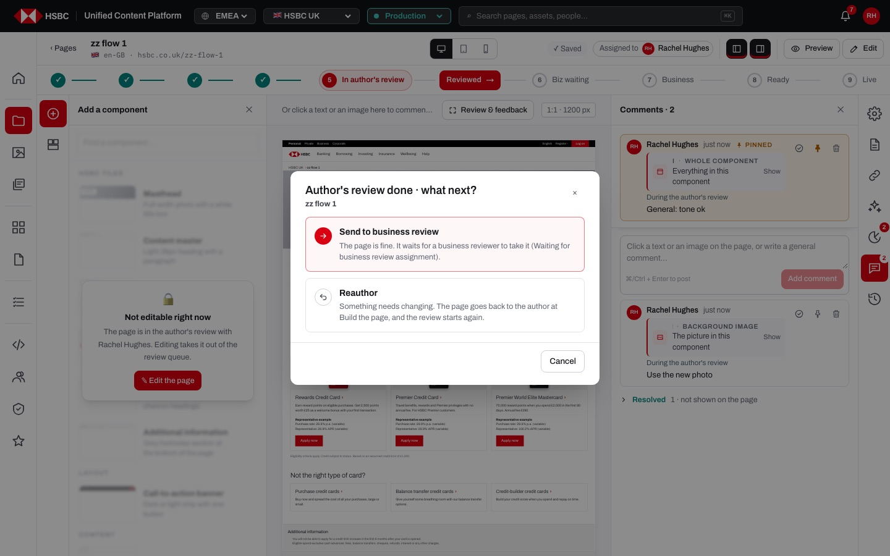
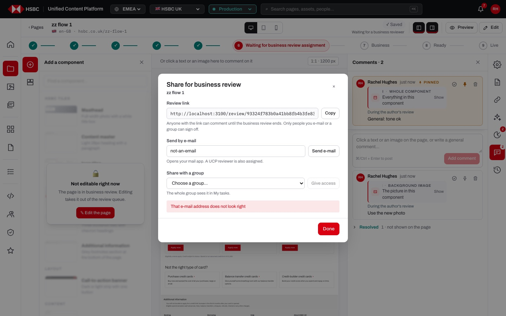
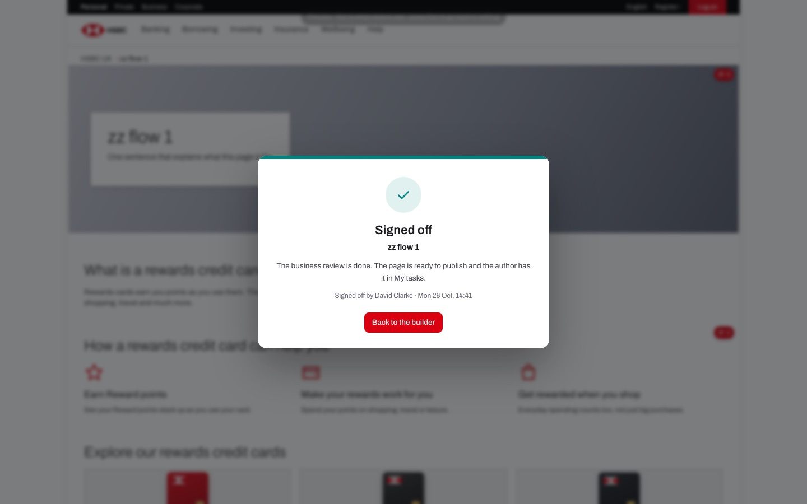

# EP-08 · Page builder · Review workflow

**Epic:** EP-08 · Page builder · Review workflow

**Business benefit:** Every page passes a peer review and a business sign-off by different named people before it can be published, so four-eyes control is enforced by the platform instead of by policy documents. Hand-offs, reminders and decisions happen inside the page builder, which removes e-mail chasing and shortens the time from draft to market.

**Scope:** The workflow stepper above the page and everything that moves a page from "Build the page" to "Ready to publish": sending for review, the shared Backlog, the author's review, the business review, sharing, reminders, comments and decisions, including site-admin actions "on behalf of" the assigned person. Publishing itself is in EP-09, the guest review link in EP-10 and the task list in EP-11.

**The view:**




- **Top bar** · page title, Jira chip and URL on the left; on the right the save state, the "Author" chip (Build the page) or the "Assigned to" chip (author's review), and a small waiting line under them that says who has the page now ("Waiting for Rachel to start · Remind", "Waiting for David to sign off · Remind", "Waiting for a publisher"). "Preview" and "Edit" sit at the far right.
- **Workflow stepper** · nine steps from "Build the page" to "Published". Done steps show a green tick, the current step shows its full name in red, the others a short name. The button for the next action sits on the line right after the step it finishes, and only for the person who may do it (for example "Assign to me", "Start review", "Reviewed", "Sign off", "Publish").
- **Left rail and panel** · the component library. In every review stage it is veiled with "Not editable right now" and a "✎ Edit the page" button.
- **Canvas** · the page at 1:1. In review stages a click on a text, an image or a component picks it as the target of the next comment, and components with open comments show a red badge. "Review & feedback" next to "1:1" opens the page full screen.
- **Right rail** · Comments (with the number of open comments) opens by itself when a review starts; Version history, Page insights and Page settings stay open. Configure and the AI assistant are veiled while the page is in review.
- **Dialogs** · Send page for review, Remind, Author's review done · what next?, Share for business review, Send it back to the author?, and the full-screen Decision overlay.


*Send page for review: the Backlog shows who can take it; the note is optional.*


*In review the page is read-only; "✎ Edit the page" takes it out of the review queue.*


*The author reminds the reviewer; a second reminder within 15 minutes is blocked.*


*Comments panel during the author's review: pinned comment on top, comments tied to a text, an image or a component, Undo after resolving.*


*"Reviewed" asks the reviewer what happens next: business review or Reauthor.*


*Share for business review opens right after the page is sent to the business review; a wrong e-mail is refused.*


*After a decision in full screen a full-screen message confirms it with name and time.*

**Stories (24):**

1. [US-08.01 · Workflow stepper: nine steps with the next action between them](#us-0801--workflow-stepper-nine-steps-with-the-next-action-between-them)
2. [US-08.02 · Send for review: put the page in the shared review Backlog with a note and due date](#us-0802--send-for-review-put-the-page-in-the-shared-review-backlog-with-a-note-and-due-date)
3. [US-08.03 · Pre-send check: 'Does everything look right?' with insights and required-field check](#us-0803--pre-send-check-does-everything-look-right-with-insights-and-required-field-check)
4. [US-08.04 · Read-only in review: lock editing during review and reopen as a draft on purpose](#us-0804--read-only-in-review-lock-editing-during-review-and-reopen-as-a-draft-on-purpose)
5. [US-08.05 · Waiting line: who has the page now, under the status chips](#us-0805--waiting-line-who-has-the-page-now-under-the-status-chips)
6. [US-08.06 · Backlog claim: reviewer assigns a review to themselves or puts it back](#us-0806--backlog-claim-reviewer-assigns-a-review-to-themselves-or-puts-it-back)
7. [US-08.07 · Review reminders: author reminds the reviewer, at most every 15 minutes](#us-0807--review-reminders-author-reminds-the-reviewer-at-most-every-15-minutes)
8. [US-08.08 · Peer review decision: start the review, mark Reviewed, then business review or Reauthor](#us-0808--peer-review-decision-start-the-review-mark-reviewed-then-business-review-or-reauthor)
9. [US-08.09 · Workflow guardrails: steps happen in order and every step leaves a version](#us-0809--workflow-guardrails-steps-happen-in-order-and-every-step-leaves-a-version)
10. [US-08.10 · Review admin: site admin reassigns the peer reviewer or acts on their behalf](#us-0810--review-admin-site-admin-reassigns-the-peer-reviewer-or-acts-on-their-behalf)
11. [US-08.11 · Business review claim: business owner takes a page waiting for business review](#us-0811--business-review-claim-business-owner-takes-a-page-waiting-for-business-review)
12. [US-08.12 · Share for business review: give access to a person, a review group or a link](#us-0812--share-for-business-review-give-access-to-a-person-a-review-group-or-a-link)
13. [US-08.13 · Business sign-off: sign off or Reauthor, also from full screen](#us-0813--business-sign-off-sign-off-or-reauthor-also-from-full-screen)
14. [US-08.14 · Business review admin: fixed reviewers, site admin can sign off on behalf](#us-0814--business-review-admin-fixed-reviewers-site-admin-can-sign-off-on-behalf)
15. [US-08.15 · Comments panel: write, browse and expand the page's comment thread](#us-0815--comments-panel-write-browse-and-expand-the-pages-comment-thread)
16. [US-08.16 · Targeted comments: comment on a specific text, image or component](#us-0816--targeted-comments-comment-on-a-specific-text-image-or-component)
17. [US-08.17 · Comment handling: jump to the commented part, resolve with undo, pin, delete own](#us-0817--comment-handling-jump-to-the-commented-part-resolve-with-undo-pin-delete-own)
18. [US-08.18 · Comments on versions: talk about one saved version of the page](#us-0818--comments-on-versions-talk-about-one-saved-version-of-the-page)
19. [US-08.19 · Review & feedback: full-screen page with floating comments](#us-0819--review--feedback-full-screen-page-with-floating-comments)
20. [US-08.20 · Workflow notifications: the bell tells each person when a page needs them](#us-0820--workflow-notifications-the-bell-tells-each-person-when-a-page-needs-them)
21. [US-08.21 · End-to-end hand-off: author → peer reviewer → business → publisher, one person per step](#us-0821--end-to-end-hand-off-author--peer-reviewer--business--publisher-one-person-per-step)
22. [US-08.22 · Reauthor loop: any reviewer sends the page back to the author with comments](#us-0822--reauthor-loop-any-reviewer-sends-the-page-back-to-the-author-with-comments)
23. [US-08.23 · Four-eyes rule: author, peer reviewer and business reviewer must be different people](#us-0823--four-eyes-rule-author-peer-reviewer-and-business-reviewer-must-be-different-people)
24. [US-08.24 · Admin walk-through: site admin performs any step, recorded as 'on behalf of'](#us-0824--admin-walk-through-site-admin-performs-any-step-recorded-as-on-behalf-of)

---

## US-08.01 · Workflow stepper: nine steps with the next action between them

**Business benefit:** Everyone sees at a glance where a page is and who acts next, which removes status questions between teams. Showing an action only to the person who may do it prevents wrong or unauthorised steps.

**User story:**

As anyone working on a page  
I want a stepper that shows every stage of the page and the one action I can take next  
So that I always know where the page is and what I have to do  

**Persona:** anyone in the content team · **Depends on:** US-04.03

**Acceptance criteria:**

**Scenario 1 · The nine steps** *(one run per row of the table)*

```gherkin
Given the page "Cash ISA" has status "<status>"
When I open it in the page builder
Then the current step of the stepper is "<step>"
And every earlier step shows a green tick

Examples:
  | status                                   | step                                   |
  | draft, not previewed                     | Build the page                         |
  | draft, previewed                         | Preview                                |
  | review, nobody assigned                  | Waiting for author's review assignment |
  | review, a reviewer took it               | Assigned to reviewer                   |
  | inreview (or reviewed)                   | In author's review                     |
  | bizreview, nobody took it, no group      | Waiting for business review assignment |
  | bizreview, a person or a group has it    | In business review                     |
  | approved or scheduled                    | Ready to publish                       |
  | published                                | Published                              |
```

**Scenario 2 · Short names for the steps that are not current**

```gherkin
Given the page is at "Build the page"
Then the other steps read "Preview", "Waiting", "Assigned", "In review", "Biz waiting", "Business", "Ready" and "Live"
And on a phone only the current step is shown
```

**Scenario 3 · The action button between the steps** *(one run per row of the table)*

```gherkin
Given the page is at "<step>"
And I am "<who>"
Then the stepper shows "<buttons>" right after that step

Examples:
  | step                                   | who                                 | buttons                        |
  | Build the page                         | an author with Edit                 | Go to preview                  |
  | Preview                                | an author with Edit                 | Send to author's review        |
  | Waiting for author's review assignment | a reviewer who did not write it     | Assign to me                   |
  | Assigned to reviewer                   | the assigned reviewer               | Start review                   |
  | Assigned to reviewer                   | the author                          | Remind                         |
  | In author's review                     | the assigned reviewer               | Reviewed                       |
  | In author's review                     | the author                          | Remind                         |
  | Waiting for business review assignment | a business owner                    | Assign to me                   |
  | In business review                     | the business reviewer               | Reauthor, Sign off             |
  | In business review                     | the author                          | Reauthor                       |
  | Ready to publish                       | a publisher                         | Publish                        |
```

**Scenario 4 · Nothing to do for me**

```gherkin
Given the page is at "Waiting for business review assignment"
And I am "rachel.hughes", who did the author's review
Then the stepper shows no button
And the waiting line says "Waiting for a business reviewer"
```

**Scenario 5 · The stepper is hidden in full screen**

```gherkin
When I open "Preview" or "Review & feedback"
Then the top bar and the stepper are hidden until I leave full screen
```

---

## US-08.02 · Send for review: put the page in the shared review Backlog with a note and due date

**Business benefit:** A shared Backlog lets the first free reviewer start, so pages do not queue behind one person's calendar. Due dates and audit entries make review turnaround measurable from day one.

**User story:**

As a content author  
I want to send the page to a Backlog that every reviewer sees, with a note  
So that the first free reviewer can take it and I don't have to chase one person  

**Persona:** content author · **Depends on:** US-04.14, US-17.01, US-08.01

**Acceptance criteria:**

**Background** (applies to every scenario below)

```gherkin
Given I am signed in as "content.author" with Edit on the folder of the page
And the page "Cash ISA" is at the "Preview" step
```

**Scenario 1 · Sending the page for review**

```gherkin
When I click "Send to author's review"
Then the dialog "Send page for review" says "It goes to the Backlog · open to all reviewers"
And it says "Nobody is assigned. Any of the 8 reviewers who can review this page takes it from My tasks → Backlog."
And it shows the avatars of those reviewers
When I add the note "Rates changed on 1 Oct" under "Note for the reviewer (optional)"
And I click "Send to the Backlog"
Then the page status is "Waiting for author's review assignment"
And nobody is assigned to review it
And the review is due in 3 days
And the audit log says "sent Cash ISA for review · open to all reviewers in the Backlog"
And I see "Sent for review · it is in the Backlog, any reviewer can take it"
```

**Scenario 2 · Nobody can review the folder**

```gherkin
Given no user has "Review & approve" on the folder of the page
When I open "Send page for review"
Then it says "Nobody has Review on this folder yet. Ask a site admin to grant it."
And "Send to the Backlog" is disabled
And the server refuses a send with "Nobody can review this page" and "Ask a site admin to grant Review & approve on this folder"
```

**Scenario 3 · A page already in review**

```gherkin
Given the page is already in the author's review
When I try to send it for review again
Then I see "Already in review"
```

---

## US-08.03 · Pre-send check: 'Does everything look right?' with insights and required-field check

**Business benefit:** Catching missing fields and quality problems before hand-off avoids wasted review cycles. Fewer round trips mean faster delivery and lower review cost.

**User story:**

As a content author  
I want a last check of the page, with any problems Page insights found  
So that I only send pages that are complete  

**Persona:** content author · **Depends on:** US-08.02, US-07.02

**Acceptance criteria:**

**Background** (applies to every scenario below)

```gherkin
Given I am signed in as "content.author" with Edit on the folder of the page
And the page "Cash ISA" is at the "Build the page" stage
```

**Scenario 1 · Leaving the preview asks whether the page looks right**

```gherkin
Given I clicked "Go to preview" and see "Preview · this is what visitors see · press Esc to go back to editing"
When I press Esc or click "Exit preview"
Then I see the dialog "Does everything look right?"
And it lists "Texts, prices and rates are correct", "Images and buttons are in the right place" and "Nothing is missing on phone and tablet"
And I can choose "No, keep editing" or "Yes, send for review"
```

**Scenario 2 · Page insights warn about problems but do not block sending**

```gherkin
Given Page insights found 2 things to fix on the page
When I leave the preview
Then the dialog says "Page insights found 2 things to fix. You can still send it, but the reviewer will see them."
```

**Scenario 3 · Required fields are missing**

```gherkin
Given 3 required component fields are empty
When I click "Send to author's review"
Then I see "Fill in 3 required fields first"
And the first incomplete component opens in Configure
```

**Scenario 4 · Choosing "Yes, send for review"**

```gherkin
When I choose "Yes, send for review"
Then the dialog "Send page for review" opens
```

---

## US-08.04 · Read-only in review: lock editing during review and reopen as a draft on purpose

**Business benefit:** Reviewers approve exactly the version that will be published, which protects the integrity of the four-eyes check. It prevents silent changes after approval that could expose the bank to conduct risk.

**User story:**

As a content author  
I want the page to be read-only during review, with a clear way to take it back  
So that reviewers check exactly what I sent  

**Persona:** content author · **Depends on:** US-08.02

**Acceptance criteria:**

**Background** (applies to every scenario below)

```gherkin
Given I am signed in as "content.author" with Edit on the folder of the page
```

**Scenario 1 · The page is read-only in review** *(one run per row of the table)*

```gherkin
Given the page "Cash ISA" is at "<stage>"
When I open it in the page builder
Then the page is shown as a preview with the hint "<hint>"
And the component library, Configure and the AI assistant are veiled with "Not editable right now" and "<reason>"
And Page settings, Page insights, Comments and Version history stay open

Examples:
  | stage                    | hint                             | reason                                                                                  |
  | In author's review       | In author's review · read-only   | The page is in the author's review with Rachel Hughes. Editing takes it out of the review queue. |
  | In business review       | In business review · read-only   | The page is in business review. Editing takes it out of the review queue.               |
  | Ready to publish         | Ready to publish · read-only     | The page passed review and is ready to publish. Editing sends it back through review.   |
```

**Scenario 2 · Taking the page back for editing**

```gherkin
Given the page was sent for review
When I click "Edit" in the top bar or "✎ Edit the page" on the veil
And I confirm "Reopen this page for editing? It will leave the review queue."
Then I see "Reopened for editing"
And the page is back at "Build the page"
And the audit log says "reopened Cash ISA as a draft"
```

**Scenario 3 · Without Edit there is no way back**

```gherkin
Given I am signed in as "david.clarke", who has Review but no Edit
Then the veil says "You don't have Edit on this folder. Ask a site admin to grant it."
And there is no "✎ Edit the page" button
```

---

## US-08.05 · Waiting line: who has the page now, under the status chips

**Business benefit:** Authors see who is holding their page without opening My tasks or asking around. Clear ownership shortens idle time between hand-offs.

**User story:**

As a content author  
I want a short line in the top bar that tells me who has my page and what it waits for  
So that I know whom to remind  

**Persona:** content author · **Depends on:** US-08.01, US-08.06

**Acceptance criteria:**

**Scenario 1 · What the line says** *(one run per row of the table)*

```gherkin
Given I am signed in as "content.author"
And the page "Cash ISA" is at "<stage>"
Then the top bar says "<line>"

Examples:
  | stage                                  | line                                                               |
  | Waiting for author's review assignment | Waiting for a reviewer · Remind                                    |
  | Assigned to reviewer                   | Waiting for Rachel to start · Remind                               |
  | In author's review                     | Rachel is reviewing it · Remind                                    |
  | Waiting for business review assignment | Waiting for a business reviewer                                    |
  | In business review                     | Waiting for David to sign off · Remind                             |
  | In business review, shared with a group| Shared with Savings & Mortgages board · Remind                     |
  | Ready to publish                       | Waiting for a publisher                                            |
```

**Scenario 2 · The assigned reviewer chip**

```gherkin
Given "rachel.hughes" took the author's review
Then the top bar shows the chip "Assigned to Rachel Hughes" with her avatar
And for everyone except site admins the chip is plain text
```

**Scenario 3 · Status reviewed (older pages)**

```gherkin
Given the page has the status "reviewed"
And I have no Edit on it
Then the top bar says "Waiting for the author to send it to the business review"
And people with Edit or Review see "Next step" on the stepper, which opens "Author's review done · what next?"
```

---

## US-08.06 · Backlog claim: reviewer assigns a review to themselves or puts it back

**Business benefit:** Reviews start as soon as any reviewer is free, so pages do not wait for one person. Each review has one named owner, which makes delays visible.

**User story:**

As a peer reviewer  
I want to assign a waiting page to myself and return it if I cannot do it  
So that every review has exactly one owner and nothing gets stuck with me  

**Persona:** peer reviewer · **Depends on:** US-08.02

**Acceptance criteria:**

**Background** (applies to every scenario below)

```gherkin
Given the page "Cash ISA" was sent for review by "content.author"
And "rachel.hughes" has "Review & approve" on the page
```

**Scenario 1 · A reviewer assigns the page to themselves in the page builder**

```gherkin
Given I am signed in as "rachel.hughes"
When I click "Assign to me" on the stepper
Then I am the peer reviewer of the page
And the stepper shows "Assigned to reviewer" with "Start review"
And I see "Assigned to you · start the review when you are ready"
And the audit log says "took the author's review of Cash ISA"
```

**Scenario 2 · A reviewer assigns the page to themselves in My tasks**

```gherkin
Given I am signed in as "rachel.hughes"
When I click "Assign to me" on "Cash ISA" in the Backlog
Then I see "Cash ISA is yours · find it in Ready for review"
```

**Scenario 3 · Two reviewers try to take the same page**

```gherkin
Given "aisha.khan" already took "Cash ISA"
When I try to take it as "rachel.hughes"
Then I see "Already assigned to Aisha Khan"
```

**Scenario 4 · Someone without Review cannot take it**

```gherkin
Given I am signed in as "tunde.boateng" who only has Read
Then the "Assign to me" button in My tasks is disabled
And I see "Only reviewers can take it · you don't have Review & approve here"
And the server refuses a claim with "You don't have Review & approve on this page"
```

**Scenario 5 · Back to backlog before the review starts** *(one run per row of the table)*

```gherkin
Given "rachel.hughes" took "Cash ISA" but has not started the review
And I am signed in as "<who>"
When I click "Back to backlog" in My tasks
Then <outcome>

Examples:
  | who           | outcome                                                                                       |
  | rachel.hughes | I see "You are no longer the reviewer · Cash ISA is back in the Backlog" and nobody is assigned |
  | aisha.khan    | I see "Only the assigned reviewer or a site admin can put it back in the Backlog"            |
```

**Scenario 6 · A started review cannot go back**

```gherkin
Given the review of "Cash ISA" has started
When the reviewer tries to put it back in the Backlog
Then they see "The review has already started"
```

**Scenario 7 · Already in the Backlog**

```gherkin
Given nobody is assigned to "Cash ISA"
When someone tries to put it back in the Backlog
Then they see "The page is already in the Backlog"
```

---

## US-08.07 · Review reminders: author reminds the reviewer, at most every 15 minutes

**Business benefit:** Rate-limited reminders keep pages moving without manual chasing or noisy escalation. Shorter waiting times bring content to market faster.

**User story:**

As a content author  
I want to remind the reviewer, but not more often than every 15 minutes  
So that my page keeps moving without spamming anyone  

**Persona:** content author · **Depends on:** US-08.06, US-08.05

**Acceptance criteria:**

**Background** (applies to every scenario below)

```gherkin
Given the page "Cash ISA" was sent for review by "content.author"
And I am signed in as "content.author"
```

**Scenario 1 · Sending a reminder to the assigned reviewer**

```gherkin
Given "rachel.hughes" took the review
When I click "Remind"
Then the dialog "Remind Rachel?" says "Cash ISA is waiting for Rachel Hughes to review it since" the time it was sent
And I click "Yes, send a reminder"
Then I see "Reminder sent to Rachel Hughes"
And Rachel gets the notification "Reminder: Content author is waiting for your review of Cash ISA"
And the audit log says "reminded Rachel Hughes that Cash ISA is waiting for review"
```

**Scenario 2 · Nobody took it yet**

```gherkin
Given the page waits in the Backlog
When I click "Remind" and "Yes, send a reminder"
Then the dialog was titled "Remind the reviewers?"
And I see "Reminder sent to the reviewers"
And reviewers get "Reminder: Content author is waiting for a review of Cash ISA"
```

**Scenario 3 · Reminder rate limit**

```gherkin
Given a reminder was sent 5 minutes ago
When I click "Remind" again
Then the dialog says "You sent a reminder a few minutes ago. Give them a moment before sending another."
And "Yes, send a reminder" is disabled
And the server refuses a reminder with "A reminder was sent a few minutes ago"
```

**Scenario 4 · Reminding the business reviewer**

```gherkin
Given "david.clarke" took the business review
When I click "Remind"
Then the dialog "Remind David?" says "Cash ISA is waiting for David Clarke to sign it off"
```

**Scenario 5 · Only people who edit the page can remind**

```gherkin
Given I have no Edit on the page
When I send a reminder
Then I see "Only people who edit this page can send reminders"
```

---

## US-08.08 · Peer review decision: start the review, mark Reviewed, then business review or Reauthor

**Business benefit:** A single decision point moves the page on or back without extra meetings or e-mails. Only the assigned reviewer can approve, which keeps the peer check accountable and auditable.

**User story:**

As a peer reviewer  
I want to finish my review with one decision: business review or back to the author  
So that the page moves on without extra hand-offs  

**Persona:** peer reviewer · **Depends on:** US-08.06

**Acceptance criteria:**

**Background** (applies to every scenario below)

```gherkin
Given the page "Cash ISA" was sent for review by "content.author"
And "rachel.hughes" has "Review & approve" on the page
```

**Scenario 1 · Starting the review**

```gherkin
Given I am signed in as "rachel.hughes" and I am assigned to "Cash ISA"
When I click "Start review"
Then I see "Review started"
And the stepper shows "In author's review" with "Reviewed"
And the Comments panel opens by itself
```

**Scenario 2 · Only the assigned reviewer decides**

```gherkin
Given "rachel.hughes" is assigned to "Cash ISA"
When "aisha.khan" marks it reviewed
Then she sees "Only the assigned reviewer can approve this page"
```

**Scenario 3 · Finishing the review opens a choice**

```gherkin
Given the review of "Cash ISA" is in progress and I am the reviewer
When I click "Reviewed"
Then I see "Author's review done · what next?"
And I can choose "Send to business review" or "Reauthor", or "Cancel"
```

**Scenario 4 · Sending to the business review**

```gherkin
When I choose "Send to business review"
Then I see "Sent to business review · now share it with the business"
And the stepper shows "Waiting for business review assignment"
And the "Share for business review" dialog opens as the next step
And I am recorded as the person who did the author's review
```

**Scenario 5 · Sending the page back to the author**

```gherkin
When I choose "Reauthor"
Then I see "Sent back to the author · the page is at Build the page again"
And the page is back at "Build the page"
And the peer reviewer, the business reviewer and the review groups are cleared
```

---

## US-08.09 · Workflow guardrails: steps happen in order and every step leaves a version

**Business benefit:** No page can jump over the peer review or the business sign-off, even through the API. A version saved before every status change lets auditors see exactly what each person approved.

**User story:**

As the bank  
I want the server to refuse any status change that skips a step  
So that every published page went through both reviews  

**Persona:** bank · **Depends on:** US-08.08, US-08.13

**Acceptance criteria:**

**Scenario 1 · Steps that are refused** *(one run per row of the table)*

```gherkin
Given the page "Cash ISA" has status "<from>"
When someone with the right permission moves it to "<to>"
Then they see "<message>"

Examples:
  | from      | to        | message                                                   |
  | inreview  | bizreview | The author's review comes first                           |
  | inreview  | approved  | Business review comes next                                |
  | draft     | inreview  | Only a page waiting for its author's review can be started |
```

**Scenario 2 · Taking a page that left the Backlog**

```gherkin
Given the review of "Cash ISA" has started
When someone tries to take it from the Backlog
Then they see "The page is not waiting for a reviewer any more"
```

**Scenario 3 · Permission per step**

```gherkin
Given I am signed in as "content.author" without Review & approve
When I try to start the review of "Cash ISA"
Then I see "You don't have Review & approve on Cash ISA"
And "Ask a site admin to grant Review & approve for Content author"
```

**Scenario 4 · A version before every status change**

```gherkin
When "Cash ISA" moves from "In author's review" to "Waiting for business review assignment"
Then Version history has a version "before: finished the author's review of"
And the audit log has one line per step
```

---

## US-08.10 · Review admin: site admin reassigns the peer reviewer or acts on their behalf

**Business benefit:** Admins can rebalance workload and unblock stuck reviews, which protects launch dates. Every intervention is logged on behalf of the reviewer, so oversight never weakens the audit trail.

**User story:**

As a site admin  
I want to reassign reviewers and act for them when needed  
So that reviews never get stuck, and everyone can see that I stepped in  

**Persona:** site admin · **Depends on:** US-08.06, US-08.08 · **Note:** site admin only

**Acceptance criteria:**

**Background** (applies to every scenario below)

```gherkin
Given the page "Cash ISA" was sent for review by "content.author"
And "rachel.hughes" took it
And I am signed in as "super.admin"
```

**Scenario 1 · Reassigning the peer reviewer from the page builder**

```gherkin
When I click the chip "Assigned to Rachel Hughes ▾"
Then "Change reviewer" lists everyone with Review & approve on the page with their open reviews, fewest first
When I choose "Aisha Khan"
Then I see "Reassigned to Aisha Khan"
And the audit log says "reassigned the review of Cash ISA from Rachel Hughes to Aisha Khan"
```

**Scenario 2 · Assigning automatically**

```gherkin
When I choose "Assign automatically"
Then the reviewer with the fewest open reviews is assigned
But never me, the site admin who clicked it
```

**Scenario 3 · Putting any review back in the Backlog**

```gherkin
Given "rachel.hughes" took "Cash ISA" but has not started the review
When I click "Back to backlog" in My tasks
Then I see "Rachel Hughes is no longer the reviewer · Cash ISA is back in the Backlog"
And the audit log says "put Cash ISA back in the Backlog (was assigned to Rachel Hughes)"
```

**Scenario 4 · Marking it reviewed for the reviewer**

```gherkin
Given "rachel.hughes" started the review
When I click "Reviewed for Rachel" on the stepper
Then the choice says "Cash ISA · on behalf of Rachel Hughes"
When I choose "Send to business review"
Then I see "Reviewed on behalf of Rachel Hughes · waiting for a business reviewer"
And the audit line ends with "(on behalf of Rachel Hughes)"
```

---

## US-08.11 · Business review claim: business owner takes a page waiting for business review

**Business benefit:** Each business decision has one named owner, which gives clear accountability for customer-facing messages. Blocking the peer reviewer from also signing off enforces four-eyes separation.

**User story:**

As a business owner  
I want to take a page that waits for business review  
So that it is clear who decides on it  

**Persona:** business owner · **Depends on:** US-08.08

**Acceptance criteria:**

**Background** (applies to every scenario below)

```gherkin
Given the author's review of "Cash ISA" was done by "rachel.hughes"
And the page was sent to the business review
```

**Scenario 1 · Waiting for a business reviewer**

```gherkin
Then the stepper shows "Waiting for business review assignment"
And My tasks lists the page under "Ready for business review"
And "Review & feedback" is not offered yet
```

**Scenario 2 · A business owner takes it**

```gherkin
Given I am signed in as "david.clarke" with Review on the page
When I click "Assign to me"
Then I see "The business review is yours · sign it off or reauthor"
And I am the business reviewer
And the stepper shows "In business review" with "Reauthor" and "Sign off"
And the audit log says "took the business review of Cash ISA"
```

**Scenario 3 · The peer reviewer cannot also do the business review**

```gherkin
Given I am signed in as "rachel.hughes"
Then there is no "Assign to me" for me on the stepper
And the server refuses a claim with "You did the author's review · someone else does the business review"
```

**Scenario 4 · Someone already took it**

```gherkin
Given "david.clarke" took the business review
When "maria.santos" tries to take it
Then she sees "Already taken by David Clarke"
```

---

## US-08.12 · Share for business review: give access to a person, a review group or a link

**Business benefit:** Getting the right stakeholders in early avoids late rejections and repeated review rounds. External partners can contribute without new UCP licences, which keeps cost down.

**User story:**

As a peer reviewer  
I want to share the page with a person, a review group or a link  
So that the right business owners see it, even without a UCP account  

**Persona:** peer reviewer · **Depends on:** US-08.08

**Acceptance criteria:**

**Background** (applies to every scenario below)

```gherkin
Given the author's review of "Cash ISA" was done by "rachel.hughes"
And the page was just sent to the business review
And the "Share for business review" dialog is open
```

**Scenario 1 · The review link**

```gherkin
Then "Review link" shows a link to /review/<token> with "Copy"
And it says "Anyone with the link can comment until the business review ends. Only people you e-mail or a group can sign off."
When I click "Copy"
Then the button says "✓ Copied"
```

**Scenario 2 · Share with a review group**

```gherkin
When I choose "Savings & Mortgages board · 3 people" under "Share with a group" and click "Give access"
Then my mail app opens to the members of the group
And I see "Savings & Mortgages board (3 people) now has access · it shows in their My tasks, 3 of them can sign off."
And the group is shown as a chip and is marked "has access" in the list, so it cannot be added twice
And the stepper shows "In business review"
```

**Scenario 3 · Share by e-mail with a UCP user**

```gherkin
When I send the review link to "maria.santos@hsbc.com" with "Send e-mail"
Then my mail app opens with the subject "Please review: Cash ISA" and the link
And I see "Maria Santos is now assigned and sees it in My tasks."
```

**Scenario 4 · Share by e-mail with someone outside UCP**

```gherkin
When I send the review link to "partner@example.com"
Then I see "partner@example.com can comment through the link."
```

**Scenario 5 · Invalid e-mail**

```gherkin
When I send the review link to "not-an-email"
Then I see "That e-mail address does not look right"
```

**Scenario 6 · Only people working on the page can share**

```gherkin
Given I am signed in as "tunde.boateng" who only has Read
When I ask for a review link
Then I see "Only people working on this page can share it for review"
```

---

## US-08.13 · Business sign-off: sign off or Reauthor, also from full screen

**Business benefit:** Nothing reaches customers without explicit business approval, which reduces conduct and mis-selling risk. Deciding on the page as customers see it lowers the chance of costly post-launch corrections.

**User story:**

As a business owner  
I want to sign the page off or send it back to the author, also from full screen  
So that I decide while looking at the page as customers will see it  

**Persona:** business owner · **Depends on:** US-08.11

**Acceptance criteria:**

**Background** (applies to every scenario below)

```gherkin
Given the author's review of "Cash ISA" was done by "rachel.hughes"
And "david.clarke" took the business review
```

**Scenario 1 · Signing off**

```gherkin
Given I am signed in as "david.clarke"
When I click "Sign off" on the stepper
Then I see "Business review done · ready to publish"
And the page status is "Ready to publish"
And the publishers see it under "Ready to publish" in My tasks
And the author sees it under "Ready to publish" with "Waiting for a publisher"
```

**Scenario 2 · Someone else tries to sign off**

```gherkin
When "maria.santos" signs it off
Then she sees "Only the assigned business reviewer can sign this page off"
```

**Scenario 3 · Sending it back**

```gherkin
When I click "Reauthor"
Then I see "Send it back to the author?" with "Cash ISA goes back to the first step, Build the page. The author changes it and sends it for review again · both reviews start over."
When I click "Reauthor" in the dialog
Then I see "Sent back to the author · the page is at Build the page again"
And both reviews start over
```

**Scenario 4 · Deciding in full screen**

```gherkin
Given I opened "Review & feedback" in full screen
Then the floating panel is titled "Review" and starts with the "Decision" section
And it says "Everything right? Sign it off. Something to change? Send it back to the author."
When I choose "Sign off" in the "Decision" section
Then it asks "Sign off this page? It becomes ready to publish." with "Yes, sign off" and "Cancel"
When I click "Yes, sign off"
Then a full-screen message says "Signed off" and "The business review is done. The page is ready to publish and the author has it in My tasks."
And it ends with "Signed off by David Clarke ·" and the date and time
And "Back to the builder" closes it and leaves full screen
```

**Scenario 5 · Reauthor in full screen**

```gherkin
When I choose "Reauthor" in the "Decision" section and click "Yes, reauthor"
Then a full-screen message says "Sent back to the author"
And "The page is back at Build the page. The author makes the changes from the comments and sends it for review again."
```

---

## US-08.14 · Business review admin: fixed reviewers, site admin can sign off on behalf

**Business benefit:** Keeping the business reviewer fixed protects the integrity of the business decision. Recorded on-behalf sign-off still lets urgent pages move without breaking the audit trail.

**User story:**

As a site admin  
I want people to stay fixed during the business review, but be able to sign off for the assignee  
So that the business decision is not changed behind its back, and urgent pages can still move  

**Persona:** site admin · **Depends on:** US-08.11, US-08.13 · **Note:** site admin only

**Acceptance criteria:**

**Background** (applies to every scenario below)

```gherkin
Given the author's review of "Cash ISA" was done by "rachel.hughes"
And the page was sent to the business review
And I am signed in as "super.admin"
```

**Scenario 1 · No reassigning in business review**

```gherkin
Then there is no pencil next to the business reviewer in My tasks
And the server refuses a change with "The business review is run by the business" and "People are not changed during the business review"
```

**Scenario 2 · Signing off on behalf**

```gherkin
Given "david.clarke" is the business reviewer
When I click "Sign off for David" on the stepper
Then I see "Signed off as site admin · ready to publish"
And the audit line ends with "(on behalf of David Clarke)"
```

**Scenario 3 · Other places to sign off now**

```gherkin
Then the "Remind David?" dialog and the "Share for business review" dialog both offer "Sign off now"
And the waiting line offers "Share link" to open the share dialog again
```

---

## US-08.15 · Comments panel: write, browse and expand the page's comment thread

**Business benefit:** All feedback on a page lives in one thread next to the page, so nothing gets lost in e-mail. A visible count of open comments shows at a glance how much work is left.

**User story:**

As anyone who edits or reviews a page  
I want a Comments panel in the right rail  
So that I can read and add feedback on the page in one place  

**Persona:** anyone who edits or reviews the page · **Depends on:** US-08.02

**Acceptance criteria:**

**Scenario 1 · Opening the panel**

```gherkin
Given "Cash ISA" has 3 open comments
Then the Comments button in the right rail shows "3"
When I click it
Then the panel "Comments · 3" opens
And in the author's review and the business review it opens by itself
```

**Scenario 2 · Writing a general comment**

```gherkin
When I write "Tone is fine" in the comment box and click "Add comment" (or press ⌘/Ctrl + Enter)
Then the comment is on top of the list with my name and "just now"
And it is marked "During the author's review" while the page is in the author's review
And the audit log says "commented on Cash ISA: “Tone is fine”"
```

**Scenario 3 · Long threads**

```gherkin
Given the page has 8 open comments
Then the first 5 are shown with "Show all 8 comments"
And "Show fewer" folds them again
```

**Scenario 4 · Empty thread**

```gherkin
Given the page has no comments
Then the panel says "No comments yet. Leave a note for the next person who edits or reviews this page."
```

**Scenario 5 · Comments from the review link**

```gherkin
Given a guest commented through a review link
Then the comment shows their name with the tag "guest"
```

---

## US-08.16 · Targeted comments: comment on a specific text, image or component

**Business benefit:** Feedback pinned to the exact element removes ambiguity and reduces rework. Limiting who can comment keeps feedback relevant and the review record trustworthy.

**User story:**

As a peer reviewer or business owner  
I want to click a text, picture or component and comment on it  
So that the author knows exactly what to change  

**Persona:** peer reviewer or business owner · **Depends on:** US-08.08, US-08.15

**Acceptance criteria:**

**Background** (applies to every scenario below)

```gherkin
Given the page "Cash ISA" is in the author's review
And I am signed in as the reviewer
```

**Scenario 1 · Picking a target** *(one run per row of the table)*

```gherkin
When I click <target> on the page
Then the comment box shows a card "<card>"
And the picked text or image is outlined on the page

Examples:
  | target                     | card                                        |
  | the masthead heading       | MASTHEAD · TEXT “Your heading here”         |
  | the masthead photo         | MASTHEAD · BACKGROUND IMAGE · The picture in this component |
  | empty space in a component | KEY FACTS · WHOLE COMPONENT · Everything in this component |
```

**Scenario 2 · Not about this part**

```gherkin
Given I picked the masthead heading
When I click ✕ on the card
Then the next comment is a general comment
And the placeholder says "Click a text or an image on the page, or write a general comment…"
```

**Scenario 3 · Invalid comments** *(one run per row of the table)*

```gherkin
When I post "<text>"
Then I see "<message>"

Examples:
  | text                     | message                              |
  |                          | Write a comment first                |
  | 2,001 characters of text | Keep comments under 2,000 characters |
```

**Scenario 4 · Only people working on the page can comment in UCP**

```gherkin
Given I am signed in as a viewer with Read only
Then there is no comment box in the Comments panel
And the server refuses a comment with "Only people who edit or review this page can comment"
```

**Scenario 5 · Opening comments**

```gherkin
Then the hint above the canvas says "Or click a text or an image here to comment on it"
And "Review & feedback" next to "1:1" opens the page full screen with floating comments
```

---

## US-08.17 · Comment handling: jump to the commented part, resolve with undo, pin, delete own

**Business benefit:** Authors see at a glance what is still open, so no requested change is missed before sign-off. Resolved comments never leak onto the published page, which protects the customer experience.

**User story:**

As a content author  
I want to jump to each comment's place, resolve it and undo by mistake  
So that I see what is still open and the published page stays clean  

**Persona:** content author · **Depends on:** US-08.16

**Acceptance criteria:**

**Background** (applies to every scenario below)

```gherkin
Given the page "Cash ISA" has comments from the review
And I can edit or review the page
```

**Scenario 1 · Components with open comments show a badge**

```gherkin
Given the "Key facts" component has 2 open comments
Then the component shows a badge with "2" titled "2 comments on this component"
```

**Scenario 2 · Jumping to what a comment is about**

```gherkin
When I click "Show" on the card of a comment
Then the page scrolls to that text, image or component and flashes it
```

**Scenario 3 · The part was removed**

```gherkin
Given the commented component was deleted from the page
When I click "Show" on the card of the comment
Then I see "That part is not on the page any more"
```

**Scenario 4 · Resolving with undo**

```gherkin
When I click "Resolve comment"
Then I see "Comment resolved · hidden from the page" with "Undo" for 6 seconds
And the comment moves under "Resolved · N · not shown on the page"
And it says "Resolved by you" and when
And its badge disappears from the page
When I click "Undo"
Then the comment is open again
```

**Scenario 5 · Pinning**

```gherkin
When I click "Pin comment to the top"
Then the comment is marked "Pinned" and stays in a strip at the top of the panel while I scroll
And resolving a pinned comment also unpins it
```

**Scenario 6 · Deleting a comment**

```gherkin
Given I wrote a comment
When I click "Delete comment"
Then I am asked inline with "Delete" and "Keep"
And "Delete" removes it
```

**Scenario 7 · Deleting someone else's comment**

```gherkin
Given I am not a site admin
Then comments of other people have no delete button
And the server refuses with "You can only delete your own comments"
```

---

## US-08.18 · Comments on versions: talk about one saved version of the page

**Business benefit:** Reviewers can point at exactly which version of a page they mean, which avoids confusion during long reviews. The version note stays in the record for audits.

**User story:**

As anyone who edits or reviews a page  
I want to comment on one version from Version history  
So that everyone knows which state of the page I am talking about  

**Persona:** anyone who edits or reviews the page · **Depends on:** US-08.15, US-06.12

**Acceptance criteria:**

**Scenario 1 · Commenting on a version**

```gherkin
Given Version history lists a version from 26 Oct, 13:40
When I click "Comment" on it
Then the Comments panel opens with the chip "About the version from" that time
And the cursor is in the comment box with the placeholder "What about this version?"
When I post "This one had the old rate"
Then the comment says "About the version from" that time
```

**Scenario 2 · Not about a version after all**

```gherkin
When I click ✕ on the version chip
Then the next comment is a general comment
```

---

## US-08.19 · Review & feedback: full-screen page with floating comments

**Business benefit:** Reviewers judge the page exactly as customers will see it while giving feedback, which catches layout and wording issues early. Fewer late findings mean fewer review rounds.

**User story:**

As a peer reviewer or business owner  
I want to see the page full screen with the comments floating next to it  
So that I review what customers will see, not the editor  

**Persona:** peer reviewer or business owner · **Depends on:** US-08.16

**Acceptance criteria:**

**Background** (applies to every scenario below)

```gherkin
Given the page "Cash ISA" is in the author's review or in business review with a reviewer
And I opened "Review & feedback"
```

**Scenario 1 · Full screen with floating comments**

```gherkin
Then the page fills the window without the top bar, stepper and rails
And a floating card "Comments" with the number of open comments sits on the right
And it says "Click a text, an image or a component on the page to comment on it."
And components show "Click a text or image to comment" when I point at them
```

**Scenario 2 · Folding the comments away**

```gherkin
When I click "Fold the comments away"
Then the card becomes a small "Comments" button with the count at the bottom right
And clicking it opens the card again
```

**Scenario 3 · Leaving full screen**

```gherkin
When I click "Exit full screen" or press Esc
Then the page builder comes back with the panels I had open
```

**Scenario 4 · Not before someone has the business review**

```gherkin
Given the page waits for a business reviewer
Then "Review & feedback" is not shown
```

---

## US-08.20 · Workflow notifications: the bell tells each person when a page needs them

**Business benefit:** People hear about work for them without watching lists, which shortens waiting time at every hand-off. Overdue items stand out, so delays are fixed before they hurt a launch.

**User story:**

As anyone in the review flow  
I want a notification when a page needs me  
So that I can act without checking My tasks all day  

**Persona:** anyone in the content team · **Depends on:** US-08.06, US-17.01

**Acceptance criteria:**

**Scenario 1 · Notification texts** *(one run per row of the table)*

```gherkin
Given "Cash ISA" is at "<stage>"
Then the right person sees "<text>" in the bell menu

Examples:
  | stage                                  | text                                                                         |
  | Assigned to reviewer (me)              | Content author assigned you to review Cash ISA                               |
  | Waiting for author's review assignment | Content author asked for a review of Cash ISA                                |
  | Reviewed (older pages)                 | Rachel Hughes finished the author's review of Cash ISA · send it to business review |
  | In business review                     | Rachel Hughes sent to business review: Cash ISA · business sign-off needed   |
  | Ready to publish                       | David Clarke finished the business review of Cash ISA · ready to publish     |
```

**Scenario 2 · Reminders come first**

```gherkin
Given the author reminded me
Then the reminder is at the top and marked as a warning
```

**Scenario 3 · Due dates**

```gherkin
Then each notification shows "N days overdue", "Due today" or "Due" with the date
And overdue ones are red
```

---

## US-08.21 · End-to-end hand-off: author → peer reviewer → business → publisher, one person per step

**Business benefit:** Every page passes through separate authoring, review, sign-off and publishing hands, which builds four-eyes control into the process itself. Clear hand-offs cut idle time between teams and shorten time to market.

**User story:**

As a content author  
I want to request each next step instead of doing it myself  
So that every page is checked by other people before customers see it  

**Persona:** content author · **Depends on:** US-08.02, US-08.08, US-08.13, US-09.03

**Acceptance criteria:**

**Background** (applies to every scenario below)

```gherkin
Given these people work on the UK site
| person         | persona         | permissions on the folder               |
| content.author | content author  | Read, Edit                              |
| rachel.hughes  | peer reviewer   | Read, Edit, Review & approve            |
| david.clarke   | business owner  | Read, Review & approve                  |
| jordan.mensah  | publisher       | Read, Edit, Review & approve, Publish   |
| super.admin    | site admin      | everything                              |
```

**Scenario 1 · The happy path, one person per step**

```gherkin
Given "content.author" built the page "Cash ISA"
When "content.author" sends it for review
Then it waits in the Backlog for any reviewer
When "rachel.hughes" takes it, starts the review, clicks "Reviewed" and chooses "Send to business review"
Then it waits for a business reviewer
When "david.clarke" takes it and signs it off
Then it is "Ready to publish"
When "jordan.mensah" publishes it
Then it is "Published"
And "content.author" sees "Cash ISA" under "Published" in My tasks
```

**Scenario 2 · What the author can do at each stage** *(one run per row of the table)*

```gherkin
Given the page "Cash ISA" is at "<stage>"
And I am signed in as "content.author"
Then the next step for me is "<my action>"
And the step itself is done by "<who acts>"

Examples:
  | stage                                  | my action                                 | who acts                       |
  | Build the page                         | Go to preview, then Send to author's review | me                           |
  | Waiting for author's review assignment | Remind · "Waiting for a reviewer"         | any reviewer except me         |
  | Assigned to reviewer                   | Remind                                    | the assigned reviewer          |
  | In author's review                     | Remind                                    | the assigned reviewer          |
  | Waiting for business review assignment | Wait · "Waiting for a business reviewer"  | a business owner               |
  | In business review                     | Remind, or Reauthor to take it back       | the business reviewer or group |
  | Ready to publish                       | Wait · "Waiting for a publisher"          | a publisher                    |
  | Published                              | Edit to start a new version               | me                             |
```

---

## US-08.22 · Reauthor loop: any reviewer sends the page back to the author with comments

**Business benefit:** Rework goes back to one accountable author instead of being patched by reviewers, which keeps responsibility clear. Restarting both reviews after changes means no unchecked edit can reach customers.

**User story:**

As a content author  
I want any reviewer to send the page back to me with comments  
So that I fix it once and the whole check starts again  

**Persona:** content author · **Depends on:** US-08.21

**Acceptance criteria:**

**Background** (applies to every scenario below)

```gherkin
Given these people work on the UK site
| person         | persona         | permissions on the folder               |
| content.author | content author  | Read, Edit                              |
| rachel.hughes  | peer reviewer   | Read, Edit, Review & approve            |
| david.clarke   | business owner  | Read, Review & approve                  |
| jordan.mensah  | publisher       | Read, Edit, Review & approve, Publish   |
| super.admin    | site admin      | everything                              |
```

**Scenario 1 · Reauthor returns the page to the author** *(one run per row of the table)*

```gherkin
Given "<reviewer>" is reviewing "Cash ISA" at "<stage>"
When they choose "Reauthor" with comments
Then the page is back at "Build the page" for "content.author"
And the comments stay on the page
And both reviews start over when it is sent again
And the audit log says "reopened Cash ISA as a draft"

Examples:
  | reviewer      | stage              |
  | rachel.hughes | In author's review |
  | david.clarke  | In business review |
```

**Scenario 2 · The next round starts in the Backlog**

```gherkin
Given "Cash ISA" was sent back and fixed
When "content.author" sends it for review again
Then it waits in the Backlog with nobody assigned
And the earlier comments are still in the Comments panel
```

---

## US-08.23 · Four-eyes rule: author, peer reviewer and business reviewer must be different people

**Business benefit:** Segregation of duties is enforced by the system rather than by policy documents, which satisfies four-eyes compliance requirements. Auditors can rely on the platform instead of sampling manual evidence.

**User story:**

As the bank  
I want different people for authoring, peer review and business review  
So that the four-eyes principle holds on every page  

**Persona:** bank · **Depends on:** US-08.21

**Acceptance criteria:**

**Background** (applies to every scenario below)

```gherkin
Given these people work on the UK site
| person         | persona         | permissions on the folder               |
| content.author | content author  | Read, Edit                              |
| rachel.hughes  | peer reviewer   | Read, Edit, Review & approve            |
| david.clarke   | business owner  | Read, Review & approve                  |
| jordan.mensah  | publisher       | Read, Edit, Review & approve, Publish   |
| super.admin    | site admin      | everything                              |
```

**Scenario 1 · Four-eyes checks** *(one run per row of the table)*

```gherkin
Given "<person>" did "<earlier step>" on "Cash ISA"
When "<person>" tries to "<later step>"
Then they see "<message>"

Examples:
  | person         | earlier step                | later step                | message                                                              |
  | rachel.hughes  | wrote and sent the page     | take the author's review  | You wrote this page, so someone else reviews it                      |
  | content.author | wrote and sent the page     | take the author's review  | You don't have Review & approve on this page                         |
  | rachel.hughes  | the peer review             | take the business review  | You did the author's review · someone else does the business review  |
  | rachel.hughes  | the peer review             | sign it off               | Someone else must do the business review                             |
```

**Scenario 2 · The author's own page is not in their Backlog**

```gherkin
Given "rachel.hughes" sent "Cash ISA" for review
Then she sees no "Assign to me" for it on the stepper or in My tasks
And My tasks shows it under "Ready for review" with "Waiting for a reviewer to take it"
```

**Scenario 3 · An author without Publish cannot put the page live**

```gherkin
Given "Cash ISA" is "Ready to publish"
And I am signed in as "content.author"
Then I see "Waiting for a publisher" instead of "Publish"
```

---

## US-08.24 · Admin walk-through: site admin performs any step, recorded as 'on behalf of'

**Business benefit:** Urgent regulatory or pricing changes can still go live when reviewers are unavailable, which reduces business risk. Every override is recorded as on behalf of a named person, so audit trails stay complete.

**User story:**

As a site admin  
I want to perform any step for the person who should do it  
So that I can demo the platform and unblock urgent pages  

**Persona:** site admin · **Depends on:** US-08.21, US-08.23 · **Note:** site admin only

**Acceptance criteria:**

**Background** (applies to every scenario below)

```gherkin
Given these people work on the UK site
| person         | persona         | permissions on the folder               |
| content.author | content author  | Read, Edit                              |
| rachel.hughes  | peer reviewer   | Read, Edit, Review & approve            |
| david.clarke   | business owner  | Read, Review & approve                  |
| jordan.mensah  | publisher       | Read, Edit, Review & approve, Publish   |
| super.admin    | site admin      | everything                              |
```

**Scenario 1 · Walking every step alone**

```gherkin
Given I am signed in as "super.admin"
Then every step on the stepper offers its action to me
And I can take my own page from the Backlog
And I can take the business review even after I did the author's review
```

**Scenario 2 · Acting on behalf is recorded** *(one run per row of the table)*

```gherkin
Given "<person>" is assigned
When I click "<button>"
Then I see "<message>"
And the audit line ends with "(on behalf of <name>)"

Examples:
  | person        | button               | message                                                          | name          |
  | rachel.hughes | Reviewed for Rachel  | Reviewed on behalf of Rachel Hughes · waiting for a business reviewer | Rachel Hughes |
  | david.clarke  | Sign off for David   | Signed off as site admin · ready to publish                      | David Clarke  |
```

**Scenario 3 · Ordinary users never see actions for other people**

```gherkin
Given I am signed in as "content.author"
Then no button on the stepper or in My tasks lets me act for someone else
```
