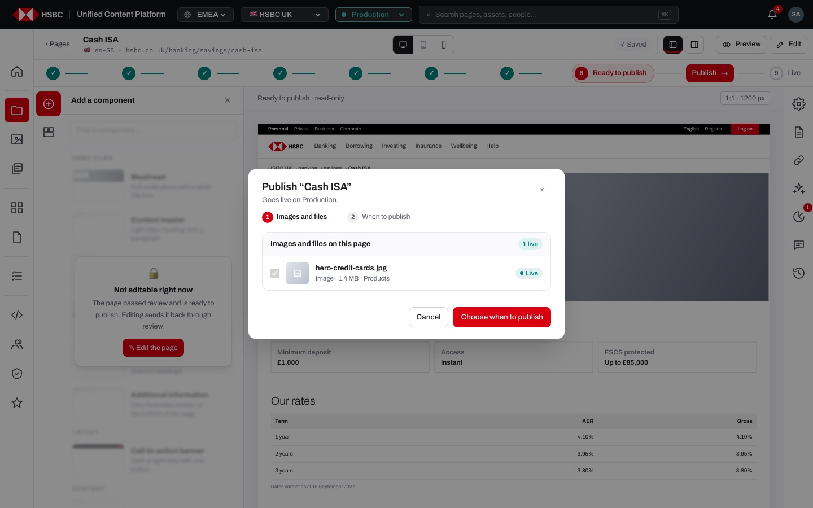
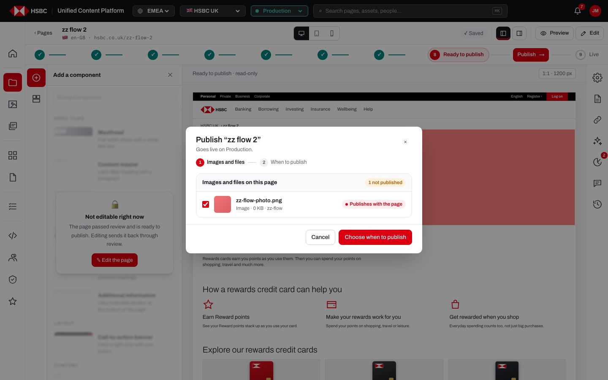
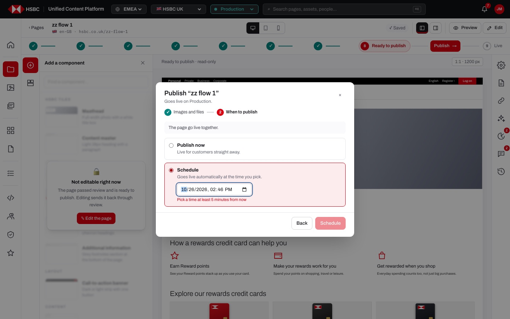
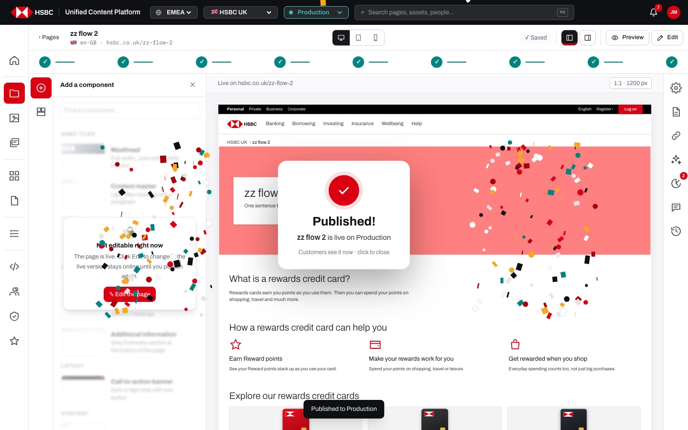

# EP-09 · Page builder · Publishing

**Epic:** EP-09 · Page builder · Publishing

**Business benefit:** Only pages that passed both reviews go live, and only through people with Publish, which keeps separation of duties intact up to the last click. Pages go live together with their pictures and documents, now or at an exact time, so campaigns start on schedule and customers never see broken content.

**Scope:** The "Ready to publish" and "Published" steps of the page builder, the Publish dialog (images and files, then when to publish), publish now, scheduling with cancel and reschedule, the publish fanfare, scheduled pages going live on their own, the hand-over to a publisher, and the planned "request publishing" for authors.

**The view:**



- **Workflow stepper** · at "Ready to publish" a publisher sees "Publish" (or "Publish / reschedule" for a scheduled page) on the line to "Published"; people without Publish see "Waiting for a publisher" in the top bar instead.
- **Publish dialog, step 1 "Images and files"** · every image and document the page uses, with a thumbnail, type, size and folder; files that are not live yet are ticked to go live with the page, files already live show "Live" and the date.
- **Publish dialog, step 2 "When to publish"** · "Publish now" or "Schedule" with a date and time in the browser's time zone; a scheduled page also gets "Cancel schedule".
- **Fanfare** · after "Publish now" confetti and a "Published!" card fill the screen.
- **Published step** · all nine steps are ticked and "Edit" starts a new version while the live one stays online.


*Step 1 · Images and files: a draft image is ticked and "Publishes with the page".*


*Step 2 · When to publish: a time sooner than 5 minutes is refused; the browser's time zone is shown.*


*After "Publish now" a fanfare confirms the page is live.*

**Stories (9):**

1. [US-09.01 · Ready to publish step: the Publish button only for publishers](#us-0901--ready-to-publish-step-the-publish-button-only-for-publishers)
2. [US-09.02 · Publish dialog step 1: choose which images and files go live with the page](#us-0902--publish-dialog-step-1-choose-which-images-and-files-go-live-with-the-page)
3. [US-09.03 · Publish now: put a signed-off page live together with its unpublished files](#us-0903--publish-now-put-a-signed-off-page-live-together-with-its-unpublished-files)
4. [US-09.04 · Publish fanfare: confetti and a 'Published!' card when a page goes live](#us-0904--publish-fanfare-confetti-and-a-published-card-when-a-page-goes-live)
5. [US-09.05 · Scheduled publish: go live at a chosen date and time, with cancel and reschedule](#us-0905--scheduled-publish-go-live-at-a-chosen-date-and-time-with-cancel-and-reschedule)
6. [US-09.06 · Scheduled pages go live on their own at the chosen time](#us-0906--scheduled-pages-go-live-on-their-own-at-the-chosen-time)
7. [US-09.07 · Published step: the page is live and Edit starts a new version](#us-0907--published-step-the-page-is-live-and-edit-starts-a-new-version)
8. [US-09.08 · Waiting for publisher: author sees the hand-over to a publisher at Ready to publish](#us-0908--waiting-for-publisher-author-sees-the-hand-over-to-a-publisher-at-ready-to-publish)
9. [US-09.09 · Publish request: author asks for a publish date and is told when the page is live](#us-0909--publish-request-author-asks-for-a-publish-date-and-is-told-when-the-page-is-live)

---

## US-09.01 · Ready to publish step: the Publish button only for publishers

**Business benefit:** Only people with Publish can put content live, which keeps the last control in the hands the bank chose. The button appears exactly when a page is ready, so publishers lose no time looking for work.

**User story:**

As a publisher  
I want a "Publish" button on the stepper when a page is ready to publish  
So that I can put it live from the page I am looking at  

**Persona:** publisher · **Depends on:** US-08.13, US-08.01

**Acceptance criteria:**

**Scenario 1 · What each person sees at Ready to publish** *(one run per row of the table)*

```gherkin
Given the page "Cash ISA" is "<status>"
And I am signed in as "<who>"
Then the stepper shows "<stepper>"
And the top bar shows "<line>"

Examples:
  | status    | who            | stepper               | line                    |
  | approved  | jordan.mensah  | Publish               |                         |
  | scheduled | jordan.mensah  | Publish / reschedule  |                         |
  | approved  | content.author | no button             | Waiting for a publisher |
  | approved  | david.clarke   | no button             | Waiting for a publisher |
```

**Scenario 2 · The page is read-only**

```gherkin
Given the page is "Ready to publish"
Then the hint above the canvas says "Ready to publish · read-only"
And the veil says "The page passed review and is ready to publish. Editing sends it back through review."
```

**Scenario 3 · Unsaved changes are saved first**

```gherkin
Given there are unsaved changes
When I click "Publish"
Then the page is saved before the Publish dialog opens
```

---

## US-09.02 · Publish dialog step 1: choose which images and files go live with the page

**Business benefit:** Pictures and documents go live together with the page, so customers never see missing images or broken PDF links. Publishers see exactly what goes out, which avoids publishing files by accident.

**User story:**

As a publisher  
I want to see every image and file the page uses and choose which unpublished ones go live with it  
So that the page is complete when customers see it  

**Persona:** publisher · **Depends on:** US-09.01, US-12.11

**Acceptance criteria:**

**Background** (applies to every scenario below)

```gherkin
Given I am signed in as "jordan.mensah" with Publish on the folder
And the page "Cash ISA" is "Ready to publish"
```

**Scenario 1 · The files of the page**

```gherkin
Given "Cash ISA" uses the picture "hero-isa.jpg" that is not published and "hero-credit-cards.jpg" that is live
When I click "Publish"
Then the dialog "Publish “Cash ISA”" says "Goes live on Production."
And the steps "1 Images and files" and "2 When to publish" are shown
And "Images and files on this page" shows "1 not published" and "1 live"
And "hero-isa.jpg" is listed first, ticked, with "Publishes with the page"
And "hero-credit-cards.jpg" is ticked but disabled, with "Live" and the date it went live
And each file shows a thumbnail or icon, its type, size and folder
```

**Scenario 2 · Several unpublished files**

```gherkin
Given the page uses 3 files that are not published
Then "Publish all 3 unpublished files" ticks or unticks all of them at once
And it shows a dash when only some are ticked
```

**Scenario 3 · Leaving a draft file behind**

```gherkin
When I untick "hero-isa.jpg"
Then it says "Not published"
And I see "hero-isa.jpg stays unpublished, so the page cannot go live yet."
When I click "Choose when to publish"
Then the summary says "1 file stays unpublished · change"
And publishing anyway is refused with "Uses 1 file that is not published yet"
```

**Scenario 4 · A page without files**

```gherkin
Given the page uses no images or files
When I click "Publish"
Then the dialog goes straight to "When to publish"
```

---

## US-09.03 · Publish now: put a signed-off page live together with its unpublished files

**Business benefit:** Approved pages reach customers in one controlled step instead of a chain of manual releases. Publishing the files with the page removes broken pictures and missing documents that damage customer trust.

**User story:**

As a publisher  
I want to put a page that passed both reviews live in one step, together with the pictures and documents it uses  
So that customers never see a page with missing pictures or documents  

**Persona:** publisher · **Depends on:** US-08.13, US-12.11, US-09.02

**Acceptance criteria:**

**Background** (applies to every scenario below)

```gherkin
Given I am signed in as "jordan.mensah" with Publish on the folder
```

**Scenario 1 · Pages that are not ready are skipped with a reason** *(one run per row of the table)*

```gherkin
Given the page "Cash ISA" has status "<status>"
When I open the Publish dialog for it
Then it says "<reason>. Only pages that passed review (Ready to publish) can go live."
And the server refuses it with "<server reason>"

Examples:
  | status    | reason                     | server reason              |
  | review    | Still in author's review   | Still in author's review   |
  | reviewed  | Business review comes next | Business review comes next |
  | bizreview | Still in business review   | Still in business review   |
  | draft     | Needs review first         | Needs approval first       |
  | published | Already live               | Already live               |
```

**Scenario 2 · Publish now (step 2, "When to publish")**

```gherkin
Given "Cash ISA" is "Ready to publish" and uses the unpublished picture "hero-isa.jpg"
When I click "Choose when to publish"
Then the summary says "The page and 1 file go live together."
When I keep "Publish now" ("Live for customers straight away.") and click "Publish now"
Then "hero-isa.jpg" is published first
And the page status is "Published"
And a live copy of the page is kept for comparisons
And I see "Published to Production"
And the audit log says "published Cash ISA"
```

**Scenario 3 · Without Publish**

```gherkin
Given I am signed in as "content.author"
When the page is sent to the publish service anyway
Then it is refused with "You don't have Publish on this page"
```

**Scenario 4 · Going back to the files**

```gherkin
Given I am on "When to publish"
When I click "Back" or the step "Images and files"
Then I see the files again with my ticks kept
```

---

## US-09.04 · Publish fanfare: confetti and a 'Published!' card when a page goes live

**Business benefit:** A clear, joyful confirmation tells the publisher beyond doubt that the page is live, which avoids double publishing or uncertain follow-up checks. It also makes the moment of launch visible to the team.

**User story:**

As a publisher  
I want a big confirmation when the page goes live  
So that I know for sure customers can see it  

**Persona:** publisher · **Depends on:** US-09.03

**Acceptance criteria:**

**Scenario 1 · Fanfare after Publish now**

```gherkin
When "Cash ISA" goes live with "Publish now"
Then HSBC-coloured confetti bursts from the bottom corners over the whole screen
And a card says "Published!", "Cash ISA is live on Production" and "Customers see it now · click to close"
```

**Scenario 2 · Several pages**

```gherkin
When 3 pages go live together
Then the card says "3 pages are live on Production"
```

**Scenario 3 · Closing**

```gherkin
Then the card closes when I click it, or by itself after about 5 seconds
```

**Scenario 4 · Reduced motion**

```gherkin
Given my system asks for reduced motion
Then only the card is shown, without confetti, for about 3.5 seconds
```

**Scenario 5 · No fanfare for a schedule**

```gherkin
When I schedule a page instead
Then there is no fanfare
```

---

## US-09.05 · Scheduled publish: go live at a chosen date and time, with cancel and reschedule

**Business benefit:** Campaigns and rate changes go live at the agreed minute without anyone working out of hours. Fewer manual late-night releases also means fewer publishing mistakes and lower overtime cost.

**User story:**

As a publisher  
I want to schedule a signed-off page to go live at a chosen time, and cancel that schedule if plans change  
So that content goes live exactly when the campaign or rate change starts, without anyone being online  

**Persona:** publisher · **Depends on:** US-09.03

**Acceptance criteria:**

**Background** (applies to every scenario below)

```gherkin
Given I am signed in as "jordan.mensah" with Publish on the folder
And "Cash ISA" is "Ready to publish"
```

**Scenario 1 · Schedule**

```gherkin
When I choose "Schedule" ("Goes live automatically at the time you pick.")
Then the date and time field shows tomorrow at 09:00
And under it the chosen time and "your time zone (Europe/London)"
When I click "Schedule"
Then I see "Scheduled for publishing"
And the page status is "Scheduled"
And the stepper offers "Publish / reschedule"
And the audit log says "scheduled Cash ISA for" the date and time in UK time
```

**Scenario 2 · Too soon to schedule**

```gherkin
When I pick a time 2 minutes from now
Then I see "Pick a time at least 5 minutes from now"
And "Schedule" is disabled
```

**Scenario 3 · No time picked**

```gherkin
When I clear the date and time
Then I see "Pick a date and time"
```

**Scenario 4 · Rescheduling or publishing a scheduled page**

```gherkin
Given "Cash ISA" is scheduled
When I click "Publish / reschedule"
Then the dialog says "Scheduled for" the date and "Change the time, publish it now, or cancel the schedule."
And "Schedule" is already chosen with the scheduled time
And I can pick a new time or switch to "Publish now"
```

**Scenario 5 · Cancelling a schedule**

```gherkin
Given "Cash ISA" is scheduled
When I click "Cancel schedule" in "When to publish"
Then I see "Schedule cancelled · back to Approved"
And the page is back at "Ready to publish"
And the audit log says "cancelled the scheduled publish of Cash ISA"
```

---

## US-09.06 · Scheduled pages go live on their own at the chosen time

**Business benefit:** Pages go live at the agreed minute even if nobody is at work, which protects campaign launches and rate changes. The system is recorded as publisher, so the audit trail shows exactly what happened.

**User story:**

As a publisher  
I want a scheduled page to go live by itself when its time comes  
So that nobody has to be online at launch time  

**Persona:** publisher · **Depends on:** US-09.05 · **Note:** runs on a stand-in (mock) today

**Acceptance criteria:**

**Scenario 1 · A scheduled page goes live**

```gherkin
Given "Cash ISA" is scheduled for a time that has passed
When anyone opens a CMS screen
Then the page status is "Published"
And it is published by "system"
And a live copy of the page is kept for comparisons
And the audit log says "published Cash ISA (scheduled)"
```

**Scenario 2 · Not yet**

```gherkin
Given "Cash ISA" is scheduled for tomorrow
When someone opens a CMS screen today
Then the page stays "Scheduled"
```

---

## US-09.07 · Published step: the page is live and Edit starts a new version

**Business benefit:** Authors can improve a live page without taking it offline, so customers always see a working page. Every change still goes through review before the new version replaces the live one.

**User story:**

As a content author  
I want to start editing a live page while the live version stays online  
So that I can update content without a gap for customers  

**Persona:** content author · **Depends on:** US-09.03

**Acceptance criteria:**

**Scenario 1 · A published page**

```gherkin
Given "Cash ISA" is "Published"
When I open it in the page builder
Then all nine steps show a green tick
And the hint says "Live on hsbc.co.uk/banking/savings/cash-isa"
And the veil says "The page is live. Click Edit to change it; the live version stays online until you publish again."
```

**Scenario 2 · Editing a live page**

```gherkin
When I click "Edit"
Then I am not asked to confirm
And I see "Editing · the live version stays online until you publish again"
And the page is back at "Build the page"
```

---

## US-09.08 · Waiting for publisher: author sees the hand-over to a publisher at Ready to publish

**Business benefit:** Keeping publishing with authorised publishers enforces separation of duties that auditors and regulators expect. Clear hand-over status reduces chasing between teams and shortens time to market.

**User story:**

As a content author  
I want to see that my signed-off page is waiting for a publisher instead of publishing it myself  
So that only people with Publish put content live, and I know who acts next until I am told the page is live  

**Persona:** content author · **Depends on:** US-09.03

**Acceptance criteria:**

**Scenario 1 · No Publish permission**

```gherkin
Given I am signed in as "content.author"
And "Cash ISA" is "Ready to publish"
Then the page builder shows "Waiting for a publisher" in the top bar
And My tasks shows "Cash ISA" under "Ready to publish" with "Waiting for a publisher"
```

**Scenario 2 · The publisher takes over**

```gherkin
Given I am signed in as "jordan.mensah"
Then My tasks shows "Cash ISA" under "Ready to publish" with "Publish"
```

**Scenario 3 · The author sees the result**

```gherkin
When "jordan.mensah" publishes "Cash ISA"
Then "content.author" finds it under "Published" in My tasks
```

---

## US-09.09 · Publish request: author asks for a publish date and is told when the page is live

**Business benefit:** Planned launch dates reduce last-minute coordination between marketing and publishers. Authors learn when a page is live without chasing anyone, which saves time and avoids missed campaign starts.

**User story:**

As a content author  
I want to request publishing at a date and be told when the page is live  
So that I can plan launches without chasing the publisher  

**Persona:** content author · **Depends on:** US-08.21, US-09.08 · **Note:** planned, not built yet

**Acceptance criteria:**

**Background** (applies to every scenario below)

```gherkin
Given these people work on the UK site
| person         | persona         | permissions on the folder               |
| content.author | content author  | Read, Edit                              |
| rachel.hughes  | peer reviewer   | Read, Edit, Review & approve            |
| david.clarke   | business owner  | Read, Review & approve                  |
| jordan.mensah  | publisher       | Read, Edit, Review & approve, Publish   |
| super.admin    | site admin      | everything                              |
```

**Scenario 1 · Requesting publishing**

```gherkin
Given "Cash ISA" is "Ready to publish"
When I click "Request publishing" and choose 1 November at 09:00
Then the publishers get a task "Publish Cash ISA on 1 Nov 09:00"
```

**Scenario 2 · Live notification**

```gherkin
When the publisher publishes "Cash ISA"
Then I get the notification "Cash ISA is live"
```
