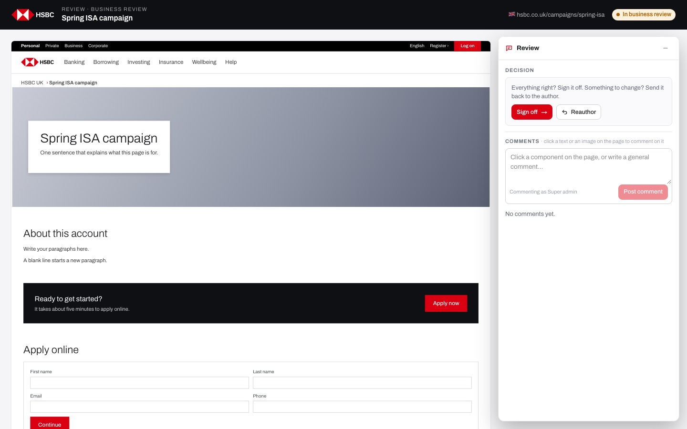
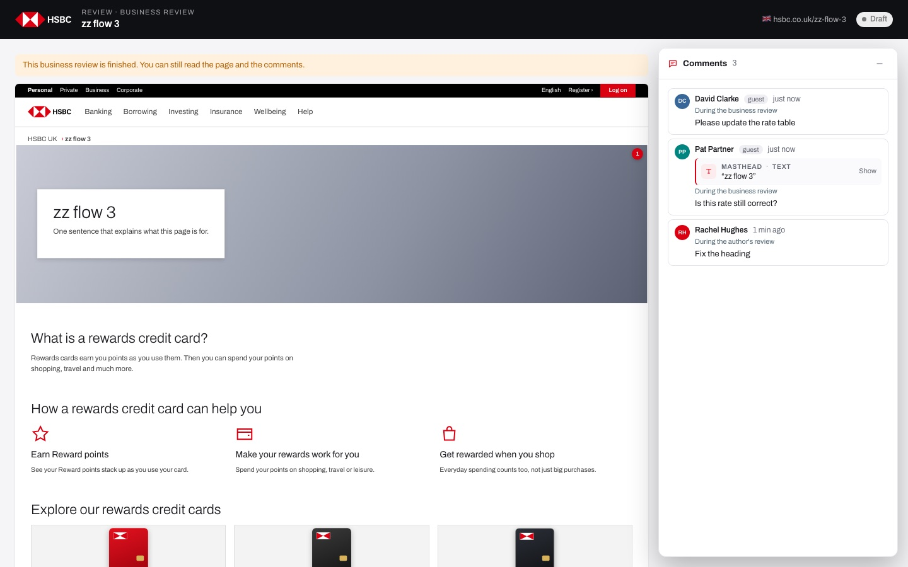

# EP-10 · Review link (guest reviewers)

**Epic:** EP-10 · Review link (guest reviewers)

**Business benefit:** Business owners, partners and occasional reviewers can read a page and give feedback through a link without a UCP licence or training. Only the people a review was sent to can sign off, so a forwarded link can never approve customer content.

**Scope:** The /review/<token> screen that a review link opens: the page as customers will see it, floating comments with name and e-mail for guests, picking a text, image or component to comment on, the business decision (sign off or Reauthor) and who may make it, the finished stage and an invalid link. Creating the link is in EP-08 (Share for business review).

**The view:**



- **Header** · HSBC logo, "Review · Business review" (or "Review · Author's review"), the page title, the market flag with the page address and the status pill.
- **Page** · the page drawn at 1:1 width and scaled to the window, like customers see it. While the review is open, pointing at a component says "Click a text or image to comment", a click picks what the next comment is about, and components with open comments show a red badge.
- **Floating panel** · on the right, titled "Comments" (or "Review" for someone who may decide). It holds the "Decision" section (Sign off · Reauthor) for invited people, the comment box with "Your name" and "Your e-mail" for guests, and the list of comments. It folds into a small button, and on phones it starts folded.
- **Notices** · "You can comment here. Signing off is for the people this review was sent to." for a plain link, "This business review is finished. You can still read the page and the comments." once the stage is over.


*After a decision the link still opens, read-only, with "This business review is finished."*

**Stories (8):**

1. [US-10.01 · Review links: open a shared review page without a UCP login](#us-1001--review-links-open-a-shared-review-page-without-a-ucp-login)
2. [US-10.02 · Review screen layout: the page as customers see it, with a floating panel](#us-1002--review-screen-layout-the-page-as-customers-see-it-with-a-floating-panel)
3. [US-10.03 · Guest review link: read the page and comment without a UCP account](#us-1003--guest-review-link-read-the-page-and-comment-without-a-ucp-account)
4. [US-10.04 · Picking a target: comment on a text, an image or a whole component](#us-1004--picking-a-target-comment-on-a-text-an-image-or-a-whole-component)
5. [US-10.05 · Guest identity: name and e-mail, remembered, fixed for e-mailed links](#us-1005--guest-identity-name-and-e-mail-remembered-fixed-for-e-mailed-links)
6. [US-10.06 · Comment list on the link: open first, resolved last, with stage and target](#us-1006--comment-list-on-the-link-open-first-resolved-last-with-stage-and-target)
7. [US-10.07 · Guest decision: invited guests sign off or Reauthor through the link](#us-1007--guest-decision-invited-guests-sign-off-or-reauthor-through-the-link)
8. [US-10.08 · Signed-in reviewer on a link: decide only when it is your review](#us-1008--signed-in-reviewer-on-a-link-decide-only-when-it-is-your-review)

---

## US-10.01 · Review links: open a shared review page without a UCP login

**Business benefit:** External and occasional reviewers can sign off pages without the bank buying and managing extra CMS licences. Reviews happen sooner because nobody waits for an account to be created.

**User story:**

As a guest reviewer  
I want to open a review link without signing in  
So that I can give feedback on a page without a CMS account  
Note: the prototype uses an SSO stand-in (pick an account, no password). Real SSO is on the roadmap.  

**Persona:** guest reviewer · **Depends on:** US-08.12 · **Note:** runs on a stand-in (mock) today

**Acceptance criteria:**

**Scenario 1 · Review links do not need a session**

```gherkin
When I open a review link "/review/<token>"
Then the page opens without signing in
```

**Scenario 2 · Search engines stay out**

```gherkin
When a search engine reads a review link
Then the page says "noindex, nofollow"
And the browser tab says "Review · HSBC Unified Content Platform"
```

---

## US-10.02 · Review screen layout: the page as customers see it, with a floating panel

**Business benefit:** Reviewers judge the real customer view instead of an editor, which catches problems before launch. A single clear screen needs no training, so busy business owners review faster.

**User story:**

As a guest reviewer  
I want to see the page full width with the comments floating next to it  
So that I review exactly what customers will see  

**Persona:** guest reviewer · **Depends on:** US-10.01

**Acceptance criteria:**

**Background** (applies to every scenario below)

```gherkin
Given the page "Cash ISA" is in business review
And I opened its review link
```

**Scenario 1 · Header and page**

```gherkin
Then the header shows "Review · Business review", "Cash ISA", "🇬🇧 hsbc.co.uk/banking/savings/cash-isa" and the status pill
And the page is drawn at 1,200 px and scaled down to the width of the window
And hidden components are not shown
```

**Scenario 2 · Folding the panel**

```gherkin
When I click "Fold the comments away"
Then the panel becomes a "Comments" button with the number of open comments at the bottom right
And clicking it opens the panel again
```

**Scenario 3 · Phones**

```gherkin
Given my screen is narrower than 1,024 px
When I open the link
Then the panel starts folded so the page is visible
```

---

## US-10.03 · Guest review link: read the page and comment without a UCP account

**Business benefit:** Stakeholders without a UCP account can give feedback, which saves licence cost and onboarding effort. Feedback lands on the page itself, so nothing is lost in e-mail threads.

**User story:**

As a guest reviewer  
I want to open a link, see the page full screen and comment on any part of it  
So that I can give feedback without learning the CMS  

**Persona:** guest reviewer · **Depends on:** US-08.12, US-10.02

**Acceptance criteria:**

**Background** (applies to every scenario below)

```gherkin
Given the page "Cash ISA" is in business review
And a review link was created for it
```

**Scenario 1 · Opening a valid link**

```gherkin
When I open the review link
Then I see the page with a floating Comments panel
And a plain link says "You can comment here. Signing off is for the people this review was sent to."
```

**Scenario 2 · Commenting on a part of the page**

```gherkin
When I click a heading on the page
And I write "Is this rate still correct?"
And I enter "Pat Partner" and "pat@example.com" and click "Post comment"
Then the comment is saved against that heading
And it shows "Pat Partner", the tag "guest" and "During the business review"
And the audit log says "Pat Partner (pat@example.com) commented during business review of Cash ISA: “Is this rate still correct?”"
```

**Scenario 3 · Commenting without a name**

```gherkin
Given I left "Your name" or "Your e-mail" empty, or the e-mail is not valid
Then "Post comment" is disabled
And the server refuses a comment with "Add your name and e-mail so the team knows who commented"
```

**Scenario 4 · The stage is over**

```gherkin
Given the page has moved on to "Ready to publish"
When I open the review link
Then I see "This business review is finished. You can still read the page and the comments."
And I cannot comment or decide
And a comment sent anyway is refused with "This review is finished"
```

**Scenario 5 · Unknown link**

```gherkin
When I open a review link with an unknown or malformed token
Then I see "This review link does not work"
And "It may be mistyped or the page may have been deleted. Ask the person who sent it for a new link."
```

---

## US-10.04 · Picking a target: comment on a text, an image or a whole component

**Business benefit:** Feedback that points at the exact text or image removes back-and-forth about what was meant. Authors fix the right thing first time, which shortens review rounds.

**User story:**

As a guest reviewer  
I want to click the part of the page my comment is about  
So that the author sees exactly what I mean  

**Persona:** guest reviewer · **Depends on:** US-10.03

**Acceptance criteria:**

**Background** (applies to every scenario below)

```gherkin
Given I opened the review link of "Cash ISA" while the review is open
```

**Scenario 1 · What a click picks** *(one run per row of the table)*

```gherkin
When I click <target>
Then the comment box shows a card "<card>"
And the component shows "Commenting here"
And the cursor moves to the comment box with "What should change here?"

Examples:
  | target                     | card                                                        |
  | the masthead heading       | MASTHEAD · TEXT “Cash ISA”                                  |
  | the masthead photo         | MASTHEAD · BACKGROUND IMAGE · The picture in this component |
  | empty space in a component | KEY FACTS · WHOLE COMPONENT · Everything in this component  |
```

**Scenario 2 · A general comment instead**

```gherkin
Given I picked the masthead heading
When I click ✕ on the card
Then the placeholder says "Click a component on the page, or write a general comment…"
```

**Scenario 3 · Showing what a comment is about**

```gherkin
When I click "Show" on the card of a comment in the list
Then the page scrolls to that part and flashes it
```

**Scenario 4 · Badges**

```gherkin
Given the "Key facts" component has 2 open comments
Then it shows a badge "2"
```

---

## US-10.05 · Guest identity: name and e-mail, remembered, fixed for e-mailed links

**Business benefit:** Every comment and decision carries a real name and e-mail, so the bank knows who said what. Fixing the address of an e-mailed link stops someone else from deciding with it.

**User story:**

As a guest reviewer  
I want to give my name and e-mail once  
So that the team knows who commented, without me typing it again  

**Persona:** guest reviewer · **Depends on:** US-10.03

**Acceptance criteria:**

**Scenario 1 · Remembered in this browser**

```gherkin
Given I posted a comment as "Pat Partner" and "pat@example.com"
When I open a review link again in the same browser
Then "Your name" and "Your e-mail" are filled in
```

**Scenario 2 · An e-mailed link fixes the address**

```gherkin
Given the link was sent to "partner@example.com"
Then "Your e-mail" shows "partner@example.com" and cannot be changed
And it says "This review was sent to this address" when I point at it
```

**Scenario 3 · Signed-in UCP users**

```gherkin
Given I am signed in to UCP as "maria.santos"
When I open the link
Then there are no name and e-mail fields
And the comment box says "Commenting as Maria Santos"
```

---

## US-10.06 · Comment list on the link: open first, resolved last, with stage and target

**Business benefit:** Guests see what others already said, which avoids duplicate feedback. Resolved points are visibly done, so reviewers focus on what is still open.

**User story:**

As a guest reviewer  
I want to read all comments on the page in a clear order  
So that I do not repeat what others already said  

**Persona:** guest reviewer · **Depends on:** US-10.03

**Acceptance criteria:**

**Scenario 1 · Order and details**

```gherkin
Given "Cash ISA" has open, pinned and resolved comments
When I open the review link
Then open comments come first, pinned ones on top, newest first
And resolved comments come last, greyed, with "✓ Resolved by" and the name
And each comment shows the name, "guest" for guests, the time and "During the author's review" or "During the business review"
```

**Scenario 2 · No comments**

```gherkin
Given nobody commented yet
Then the panel says "No comments yet."
```

---

## US-10.07 · Guest decision: invited guests sign off or Reauthor through the link

**Business benefit:** The business can approve without a UCP account, which speeds up sign-off for busy owners. Restricting decisions to invited addresses stops forwarded links from approving content, which limits fraud and compliance risk.

**User story:**

As a guest reviewer who was invited  
I want to sign off or send the page back from the link  
So that the business can decide without a UCP account, while a forwarded link cannot approve anything  

**Persona:** guest reviewer who was invited · **Depends on:** US-10.03, US-10.05

**Acceptance criteria:**

**Background** (applies to every scenario below)

```gherkin
Given the page "Cash ISA" is in business review
And a review link was created for it
```

**Scenario 1 · The Decision section for invited people**

```gherkin
Given the link was sent to "partner@example.com"
When I open it
Then the panel is titled "Review" and starts with "Decision"
And it says "Everything right? Sign it off. Something to change? Send it back to the author."
And "Sent to partner@example.com · uses the name and e-mail below."
```

**Scenario 2 · Who may sign off through the link** *(one run per row of the table)*

```gherkin
Given the link was <sent>
When a guest using "<email>" signs off
Then <outcome>

Examples:
  | sent                            | email                 | outcome                                                                          |
  | to "partner@example.com"        | partner@example.com   | the page is "Ready to publish" and approved by "guest:partner@example.com"      |
  | to "partner@example.com"        | other@example.com     | they see "This link was sent to partner@example.com. Use that e-mail to decide." |
  | to the "Business owners" group  | david.clarke@hsbc.com | the page is "Ready to publish"                                                   |
  | as a plain copied link          | anyone@example.com    | they see "This link is for comments. Signing off is for the people the review was sent to." |
```

**Scenario 3 · Confirming the decision**

```gherkin
When I click "Sign off"
Then it asks "Sign off this page? It becomes ready to publish." with "Yes, sign off" and "Cancel"
And when I have written a comment it adds "Your comment goes with it."
```

**Scenario 4 · Deciding without a name**

```gherkin
Given "Your name" is empty
When I click "Yes, sign off"
Then I see "Add your name and e-mail first, so the team knows who decided"
```

**Scenario 5 · A business reviewer is already assigned**

```gherkin
Given "david.clarke" is the assigned business reviewer
When another invited person tries to decide
Then they see "David Clarke decides on this page."
```

**Scenario 6 · Reauthor through the link**

```gherkin
When the invited reviewer writes "Please update the rate table", chooses "Reauthor" and clicks "Yes, reauthor"
Then the page is back at "Build the page"
And the note is added as a comment "During the business review"
And a full-screen message says "Sent back to the author" with "Sent back by" the name and the time
And "See the page" reloads the link, which now says the business review is finished
```

**Scenario 7 · Sign-off is recorded**

```gherkin
When a guest "Pat Partner" (partner@example.com) signs off
Then the audit log says "Pat Partner (partner@example.com) signed off Cash ISA through the business review link"
And My tasks shows "Pat Partner" as the business reviewer
And a full-screen message says "Signed off"
```

---

## US-10.08 · Signed-in reviewer on a link: decide only when it is your review

**Business benefit:** UCP users who open a shared link get the same four-eyes checks as in the page builder. A link can never become a back door around the business review rules.

**User story:**

As a business owner with a UCP account  
I want to decide through a review link I was sent  
So that I can sign off from the e-mail without opening the CMS  

**Persona:** business owner · **Depends on:** US-10.07, US-08.23

**Acceptance criteria:**

**Scenario 1 · Who may decide while signed in** *(one run per row of the table)*

```gherkin
Given "Cash ISA" is in business review and the author's review was done by "rachel.hughes"
And I am signed in to UCP as "<who>"
When I sign off through the link
Then <outcome>

Examples:
  | who           | outcome                                                                          |
  | david.clarke  | the page is "Ready to publish" (nobody else took the business review)            |
  | rachel.hughes | I see "You can comment, but someone else signs this page off"                    |
  | maria.santos  | I see "You can comment, but someone else signs this page off" when David took it |
  | super.admin   | the page is "Ready to publish"                                                   |
```

**Scenario 2 · Author's review links**

```gherkin
Given a link was created while "Cash ISA" was in the author's review
And I am the assigned reviewer, signed in
When I open it
Then I see "Everything right?" with "Send to business review" and "Reauthor"
And guests can only comment on it
And the link stops working for comments once the author's review is over ("This author's review is finished.")
```
