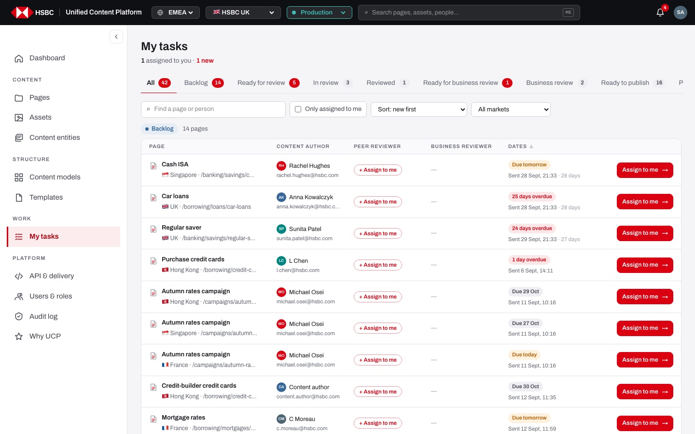
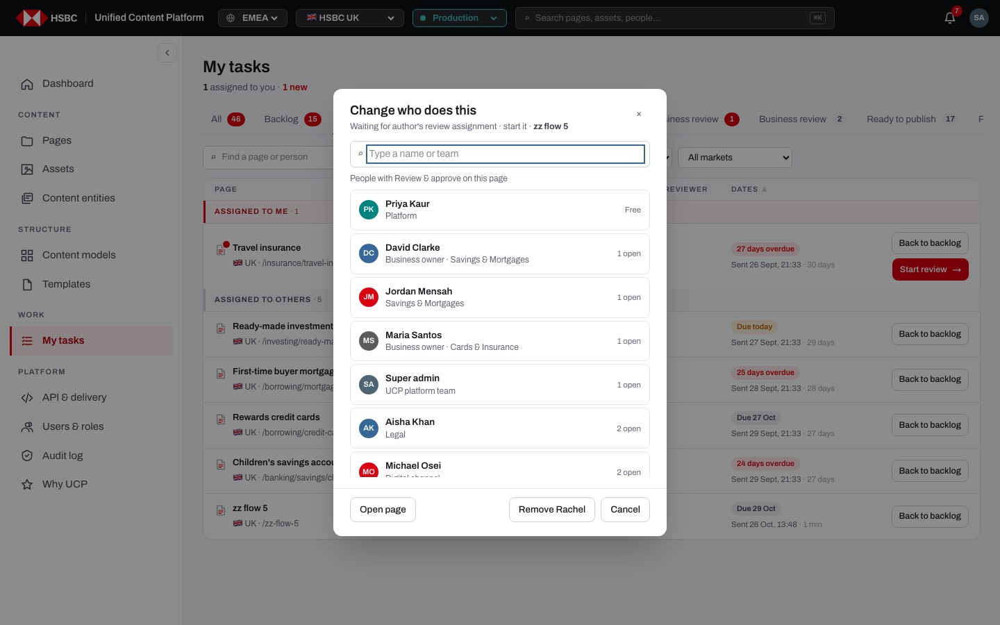
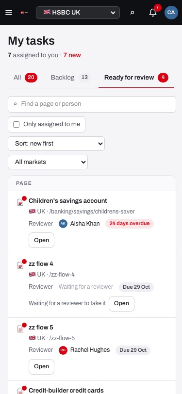

# EP-11 · My tasks

**Epic:** EP-11 · My tasks

**Business benefit:** Everyone in the content team works from one list that shows every page in the review flow, who has it and when it is due, so nothing waits unnoticed. The one action each person may take sits right on the row, which shortens every hand-off and keeps unauthorised steps out of reach.

**Scope:** The /uk/prod/tasks screen across all markets: stage tabs, the people and date columns, row actions per person, the site admin's pencil and assign dialog, search, "Only assigned to me", sorting, the market filter, "new" dots, the Published tab and the phone layout. The actions themselves are specified in EP-08 and EP-09.

**The view:**



- **Header** · "My tasks" and "N assigned to you · M new".
- **Stage tabs** · All, Backlog, Ready for review, In review, Reviewed (only when something is there), Ready for business review, Business review, Ready to publish, Published. Each tab has a count, red when something in it is new for you. The tab is kept in the address (?view=…).
- **Filters** · "Find a page or person", "Only assigned to me", sort (new first, due date soonest or latest first) and "All markets".
- **Task table** · one row per page: title with a red "new" dot, Jira chip and market/address; Content author (with co-authors), Peer reviewer and Business reviewer with avatar, name and e-mail; Dates (due chip and when it was sent, with how long it waits); and the action buttons on the right. Site admins see the rows split into "Assigned to me" and "Assigned to others".
- **All tab** · one card per stage under a stage heading that opens its tab; empty stages are a thin line with "nothing here".
- **Dialogs** · Author's review done · what next?, Share for business review, Publish, and the site admin's "Change who does this".


*Site admins change the peer reviewer with the pencil next to that person.*


*On a phone the people and due date sit under the title and the actions under the row.*

**Stories (11):**

1. [US-11.01 · My tasks: one task per page in stage tabs with people and due dates](#us-1101--my-tasks-one-task-per-page-in-stage-tabs-with-people-and-due-dates)
2. [US-11.02 · Stage tabs: counts, new badges and the All overview](#us-1102--stage-tabs-counts-new-badges-and-the-all-overview)
3. [US-11.03 · Task columns: who has the page at every step](#us-1103--task-columns-who-has-the-page-at-every-step)
4. [US-11.04 · My tasks (author): follow my own pages and who has them](#us-1104--my-tasks-author-follow-my-own-pages-and-who-has-them)
5. [US-11.05 · My tasks (reviewer / publisher): the next action for my step on each row](#us-1105--my-tasks-reviewer--publisher-the-next-action-for-my-step-on-each-row)
6. [US-11.06 · My tasks (admin): all tasks, split by assignee, with reviewer reassign](#us-1106--my-tasks-admin-all-tasks-split-by-assignee-with-reviewer-reassign)
7. [US-11.07 · Assign dialog: site admin picks, changes or removes the peer reviewer](#us-1107--assign-dialog-site-admin-picks-changes-or-removes-the-peer-reviewer)
8. [US-11.08 · Search, Only assigned to me, sorting and market filter](#us-1108--search-only-assigned-to-me-sorting-and-market-filter)
9. [US-11.09 · New for you: red dots until I have seen a task](#us-1109--new-for-you-red-dots-until-i-have-seen-a-task)
10. [US-11.10 · Published tab: the latest live pages and who published them](#us-1110--published-tab-the-latest-live-pages-and-who-published-them)
11. [US-11.11 · My tasks on a phone: people, due date and actions under the title](#us-1111--my-tasks-on-a-phone-people-due-date-and-actions-under-the-title)

---

## US-11.01 · My tasks: one task per page in stage tabs with people and due dates

**Business benefit:** One prioritised work list reduces time lost looking for pending work across tools. Due dates and overdue markers make bottlenecks visible to the team and management.

**User story:**

As anyone in the content team  
I want every page in the workflow as one task in the right tab  
So that I know what to do next without thinking  

**Persona:** anyone in the content team · **Depends on:** US-08.02

**Acceptance criteria:**

**Scenario 1 · Task per stage** *(one run per row of the table)*

```gherkin
Given a page with status "<status>"
Then My tasks shows it in "<tab>"
And its task says "<text>"

Examples:
  | status                          | tab                       | text                                              |
  | review, nobody assigned         | Backlog                   | Waiting for author's review assignment · start it |
  | review, a reviewer took it      | Ready for review          | Waiting for author's review assignment · start it |
  | inreview                        | In review                 | In author's review · finish and mark reviewed     |
  | reviewed                        | Reviewed                  | Author's review done · send to business review    |
  | bizreview, nobody has it        | Ready for business review | Business review · sign off before publishing      |
  | bizreview, a person or a group  | Business review           | Business review · sign off before publishing      |
  | approved                        | Ready to publish          | Business review done · ready to publish           |
  | scheduled                       | Ready to publish          | Check scheduled publish                           |
```

**Scenario 2 · People and dates on every row**

```gherkin
Then each row shows the Content author, the Peer reviewer and the Business reviewer with avatar, full name and e-mail
And "You" instead of my own name
And co-authors are listed under the Content author as "+ Name"
And a Jira chip is shown next to the title when the page has a ticket
And the due date shows "N days overdue", "Due today", "Due tomorrow" or "Due" with the date
And under it "Sent" with the date and how long it has been waiting
```

**Scenario 3 · Every market in one list**

```gherkin
Then tasks of every market are listed
And each row shows the market flag, the market name and the page address
```

---

## US-11.02 · Stage tabs: counts, new badges and the All overview

**Business benefit:** Counts per stage show where work piles up, so team leads can move people to the bottleneck. The overview groups everything by stage, which makes a weekly status meeting unnecessary.

**User story:**

As anyone in the content team  
I want tabs per stage with counts and an overview of all stages  
So that I see at a glance where pages are waiting  

**Persona:** anyone in the content team · **Depends on:** US-11.01

**Acceptance criteria:**

**Scenario 1 · Tabs and counts**

```gherkin
When I open My tasks
Then the tabs are "All", "Backlog", "Ready for review", "In review", "Ready for business review", "Business review", "Ready to publish" and "Published"
And "Reviewed" is shown only when a page waits there
And every tab shows how many pages it has
And the count is red when some of them are new for me, with the tooltip "N pages · M new for you"
```

**Scenario 2 · The tab is in the address**

```gherkin
When I open "In review"
Then the address is /uk/prod/tasks?view=inreview
And opening that address opens the same tab
```

**Scenario 3 · The All overview**

```gherkin
Given I am on "All"
Then each stage is a card under its own heading with "N pages"
And clicking the heading opens that tab
And a stage with nothing in it is a thin line that says "nothing here"
```

**Scenario 4 · Empty tab**

```gherkin
Given no page waits for a business reviewer
When I open "Ready for business review"
Then I see "No page is waiting for a business reviewer."
```

---

## US-11.03 · Task columns: who has the page at every step

**Business benefit:** Seeing the author, the peer reviewer and the business reviewer side by side makes ownership clear at every step. E-mail links let people contact the right person straight away.

**User story:**

As anyone in the content team  
I want the three people of the review flow in their own columns  
So that I know whom to ask about each page  

**Persona:** anyone in the content team · **Depends on:** US-11.01

**Acceptance criteria:**

**Scenario 1 · What the reviewer columns say before someone takes the page** *(one run per row of the table)*

```gherkin
Given a page at "<stage>"
Then the "<column>" column shows "<text>"

Examples:
  | stage                                  | column            | text                                        |
  | Waiting for author's review assignment | Peer reviewer     | + Assign to me (for reviewers), else Waiting for a reviewer |
  | Waiting for business review assignment | Business reviewer | Anyone with Review                          |
  | In business review, shared with a group| Business reviewer | the group as a chip, e.g. "Business owners" |
```

**Scenario 2 · Guest business reviewers**

```gherkin
Given a guest "Pat Partner" signed off through a review link
Then the Business reviewer column shows "Pat Partner"
```

**Scenario 3 · E-mail links**

```gherkin
When I click a person's e-mail under their name
Then my mail app opens to that address
```

**Scenario 4 · Scheduled pages**

```gherkin
Given a page is scheduled
Then its row shows the "Scheduled" pill next to the title
```

**Scenario 5 · Opening a page**

```gherkin
When I click a page title
Then the page opens in the page builder of its own market
```

---

## US-11.04 · My tasks (author): follow my own pages and who has them

**Business benefit:** Authors can track their pages without asking around, which reduces status meetings. Hiding review actions on their own work enforces four-eyes separation in the interface.

**User story:**

As a content author  
I want to see where each of my pages is and who has it, without review buttons for my own work  
So that I know whom to remind and when the page comes back to me  

**Persona:** content author · **Depends on:** US-11.01

**Acceptance criteria:**

**Background** (applies to every scenario below)

```gherkin
Given I am signed in as "content.author"
```

**Scenario 1 · My page waits for a reviewer**

```gherkin
Given I sent "Cash ISA" for review
Then "Cash ISA" is not in my Backlog
And it is under "Ready for review" with "Waiting for a reviewer to take it" and "Open"
```

**Scenario 2 · My actions on my own page** *(one run per row of the table)*

```gherkin
Given my page is in "<tab>"
Then I see "<actions>"

Examples:
  | tab                         | actions                         |
  | Ready for review (taken)    | No action for you, Open         |
  | In review                   | Remind                          |
  | Business review             | Reauthor                        |
  | Ready to publish            | Waiting for a publisher         |
  | Published                   | Open                            |
```

**Scenario 3 · Reminding from My tasks**

```gherkin
When I click "Remind" on "Cash ISA"
Then I see "Reminder sent"
```

---

## US-11.05 · My tasks (reviewer / publisher): the next action for my step on each row

**Business benefit:** Taking and finishing work from one list shortens cycle time for every hand-off. Showing only the permitted action reduces errors and unauthorised steps.

**User story:**

As a peer reviewer, business owner or publisher  
I want the action for my step right on the row  
So that I can take and finish work from one list  

**Persona:** peer reviewer, business owner or publisher · **Depends on:** US-11.01

**Acceptance criteria:**

**Scenario 1 · The Backlog is a shared bucket**

```gherkin
Given I am signed in as a reviewer
Then each Backlog row has "Assign to me" instead of "Open"
And the Peer reviewer column offers "+ Assign to me" too
And someone with Read only sees "Only reviewers can take it · you don't have Review & approve here" next to a disabled "Assign to me"
```

**Scenario 2 · Row actions** *(one run per row of the table)*

```gherkin
Given a task in "<tab>"
And I am "<who>"
Then I see "<actions>"

Examples:
  | tab                       | who                                | actions                       |
  | Backlog                   | a reviewer                         | Assign to me                  |
  | Ready for review          | the assigned reviewer              | Back to backlog, Start review |
  | In review                 | the assigned reviewer              | Reviewed                      |
  | Reviewed                  | someone with Edit or Review        | Next step                     |
  | Ready for business review | a business owner                   | Assign to me                  |
  | Ready for business review | the person who did the peer review | Waiting for a business reviewer |
  | Business review           | the business reviewer              | Reauthor, Sign off            |
  | Ready to publish          | a publisher                        | Publish                       |
```

**Scenario 3 · What the buttons say when they are done** *(one run per row of the table)*

```gherkin
When I click "<button>" on "Cash ISA"
Then I see "<message>"

Examples:
  | button                         | message                                                          |
  | Assign to me (Backlog)         | Cash ISA is yours · find it in Ready for review                  |
  | Start review                   | Cash ISA: review started                                         |
  | Assign to me (business review) | Cash ISA: the business review is yours                           |
  | Sign off                       | Cash ISA: signed off · ready to publish                          |
  | Reauthor, then confirm         | Cash ISA is back with the author                                 |
```

**Scenario 4 · Reviewed opens the choice**

```gherkin
When I click "Reviewed" and choose "Send to business review"
Then I see "Cash ISA sent to business review · share it with the business"
And the "Share for business review" dialog opens
```

**Scenario 5 · Publish from the list**

```gherkin
When I click "Publish" as a publisher
Then the Publish dialog opens with "Publish now" or "Schedule"
And afterwards I see "Cash ISA is live", "Cash ISA is scheduled" or "Schedule cancelled"
```

---

## US-11.06 · My tasks (admin): all tasks, split by assignee, with reviewer reassign

**Business benefit:** Admins can balance workload across reviewers, which protects delivery dates. Restricting reassignment once a page is ready to publish keeps late changes under control.

**User story:**

As a site admin  
I want to see all tasks, split by who has them, and change the peer reviewer  
So that I can balance work and unblock pages  

**Persona:** site admin · **Depends on:** US-11.01, US-11.05 · **Note:** site admin only

**Acceptance criteria:**

**Background** (applies to every scenario below)

```gherkin
Given I am signed in as "super.admin"
```

**Scenario 1 · Admin view**

```gherkin
Then I see every task of every market
And each tab is split into "Assigned to me" and "Assigned to others" with counts
And a pencil next to the Peer reviewer lets me change the person while the page is in the author's review
```

**Scenario 2 · Admin row actions**

```gherkin
Then rows in "Ready for review" offer "Back to backlog" even when someone else took them
And rows in "In review" offer "Reviewed for Rachel" when Rachel is the reviewer
And rows in "Business review" offer "Share", "Reauthor" and "Sign off"
And I can take my own pages from the Backlog
```

**Scenario 3 · No reassigning in business review or at Ready to publish**

```gherkin
Then rows in "Business review" and "Ready to publish" have no pencil
```

---

## US-11.07 · Assign dialog: site admin picks, changes or removes the peer reviewer

**Business benefit:** Workload can be balanced in seconds, using how many open reviews each person already has. Every change is written to the audit log, so oversight stays visible.

**User story:**

As a site admin  
I want to choose the peer reviewer of a page from the people who may review it  
So that reviews go to someone with time and the right permission  

**Persona:** site admin · **Depends on:** US-11.06 · **Note:** site admin only

**Acceptance criteria:**

**Background** (applies to every scenario below)

```gherkin
Given I am signed in as "super.admin"
And "rachel.hughes" took the author's review of "Cash ISA"
```

**Scenario 1 · Opening the dialog**

```gherkin
When I click the pencil "Change reviewer" next to Rachel Hughes
Then the dialog "Change who does this" opens for "Cash ISA"
And it lists "People with Review & approve on this page" with team and "Free", "N open" or "Assigned now"
And it has "Open page", "Remove Rachel" and "Cancel"
```

**Scenario 2 · Choosing someone else**

```gherkin
When I type "aisha" in "Type a name or team" and choose "Aisha Khan"
Then I see "Cash ISA: assigned to Aisha Khan"
And the audit log says "assigned the review task on Cash ISA to Aisha Khan (was Rachel Hughes)"
```

**Scenario 3 · Removing the reviewer**

```gherkin
When I click "Remove Rachel"
Then I see "Cash ISA: not assigned"
And the page is back in the Backlog
```

**Scenario 4 · Nobody matches**

```gherkin
When I type "zzz"
Then I see "Nobody matches that name."
```

**Scenario 5 · Not an admin**

```gherkin
Given I am signed in as "rachel.hughes"
When a task assignment is sent anyway
Then it is refused with "Only site admins can assign tasks"
```

---

## US-11.08 · Search, Only assigned to me, sorting and market filter

**Business benefit:** People find the page they are asked about in seconds, even across many markets. Sorting by due date puts urgent work first, which reduces missed deadlines.

**User story:**

As anyone in the content team  
I want to search, filter and sort my tasks  
So that I find the right page quickly and do the urgent ones first  

**Persona:** anyone in the content team · **Depends on:** US-11.01

**Acceptance criteria:**

**Scenario 1 · Search**

```gherkin
When I type "cash" in "Find a page or person"
Then only tasks whose title, address or people match stay in every tab
```

**Scenario 2 · Nothing matches**

```gherkin
When I type "qqqqq"
Then I see "No pages match." with "Clear filters"
And "Clear filters" empties the search and the market filter
```

**Scenario 3 · Only assigned to me**

```gherkin
When I tick "Only assigned to me"
Then only tasks where I am the assignee stay
And in "Published" only pages I published
```

**Scenario 4 · Sorting**

```gherkin
Then the sort offers "Sort: new first", "Sort: due date, soonest first" and "Sort: due date, latest first"
And clicking the "Dates" column heading switches between soonest and latest first
```

**Scenario 5 · Market filter**

```gherkin
When I choose "🇭🇰 HSBC Hong Kong" instead of "All markets"
Then only Hong Kong pages are listed
And the list offers only markets that have tasks or published pages
```

---

## US-11.09 · New for you: red dots until I have seen a task

**Business benefit:** New work stands out from what people already know about, so hand-offs are noticed at once. Nobody needs a separate notification to spot a new task.

**User story:**

As anyone in the content team  
I want new tasks marked until I have looked at them  
So that I spot new work at once  

**Persona:** anyone in the content team · **Depends on:** US-11.02

**Acceptance criteria:**

**Scenario 1 · A new task**

```gherkin
Given a page reached a stage where it is mine (assigned to me, I wrote it, or I can take it from the Backlog)
Then its row shows a red dot "New for you"
And the header says "N assigned to you · M new"
```

**Scenario 2 · Seen**

```gherkin
When I leave the tab, open the page or leave My tasks
Then the tasks I had on screen are no longer new
And this is remembered in this browser
```

**Scenario 3 · New again**

```gherkin
Given I saw "Cash ISA" in "Ready for review"
When it moves to "In review" or gets another reviewer
Then it is new again
```

**Scenario 4 · Nothing for me**

```gherkin
Given nothing is assigned to me
Then the header says "Nothing is assigned to you right now"
```

---

## US-11.10 · Published tab: the latest live pages and who published them

**Business benefit:** Authors see their work go live without asking the publisher, which closes the loop of every hand-off. Admins get a quick log of recent launches.

**User story:**

As anyone in the content team  
I want a Published tab with the pages that went live recently  
So that I know my page is live  

**Persona:** anyone in the content team · **Depends on:** US-09.03

**Acceptance criteria:**

**Scenario 1 · Published pages**

```gherkin
When I open "Published"
Then I see up to 30 of the most recently published pages, newest first
And each row shows the title, the "Published" pill, the live address, "Published by" and the date
And "Open" opens the page
```

**Scenario 2 · Mine or everyone's**

```gherkin
Given I am not a site admin
Then I see only pages published by me
And site admins see "Published by me" and "Published by others"
```

**Scenario 3 · Nothing yet**

```gherkin
Given nothing of mine was published recently
Then I see "Nothing of yours published recently."
```

---

## US-11.11 · My tasks on a phone: people, due date and actions under the title

**Business benefit:** Reviewers and business owners can take and finish work on the move, which shortens waiting time. The same list works on every screen without a separate app.

**User story:**

As anyone in the content team  
I want My tasks to work on my phone  
So that I can take or finish work away from my desk  

**Persona:** anyone in the content team · **Depends on:** US-11.01

**Acceptance criteria:**

**Scenario 1 · Phone layout**

```gherkin
Given my screen is narrower than 768 px
When I open My tasks
Then each row shows the title, the market and address
And under it the person who has the page now (e.g. "Reviewer Rachel Hughes") and the due chip
And the actions sit under the row
And the tabs scroll sideways
```

**Scenario 2 · Medium screens**

```gherkin
Given my screen is narrower than 1,400 px
Then the three people columns fold into one line under the title
And the Dates and action columns stay
```
