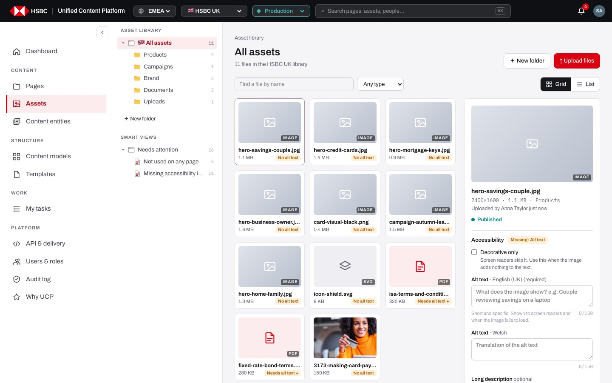
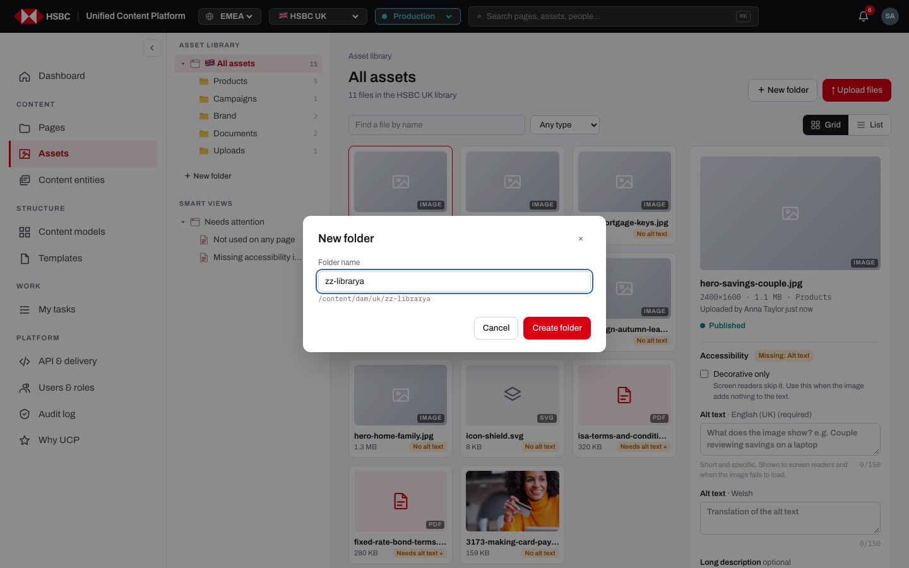
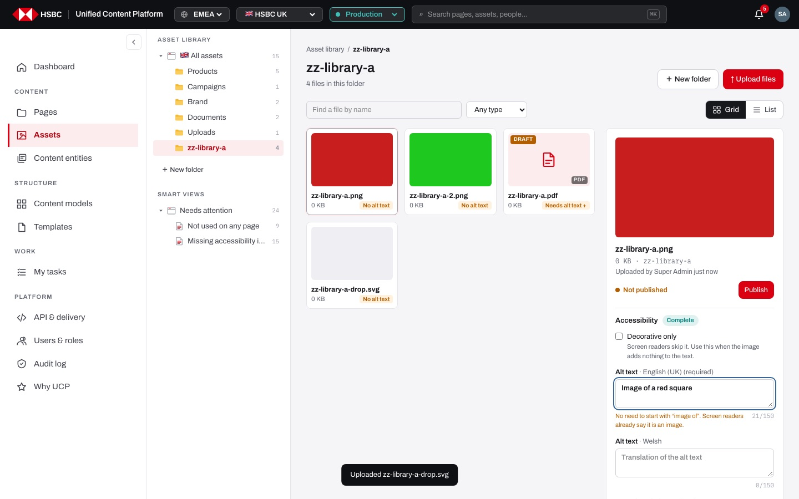
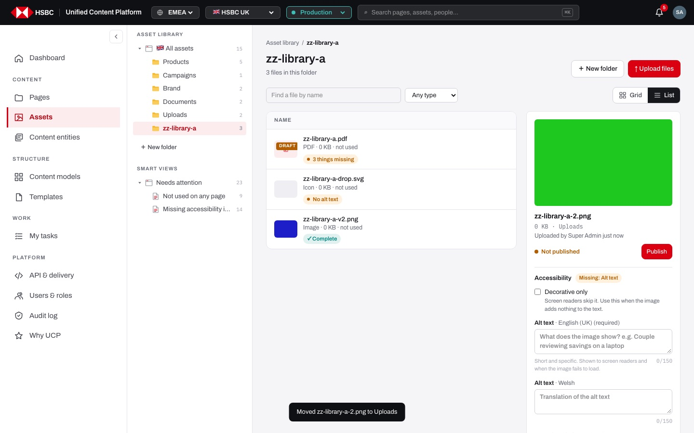
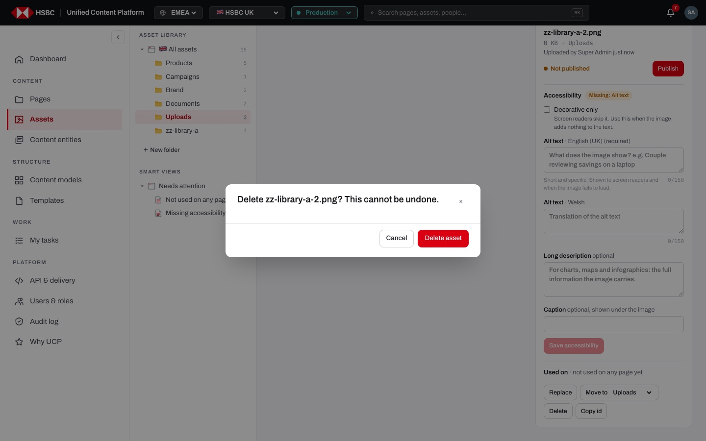
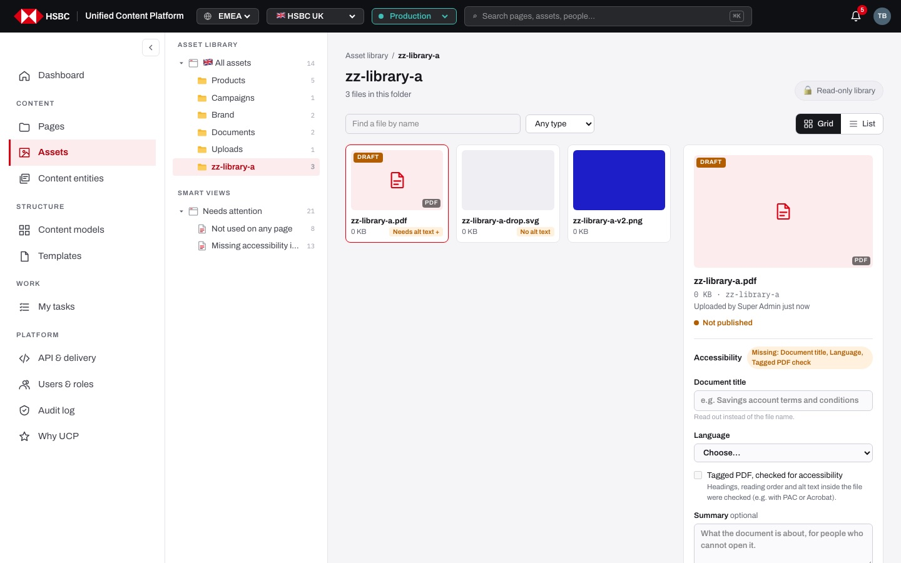

# EP-12 · Assets

**Epic:** EP-12 · Assets

**Business benefit:** One shared library of approved images, icons and documents per market lets teams reuse material instead of buying, uploading and approving it again. Rules on publishing, deleting and accessibility make sure no live page shows an unapproved, missing or inaccessible file.

**Scope:** The Assets screen of a market: folders and smart views, finding and filtering files, the detail panel, uploading, replacing, moving, deleting and publishing files, and their accessibility details. Picking a file inside the page builder and publishing files together with pages are covered in the page builder and publishing epics.

**The view:**



- **Left rail · Asset library:** "All assets" with the market flag and a count, then one entry per folder with its count (the five standard folders first, then any folder the team created) and "＋ New folder".
- **Left rail · Smart views:** "Needs attention" with "Not used on any page" and "Missing accessibility info", each with a count.
- **Header:** breadcrumb "Asset library / <folder or view>", the title, a file count ("11 files in the HSBC UK library") and, for people with Edit, "＋ New folder" and "↑ Upload files" (otherwise a "Read-only library" badge).
- **Toolbar:** "Find a file by name", the "Any type / Images / Documents / Icons" filter and the Grid / List switch.
- **File area:** a grid of thumbnails or a list with name, type, size, folder, "Used on" and an accessibility chip; files can also be dropped here.
- **Detail panel (right):** preview, file facts, upload and publish status, the Accessibility form, "Used on N pages" and the actions "Replace", "Move to", "Delete" and "Copy id".


*The "New folder" dialog shows the repository path the folder will get; slashes are removed from the name.*


*A fresh upload is "Not published" with a "Publish" button; the alt text field warns about "image of" and counts characters.*


*The list view shows type, size, usage and an accessibility chip per file.*


*Deleting an unused file asks for confirmation; files used on pages cannot be deleted.*


*Without Edit the library is read-only: no upload, folder or file actions, and the accessibility fields are locked. Documents show title, language, tagged-PDF check and summary instead of alt text.*

**Stories (12):**

1. [US-12.01 · Asset library: browse files by folder with counts and a breadcrumb](#us-1201--asset-library-browse-files-by-folder-with-counts-and-a-breadcrumb)
2. [US-12.02 · Asset library: find by name, filter by type and switch between grid and list](#us-1202--asset-library-find-by-name-filter-by-type-and-switch-between-grid-and-list)
3. [US-12.03 · Asset details: see a file's facts, status and the pages that use it](#us-1203--asset-details-see-a-files-facts-status-and-the-pages-that-use-it)
4. [US-12.04 · Asset folders: create a new folder](#us-1204--asset-folders-create-a-new-folder)
5. [US-12.05 · Asset upload: upload files with the button or by drag and drop, never overwriting](#us-1205--asset-upload-upload-files-with-the-button-or-by-drag-and-drop-never-overwriting)
6. [US-12.06 · Asset replace: swap a file for a new version without breaking pages](#us-1206--asset-replace-swap-a-file-for-a-new-version-without-breaking-pages)
7. [US-12.07 · Asset actions: move a file to another folder and copy its id](#us-1207--asset-actions-move-a-file-to-another-folder-and-copy-its-id)
8. [US-12.08 · Asset delete: delete unused files after confirmation](#us-1208--asset-delete-delete-unused-files-after-confirmation)
9. [US-12.09 · Asset accessibility: alt text per language and document accessibility details](#us-1209--asset-accessibility-alt-text-per-language-and-document-accessibility-details)
10. [US-12.10 · Asset smart views: find unused files and files missing accessibility info](#us-1210--asset-smart-views-find-unused-files-and-files-missing-accessibility-info)
11. [US-12.11 · Asset publishing: publish files and block pages that still use draft files](#us-1211--asset-publishing-publish-files-and-block-pages-that-still-use-draft-files)
12. [US-12.12 · Asset library: read-only access for people without Edit](#us-1212--asset-library-read-only-access-for-people-without-edit)

---

## US-12.01 · Asset library: browse files by folder with counts and a breadcrumb

**Business benefit:** Authors find approved material in seconds instead of asking colleagues or uploading duplicates. A clear folder structure per market keeps brand, product and legal files apart and easy to govern.

**User story:**

As a content author  
I want to open the asset library of my market and move between its folders  
So that I can quickly see which files we already have  

**Persona:** content author · **Depends on:** —

**Acceptance criteria:**

**Scenario 1 · Opening the library**

```gherkin
Given I am signed in to the market "HSBC UK"
When I open "Assets"
Then the title is "All assets" with the line "11 files in the HSBC UK library"
And the left rail shows "🇬🇧 All assets" and the folders "Products", "Campaigns", "Brand", "Documents" and "Uploads", each with its number of files
And folders created by the team are listed after the standard ones
And the first file of the list is selected in the detail panel
```

**Scenario 2 · Opening a folder**

```gherkin
When I click the folder "Products" in the left rail
Then the address ends with "?folder=Products"
And the folder is highlighted, the title is "Products" and the line says "5 files in this folder"
And the breadcrumb shows "Asset library / Products"
When I click "Asset library" in the breadcrumb
Then I am back on "All assets"
```

**Scenario 3 · Empty folder**

```gherkin
Given the folder "Spring campaign" has no files
When I open it
Then I see "No files here yet. Upload some or drag them in."
```

---

## US-12.02 · Asset library: find by name, filter by type and switch between grid and list

**Business benefit:** Large libraries stay usable, so authors pick the right approved file instead of a near-duplicate. The list view shows usage and accessibility at a glance, which speeds up clean-up work.

**User story:**

As a content author  
I want to search files by name, filter them by type and choose a grid or list view  
So that I find the file I need however big the library gets  

**Persona:** content author · **Depends on:** US-12.01

**Acceptance criteria:**

**Scenario 1 · Finding by name**

```gherkin
Given I am on "All assets"
When I type "hero" into "Find a file by name"
Then only files whose name contains "hero" are shown, ignoring upper and lower case
And the count line shows how many files match
When I type a name no file has
Then I see "No files here yet."
```

**Scenario 2 · Filtering by type** *(one run per row of the table)*

```gherkin
When I choose "<filter>" in the type filter
Then only <files> are shown

Examples:
  | filter    | files                     |
  | Any type  | all files                 |
  | Images    | JPG, PNG and other images |
  | Documents | PDF files                 |
  | Icons     | SVG files                 |
```

**Scenario 3 · Grid or list**

```gherkin
When I click "List"
Then the files are shown as rows with a thumbnail, the name, the type, the size, the folder (on "All assets"), how many pages use it and an accessibility chip such as "✓ Complete", "No alt text" or "3 things missing"
And on very wide screens "Used on" and "Accessibility" are separate columns
When I click "Grid"
Then the files are shown as thumbnails with name, size and a warning chip when accessibility info is missing
And my choice is remembered in this browser the next time I open Assets
```

**Scenario 4 · Long lists**

```gherkin
Given a view holds more than 60 files
Then the first 60 are shown with "Showing 60 of <total>" and "Show more"
When I click "Show more"
Then 60 more files are shown
And changing the folder, view, search or type starts again at 60
```

---

## US-12.03 · Asset details: see a file's facts, status and the pages that use it

**Business benefit:** Authors see before they change anything whether a file is live and which pages depend on it, which prevents broken or wrong pages. Knowing who uploaded and published each file supports audits and questions from the business.

**User story:**

As a content author  
I want to select a file and see its details and where it is used  
So that I know what I am dealing with before I reuse, change or remove it  

**Persona:** content author · **Depends on:** US-12.01

**Acceptance criteria:**

**Scenario 1 · File facts**

```gherkin
When I click "hero-savings-couple.jpg"
Then the file is highlighted and the detail panel shows a large preview, the name and "2400×1600 · 1.1 MB · Products"
And it shows "Uploaded by <person> <when>"
And it shows "Published" with when and by whom, or "Not published"
```

**Scenario 2 · Preview of files without a picture**

```gherkin
Given a file has no stored picture
Then its thumbnail is a calm tile with an image, document or icon symbol and the type "IMAGE", "PDF" or "SVG"
And a draft file shows the badge "Draft" with the tooltip "Not published · pages that use it cannot go live until it is"
```

**Scenario 3 · Pages that use the file**

```gherkin
Given "hero-savings-couple.jpg" is used on 1 live page
Then the panel shows "Used on 1 page" with the summary "1 live"
When I click "Show"
Then I see each page with its status and title, linking to the page in the page builder
And with more than 5 pages only the first 5 are listed with "Show all <n>", and then "Show fewer"
When I click "Hide"
Then the list folds again
```

**Scenario 4 · Unused file**

```gherkin
Given no page uses the file
Then the panel says "Used on · not used on any page yet"
```

---

## US-12.04 · Asset folders: create a new folder

**Business benefit:** Teams can organise files per campaign or product line, which keeps the library tidy as it grows. Clear folders shorten search time and reduce accidental use of old material.

**User story:**

As a content author  
I want to create a new asset folder  
So that files of a campaign or product line sit together  

**Persona:** content author · **Depends on:** US-12.01

**Acceptance criteria:**

**Scenario 1 · Creating a folder**

```gherkin
Given I have Edit on the market
When I click "＋ New folder" in the header or in the left rail
Then the dialog "New folder" opens with "Folder name" and the placeholder "e.g. Spring campaign"
When I type "Spring campaign"
Then I see the path "/content/dam/uk/Spring campaign"
When I click "Create folder" or press Enter
Then I see "Created folder Spring campaign"
And the new folder opens and is listed in the left rail
```

**Scenario 2 · Name rules**

```gherkin
Given the dialog "New folder" is open
Then "Create folder" is disabled while the name is empty
And slashes and backslashes I type are removed from the name
```

**Scenario 3 · The folder already exists**

```gherkin
Given a folder "Spring campaign" exists
When I try to create "Spring campaign" again
Then an error banner shows "Node already exists. /content/dam/uk/Spring campaign" with a request id and "Dismiss"
And the dialog stays open
```

**Scenario 4 · Closing without creating**

```gherkin
When I click "Cancel", "×" or outside the dialog
Then the dialog closes and no folder is created
```

---

## US-12.05 · Asset upload: upload files with the button or by drag and drop, never overwriting

**Business benefit:** Files can be added without breaking live pages, protecting the customer experience and the bank's reputation. Automatic renaming prevents costly overwrites of approved material.

**User story:**

As a content author  
I want to upload one or more files with a button or by dropping them on the library  
So that new material is available without ever overwriting another file  

**Persona:** content author · **Depends on:** US-12.01

**Acceptance criteria:**

**Scenario 1 · Uploading with the button**

```gherkin
Given I have Edit and I am in the folder "Campaigns"
When I click "↑ Upload files" and choose "hero.jpg"
Then the button shows "Uploading…" and then I see "Uploaded hero.jpg"
And "hero.jpg" is in "Campaigns", selected in the detail panel and "Not published"
And choosing several files at once shows "Uploaded <n> files"
And the file picker offers images, PDF and SVG files
```

**Scenario 2 · Dropping files**

```gherkin
When I drag files over the file area
Then it gets a dashed outline
When I drop "hero.jpg" into "Campaigns"
Then it is uploaded into "Campaigns" as a draft
And files dropped or uploaded on "All assets" or a smart view go to "Uploads"
```

**Scenario 3 · Never overwriting**

```gherkin
Given "hero.jpg" is already in "Campaigns"
When I upload another "hero.jpg" into "Campaigns"
Then the new file becomes "hero-2.jpg"
And the existing "hero.jpg" is unchanged
```

**Scenario 4 · File type and preview**

```gherkin
When I upload a file
Then an image becomes type "Image", an SVG "Icon", a PDF "Document" and anything else "File"
And images under 1.5 MB keep a preview picture
And the upload is written to the audit log
```

---

## US-12.06 · Asset replace: swap a file for a new version without breaking pages

**Business benefit:** Updated material such as a new campaign photo or revised terms reaches every page that uses it without editing each page. Keeping the file's id and accessibility details avoids broken images and lost alt text.

**User story:**

As a content author  
I want to replace a file with a new version  
So that every page that uses it shows the new version  

**Persona:** content author · **Depends on:** US-12.05, US-12.03

**Acceptance criteria:**

**Scenario 1 · Replacing keeps pages working**

```gherkin
Given "hero.jpg" is selected and used on 2 pages
When I click "Replace" and choose "hero-autumn.jpg"
Then the button shows "Replacing…" and then I see "Replaced hero.jpg"
And the file keeps its id, so the 2 pages show the new file
And its alt text and other accessibility details are kept
```

**Scenario 2 · The new version needs publishing**

```gherkin
When a file has been replaced
Then it carries the name of the new file
And it is "Not published" until someone with Publish publishes it
```

---

## US-12.07 · Asset actions: move a file to another folder and copy its id

**Business benefit:** Files can be reorganised at any time without breaking the pages that use them. Copying the id gives developers and authors an exact reference to the approved file.

**User story:**

As a content author  
I want to move a file to another folder and copy its id  
So that the library stays organised and I can refer to a file exactly  

**Persona:** content author · **Depends on:** US-12.03, US-12.04

**Acceptance criteria:**

**Scenario 1 · Moving a file**

```gherkin
Given "hero.jpg" in "Campaigns" is selected
When I choose "Uploads" in "Move to"
Then I see "Moved hero.jpg to Uploads"
And the file is listed in "Uploads" and the folder counts are updated
And pages that use it keep working
```

**Scenario 2 · Copying the id**

```gherkin
When I click "Copy id"
Then the file's id is copied to the clipboard and I see "Copied <id>"
And when the browser blocks the clipboard I see "Clipboard is not available in this browser"
And "Copy id" is available to everyone who can open the library
```

---

## US-12.08 · Asset delete: delete unused files after confirmation

**Business benefit:** Outdated material can be removed so it is not reused by mistake. Blocking deletion of files that pages still use prevents broken images and missing documents on live pages.

**User story:**

As a content author  
I want to delete files that no page uses, after confirming  
So that the library stays clean without breaking any page  

**Persona:** content author · **Depends on:** US-12.03

**Acceptance criteria:**

**Scenario 1 · Deleting an unused file**

```gherkin
Given "old-banner.jpg" is not used on any page
When I click "Delete"
Then I am asked "Delete old-banner.jpg? This cannot be undone." with "Cancel" and "Delete asset"
When I click "Delete asset"
Then I see "Deleted old-banner.jpg" and the file is gone from the library
And the deletion is written to the audit log
```

**Scenario 2 · Deleting a used file**

```gherkin
Given "hero.jpg" is used on 2 pages
Then "Delete" is disabled with the tooltip "Remove it from pages first"
```

**Scenario 3 · Changing my mind**

```gherkin
Given the delete confirmation is open
When I click "Cancel" or "×"
Then nothing is deleted
```

---

## US-12.09 · Asset accessibility: alt text per language and document accessibility details

**Business benefit:** Recording alt text and document accessibility details helps the bank meet its accessibility obligations and avoid legal risk. Customers using assistive technology get the same information as everyone else.

**User story:**

As a content author  
I want to record alt text per language for images and the accessibility details of documents  
So that every file on our pages can be used by customers with assistive technology  

**Persona:** content author · **Depends on:** US-12.03

**Acceptance criteria:**

**Scenario 1 · Alt text per language**

```gherkin
Given an image of the market "HSBC UK" is selected
Then the Accessibility section shows "Missing: Alt text" or "Complete"
And I see "Alt text · English (UK) (required)" and "Alt text · Welsh", each with a counter "<n>/150"
And instead of alt text I can tick "Decorative only", which hides the alt text and long description fields
And I can add an optional "Long description" and an optional "Caption"
```

**Scenario 2 · Hints for better alt text** *(one run per row of the table)*

```gherkin
When I type "<alt text>" as the English alt text
Then I see the hint "<hint>"

Examples:
  | alt text                    | hint                                                                          |
  | Image of a couple           | No need to start with “image of”. Screen readers already say it is an image. |
  | hero.jpg                    | Describe what the image shows, not the file name.                            |
  | a text of 151 characters    | Keep it under 150 characters. Use the long description for detail.           |
```

**Scenario 3 · Documents**

```gherkin
Given a PDF is selected
Then I see "Document title", "Language" with "Choose…", "Tagged PDF, checked for accessibility" and an optional "Summary"
And while any of them is empty the badge shows "Missing: Document title, Language, Tagged PDF check"
```

**Scenario 4 · Saving and discarding**

```gherkin
Given I changed a field
When I click "Save accessibility"
Then I see "Saved accessibility for <file>" and "Last updated by <me> · <date>"
And the details apply to every page that uses the file
And "Save accessibility" is disabled while nothing has changed
When I change a field and click "Discard"
Then the saved values come back
```

---

## US-12.10 · Asset smart views: find unused files and files missing accessibility info

**Business benefit:** Reusing approved files avoids duplicate purchases and repeated approvals, lowering cost. Smart views surface unused and inaccessible files so problems are fixed before audits find them.

**User story:**

As a content author  
I want to see which files are unused or missing accessibility details  
So that I reuse approved files and can clean up problems quickly  

**Persona:** content author · **Depends on:** US-12.01, US-12.09

**Acceptance criteria:**

**Scenario 1 · Needs attention**

```gherkin
When I open Assets
Then the left rail shows "Smart views" with "Needs attention" and its total
And under it "Not used on any page" and "Missing accessibility info", each with a count
```

**Scenario 2 · Smart views** *(one run per row of the table)*

```gherkin
When I open "<view>"
Then the address ends with "<address>"
And the title and breadcrumb show "<view>" and the line says "<n> files in this view"
And I see <what>

Examples:
  | view                       | address      | what                                                                 |
  | Not used on any page       | ?view=unused | files no page uses                                                   |
  | Missing accessibility info | ?view=noalt  | images and icons without alt text or "Decorative only", and PDFs without title, language or tagged check |
```

**Scenario 3 · Fixing a file**

```gherkin
Given I am in "Missing accessibility info"
When I complete and save the accessibility details of a file
Then the file leaves the view and the count goes down
```

---

## US-12.11 · Asset publishing: publish files and block pages that still use draft files

**Business benefit:** Only approved files can appear on live pages, reducing brand, legal and compliance risk. The publish record shows who approved each file and when, supporting audits.

**User story:**

As a publisher  
I want to publish draft files and have pages refused while they still use a draft file  
So that customers only ever see approved files  

**Persona:** publisher · **Depends on:** US-12.05, US-12.03

**Acceptance criteria:**

**Scenario 1 · Publishing a file**

```gherkin
Given I have Publish
And the draft file "hero.jpg" is selected
When I click "Publish"
Then the button shows "Publishing…" and then I see "Published hero.jpg"
And the panel shows "Published just now by <me>"
And the publication is written to the audit log
```

**Scenario 2 · Without Publish**

```gherkin
Given I have Edit but not Publish
When I select a draft file
Then I see "Not published" without a "Publish" button
And publishing files through the API is refused with "You don't have Publish"
```

**Scenario 3 · A page cannot go live with a draft file**

```gherkin
Given the approved page "Spring offer" uses the draft file "hero.jpg"
When the page is published without its files
Then it is refused with "Uses 1 file that is not published yet"
And it can go live once the file is published, or when the files are published together with the page in the Publish dialog
```

---

## US-12.12 · Asset library: read-only access for people without Edit

**Business benefit:** Reviewers, business owners and marketing colleagues can look up approved files without the risk of changing them. Limiting changes to people with Edit keeps the library under control.

**User story:**

As a viewer or reviewer  
I want to browse the asset library without being able to change it  
So that I can check and reference files safely  

**Persona:** viewer · **Depends on:** US-12.03, US-12.09

**Acceptance criteria:**

**Scenario 1 · Read-only library**

```gherkin
Given I am signed in without Edit on the market
When I open "Assets"
Then instead of "＋ New folder" and "↑ Upload files" I see "Read-only library" with the tooltip "You don't have Edit on this site. Ask a site admin."
And there is no "＋ New folder" in the left rail
And dropping files on the library does nothing
And the empty-folder text is "No files here yet." without the upload hint
```

**Scenario 2 · Read-only details**

```gherkin
When I select a file
Then I see its facts, status, accessibility details and the pages that use it
And the accessibility fields are locked and there is no "Save accessibility"
And there are no "Replace", "Move to", "Delete" or "Publish" actions
But I can use "Copy id"
```
