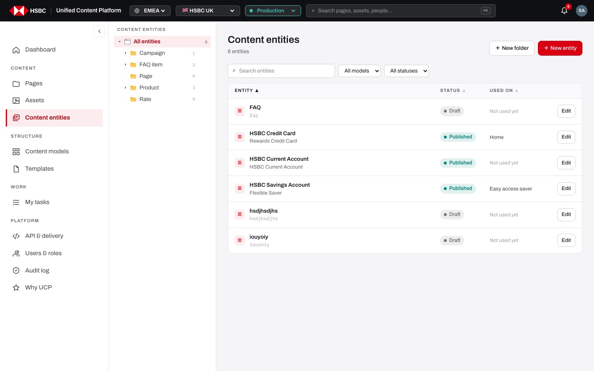
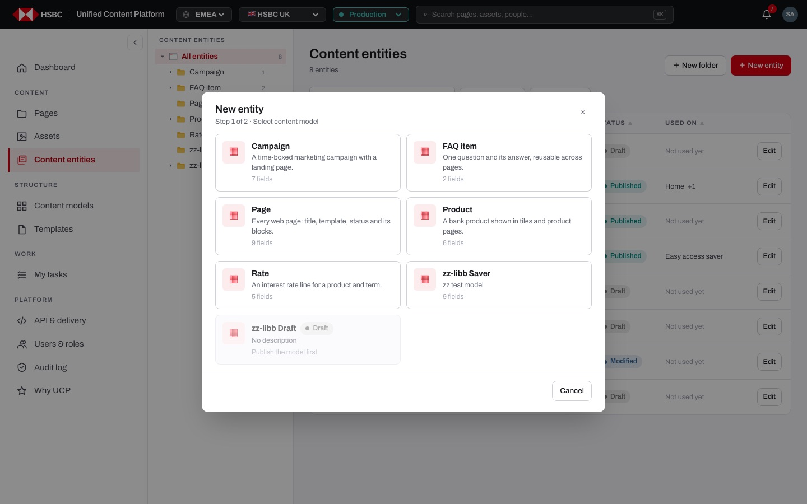
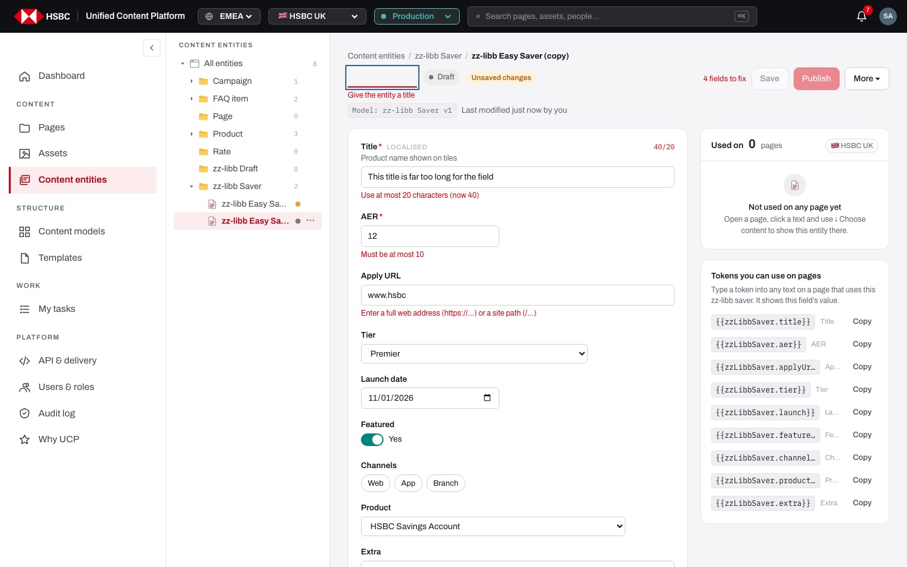
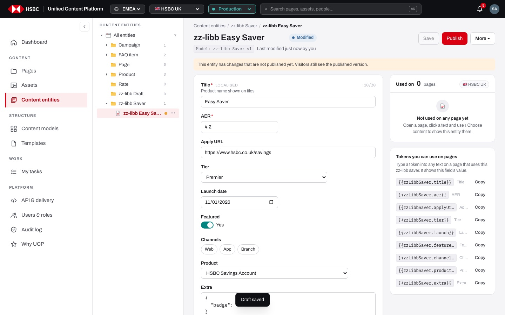
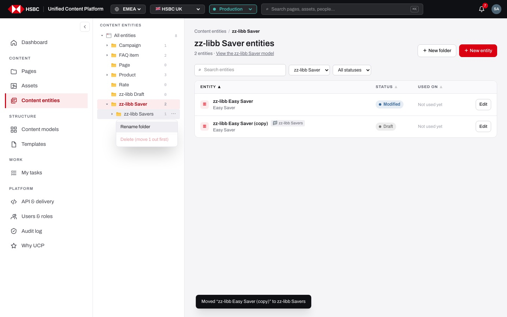
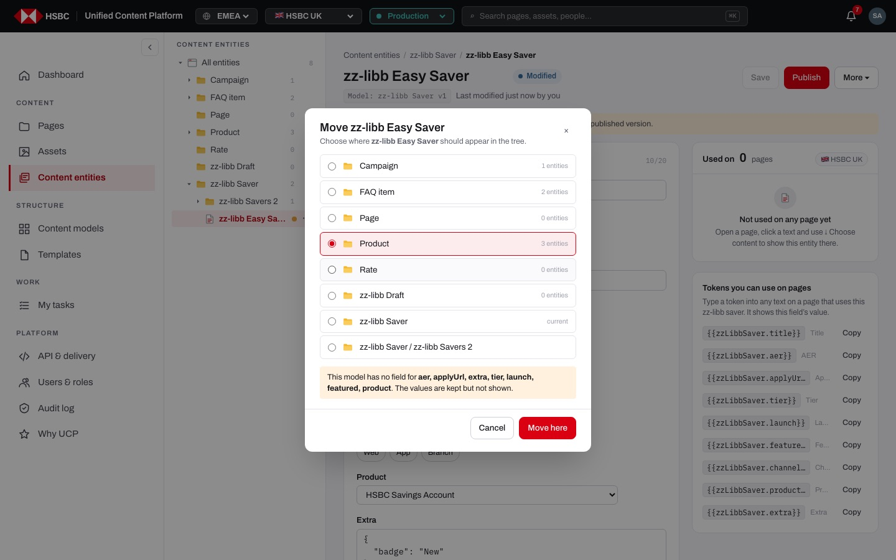
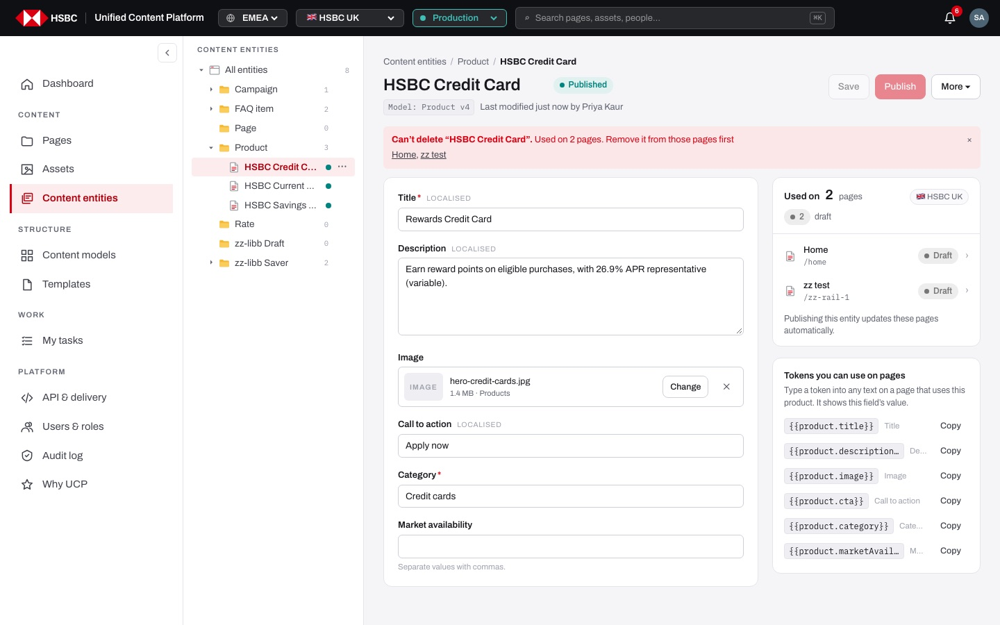

# EP-13 · Content entities

**Epic:** EP-13 · Content entities

**Business benefit:** Facts such as product names, rates and FAQ answers are written once as structured, validated content and reused on every page, so the bank no longer maintains the same figure in many places. One publish updates every page that shows the entity, which lowers the conduct risk of customers seeing outdated or conflicting information.

**Scope:** The Content entities screen of a market: browsing entities by content model and folder, finding and sorting them, creating them from a published model, filling in the generated form, saving, publishing, duplicating, moving and deleting them, entity folders and the token help. Defining the models themselves is EP-14; linking an entity to a page is covered in the page builder epics.

**The view:**



- **Left rail · Content entities tree:** "All entities" with a total count, one folder per content model with its count, entity folders inside a model, and the entities themselves with a status dot (grey draft, green published, amber modified). People with Edit get a "⋯" menu on each row ("＋ New folder" on a model; "Rename folder" / "Delete folder" on a folder; "Open" / "Move to…" on an entity) and can drag entities.
- **Header:** breadcrumb, the title ("Content entities", "<Model> entities" or the folder name), the entity count with "View the <Model> model", and "＋ New folder" / "＋ New entity" for people with Edit (otherwise a "Read-only" badge).
- **Toolbar:** "Search entities", the content model filter ("All models") and the status filter ("All statuses"), with "N of M" when filtered.
- **Entity table:** Entity (title, folder chip, first filled-in text), Model (on wide screens, all-entities view only), Status, Used on (first page and "+N"), Updated (on wide screens) and an "Edit" / "View" button. Column headers sort.
- **Entity editor (after opening an entity):** inline title, status pill, "Model: <name> vN" chip, last modified line, "Save", "Publish" and "More ▾" (Duplicate, Delete); the generated form on the left; "Used on" and "Tokens you can use on pages" on the right.


*"＋ New entity" first asks for the content model; draft models are greyed out with "Publish the model first".*


*Every field shows its own problem in plain words; the header counts "4 fields to fix" and Save and Publish stay disabled.*


*A published entity with saved changes is "Modified" and warns that visitors still see the published version.*


*A folder can be renamed; deleting it is only offered once it is empty ("Delete (move 1 out first)").*


*"Move to…" lists every model and folder; moving to another model warns which values the new model cannot show.*


*An entity that is used on pages cannot be deleted; the banner names the pages that use it.*

**Stories (15):**

1. [US-13.01 · Entity tree: browse entities by content model and folder](#us-1301--entity-tree-browse-entities-by-content-model-and-folder)
2. [US-13.02 · Entity list: search, filter by model and status, and sort](#us-1302--entity-list-search-filter-by-model-and-status-and-sort)
3. [US-13.03 · Entity creation: create an entity from a published content model](#us-1303--entity-creation-create-an-entity-from-a-published-content-model)
4. [US-13.04 · Entity editor: fill in a form generated from the model's fields](#us-1304--entity-editor-fill-in-a-form-generated-from-the-models-fields)
5. [US-13.05 · Entity editor: validation that blocks saving and publishing invalid values](#us-1305--entity-editor-validation-that-blocks-saving-and-publishing-invalid-values)
6. [US-13.06 · Entity editor: save changes as a draft without affecting live pages](#us-1306--entity-editor-save-changes-as-a-draft-without-affecting-live-pages)
7. [US-13.07 · Entity publishing: one publish updates every page that shows the entity](#us-1307--entity-publishing-one-publish-updates-every-page-that-shows-the-entity)
8. [US-13.08 · Entity editor: warn before leaving with unsaved changes](#us-1308--entity-editor-warn-before-leaving-with-unsaved-changes)
9. [US-13.09 · Entity actions: duplicate an entity as a new draft](#us-1309--entity-actions-duplicate-an-entity-as-a-new-draft)
10. [US-13.10 · Entity folders: group the entities of a model in folders](#us-1310--entity-folders-group-the-entities-of-a-model-in-folders)
11. [US-13.11 · Entity actions: move an entity to another folder or content model](#us-1311--entity-actions-move-an-entity-to-another-folder-or-content-model)
12. [US-13.12 · Entity actions: delete an entity, never one that pages still use](#us-1312--entity-actions-delete-an-entity-never-one-that-pages-still-use)
13. [US-13.13 · Entity editor: see on which pages an entity is used](#us-1313--entity-editor-see-on-which-pages-an-entity-is-used)
14. [US-13.14 · Entity editor: copy page tokens for each field](#us-1314--entity-editor-copy-page-tokens-for-each-field)
15. [US-13.15 · Content entities: read-only view without Edit](#us-1315--content-entities-read-only-view-without-edit)

---

## US-13.01 · Entity tree: browse entities by content model and folder

**Business benefit:** Authors find the reusable content they need in seconds, grouped the same way the bank defines its content types. Less time is lost searching and fewer duplicates are created by people who could not find the existing item.

**User story:**

As a content author  
I want a tree of all entities grouped by content model and folder  
So that I can quickly see what reusable content exists and open it  

**Persona:** content author · **Depends on:** US-14.04

**Acceptance criteria:**

**Background** (applies to every scenario below)

```gherkin
Given I am signed in and open "Content entities" in the HSBC UK market
```

**Scenario 1 · Tree with counts**

```gherkin
Then the left rail shows "All entities" with the total number of entities
And one folder per content model (for example "Campaign", "FAQ item", "Product", "Rate") with its number of entities
And models without entities are listed with the count 0
```

**Scenario 2 · Opening a model, a folder or an entity**

```gherkin
When I click the model "Product" in the tree
Then the list shows "Product entities" with a breadcrumb "Content entities / Product" and the link "View the Product model"
When I click an entity in the tree
Then its editor opens and the entity is highlighted in the tree
```

**Scenario 3 · Status dots**

```gherkin
Then each entity row in the tree shows a dot: grey for "Draft · never published", green for "Published · matches what visitors see" and amber for "Modified · has changes that are not published yet"
```

**Scenario 4 · Link to an entity that no longer exists**

```gherkin
When I open a link to an entity that has been deleted
Then I see "This entity no longer exists"
And "Back to Product entities" takes me to the list of that model
```

**Scenario 5 · "View the model" link**

```gherkin
Given I am on "Product entities"
When I click "View the Product model"
Then the Product model opens in Content models
```

---

## US-13.02 · Entity list: search, filter by model and status, and sort

**Business benefit:** Authors can narrow hundreds of items to the one they need, for example all modified rates waiting to be published. This speeds up routine updates and makes forgotten unpublished changes visible.

**User story:**

As a content author  
I want to search, filter and sort the entity list  
So that I find the right entity and spot those that still need publishing  

**Persona:** content author · **Depends on:** US-13.01

**Acceptance criteria:**

**Background** (applies to every scenario below)

```gherkin
Given I am on "Content entities" with "All models" selected
```

**Scenario 1 · Table content**

```gherkin
Then each row shows the entity title, its folder chip if it is in a folder, and the first filled-in text value of the entity (or its id when nothing is filled in)
And its status ("Draft", "Published" or "Modified")
And "Used on" with the first page and "+N" for more pages, or "Not used yet"
And an "Edit" button (or "View" when I cannot edit)
```

**Scenario 2 · Search**

```gherkin
When I type "saver" into "Search entities"
Then only entities whose title, id or first text value contains "saver" are listed
And "N of M" shows how many of the entities are listed
```

**Scenario 3 · Filters** *(one run per row of the table)*

```gherkin
When I choose <value> in the <filter> filter
Then <result>

Examples:
  | filter        | value     | result                                                   |
  | content model | Product   | the "Product entities" view opens                        |
  | status        | Modified  | only entities with unpublished changes are listed        |
  | status        | Draft     | only entities that were never published are listed      |
```

**Scenario 4 · Sorting**

```gherkin
When I click the column header "Used on"
Then the entities used on the most pages come first
When I click "Used on" again
Then the order is reversed and the header arrow points down
```

**Scenario 5 · Nothing matches**

```gherkin
When my search and filters match no entity
Then I see "No entities match" and "Clear filters"
When I click "Clear filters"
Then the search and the status filter are reset
```

**Scenario 6 · Empty model**

```gherkin
Given the published model "Rate" has no entities yet
When I open "Rate entities"
Then I see "No Rate entities yet" and "Fill in this model’s fields to create reusable content." with "＋ New folder" and "＋ New entity"
But for a model that is still a draft I see "Publish the model first, then fill in its fields to create reusable content." without the buttons
```

---

## US-13.03 · Entity creation: create an entity from a published content model

**Business benefit:** Facts such as rates are entered once, so the bank avoids inconsistent figures that could mislead customers. Only published, reviewed models can be used, so every new item follows an approved structure.

**User story:**

As a content author  
I want to create an entity by picking a published content model and giving it a title  
So that I can fill in facts like rates once, in the structure the bank has defined  

**Persona:** content author · **Depends on:** US-14.04, US-13.01

**Acceptance criteria:**

**Scenario 1 · Two-step "New entity" dialog**

```gherkin
Given I have Edit on the market
When I click "＋ New entity"
Then the dialog "New entity" shows "Step 1 of 2 · Select content model" with one card per model (name, description, number of fields)
When I pick "Rate"
Then step 2 "New Rate entity" shows "Content model: Rate" with "Change model" and a "Title" field
```

**Scenario 2 · Draft models cannot be used**

```gherkin
Given the model "Savings product" is still a draft
Then its card shows "Draft" and "Publish the model first" and cannot be picked
```

**Scenario 3 · Title is required**

```gherkin
Given I am on step 2
Then "Create and fill in" is disabled until I type a title
And the hint says "Only people in your team see this name; pages show the field values."
```

**Scenario 4 · Creating the entity**

```gherkin
When I enter "ISA rates 2026" and click "Create and fill in"
Then a draft entity is created with the id "isa-rates-2026"
And I see "Created “ISA rates 2026” (draft). Fill in the content, then save."
And its editor opens with a form built from the model's published fields
```

**Scenario 5 · Starting from a model or folder**

```gherkin
Given I am on "Rate entities" in the folder "2026"
When I click "＋ New entity"
Then the dialog starts at step 2 for "Rate"
And the new entity is placed in the folder "2026"
```

**Scenario 6 · No Edit, no creation**

```gherkin
Given I do not have Edit on the market
Then I see "Read-only" instead of "＋ New entity"
And the server refuses a create request with "You don't have Edit on this market"
```

---

## US-13.04 · Entity editor: fill in a form generated from the model's fields

**Business benefit:** Authors get exactly the inputs the model defines, so values arrive in the right format for web, app and API channels. No developer is needed to build a form for each new content type.

**User story:**

As a content author  
I want the entity editor to show a form generated from the model's published fields  
So that I fill in each value with the right kind of input and help text  

**Persona:** content author · **Depends on:** US-13.03

**Acceptance criteria:**

**Background** (applies to every scenario below)

```gherkin
Given I open the entity "ISA rates 2026" of the model "Rate"
```

**Scenario 1 · One input per field type** *(one run per row of the table)*

```gherkin
Then a field of type <type> is shown as <input>

Examples:
  | type                    | input                                                        |
  | Text, URL               | a one-line text box                                          |
  | Long text, Rich text    | a multi-line text box                                        |
  | Number, Decimal         | a number box                                                 |
  | Boolean                 | a "Yes" / "No" switch                                        |
  | Date, Date & time       | a date or date-and-time picker                               |
  | Select with options     | a drop-down starting with "— Choose —"                       |
  | Multi-select with options | toggle chips, one per option                               |
  | Multi-select without options | a text box with "Separate values with commas."          |
  | Asset, Image            | the asset picker of the market                               |
  | Reference               | a drop-down of entities of the target model, "— None —" first |
  | Reference (several)     | a checkbox list of entities                                  |
  | JSON, Group             | a code text box for structured data                          |
```

**Scenario 2 · Field labels and help**

```gherkin
Then required fields show "*" after the label
And localised fields show "LOCALISED"
And the field description from the model is shown under the label
And text fields with a maximum length show a counter such as "10/20"
```

**Scenario 3 · Published schema only**

```gherkin
Given the model has a draft change that is not published yet
Then the form still follows the published schema
And fields hidden from authors are not shown
And the chip "Model: Rate v3" names the published version and opens the model
```

**Scenario 4 · Inline title**

```gherkin
When I click the entity title and type a new one
Then the title changes in the breadcrumb and "Unsaved changes" appears
```

---

## US-13.05 · Entity editor: validation that blocks saving and publishing invalid values

**Business benefit:** Wrong rates, broken links or overlong texts are caught while typing instead of on the live site. This protects customers from misleading figures and saves correction work after publishing.

**User story:**

As a content author  
I want every invalid value to be explained next to its field and to block saving  
So that only correct content can be saved and published  

**Persona:** content author · **Depends on:** US-13.04

**Acceptance criteria:**

**Scenario 1 · Field messages** *(one run per row of the table)*

```gherkin
When I enter <value> in a field with <rule>
Then the field turns red and shows "<message>"

Examples:
  | rule                         | value                      | message                                                         |
  | required                     | nothing                    | Required                                                        |
  | max length 20                | a 40-character text        | Use at most 20 characters (now 40)                              |
  | min length 5                 | "abc"                      | Use at least 5 characters (now 3)                               |
  | number between 0 and 10      | 12                         | Must be at most 10                                              |
  | whole number                 | 2.5                        | Enter a whole number                                            |
  | pattern ^[A-Z]               | "isa"                      | Doesn't match the required format (^[A-Z])                      |
  | URL                          | "www.hsbc"                 | Enter a full web address (https://…) or a site path (/…)        |
  | JSON                         | "{ bad json"               | Not valid JSON: …                                               |
```

**Scenario 2 · Empty title**

```gherkin
When I clear the entity title
Then I see "Give the entity a title"
```

**Scenario 3 · Saving and publishing are blocked**

```gherkin
Given 4 fields are invalid
Then the header shows "4 fields to fix"
And "Save" and "Publish" are disabled ("Fix the highlighted fields first")
When I press Enter in a field
Then I see "Fix 4 fields before saving"
```

---

## US-13.06 · Entity editor: save changes as a draft without affecting live pages

**Business benefit:** Authors can prepare a rate change in advance while customers keep seeing the approved values. Changes go live only when someone deliberately publishes them.

**User story:**

As a content author  
I want to save my changes as a draft  
So that I can prepare content without changing what visitors see  

**Persona:** content author · **Depends on:** US-13.05

**Acceptance criteria:**

**Scenario 1 · Saving**

```gherkin
Given I changed a value and every field is valid
When I click "Save"
Then I see "Draft saved"
And "Last modified just now by you" is shown
And "Save" is disabled again until the next change
```

**Scenario 2 · Saved changes on a published entity**

```gherkin
Given the entity is published
When I save a change
Then its status becomes "Modified"
And I see "This entity has changes that are not published yet. Visitors still see the published version."
```

**Scenario 3 · Never published**

```gherkin
Given the entity was never published
When I save
Then its status stays "Draft"
```

---

## US-13.07 · Entity publishing: one publish updates every page that shows the entity

**Business benefit:** A rate change reaches every page and channel at the same moment, lowering conduct risk from outdated figures. It removes the cost of editing many pages by hand.

**User story:**

As a content author  
I want publishing an entity to update every page that shows it  
So that a changed rate is correct on all pages and channels at the same moment  

**Persona:** content author · **Depends on:** US-13.06, US-06.07

**Acceptance criteria:**

**Scenario 1 · Publishing an entity updates the pages that use it**

```gherkin
Given "ISA rates 2026" is used on 3 pages
When I click "Publish"
Then I see "Published · 3 pages updated"
And the audit log says "published rate entity “ISA rates 2026” (updates 3 pages)"
And the delivery API shows the new values on those pages
```

**Scenario 2 · Unsaved changes are saved first**

```gherkin
Given I changed a value without saving
When I click "Publish"
Then the change is saved and published in one go
And the status becomes "Published"
```

**Scenario 3 · Nothing to publish**

```gherkin
Given the entity is published and I have no unsaved changes
Then "Publish" is disabled with the tooltip "Everything is published"
```

**Scenario 4 · Entity not used yet**

```gherkin
Given the entity is not used on any page
When I publish it
Then I see "Published"
```

---

## US-13.08 · Entity editor: warn before leaving with unsaved changes

**Business benefit:** Authors do not lose prepared content by clicking away by mistake. This avoids rework and half-finished updates.

**User story:**

As a content author  
I want to be asked before I leave an entity with unsaved changes  
So that I do not lose my work by accident  

**Persona:** content author · **Depends on:** US-13.06

**Acceptance criteria:**

**Background** (applies to every scenario below)

```gherkin
Given I changed a value of "ISA rates 2026" without saving
```

**Scenario 1 · Leaving inside the app**

```gherkin
When I click another entity, a tree folder or a breadcrumb
Then the dialog "Unsaved changes" says "You have unsaved changes to “ISA rates 2026”. Save them as a draft, discard them, or stay on this page."
And I can choose "Stay", "Discard changes" or "Save"
```

**Scenario 2 · Save and continue**

```gherkin
When I choose "Save" in the dialog
Then the draft is saved and I go to the page I clicked
But if a field is invalid I see "Fix N fields before saving" and stay
```

**Scenario 3 · Closing or reloading the tab**

```gherkin
When I close or reload the browser tab
Then the browser asks me to confirm leaving the page
```

**Scenario 4 · Moving an entity with unsaved changes**

```gherkin
When I try to move "ISA rates 2026" before saving
Then I see "Save or discard your changes first"
```

---

## US-13.09 · Entity actions: duplicate an entity as a new draft

**Business benefit:** Similar products or rate lines are created from an existing one instead of being typed again. This saves time and copies a known-good structure.

**User story:**

As a content author  
I want to duplicate an entity  
So that I can create a similar item quickly  

**Persona:** content author · **Depends on:** US-13.03

**Acceptance criteria:**

**Scenario 1 · Duplicating**

```gherkin
Given I open "ISA rates 2026"
When I choose "More ▾" and "Duplicate"
Then a new draft "ISA rates 2026 (copy)" with the same values is created
And I see "Duplicated as “ISA rates 2026 (copy)” (draft)"
And the copy opens in the editor
```

**Scenario 2 · The copy is independent**

```gherkin
Then the copy is not used on any page
And changing or publishing it does not change the original
```

---

## US-13.10 · Entity folders: group the entities of a model in folders

**Business benefit:** Teams keep large sets of entities, such as many rate lines, in a clear order by product line or campaign. Finding and reviewing related items becomes faster.

**User story:**

As a content author  
I want to create, rename and delete folders inside a content model  
So that I can group related entities  

**Persona:** content author · **Depends on:** US-13.01

**Acceptance criteria:**

**Scenario 1 · Creating a folder**

```gherkin
Given I have Edit on the market
When I choose "＋ New folder" in the "⋯" menu of the model "Rate" (or the "＋ New folder" button on "Rate entities")
Then the dialog "New folder in Rate" says "Group entities of one content model. Drag entities into it afterwards."
When I enter "2026" and click "Create folder"
Then I see "Created folder 2026 in Rate" and the folder appears under "Rate"
```

**Scenario 2 · Folder names are unique per model**

```gherkin
Given "Rate" already has the folder "2026"
When I create a folder "2026" in "Rate" again (in any letter case)
Then I see "A folder with this name already exists"
```

**Scenario 3 · Folder view**

```gherkin
When I click the folder "2026"
Then the list shows only its entities with the breadcrumb "Content entities / Rate / 2026"
And entities in a folder show a folder chip in every list
```

**Scenario 4 · Renaming**

```gherkin
When I choose "Rename folder" and enter "Rates 2026"
Then I see "Renamed to Rates 2026" and its entities move with it
```

**Scenario 5 · Only empty folders can be deleted**

```gherkin
Given the folder holds 1 entity
Then its menu shows "Delete (move 1 out first)" disabled
Given the folder is empty
When I choose "Delete folder" and confirm "Delete folder"
Then I see "Deleted folder Rates 2026"
```

---

## US-13.11 · Entity actions: move an entity to another folder or content model

**Business benefit:** Content created in the wrong place can be reorganised without re-typing it or breaking the pages that use it. Pages are re-linked automatically, so live content stays intact.

**User story:**

As a content author  
I want to move an entity to another folder, position or content model  
So that content stays well organised without breaking pages  

**Persona:** content author · **Depends on:** US-13.10

**Acceptance criteria:**

**Scenario 1 · Move to a folder**

```gherkin
Given I choose "Move to…" in the "⋯" menu of "ISA rates 2026"
Then the dialog "Move ISA rates 2026" lists every model and every folder ("Rate / 2026") with the current place marked "current"
When I pick "Rate / 2026" and click "Move here"
Then I see "Moved “ISA rates 2026” to 2026"
```

**Scenario 2 · Drag in the tree**

```gherkin
When I drag "ISA rates 2026" onto another entity of the same folder
Then it is placed before that entity and I see "Order saved"
When I drag it onto a folder
Then it moves into that folder
```

**Scenario 3 · Move to another content model**

```gherkin
When I pick another model in "Move to…"
Then the dialog warns "This model has no field for aer, term. The values are kept but not shown."
And for an entity used on pages "Used on 2 pages. They will point to the new place automatically."
When I click "Move here"
Then I see "Moved “ISA rates 2026” to Product · 2 pages re-linked"
And the editor reopens at the entity's new address
```

**Scenario 4 · Dragging to another model asks first**

```gherkin
When I drag the entity onto another model in the tree
Then the browser asks "Move “ISA rates 2026” to Product?" with the same warnings
```

---

## US-13.12 · Entity actions: delete an entity, never one that pages still use

**Business benefit:** Outdated content can be removed to keep the library clean. Blocking deletion of entities in use prevents pages from losing content or breaking.

**User story:**

As a content author  
I want to delete entities that are no longer needed, but be stopped when pages still use them  
So that the library stays tidy and no page loses its content  

**Persona:** content author · **Depends on:** US-13.03

**Acceptance criteria:**

**Scenario 1 · Confirming a delete**

```gherkin
Given "ISA rates 2025" is not used on any page
When I choose "More ▾" and "Delete"
Then I am asked "Delete “ISA rates 2025”? This cannot be undone."
When I click "Delete entity"
Then I see "Deleted ISA rates 2025" and return to the list of its model
```

**Scenario 2 · Entities in use cannot be deleted**

```gherkin
Given "ISA rates 2026" is used on 3 pages
When I delete it and confirm
Then the entity is kept
And I see "Can’t delete “ISA rates 2026”. Used on 3 pages. Remove it from those pages first" with links to the 3 pages
And I can close the banner with "×"
```

---

## US-13.13 · Entity editor: see on which pages an entity is used

**Business benefit:** Authors know the impact of a change before they publish it. This avoids surprise changes on high-traffic pages and supports a four-eyes check where needed.

**User story:**

As a content author  
I want to see every page that uses the entity, with its status  
So that I know what my publish will change  

**Persona:** content author · **Depends on:** US-06.07

**Acceptance criteria:**

**Scenario 1 · Used on panel**

```gherkin
Given "ISA rates 2026" is used on 3 pages
Then the "Used on" card shows "3 pages", the market "HSBC UK" and a count per page status
And lists the pages with title, address and status, each opening the page builder
And says "Publishing this entity updates these pages automatically."
```

**Scenario 2 · Long lists**

```gherkin
Given the entity is used on more than 6 pages
Then I can "Find a page" by title or address
And "Show all N pages" lists the pages beyond the first 5
```

**Scenario 3 · Not used yet**

```gherkin
Given the entity is not used on any page
Then the card says "Not used on any page yet" and "Open a page, click a text and use ⤓ Choose content to show this entity there."
```

---

## US-13.14 · Entity editor: copy page tokens for each field

**Business benefit:** Authors can place a single fact, such as an AER, inside any sentence of a page without retyping it. The figure then stays correct everywhere when the entity changes.

**User story:**

As a content author  
I want to see and copy the token of each field  
So that I can show a single value inside page text  

**Persona:** content author · **Depends on:** US-13.04, US-06.07

**Acceptance criteria:**

**Scenario 1 · Token list**

```gherkin
Given I open an entity of the model "Rate"
Then "Tokens you can use on pages" lists one token per visible field, such as "{{rate.aer}}" with the field label
And explains "Type a token into any text on a page that uses this rate. It shows this field’s value."
```

**Scenario 2 · Copying a token**

```gherkin
When I click "Copy" next to "{{rate.aer}}"
Then the token is on my clipboard and I see "Copied {{rate.aer}}"
But if the browser blocks the clipboard I see "Couldn't copy. Select the token and copy it by hand."
```

---

## US-13.15 · Content entities: read-only view without Edit

**Business benefit:** Reviewers and viewers can check the exact content and where it is used without the risk of changing it. Access rules are enforced by the server, not only hidden in the screen.

**User story:**

As a viewer without Edit on the market  
I want to see entities in a read-only view  
So that I can check content without being able to change it  

**Persona:** viewer · **Depends on:** US-13.01

**Acceptance criteria:**

**Scenario 1 · Read-only list and tree**

```gherkin
Given I am signed in as a viewer without Edit
Then the list shows a "Read-only" badge ("You need Edit on this site to create content.") instead of "＋ New folder" and "＋ New entity"
And the rows offer "View" instead of "Edit"
And the tree has no "⋯" menus and entities cannot be dragged
```

**Scenario 2 · Read-only editor**

```gherkin
When I open an entity
Then the title is plain text, all fields are disabled
And "Save", "Publish" and "More ▾" are replaced by "Read-only"
```

**Scenario 3 · The server refuses changes**

```gherkin
When a create, save, publish, move or delete request is sent without Edit
Then it is refused with "You don't have Edit on this market"
```
