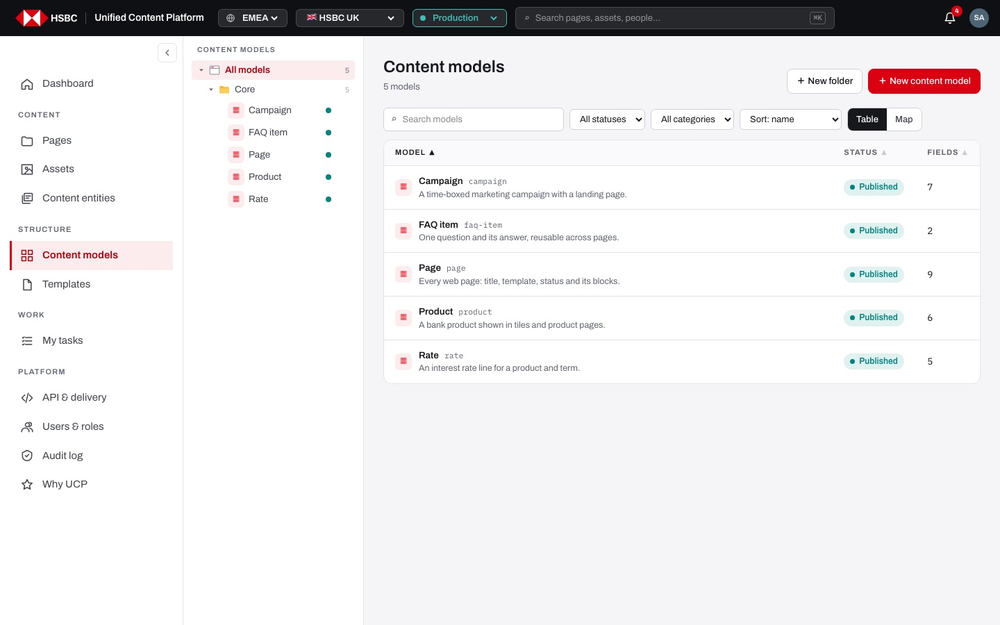
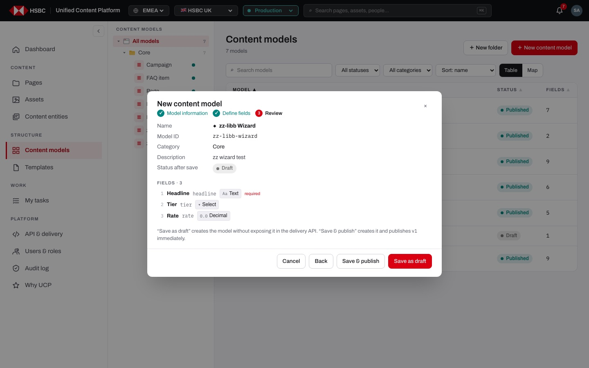
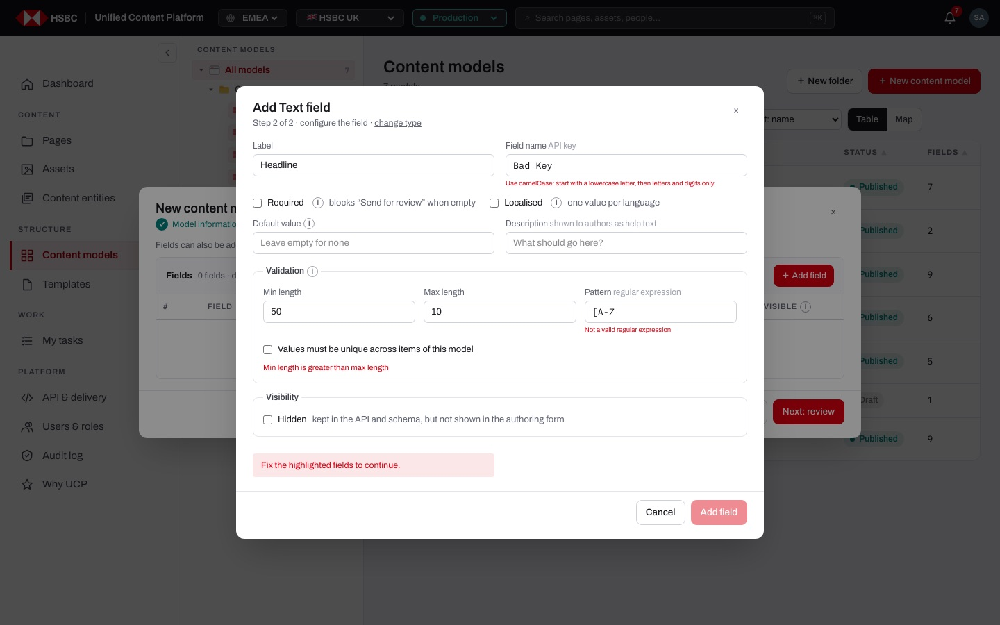
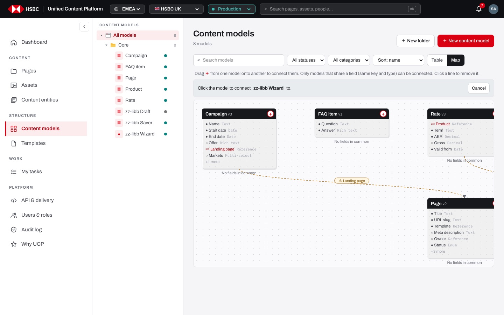
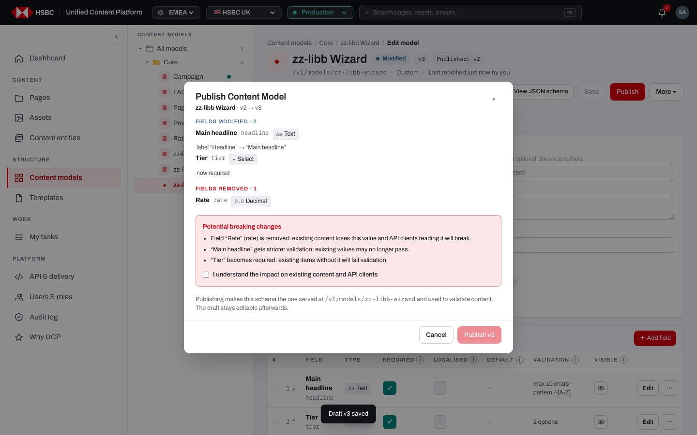
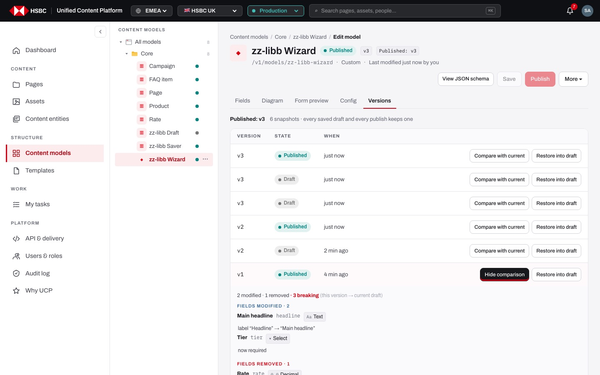
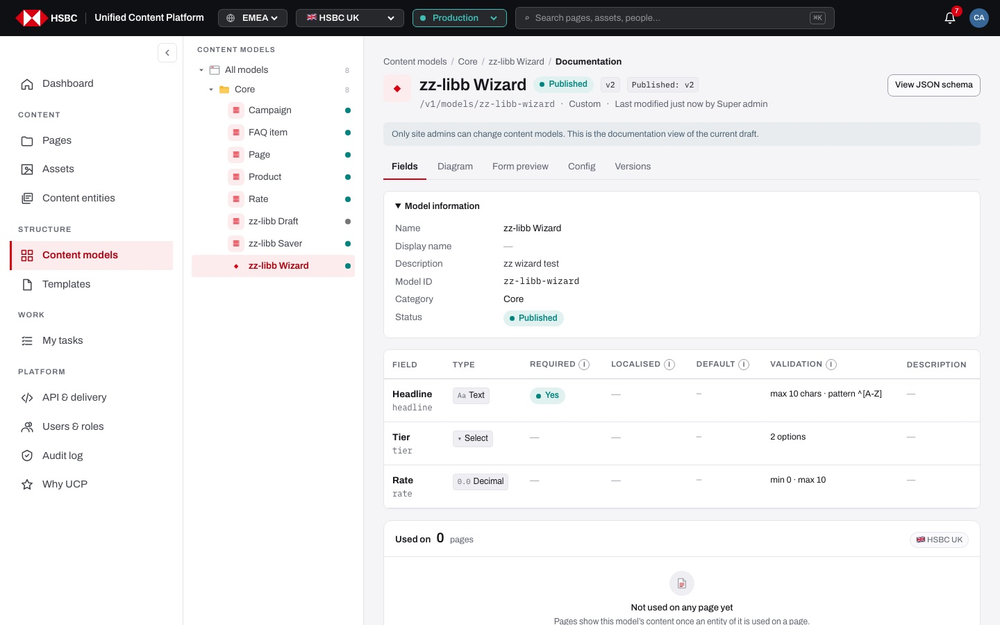

# EP-14 · Content models

**Epic:** EP-14 · Content models

**Business benefit:** Site admins define each type of reusable content once, with validated fields, so every channel and API client receives consistent, well-structured data about products, rates and campaigns. Drafts, guarded breaking changes and versions let the bank evolve these structures without breaking live content or partner integrations.

**Scope:** The Content models screen: the overview table and the map of connections, the category tree, the model detail, the three-step "New content model" wizard, the field editor with validation rules, saving drafts, publishing with a review of breaking changes, versions, folders, duplicating, moving and deleting models, and the read-only documentation view for everyone who is not a site admin. The delivery API that serves the schemas is covered in EP-16.

**The view:**



- **Left rail · Content models tree:** "All models" with a count, one folder per category (for example "Core") with its models, each with its icon and a status dot. Site admins get a "⋯" menu per model ("Edit model", "Duplicate", "Move to…", "Publish", "Delete") and per folder ("Rename folder", "Delete folder"), and can drag models.
- **Header:** the title ("Content models" or the category name), the model count, and "＋ New folder" / "＋ New content model" for site admins (otherwise "Read-only · documentation view").
- **Toolbar:** "Search models", status and category filters, "Sort: name / last modified / status / fields", "N of M" when filtered and the "Table" / "Map" switch.
- **Table:** Model (icon, name, id, description), Status, Fields, and on wide screens Last modified, By and Used on. Clicking a row opens the model detail.
- **Map:** one box per model with its first fields; arrows are Reference fields between models. Admins connect models with the "＋" handle.
- **Model detail:** status, draft and published version, description, "Fields" and "Used on" figures, the number of entities with "Open in Content entities →", the field list, the "Used on" card, "View JSON schema" and "✎ Edit model" (or "View documentation").
- **Model editor:** "Save", "Publish", "More ▾" (Duplicate, Restore published schema into draft, Delete) and the tabs "Fields", "Diagram", "Form preview", "Config" and "Versions".


*Step 3 of "New content model" sums up the information and the fields before "Save & publish" or "Save as draft".*


*The field panel explains each problem: a key that is not camelCase, a minimum length above the maximum and an invalid regular expression.*


*In connect mode models that share no field with the source show "No fields in common"; existing connections without a shared field are dashed with "⚠".*


*Publishing lists added, modified and removed fields; breaking changes must be acknowledged before "Publish v3" is enabled.*


*Every saved draft and every publish keeps a snapshot that can be compared with the current draft or restored into it.*


*People who are not site admins see the model as read-only documentation with the field rules in a table.*

**Stories (15):**

1. [US-14.01 · Models overview: list content models with search, filters and sorting](#us-1401--models-overview-list-content-models-with-search-filters-and-sorting)
2. [US-14.02 · Model tree: browse content models by category](#us-1402--model-tree-browse-content-models-by-category)
3. [US-14.03 · Model detail: see a model's fields, usage and entities](#us-1403--model-detail-see-a-models-fields-usage-and-entities)
4. [US-14.04 · Model creation: create a content model in three steps](#us-1404--model-creation-create-a-content-model-in-three-steps)
5. [US-14.05 · Field editor: add, edit, reorder, duplicate and remove fields](#us-1405--field-editor-add-edit-reorder-duplicate-and-remove-fields)
6. [US-14.06 · Field editor: validation rules for each field type](#us-1406--field-editor-validation-rules-for-each-field-type)
7. [US-14.07 · Model editor: edit model information and save a draft](#us-1407--model-editor-edit-model-information-and-save-a-draft)
8. [US-14.08 · Model publishing: review the changes and confirm breaking ones](#us-1408--model-publishing-review-the-changes-and-confirm-breaking-ones)
9. [US-14.09 · Model versions: compare snapshots and restore one into the draft](#us-1409--model-versions-compare-snapshots-and-restore-one-into-the-draft)
10. [US-14.10 · Model editor: warn before leaving with unsaved changes](#us-1410--model-editor-warn-before-leaving-with-unsaved-changes)
11. [US-14.11 · Model editor: diagram, form preview, configuration and JSON schema](#us-1411--model-editor-diagram-form-preview-configuration-and-json-schema)
12. [US-14.12 · Model map: see and edit the connections between models](#us-1412--model-map-see-and-edit-the-connections-between-models)
13. [US-14.13 · Model folders: organise models in categories](#us-1413--model-folders-organise-models-in-categories)
14. [US-14.14 · Model actions: duplicate or delete a model](#us-1414--model-actions-duplicate-or-delete-a-model)
15. [US-14.15 · Content models: read-only documentation view for non-admins](#us-1415--content-models-read-only-documentation-view-for-non-admins)

---

## US-14.01 · Models overview: list content models with search, filters and sorting

**Business benefit:** Admins and developers see at a glance which content types exist, which are still drafts and which have unpublished changes. This prevents duplicate models and forgotten changes that never reach the API.

**User story:**

As a site admin  
I want a searchable, sortable table of all content models  
So that I can find a model and see its state quickly  

**Persona:** site admin · **Depends on:** —

**Acceptance criteria:**

**Background** (applies to every scenario below)

```gherkin
Given I open "Content models"
```

**Scenario 1 · Table content**

```gherkin
Then I see "Content models" with the number of models
And each row shows the icon, name, id and description, the status ("Draft", "Published" or "Modified") and the number of fields
And on wide screens also "Last modified", "By" and "Used on" ("N pages")
When I click a row
Then the model detail opens
```

**Scenario 2 · Search and filters**

```gherkin
When I type "rate" into "Search models"
Then only models whose name, id, display name or description contain "rate" are listed with "N of M"
When I choose "Draft" in the status filter or a category in "All categories"
Then only matching models are listed
```

**Scenario 3 · Sorting**

```gherkin
When I choose "Sort: fields"
Then the model with the most fields comes first
When I click a sortable column header ("Model", "Status", "Fields", "Last modified")
Then the table sorts by it, and a second click reverses the order
```

**Scenario 4 · Nothing matches**

```gherkin
When my search and filters match no model
Then I see "No models match" and "Clear filters"
```

**Scenario 5 · No models at all**

```gherkin
Given there are no content models
Then a site admin sees "No Content Models yet" and "＋ New content model"
And everyone else sees "No Content Models available." and "Ask a site admin to define the first one."
```

---

## US-14.02 · Model tree: browse content models by category

**Business benefit:** Models are grouped the way the bank thinks about its content, such as core, products or marketing. Teams find the right structure faster as the number of models grows.

**User story:**

As a site admin  
I want a tree of categories and their models  
So that I can browse and open models by category  

**Persona:** site admin · **Depends on:** US-14.01

**Acceptance criteria:**

**Scenario 1 · Tree**

```gherkin
Given I open "Content models"
Then the left rail shows "All models" with the total count and one folder per category with its count
And each model shows its icon and a status dot ("Draft · never published", "Published · matches what visitors see", "Modified · has changes that are not published yet")
```

**Scenario 2 · Category view**

```gherkin
When I click the category "Core"
Then the list shows "Core" with "Category · 5 models" and the breadcrumb "Content models / Core"
And an empty category says "This folder is empty" and "Drag models onto it in the tree, or use “Move to…” in a model’s menu."
```

**Scenario 3 · Model menu**

```gherkin
Given I am a site admin
When I open the "⋯" menu of a model
Then I see "Edit model", "Duplicate", "Move to…", "Publish" and "Delete"
And "Publish" is disabled when the model is already published
```

---

## US-14.03 · Model detail: see a model's fields, usage and entities

**Business benefit:** Anyone can understand what a content type contains and how widely it is used before changing it. This reduces the risk of uninformed changes to structures that many pages rely on.

**User story:**

As a site admin  
I want a summary page for each model  
So that I understand its structure and impact before I edit it  

**Persona:** site admin · **Depends on:** US-14.01

**Acceptance criteria:**

**Background** (applies to every scenario below)

```gherkin
Given I open the model "Rate"
```

**Scenario 1 · Header and figures**

```gherkin
Then I see the name, the status, the draft version "v3" and "Published: v3", and the description
And the figures "Fields" (with "N hidden from authors" when fields are hidden) and "Used on" ("pages in HSBC UK")
And "N entities use this model · Open in Content entities →"
```

**Scenario 2 · Field list**

```gherkin
Then every field shows its label, "*" when required, its key, "Localised" when localised, its type and its description
And hidden fields are greyed out with "hidden"
And when the model has unpublished changes I see "Showing the draft. Authors fill in the published schema (v3) until it is published."
```

**Scenario 3 · Actions**

```gherkin
Then "✎ Edit model" opens the editor
And "View JSON schema" opens the model in "API & delivery"
And "Open in Content entities →" lists the entities of "Rate"
```

**Scenario 4 · Model without fields**

```gherkin
Given the model has no fields
Then I see "This model has no fields yet." and, as a site admin, "Add fields"
```

---

## US-14.04 · Model creation: create a content model in three steps

**Business benefit:** Structured, validated content types give every channel consistent data and reduce errors in key facts. A guided wizard lets admins define a new type correctly the first time, without developer help.

**User story:**

As a site admin  
I want to create a content model in three steps: information, fields and review  
So that authors get a well-structured content type that I can publish when it is ready  

**Persona:** site admin · **Depends on:** US-14.01 · **Note:** site admin only

**Acceptance criteria:**

**Scenario 1 · Step 1 · Model information**

```gherkin
Given I am a site admin
When I click "＋ New content model"
Then the dialog "New content model" shows the steps "Model information", "Define fields" and "Review"
And asks for "Name", "Display name", "Description", "Model ID", "Category" and "Icon"
When I enter the name "Savings product"
Then the model ID becomes "savings-product" and "/v1/models/savings-product" is shown
```

**Scenario 2 · Model ID must be new and valid**

```gherkin
When I enter a name whose ID already exists
Then I see "A model with this ID already exists" and "Next: define fields" is disabled
When the name contains no letters or digits
Then I see "The name must contain letters or digits"
```

**Scenario 3 · Step 2 · Fields**

```gherkin
When I click "Next: define fields"
Then I see "Fields can also be added later. Start with what the API and authors need on day one."
And I can add, edit, reorder and remove fields as in the field editor
```

**Scenario 4 · Step 3 · Review and save**

```gherkin
When I click "Next: review"
Then I see the name, model ID, category, description, "Status after save" and the numbered list of fields
And I can choose "Save as draft" (not exposed in the delivery API) or "Save & publish" (publishes v1 immediately)
When I click "Save & publish"
Then I see "Created and published Savings product v1" and the model detail opens
But "Save as draft" shows "Created as draft"
```

**Scenario 5 · Going back**

```gherkin
Given I am on step 3
When I click "Back"
Then I return to step 2 with my fields kept
```

---

## US-14.05 · Field editor: add, edit, reorder, duplicate and remove fields

**Business benefit:** Admins shape content types precisely to what the bank's channels need, without code changes. Clear controls reduce mistakes in the structure that all content depends on.

**User story:**

As a site admin  
I want to manage the fields of a model in one table  
So that I can shape the model to what authors and API clients need  

**Persona:** site admin · **Depends on:** US-14.04 · **Note:** site admin only

**Acceptance criteria:**

**Scenario 1 · Pick a type**

```gherkin
When I click "＋ Add field"
Then "Step 1 of 2 · pick a type" offers Text, Long text, Rich text, Number, Decimal, Boolean, Date, Date & time, Select, Multi-select, Reference, Asset, Image, URL and JSON, each with a one-line hint
When I pick "Decimal"
Then "Add Decimal field" opens with "Step 2 of 2 · configure the field" and "change type"
```

**Scenario 2 · Label and key**

```gherkin
When I type the label "Interest rate"
Then the field name (API key) becomes "interestRate" until I change it myself
And the panel offers "Required", "Localised", "Default value", "Description" and "Hidden"
When I click "Add field"
Then the field is added at the end of the table
```

**Scenario 3 · Field table**

```gherkin
Then each row shows its position, label and key, type, the switches "Required" and "Localised", default, validation summary (such as "max 10 chars · pattern ^[A-Z]"), the eye for "Visible" and "Edit" / "⋯"
And the ⓘ tips explain Required, Localised, Default, Validation and Visible in plain words
```

**Scenario 4 · Reordering**

```gherkin
When I drag a row onto another row, or use ▲ / ▼
Then the field moves to that position
```

**Scenario 5 · Editing, duplicating and removing**

```gherkin
When I choose "Edit"
Then "Edit field “Interest rate”" opens with the type fixed ("changing the type is a breaking change, so it is fixed while editing")
When I choose "Duplicate"
Then a copy "Interest rate (copy)" with the key "interestRateCopy" is inserted below
When I choose "Delete"
Then I am asked "Remove field “Interest rate”? Existing content keeps its value until the model is published." with "Remove field"
```

---

## US-14.06 · Field editor: validation rules for each field type

**Business benefit:** Rules such as length limits, number ranges and allowed options stop wrong values at the source. Customers and API clients receive data that is complete and in the expected format.

**User story:**

As a site admin  
I want to set validation rules suited to each field type  
So that authors can only enter valid values  

**Persona:** site admin · **Depends on:** US-14.05 · **Note:** site admin only

**Acceptance criteria:**

**Scenario 1 · Rules per type** *(one run per row of the table)*

```gherkin
When I configure a <type> field
Then the "Validation" box offers <rules>

Examples:
  | type                       | rules                                                        |
  | Text, Long text, Rich text, URL | "Min length", "Max length" and "Pattern" (regular expression) |
  | Number, Decimal            | "Minimum" and "Maximum"                                      |
  | Select, Multi-select       | "Options", one per row, with "＋ Add option"                 |
  | Reference                  | "Target model" and "Allow several items"                     |
  | Text, URL, Number, Decimal | "Values must be unique across items of this model"           |
  | Boolean, Date, Asset, JSON | "No validation options for <type> fields."                  |
```

**Scenario 2 · Invalid settings** *(one run per row of the table)*

```gherkin
When I click "Add field" with <problem>
Then I see "<message>" and "Fix the highlighted fields to continue."

Examples:
  | problem                                  | message                                                               |
  | no label                                 | A label is required                                                   |
  | no field name                            | A field name is required                                              |
  | a key that is not camelCase              | Use camelCase: start with a lowercase letter, then letters and digits only |
  | a key that already exists                | Another field already uses this name                                  |
  | a minimum length above the maximum       | Min length is greater than max length                                 |
  | a minimum above the maximum              | Min is greater than max                                               |
  | an invalid regular expression            | Not a valid regular expression                                        |
  | a select field without options           | Add at least one option                                               |
  | a reference without a target model       | Pick the model this field points to                                   |
```

**Scenario 3 · Reference targets must share a field**

```gherkin
Given I add a Reference field to an existing model
Then target models that share no field (same key and type) are disabled with "no fields in common"
```

**Scenario 4 · Default value**

```gherkin
Then the default value is a "None / On / Off" choice for Boolean, a choice of the options for Select, and a text, number or date box otherwise
```

---

## US-14.07 · Model editor: edit model information and save a draft

**Business benefit:** Admins can prepare changes to a content type safely while authors and API clients keep using the published version. Every saved draft is versioned, so nothing is lost.

**User story:**

As a site admin  
I want to edit a model's information and fields and save them as a draft  
So that I can prepare changes without affecting live content  

**Persona:** site admin · **Depends on:** US-14.05 · **Note:** site admin only

**Acceptance criteria:**

**Scenario 1 · Model information**

```gherkin
When I open "✎ Edit model"
Then "Model information" lets me change the name, display name, description, category and icon
And the model ID is "read-only"
```

**Scenario 2 · Saving a draft**

```gherkin
Given the model "Rate" is published as v3
When I change a field and click "Save"
Then I see "Draft v4 saved"
And the model shows "Modified", "v4" and "Published: v3"
And a "draft saved" snapshot is added to the versions
```

**Scenario 3 · Unsaved changes**

```gherkin
When I change anything
Then "Unsaved changes" appears next to the title and "Save" is enabled
```

**Scenario 4 · Connections need a shared field**

```gherkin
When I save a Reference field to a model that shares no field with this one
Then I see "Rate and FAQ item have no fields in common"
```

---

## US-14.08 · Model publishing: review the changes and confirm breaking ones

**Business benefit:** Guarded breaking changes protect live content and API clients from careless schema changes and costly outages. Admins see exactly what changes before it reaches every channel.

**User story:**

As a site admin  
I want to review what changes and confirm breaking changes before publishing a model  
So that I do not break existing content or API clients by accident  

**Persona:** site admin · **Depends on:** US-14.07 · **Note:** site admin only

**Acceptance criteria:**

**Scenario 1 · Review before publishing**

```gherkin
Given "Rate" has draft changes
When I click "Publish"
Then "Publish Content Model" shows "Rate · v3 → v4" (and "unsaved changes will be saved first" if any)
And lists "Fields added", "Fields modified" (with what changed), "Fields removed" and "Validation changes"
```

**Scenario 2 · Breaking changes need confirmation**

```gherkin
Given I removed a field, changed a type, made a field required or tightened its validation
Then "Potential breaking changes" explains each one, for example "Field “Gross” (gross) is removed: existing content loses this value and API clients reading it will break."
And "Publish v4" stays disabled until I tick "I understand the impact on existing content and API clients"
```

**Scenario 3 · Publishing**

```gherkin
When I click "Publish v4"
Then I see "Published v4"
And the schema served at "/v1/models/rate" is the new one
And a "published v4" snapshot is kept
```

**Scenario 4 · Nothing to publish**

```gherkin
Given the published schema is up to date
Then "Publish" is disabled with "The published schema is up to date"
```

**Scenario 5 · Quick publish from the tree**

```gherkin
When I choose "Publish" in the "⋯" menu of a modified model
Then the browser asks "Publish Rate v4? Open the editor to review the changes first if you are unsure."
And after confirming I see "Published Rate v4"
```

---

## US-14.09 · Model versions: compare snapshots and restore one into the draft

**Business benefit:** Every change to a content type can be traced and undone, which supports audit and lowers the cost of mistakes. Restoring never touches the published schema, so live content stays safe.

**User story:**

As a site admin  
I want to compare earlier versions with the current draft and restore one  
So that I can understand and undo changes to a model  

**Persona:** site admin · **Depends on:** US-14.08 · **Note:** site admin only

**Acceptance criteria:**

**Scenario 1 · Version list**

```gherkin
When I open the "Versions" tab
Then I see "Published: v3 · Draft: v4" and "N snapshots · every saved draft and every publish keeps one"
And each snapshot shows its version, "Published" or "Draft", who, when, a note and the number of fields
```

**Scenario 2 · Compare**

```gherkin
When I click "Compare with current" on v2
Then a summary such as "2 modified · 1 removed · 3 breaking (this version → current draft)" and the field changes are shown below the row
And "Hide comparison" closes it
```

**Scenario 3 · Restore into the draft**

```gherkin
When I click "Restore into draft" on v2 and confirm "Restore version 2 (published v2) into the draft? The published schema is not changed; you can review and publish afterwards."
Then I see "Restored v2 into draft v5"
And the published schema stays v3
```

**Scenario 4 · Restore the published schema**

```gherkin
When I choose "More ▾" and "Restore published schema into draft" and confirm
Then the draft fields are replaced by the published ones
And nothing is saved until I click "Save"
```

---

## US-14.10 · Model editor: warn before leaving with unsaved changes

**Business benefit:** Admins do not lose prepared schema changes by navigating away by mistake. This avoids rework on structures that take time to design.

**User story:**

As a site admin  
I want to be asked before leaving a model with unsaved changes  
So that I do not lose my work  

**Persona:** site admin · **Depends on:** US-14.07 · **Note:** site admin only

**Acceptance criteria:**

**Scenario 1 · Leaving inside the app**

```gherkin
Given I changed the model without saving
When I click another model, a folder or a breadcrumb
Then "Unsaved changes" says "You have unsaved changes to this Content Model. Save them as a draft, discard them, or stay on this page."
And I can choose "Stay", "Discard changes" or "Save"
```

**Scenario 2 · Closing or reloading the tab**

```gherkin
When I close or reload the browser tab
Then the browser asks me to confirm leaving the page
```

---

## US-14.11 · Model editor: diagram, form preview, configuration and JSON schema

**Business benefit:** Admins see how a model looks to authors and to developers before publishing it. This catches usability and integration problems early, when they are cheap to fix.

**User story:**

As a site admin  
I want to preview the authoring form, the configuration and the JSON schema of a model  
So that I can check the result for authors and API clients before publishing  

**Persona:** site admin · **Depends on:** US-14.07

**Acceptance criteria:**

**Scenario 1 · Form preview**

```gherkin
When I open "Form preview"
Then "What authors see" shows disabled inputs for every visible field, with "required" and "localised" marks
And says "Required fields block “Send for review”. Localised fields get one value per locale (en-GB, cy-GB)."
And it already reflects unsaved changes
```

**Scenario 2 · Diagram**

```gherkin
When I open "Diagram"
Then the model map highlights this model and its connections
And a connection I draw here is added as a Reference field: "Connected to Product (shared: title). Save the draft to keep it."
```

**Scenario 3 · Configuration and JSON schema**

```gherkin
When I open "Config"
Then I see the "UCP configuration" and the "JSON Schema served at /v1/models/rate"
And with unsaved changes "Shows the last saved draft. Save to refresh it with your changes."
```

**Scenario 4 · Open in API & delivery**

```gherkin
When I click "View JSON schema" or "Open in API & delivery"
Then "API & delivery" opens on the Models tab for this model
```

---

## US-14.12 · Model map: see and edit the connections between models

**Business benefit:** A picture of how products, rates, campaigns and pages relate makes the content structure understandable for business and technical teams alike. Rules on shared fields prevent meaningless links that would confuse authors and API clients.

**User story:**

As a site admin  
I want a map of models and their connections that I can edit  
So that I understand and shape how content types relate  

**Persona:** site admin · **Depends on:** US-14.01 · **Note:** site admin only

**Acceptance criteria:**

**Scenario 1 · Map view**

```gherkin
When I click "Map"
Then the address gets "?view=map"
And each model is a box with its name, version and first 6 fields ("+N more"); Reference fields are marked "⇄"
And arrows point from a model to the model its Reference field links to, labelled with the field
```

**Scenario 2 · Arranging boxes**

```gherkin
When I drag a box
Then it stays where I put it in this browser
And "Reset positions" restores the automatic layout
And clicking a box opens the model
```

**Scenario 3 · Connecting two models**

```gherkin
When I drag the "＋" handle of "Savings product" onto "Product" (or click the handle, then the model)
Then a Reference field "Product" is added to "Savings product" and I see "Connected Savings product → Product (shared: title)"
```

**Scenario 4 · Only models that share a field** *(one run per row of the table)*

```gherkin
When I try to connect <from> to <to>
Then I see "<message>"

Examples:
  | from     | to       | message                                                                 |
  | Savings product | FAQ item | Savings product and FAQ item have no fields in common, so they can't be connected |
  | Savings product | Product  | Savings product is already connected to Product                                    |
```

**Scenario 5 · Removing a connection**

```gherkin
When I click an arrow
Then "Savings product → Product" is shown with "Close" and "Remove connection"
When I click "Remove connection" and confirm "Remove the connection Savings product → Product?"
Then the Reference field is removed and I see "Removed the connection Savings product → Product"
And connections between models without a shared field are dashed with "⚠" and "These models have no fields in common. Remove this connection."
```

---

## US-14.13 · Model folders: organise models in categories

**Business benefit:** A growing catalogue of content types stays easy to navigate for every team. Organising models never changes their schema, so reorganising is risk-free for live content.

**User story:**

As a site admin  
I want to create, rename and delete categories and move models between them  
So that the model catalogue stays organised  

**Persona:** site admin · **Depends on:** US-14.02 · **Note:** site admin only

**Acceptance criteria:**

**Scenario 1 · Creating a folder**

```gherkin
When I click "＋ New folder", enter "Products" and click "Create folder"
Then I see "Created folder Products"
And a name that already exists in any letter case is refused with "A folder with this name already exists"
```

**Scenario 2 · Moving a model**

```gherkin
When I choose "Move to…" on "Rate"
Then I can pick a category or type a "New category name"
When I click "Move here"
Then I see "Moved Rate to Products"
And the schema, version and status of "Rate" do not change
```

**Scenario 3 · Dragging in the tree**

```gherkin
When I drag "Rate" onto another model of the same folder
Then it is placed before that model and I see "Reordered Core"
When I drag it onto another folder
Then it moves there
```

**Scenario 4 · Renaming and deleting**

```gherkin
When I choose "Rename folder" on "Products" and enter "Product data"
Then its models move with it
And "Core" has no folder menu
And a folder that still holds models shows "Delete (move 2 models out first)" disabled
When the folder is empty and I choose "Delete folder" and confirm
Then I see "Deleted folder Product data"
```

---

## US-14.14 · Model actions: duplicate or delete a model

**Business benefit:** New content types can start from a proven one, saving design time. Deleting asks for confirmation so a model is not removed by accident.

**User story:**

As a site admin  
I want to duplicate and delete content models  
So that I can reuse good structures and remove ones that are no longer needed  

**Persona:** site admin · **Depends on:** US-14.04 · **Note:** site admin only

**Acceptance criteria:**

**Scenario 1 · Duplicate**

```gherkin
When I choose "Duplicate" on "Rate"
Then a draft "Rate (copy)" with the id "rate-copy" and the same fields is created
And I see "Duplicated as “Rate (copy)” (draft)" and its detail opens
```

**Scenario 2 · Delete**

```gherkin
When I choose "Delete" on "Rate (copy)"
Then I am asked "Delete content model “Rate (copy)”? Content using it keeps its data but loses validation. This cannot be undone." with "Delete model"
When I confirm
Then I see "Deleted Rate (copy)" and return to the overview
```

---

## US-14.15 · Content models: read-only documentation view for non-admins

**Business benefit:** Authors and developers can read exactly how each content type is defined without being able to change it. The server enforces the rule, so only site admins can alter structures that all content depends on.

**User story:**

As a content author  
I want to read content models as documentation  
So that I know which fields and rules apply when I fill in content  

**Persona:** content author · **Depends on:** US-14.03

**Acceptance criteria:**

**Scenario 1 · Read-only overview**

```gherkin
Given I am signed in as a content author
When I open "Content models"
Then I see "Read-only · documentation view" ("Only site admins can change content models.") instead of the create buttons
And the tree has no "⋯" menus and models cannot be dragged
```

**Scenario 2 · Documentation view**

```gherkin
When I open a model
Then I see "View documentation" instead of "✎ Edit model"
When I click it
Then I see "Only site admins can change content models. This is the documentation view of the current draft."
And a table of fields with type, required, localised, default, validation and description
And no "Save", "Publish" or "More ▾"
```

**Scenario 3 · The server refuses changes**

```gherkin
When a content author sends a request to save, publish, create, move or delete a model
Then it is refused with "Only site admins can change content models"
```
