# EP-15 · Templates

**Epic:** EP-15 · Templates

**Business benefit:** Every new page starts from an approved, brand-safe structure, so authors build pages faster and reviewers see fewer layout problems. Central control over who may change templates and which markets may use them keeps local regulatory and brand risk low.

**Scope:** The template library (folders, search, grid and list views, template cards, new folder, new template, duplicate) and the template editor (add, move and remove blocks, preview and device widths, template settings with name, description, folder, markets, usage and delete), with read-only access for everyone who is not a site admin.

**The view:**

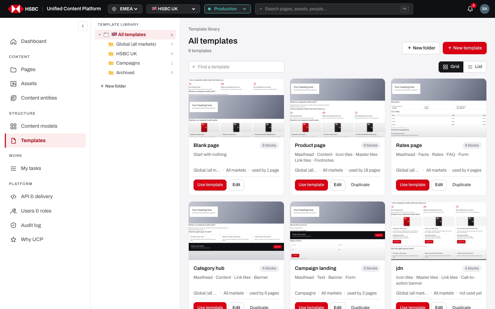
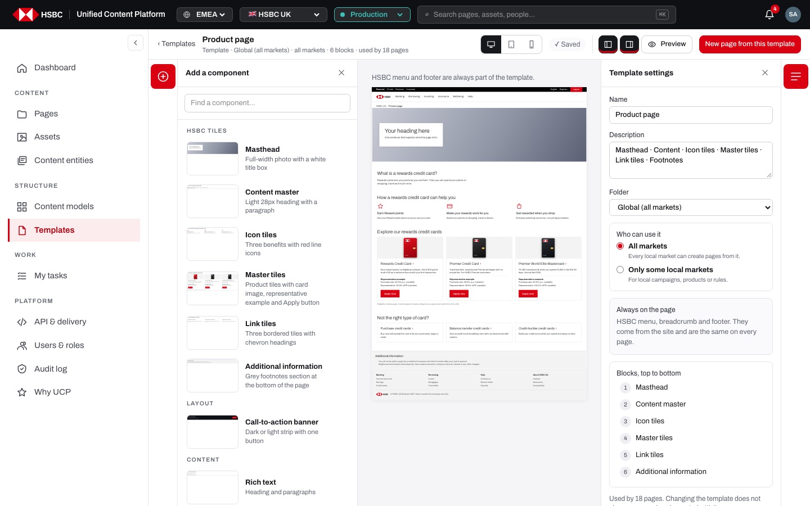

The **template library** (`/uk/prod/templates`):

- **Folder tree (left)** · "Template library" with "All templates" (flag of the current market and a total count) and one entry per folder: "Global (all markets)", the market's own folder (e.g. "HSBC UK"), "Campaigns", "Archived" and any folder that holds a template, each with a count; "＋ New folder" for site admins.
- **Header** · breadcrumb "Template library / <folder>", the folder name, "N templates", and "＋ New folder" / "＋ New template" for site admins or the badge "🔒 Read-only · ask a site admin to change templates" for everyone else.
- **Toolbar** · "Find a template" search (name and description) and the "Grid" / "List" toggle.
- **Templates** · cards (live thumbnail, name, block count, description or block list, folder, markets, usage, "Use template" or "Not for <market>", "Edit" / "View", "Duplicate") or a table (Template, Blocks, Folder, Used by, actions).

The **template editor** (`/uk/prod/templates/<id>`), laid out like the page builder:

- **Top bar** · "‹ Templates", the template name and a summary line (folder · markets · blocks · used by), device widths (desktop, tablet, mobile), save status ("✓ Saved", "Saving…" or "🔒 Read-only"), panel toggles, "Preview" and "New page from this template".
- **Left rail and "Add a component" panel** · the component library with "Find a component…".
- **Canvas** · the template rendered as a page inside the HSBC menu, breadcrumb and footer, with each block's default content; a selected block shows a toolbar (↑, ↓, "Remove").
- **Right rail and "Template settings" panel** · Name, Description, Folder, "Who can use it", "Always on the page", "Blocks, top to bottom", usage note and "Delete template".

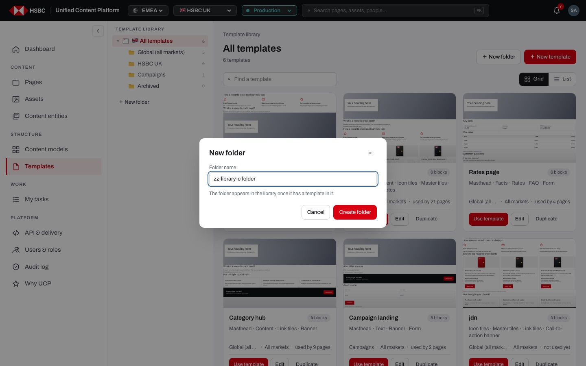
*"New folder" dialog: the folder only stays once a template is created in it.*

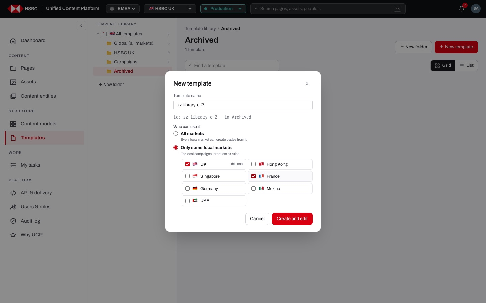
*"New template" dialog with the generated id, the target folder and "Who can use it" set to selected markets.*

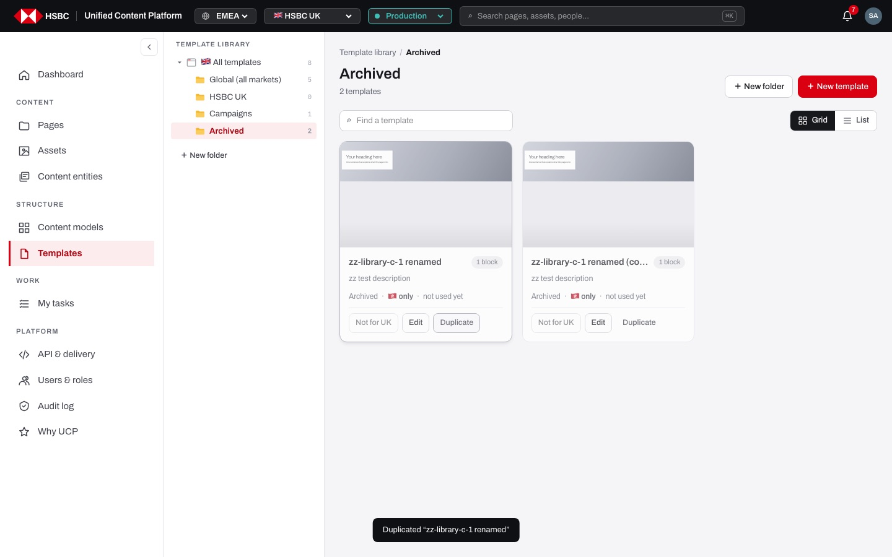
*A Hong Kong-only template seen from the UK: dimmed card with "Not for UK", and the toast after "Duplicate".*

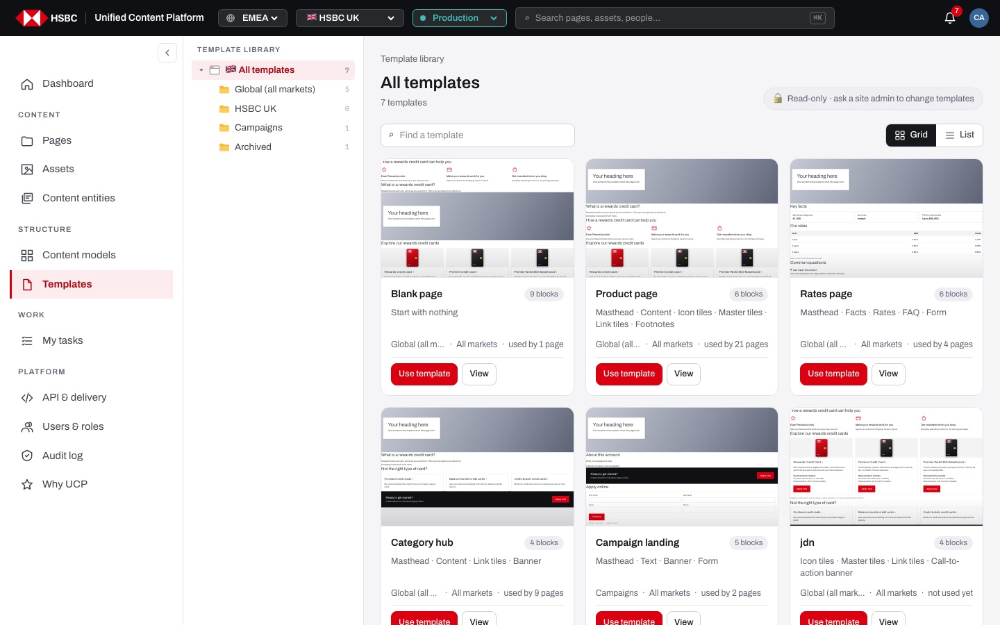
*A content author sees the read-only badge, "View" instead of "Edit", and no New / Duplicate buttons.*

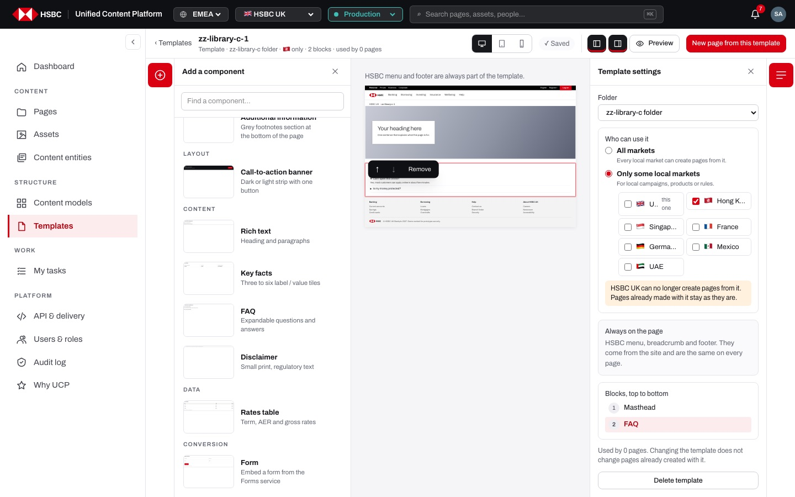
*Template editor with the component panel open, a selected block with ↑ ↓ Remove, and the market warning in Template settings.*

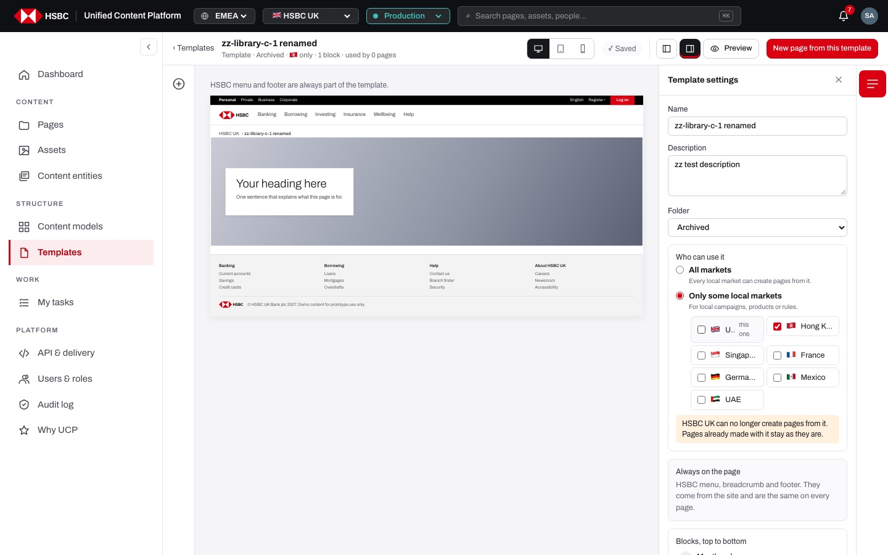
*Template settings: name, description, folder, markets, always-on parts, block list, usage note and "Delete template".*

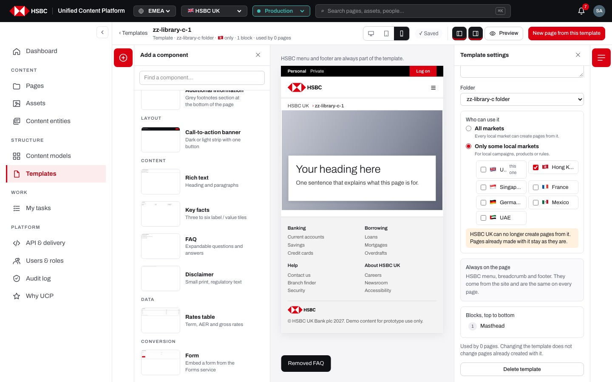
*The canvas switched to the mobile width (390 px), with the toast "Removed FAQ".*

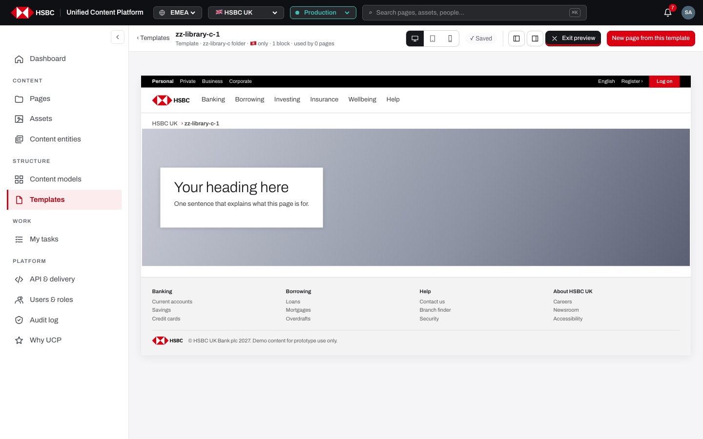
*Preview: rails, panels and block labels are hidden; "Exit preview" or Esc goes back.*

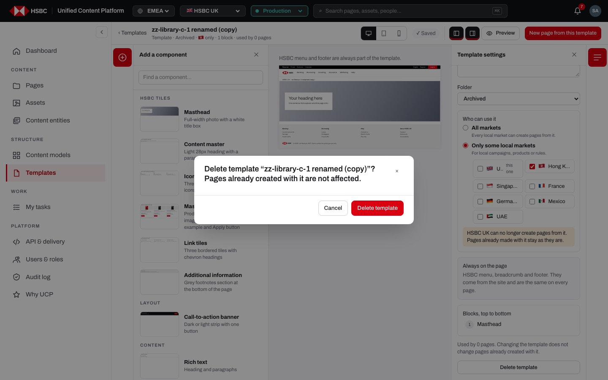
*Delete confirmation: pages already created with the template are not affected.*

**Stories (11):**

1. [US-15.01 · Template library: browse folders, search and switch between grid and list](#us-1501--template-library-browse-folders-search-and-switch-between-grid-and-list)
2. [US-15.02 · Template library: see what each template contains and where it can be used, read-only for non-admins](#us-1502--template-library-see-what-each-template-contains-and-where-it-can-be-used-read-only-for-non-admins)
3. [US-15.03 · Use template: start a new page from a template](#us-1503--use-template-start-a-new-page-from-a-template)
4. [US-15.04 · New folder: group templates in a new folder](#us-1504--new-folder-group-templates-in-a-new-folder)
5. [US-15.05 · Templates (admin): create, duplicate and delete page templates](#us-1505--templates-admin-create-duplicate-and-delete-page-templates)
6. [US-15.06 · Template editor: see the template as a page inside the HSBC menu and footer](#us-1506--template-editor-see-the-template-as-a-page-inside-the-hsbc-menu-and-footer)
7. [US-15.07 · Template editor: add, select, move and remove blocks with automatic save](#us-1507--template-editor-add-select-move-and-remove-blocks-with-automatic-save)
8. [US-15.08 · Template editor: preview, device widths and panel toggles](#us-1508--template-editor-preview-device-widths-and-panel-toggles)
9. [US-15.09 · Template settings: name, description, folder and usage](#us-1509--template-settings-name-description-folder-and-usage)
10. [US-15.10 · Template markets (admin): limit a template to selected local markets](#us-1510--template-markets-admin-limit-a-template-to-selected-local-markets)
11. [US-15.11 · Template editor (read-only): look at a template without changing it](#us-1511--template-editor-read-only-look-at-a-template-without-changing-it)

---

## US-15.01 · Template library: browse folders, search and switch between grid and list

**Business benefit:** Authors find the right approved template in seconds instead of copying old pages. A clear folder structure keeps a growing template set manageable for every market.

**User story:**

As a content author  
I want to browse templates by folder, search them by name or description and choose a grid or a list  
So that I quickly find the template that fits the page I need to build  

**Persona:** content author · **Depends on:** US-01.01

**Acceptance criteria:**

**Background** (applies to every scenario below)

```gherkin
Given I am signed in and open "Templates" in the market "HSBC UK"
```

**Scenario 1 · Folder tree with counts**

```gherkin
Then the left panel "Template library" shows "🇬🇧 All templates" with the total number of templates
And it lists "Global (all markets)", "HSBC UK", "Campaigns" and "Archived" and every other folder that holds a template, each with its count
```

**Scenario 2 · Open a folder**

```gherkin
When I click the folder "Campaigns"
Then the address gets "?folder=Campaigns&view=grid"
And the breadcrumb reads "Template library / Campaigns"
And the heading reads "Campaigns" with "1 template" below it
```

**Scenario 3 · Search**

```gherkin
When I type "rates" into "Find a template"
Then only templates whose name or description contains "rates" are shown
And the count reads "1 template"
When I type text that matches nothing
Then I see "No templates here."
```

**Scenario 4 · Grid and list**

```gherkin
When I click "List"
Then the templates are shown as a table with the columns "Template", "Blocks", "Folder" and "Used by" and the actions per row
When I click "Grid"
Then the templates are shown as cards again
And the chosen view is kept in the address ("view=list" or "view=grid")
```

---

## US-15.02 · Template library: see what each template contains and where it can be used, read-only for non-admins

**Business benefit:** Authors start from approved, market-appropriate templates instead of improvising layouts, which lowers rework and review effort. Read-only access protects templates from accidental change.

**User story:**

As a content author  
I want to browse the template library and see what each template contains and where it can be used, without being able to change it  
So that I start pages from an approved template that is allowed in my market  

**Persona:** content author · **Depends on:** US-15.05, US-15.10, US-15.01

**Acceptance criteria:**

**Scenario 1 · Read-only for everyone else**

```gherkin
Given I am signed in as "content.author"
When I open "Templates"
Then the library says "Read-only · ask a site admin to change templates"
And there are no "＋ New folder", "＋ New template" or "Duplicate" buttons
And the "Edit" buttons read "View"
```

**Scenario 2 · Template cards**

```gherkin
When I look at the grid
Then each card shows a live thumbnail of the blocks with their default content, the name and the number of blocks
And the description, or the block names when there is no description
And the folder, "All markets" or the flags of its markets followed by "only", and "used by N pages" or "not used yet"
```

**Scenario 3 · A template for another market**

```gherkin
Given a template is limited to Hong Kong
When I open the library in the UK
Then its card is dimmed and shows "🇭🇰 only"
And instead of "Use template" the button says "Not for UK" and cannot be clicked
And its tooltip says "Only for 🇭🇰 · change it in the template settings"
And in the list view its "Use" button is disabled with the tooltip "Not available in HSBC UK"
```

---

## US-15.03 · Use template: start a new page from a template

**Business benefit:** Pages are created straight from the approved structure, which removes manual set-up and copy-paste errors. Authors cannot start a page from a template their market is not allowed to use.

**User story:**

As a content author  
I want to start a new page directly from a template in the library or the template editor  
So that the page gets the approved blocks without extra steps  

**Persona:** content author · **Depends on:** US-15.02, US-03.03

**Acceptance criteria:**

**Scenario 1 · From a card**

```gherkin
Given I am in the template library in the UK
When I click "Use template" on "Rates page"
Then "Pages" opens with the "New page" dialog
And "Rates page" is already chosen as the template
```

**Scenario 2 · From the template editor**

```gherkin
Given I am in the template editor of "Product page"
When I click "New page from this template"
Then the "New page" dialog opens with "Product page" chosen
```

**Scenario 3 · Only templates allowed in the market**

```gherkin
Given a template is limited to Hong Kong
When I open the "New page" dialog in the UK
Then that template is not offered in the list of templates
```

---

## US-15.04 · New folder: group templates in a new folder

**Business benefit:** Site admins can organise templates by product line or campaign, so authors find them faster. Empty folders are not left behind, which keeps the library tidy.

**User story:**

As a site admin  
I want to create a new template folder  
So that related templates are grouped together  

**Persona:** site admin · **Depends on:** US-15.01 · **Note:** site admin only

**Acceptance criteria:**

**Scenario 1 · Create a folder**

```gherkin
Given I am a site admin in the template library
When I click "＋ New folder"
Then the dialog "New folder" asks for "Folder name" and says "The folder appears in the library once it has a template in it."
And "Create folder" stays disabled until I type a name
When I type "Insurance" and click "Create folder"
Then the library opens the folder "Insurance"
And the "New template" dialog opens for that folder
```

**Scenario 2 · A folder only stays with a template in it**

```gherkin
Given I created the folder "Insurance" but closed the "New template" dialog
When I reload the library
Then "Insurance" is no longer in the folder tree
```

---

## US-15.05 · Templates (admin): create, duplicate and delete page templates

**Business benefit:** Every page type starts from an approved structure with mandatory brand and navigation parts, so brand and compliance consistency is built in. New pages are created faster, cutting time to market.

**User story:**

As a site admin  
I want to create, duplicate and delete templates  
So that every new page of a type starts consistent, with the required HSBC parts in place  

**Persona:** site admin · **Depends on:** US-15.01 · **Note:** site admin only

**Acceptance criteria:**

**Scenario 1 · New template**

```gherkin
Given I am a site admin in the folder "Archived"
When I click "＋ New template" and type "Savings product"
Then the dialog shows "id: savings-product · in Archived"
When I click "Create and edit"
Then the template is created empty in that folder
And its template editor opens
```

**Scenario 2 · The name must be unique**

```gherkin
When I type "Rates" in "Template name" and click "Create and edit"
Then I see "A template with that name already exists."
And no template is created
```

**Scenario 3 · Duplicate**

```gherkin
When I click "Duplicate" on "Product page"
Then a copy named "Product page (copy)" is created in the same folder with the same blocks, description and markets
And I see "Duplicated “Product page”"
And duplicating it again creates the id "product-copy-2"
```

**Scenario 4 · Delete**

```gherkin
Given I am in the template editor of a template I created
When I click "Delete template"
Then I am asked "Delete template “<name>”? Pages already created with it are not affected."
When I click "Delete template" in the dialog
Then the template is deleted and I am back in the template library
```

**Scenario 5 · The Blank page is protected**

```gherkin
Then "Blank page" has no "Duplicate" button in the library
And no "Delete template" button in its settings
```

**Scenario 6 · Existing pages are not changed**

```gherkin
Then Template settings say "Changing the template does not change pages already created with it."
```

---

## US-15.06 · Template editor: see the template as a page inside the HSBC menu and footer

**Business benefit:** Site admins see exactly how pages built from a template will look, so layout problems are caught before authors use it. Brand parts that every page needs cannot be forgotten or removed.

**User story:**

As a site admin  
I want the template shown as a real page with the HSBC menu, breadcrumb and footer and each block's default content  
So that I judge the template the way customers will see the pages built from it  

**Persona:** site admin · **Depends on:** US-15.05 · **Note:** site admin only

**Acceptance criteria:**

**Background** (applies to every scenario below)

```gherkin
Given I am a site admin in the template editor of "Product page"
```

**Scenario 1 · Top bar summary**

```gherkin
Then the top bar shows "‹ Templates", the name "Product page"
And the line "Template · Global (all markets) · all markets · 6 blocks · used by N pages"
And "‹ Templates" goes back to the library in the template's folder
```

**Scenario 2 · HSBC chrome is always there**

```gherkin
Then above the canvas I read "HSBC menu and footer are always part of the template."
And the blocks are rendered between the HSBC menu with the breadcrumb "HSBC UK › Product page" and the HSBC footer
And Template settings show "Always on the page" with "HSBC menu, breadcrumb and footer. They come from the site and are the same on every page."
```

**Scenario 3 · Empty template**

```gherkin
Given the template has no blocks
Then the canvas says "Empty template. Add components from the left."
And "Blocks, top to bottom" says "No blocks yet."
```

**Scenario 4 · Unknown template**

```gherkin
When I open "/uk/prod/templates/does-not-exist"
Then I see the "404 · This page could not be found." page
```

---

## US-15.07 · Template editor: add, select, move and remove blocks with automatic save

**Business benefit:** Site admins change the standard page structure in minutes without a developer. Every change saves itself, so no work is lost and authors always get the latest version.

**User story:**

As a site admin  
I want to add components from the library, reorder them and remove them  
So that the template has exactly the approved structure  

**Persona:** site admin · **Depends on:** US-15.06 · **Note:** site admin only

**Acceptance criteria:**

**Background** (applies to every scenario below)

```gherkin
Given I am a site admin in the template editor of my template
And the "Add a component" panel is open on the left
```

**Scenario 1 · Find and add a component**

```gherkin
When I type "faq" into "Find a component…"
Then only "FAQ" is listed
When I click "FAQ"
Then the block is added below the selected block, or at the end when nothing is selected
And the new block is selected
And I see "Added FAQ"
And the top bar shows "Saving…" and then "✓ Saved"
```

**Scenario 2 · Select a block**

```gherkin
When I click a block on the canvas or its name in "Blocks, top to bottom"
Then the block is outlined and its name is highlighted in the list
And a toolbar with "↑", "↓" and "Remove" appears on it
When I click the same block again or an empty part of the canvas
Then nothing is selected
```

**Scenario 3 · Move a block**

```gherkin
When I click "↑" on the second block
Then it becomes the first block and stays selected
And "↑" is disabled on the first block and "↓" on the last block
```

**Scenario 4 · Remove a block**

```gherkin
When I click "Remove" on "FAQ"
Then the block disappears from the canvas and from "Blocks, top to bottom"
And I see "Removed FAQ"
```

**Scenario 5 · Every change is saved and logged**

```gherkin
When I add, move or remove a block
Then the template is saved without a Save button
And the audit log records "updated template <name>"
```

---

## US-15.08 · Template editor: preview, device widths and panel toggles

**Business benefit:** Site admins check that a template works on desktop, tablet and phone before authors rely on it. A clean preview shows the page without editing clutter, which speeds up sign-off.

**User story:**

As a site admin  
I want to switch device widths, hide the side panels and preview the template cleanly  
So that I can check how pages from it will look on every screen  

**Persona:** site admin · **Depends on:** US-15.06

**Acceptance criteria:**

**Background** (applies to every scenario below)

```gherkin
Given I am in the template editor of a template
```

**Scenario 1 · Device widths** *(one run per row of the table)*

```gherkin
When I click the "<device> view" button in the top bar
Then the page on the canvas is <width> wide, scaled down to fit when needed
And the button is shown as pressed

Examples:
  | device  | width   |
  | desktop | 1200 px |
  | tablet  | 768 px  |
  | mobile  | 390 px  |
```

**Scenario 2 · Panel toggles**

```gherkin
When I click "Components panel" in the top bar or the left rail button "Add a component"
Then the "Add a component" panel opens or closes
When I click "Template settings panel" in the top bar or the right rail button "Template settings"
Then the "Template settings" panel opens or closes
And "✕" in a panel closes it
```

**Scenario 3 · Preview**

```gherkin
When I click "Preview"
Then the rails, panels, block labels, selection and the "HSBC menu and footer…" hint are hidden
And the button reads "Exit preview"
When I press Esc or click "Exit preview"
Then the editor comes back
```

**Scenario 4 · On a phone**

```gherkin
Given I use the editor on a phone
Then there are no side rails
And "＋ Add" and "Settings" in the top bar open the component library or the settings full screen, one at a time
And the primary button reads "Use"
```

---

## US-15.09 · Template settings: name, description, folder and usage

**Business benefit:** Clear names, descriptions and folders help authors pick the right template the first time. Showing how many pages use a template lets site admins judge the impact of a change before making it.

**User story:**

As a site admin  
I want to rename a template, describe what it is for, move it to another folder and see how many pages use it  
So that authors understand and find the template easily  

**Persona:** site admin · **Depends on:** US-15.06 · **Note:** site admin only

**Acceptance criteria:**

**Background** (applies to every scenario below)

```gherkin
Given I am a site admin with "Template settings" open
```

**Scenario 1 · Name and description**

```gherkin
When I change "Name" or "Description" (placeholder "What is this template for?") and leave the field
Then the change is saved
And the top bar shows the new name
And a blank name falls back to the template id
```

**Scenario 2 · Folder**

```gherkin
When I choose "Archived" in "Folder"
Then the template moves to that folder at once
And the top bar line reads "Template · Archived · …"
```

**Scenario 3 · Blocks and usage**

```gherkin
Then "Blocks, top to bottom" lists the blocks numbered in page order, and clicking one selects it on the canvas
And the panel says "Used by N pages. Changing the template does not change pages already created with it."
```

---

## US-15.10 · Template markets (admin): limit a template to selected local markets

**Business benefit:** Market-specific layouts cannot be reused by markets they were not approved for, reducing local regulatory and brand risk. Central teams can share templates safely without extra manual checks.

**User story:**

As a site admin  
I want to choose in which local markets a template can be used  
So that local templates stay local  

**Persona:** site admin · **Depends on:** US-15.05 · **Note:** site admin only

**Acceptance criteria:**

**Scenario 1 · Choosing markets**

```gherkin
Given I am a site admin in the UK with "Template settings" open
When I choose "Only some local markets" under "Who can use it"
Then the current market "UK" is ticked and marked "this one"
When I tick "Hong Kong" and untick "UK"
Then only Hong Kong can create pages from it
And I am warned "HSBC UK can no longer create pages from it. Pages already made with it stay as they are."
And the top bar line shows "🇭🇰 only"
```

**Scenario 2 · At least one market stays ticked**

```gherkin
Given only "UK" is ticked
When I untick "UK"
Then "UK" stays ticked
```

**Scenario 3 · Back to all markets**

```gherkin
When I choose "All markets"
Then every local market can create pages from it
And the warning disappears and the top bar line shows "all markets"
And the audit log records "set where template <name> can be used: all markets"
```

**Scenario 4 · Markets when creating a template**

```gherkin
When I create a template in the "New template" dialog
Then I can choose "All markets" or "Only some local markets" there in the same way
```

---

## US-15.11 · Template editor (read-only): look at a template without changing it

**Business benefit:** Authors can inspect the exact structure of a template before using it, without risk of changing the standard for everyone. The server refuses changes from non-admins, so templates stay protected even outside the screen.

**User story:**

As a content author  
I want to open a template and see its blocks and settings without being able to edit them  
So that I understand what my page will contain  

**Persona:** content author · **Depends on:** US-15.02, US-15.06

**Acceptance criteria:**

**Background** (applies to every scenario below)

```gherkin
Given I am signed in as "content.author"
And I click "View" on a template
```

**Scenario 1 · Read-only editor**

```gherkin
Then the top bar shows "🔒 Read-only"
And there is no "Components panel" toggle and the "Add a component" rail button is disabled
And Name, Description, Folder and "Who can use it" are disabled
And there is no "Delete template" button
```

**Scenario 2 · Blocks can be looked at, not changed**

```gherkin
When I click a block
Then no toolbar with "↑", "↓" or "Remove" appears
And an empty template only says "Empty template."
```

**Scenario 3 · The server refuses changes**

```gherkin
When a non-admin sends a change to a template to the repository
Then it is refused with 403 "Only site admins can change content models and templates"
```

**Scenario 4 · Preview and new page still work**

```gherkin
Then I can still switch device widths, use "Preview" and click "New page from this template"
```
