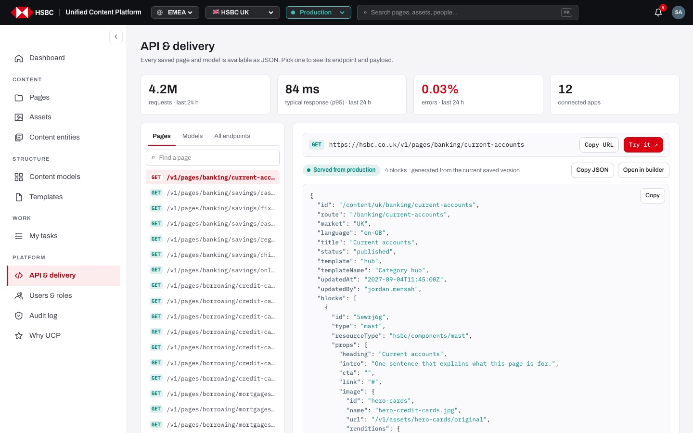
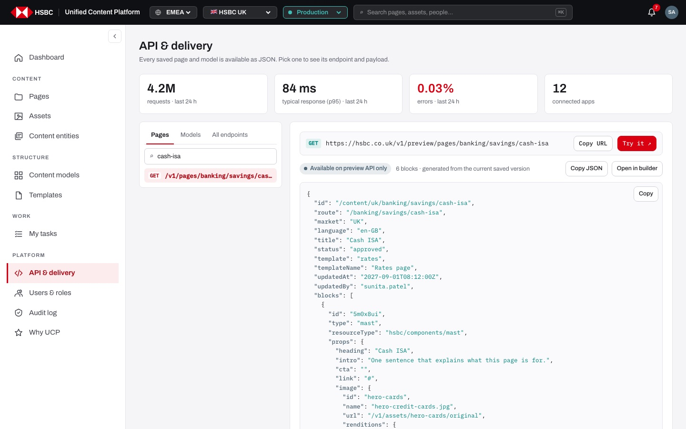
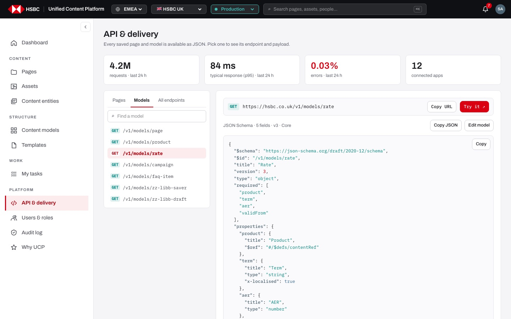
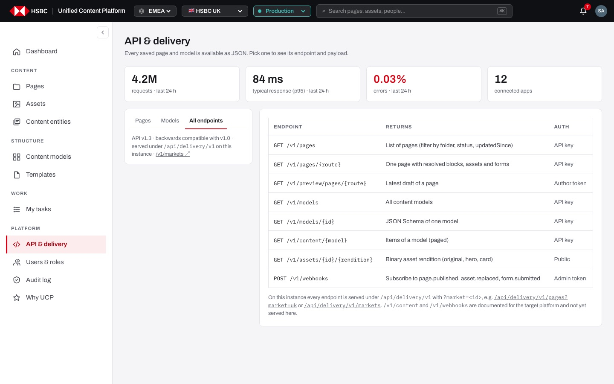

# EP-16 · API & delivery

**Epic:** EP-16 · API & delivery

**Business benefit:** Every website, app and partner channel takes the same approved content from one read-only API, so the bank stops maintaining the same offer in several systems. Only published content is public, which keeps unreleased offers and rates away from customers.

**Scope:** The public delivery API under `/api/delivery/v1` (pages, preview, models, markets, templates, assets, errors and response headers) and the "API & delivery" screen in the CMS that documents it with the Pages, Models and All endpoints tabs, "Copy URL", "Try it ↗" and "Copy JSON".

**The view:**



- **Header** · "API & delivery" and "Every saved page and model is available as JSON. Pick one to see its endpoint and payload."
- **Usage tiles** · four tiles: requests in the last 24 h, typical response time (p95), error rate and connected apps.
- **Left panel** · tabs "Pages", "Models" and "All endpoints"; on Pages and Models a search ("Find a page" / "Find a model") and the list of endpoints (`GET /v1/pages/<route>`, `GET /v1/models/<id>`); on All endpoints the API version note and a link to `/v1/markets ↗`.
- **Detail panel** · for a page or model: the address line (GET · public URL · "Copy URL" · "Try it ↗"), a status line ("Served from production" or "Available on preview API only", or "JSON Schema · N fields · vN · group"), "Copy JSON", "Open in builder" / "Edit model", and the JSON with its own "Copy" button; on All endpoints the table Endpoint · Returns · Auth.


*A page that is not published: preview address, "Available on preview API only" and the draft JSON.*


*Models tab: the JSON Schema of "Rate" with required fields and "x-localised" marks.*


*All endpoints tab: every endpoint with what it returns and the authentication it needs on the target platform.*

**Stories (13):**

1. [US-16.01 · Delivery API: public published pages only, separate preview endpoint for drafts](#us-1601--delivery-api-public-published-pages-only-separate-preview-endpoint-for-drafts)
2. [US-16.02 · Delivery API: choose the market and filter pages by status](#us-1602--delivery-api-choose-the-market-and-filter-pages-by-status)
3. [US-16.03 · Page JSON: resolved tokens, image renditions, form references and SEO meta](#us-1603--page-json-resolved-tokens-image-renditions-form-references-and-seo-meta)
4. [US-16.04 · Delivery API: list content models and get the JSON Schema of each](#us-1604--delivery-api-list-content-models-and-get-the-json-schema-of-each)
5. [US-16.05 · Delivery API: markets, templates and asset renditions](#us-1605--delivery-api-markets-templates-and-asset-renditions)
6. [US-16.06 · Delivery API: standard errors, caching and CORS headers](#us-1606--delivery-api-standard-errors-caching-and-cors-headers)
7. [US-16.07 · Delivery API: API keys for public endpoints and author tokens for preview](#us-1607--delivery-api-api-keys-for-public-endpoints-and-author-tokens-for-preview)
8. [US-16.08 · Delivery API: content items per model and webhooks](#us-1608--delivery-api-content-items-per-model-and-webhooks)
9. [US-16.09 · API & delivery screen: header and usage tiles](#us-1609--api--delivery-screen-header-and-usage-tiles)
10. [US-16.10 · API explorer, Pages tab: find a page and see its address and JSON](#us-1610--api-explorer-pages-tab-find-a-page-and-see-its-address-and-json)
11. [US-16.11 · API explorer, Models tab: find a model and see its JSON Schema](#us-1611--api-explorer-models-tab-find-a-model-and-see-its-json-schema)
12. [US-16.12 · API explorer, All endpoints tab: every endpoint with what it returns and its auth](#us-1612--api-explorer-all-endpoints-tab-every-endpoint-with-what-it-returns-and-its-auth)
13. [US-16.13 · API explorer: Copy URL, Try it and Copy JSON](#us-1613--api-explorer-copy-url-try-it-and-copy-json)

---

## US-16.01 · Delivery API: public published pages only, separate preview endpoint for drafts

**Business benefit:** Only approved content can reach customers through any channel, reducing the risk of leaking unreleased offers. Separate previews let teams test upcoming pages without affecting live sites.

**User story:**

As a front-end developer  
I want the public API to return only published pages, with a separate preview address for drafts  
So that customers only ever see approved content while I can still test upcoming pages  

**Persona:** front-end developer · **Depends on:** US-09.03

**Acceptance criteria:**

**Scenario 1 · List of published pages**

```gherkin
When I call "GET /api/delivery/v1/pages?market=uk"
Then I get "items" with only published pages, each with route, title, status, template, updatedAt and "_links.self"
And "total" with the number of items
```

**Scenario 2 · A page that is not published is not public**

```gherkin
Given the page "/banking/savings/cash-isa" is approved but not published
When I call "GET /api/delivery/v1/pages/banking/savings/cash-isa?market=uk"
Then I get 404 "Not published" with the detail "Available on the preview API: /v1/preview/pages/banking/savings/cash-isa"
```

**Scenario 3 · Preview includes drafts**

```gherkin
When I call "GET /api/delivery/v1/preview/pages/banking/savings/cash-isa?market=uk"
Then I get the page JSON with "status": "approved"
When I call "GET /api/delivery/v1/preview/pages?market=uk"
Then the list includes pages in every status (draft, in review, approved, scheduled, published …)
```

---

## US-16.02 · Delivery API: choose the market and filter pages by status

**Business benefit:** Each local site pulls only its own content, so markets cannot show each other's offers by mistake. Status filters let teams check what is waiting to go live without opening the CMS.

**User story:**

As a front-end developer  
I want to pass the market and a status to the pages endpoints  
So that I get exactly the pages my channel needs  

**Persona:** front-end developer · **Depends on:** US-16.01

**Acceptance criteria:**

**Scenario 1 · Market** *(one run per row of the table)*

```gherkin
When I call "GET /api/delivery/v1/pages?market=<market>"
Then I get <result>

Examples:
  | market    | result                                     |
  | uk        | the published pages of HSBC UK             |
  | hk        | the published pages of HSBC Hong Kong      |
  | (missing) | the published pages of HSBC UK (default)   |
  | zz        | an empty list with "total": 0              |
```

**Scenario 2 · Status filter on the preview list**

```gherkin
When I call "GET /api/delivery/v1/preview/pages?market=uk&status=draft"
Then I get only draft pages
```

**Scenario 3 · Status filter on the public list**

```gherkin
When I call "GET /api/delivery/v1/pages?market=uk&status=draft"
Then I get an empty list, because the public list only ever holds published pages
```

---

## US-16.03 · Page JSON: resolved tokens, image renditions, form references and SEO meta

**Business benefit:** All websites and apps show the same approved content from one source, cutting duplicate work across channels. Ready-to-use JSON shortens integration time and reduces rendering errors.

**User story:**

As a front-end developer  
I want page JSON with resolved values, image renditions, form references and meta  
So that any channel can render the content without extra lookups or guesswork  

**Persona:** front-end developer · **Depends on:** US-16.01, US-06.07, US-12.05

**Acceptance criteria:**

**Background** (applies to every scenario below)

```gherkin
Given I call "GET /api/delivery/v1/pages/banking/savings/easy-access?market=uk"
```

**Scenario 1 · Page fields**

```gherkin
Then I get id (repository path), route, market "UK", language, title, status, template, templateName, updatedAt and updatedBy
And "_links" with self, preview, schema "/v1/models/page" and repository
```

**Scenario 2 · Blocks**

```gherkin
Then "blocks" lists the components in page order, each with id, type, resourceType and props
And {{tokens}} in texts are replaced with the published values of the linked entities
And table texts (rows with "|") come as arrays of rows and cells
```

**Scenario 3 · Images and forms**

```gherkin
Then an image comes as id, name, url "/v1/assets/<id>/original" and renditions hero and card
And a form comes as id, name, version and the embed reference "forms://uk/<form>/v<version>"
```

**Scenario 4 · SEO meta**

```gherkin
Then "meta" has the canonical address "https://hsbc.co.uk/banking/savings/easy-access", "index": true and the description
```

---

## US-16.04 · Delivery API: list content models and get the JSON Schema of each

**Business benefit:** Channels validate content against the same schema the CMS uses, so broken or incomplete content is caught before it reaches customers. Developers do not need separate documentation for each model.

**User story:**

As a front-end developer  
I want a list of all content models and a JSON Schema per model  
So that I can generate types and validate the content I render  

**Persona:** front-end developer · **Depends on:** US-16.01

**Acceptance criteria:**

**Scenario 1 · All models**

```gherkin
When I call "GET /api/delivery/v1/models"
Then I get "items" with id, name, group, version, the number of fields and "_links.schema" for every model
```

**Scenario 2 · Schema of one model**

```gherkin
When I call "GET /api/delivery/v1/models/rate"
Then I get a JSON Schema (draft 2020-12) with "$id": "/v1/models/rate", title, version and "required" fields
And localised fields are marked with "x-localised": true
And references to assets, content and forms point to "$defs" assetRef, contentRef and formRef
```

**Scenario 3 · Unknown model**

```gherkin
When I call "GET /api/delivery/v1/models/nope"
Then I get 404 "Not found" with the detail "model nope"
```

---

## US-16.05 · Delivery API: markets, templates and asset renditions

**Business benefit:** Channels discover markets, locales and templates from the platform instead of hard-coding them, so a new market can go live without code changes. Asset addresses come from one place, which keeps images consistent across channels.

**User story:**

As a front-end developer  
I want endpoints for markets, the templates of a market and asset renditions  
So that my channel can be configured from the platform  

**Persona:** front-end developer · **Depends on:** US-16.01 · **Note:** runs on a stand-in (mock) today

**Acceptance criteria:**

**Scenario 1 · Markets**

```gherkin
When I call "GET /api/delivery/v1/markets"
Then I get every market with id, name, locales, domain and status (e.g. "uk", "HSBC UK", ["en-GB", "cy-GB"], "hsbc.co.uk", "Live on UCP")
```

**Scenario 2 · Templates of a market**

```gherkin
When I call "GET /api/delivery/v1/templates?market=uk"
Then I get the templates the UK may use, with id, path, name, desc, blocks, folder and markets
And templates limited to other markets are left out
```

**Scenario 3 · Asset rendition**

```gherkin
When I call "GET /api/delivery/v1/assets/hero-cards/hero?market=uk"
Then I get id, name, type, rendition "hero", width and height
And for library files "url" is null with the note "binary served by the DAM on the Sling backend"
And for files uploaded in this prototype "url" holds the inline data with the note "inline data for mock uploads"
When the asset does not exist
Then I get 404 "Not found" with the detail "asset <id>"
```

---

## US-16.06 · Delivery API: standard errors, caching and CORS headers

**Business benefit:** Predictable errors and headers let every channel handle problems the same way, which reduces support tickets. Short caching keeps the API fast under load while content stays fresh.

**User story:**

As a front-end developer  
I want standard problem responses for errors and cache, CORS and request-id headers on every answer  
So that my channel can cache, call from the browser and trace requests  

**Persona:** front-end developer · **Depends on:** US-16.01

**Acceptance criteria:**

**Scenario 1 · Successful answers**

```gherkin
When any delivery endpoint answers with 200
Then the answer is JSON
And it has "Cache-Control: public, max-age=60", "Access-Control-Allow-Origin: *" and a unique "X-Request-Id"
```

**Scenario 2 · Not found** *(one run per row of the table)*

```gherkin
When I call "<address>"
Then I get 404 as "application/problem+json" with title "<title>" and detail "<detail>"

Examples:
  | address                                          | title         | detail                                                         |
  | /api/delivery/v1/pages/does/not/exist?market=uk  | Not found     | page does/not/exist                                            |
  | /api/delivery/v1/pages/banking/savings/cash-isa  | Not published | Available on the preview API: /v1/preview/pages/banking/savings/cash-isa |
  | /api/delivery/v1/content/rate                    | Not found     | content/rate                                                   |
```

**Scenario 3 · Read-only**

```gherkin
When I send "POST /api/delivery/v1/pages"
Then I get 405, because the delivery API only reads
```

---

## US-16.07 · Delivery API: API keys for public endpoints and author tokens for preview

**Business benefit:** Only known apps can call the API and only signed-in authors can read drafts, so unreleased offers cannot leak through the preview address. Usage can be traced per connected app.

**User story:**

As a platform owner  
I want the delivery API to require an API key, the preview API an author token and webhooks an admin token  
So that drafts and usage are protected  

**Persona:** platform owner · **Depends on:** US-16.01 · **Note:** planned, not built yet

**Acceptance criteria:**

**Scenario 1 · Auth as documented** *(one run per row of the table)*

```gherkin
When I call "<endpoint>" without credentials
Then I get 401

Examples:
  | endpoint                       |
  | GET /v1/pages                  |
  | GET /v1/preview/pages/{route}  |
  | GET /v1/models                 |
  | POST /v1/webhooks              |
```

**Scenario 2 · Asset renditions stay public**

```gherkin
When I call "GET /v1/assets/{id}/{rendition}" without credentials
Then I get the rendition
```

**Scenario 3 · Today on this instance**

```gherkin
Given the prototype serves the API without any authentication
When I call "GET /api/delivery/v1/preview/pages?market=uk" without signing in
Then I still get every draft page
```

---

## US-16.08 · Delivery API: content items per model and webhooks

**Business benefit:** Channels can reuse structured content such as rates and FAQs outside pages, and react to changes at once instead of polling. This shortens the time between publishing and the change being visible everywhere.

**User story:**

As a front-end developer  
I want to list the items of a model and subscribe to platform events  
So that my channel shows reusable content and refreshes when something changes  

**Persona:** front-end developer · **Depends on:** US-16.04, US-16.07 · **Note:** planned, not built yet

**Acceptance criteria:**

**Scenario 1 · Items of a model**

```gherkin
When I call "GET /v1/content/rate"
Then I get the published items of the model "Rate", paged
```

**Scenario 2 · Webhooks**

```gherkin
When I call "POST /v1/webhooks" with an admin token and the events "page.published", "asset.replaced" or "form.submitted"
Then my endpoint is called whenever such an event happens
```

---

## US-16.09 · API & delivery screen: header and usage tiles

**Business benefit:** Developers and product owners see at a glance that the API is healthy and how much it is used. This helps plan capacity and shows the value of moving channels onto the platform.

**User story:**

As a front-end developer  
I want to see the API's traffic, speed, error rate and connected apps when I open the screen  
So that I know the API is healthy before I start integrating  

**Persona:** front-end developer · **Depends on:** US-01.01 · **Note:** runs on a stand-in (mock) today

**Acceptance criteria:**

**Scenario 1 · Header and tiles**

```gherkin
Given I am signed in
When I open "API & delivery" in the side navigation
Then I see "API & delivery" and "Every saved page and model is available as JSON. Pick one to see its endpoint and payload."
And four tiles: "4.2M requests · last 24 h", "84 ms typical response (p95) · last 24 h", "0.03% errors · last 24 h" and "12 connected apps"
```

**Scenario 2 · Default tab**

```gherkin
When I open the screen without a tab or with an unknown tab in the address
Then the "Pages" tab is shown with the first page of the market selected
```

---

## US-16.10 · API explorer, Pages tab: find a page and see its address and JSON

**Business benefit:** Developers integrate new channels faster without waiting for separate documentation. Self-service exploration lowers support effort and time to market.

**User story:**

As a front-end developer  
I want to pick a page and see its public or preview address and its JSON  
So that I can integrate quickly without reading separate documentation  

**Persona:** front-end developer · **Depends on:** US-16.01, US-16.03, US-16.09

**Acceptance criteria:**

**Background** (applies to every scenario below)

```gherkin
Given I am on "API & delivery" in the UK with the tab "Pages"
```

**Scenario 1 · Find a page**

```gherkin
Then the left panel lists "GET /v1/pages/<route>" for every page of the market
When I type "cash-isa" into "Find a page"
Then only "/v1/pages/banking/savings/cash-isa" is listed
When nothing matches
Then I see "No match"
```

**Scenario 2 · A published page**

```gherkin
When I pick "/v1/pages/banking/current-accounts"
Then the address line shows "GET https://hsbc.co.uk/v1/pages/banking/current-accounts"
And the status line says "Served from production" and "4 blocks · generated from the current saved version"
And the page JSON is shown below
```

**Scenario 3 · A page that is not published**

```gherkin
When I pick "/v1/pages/banking/savings/cash-isa"
Then the address line shows "https://hsbc.co.uk/v1/preview/pages/banking/savings/cash-isa"
And the status line says "Available on preview API only"
```

**Scenario 4 · Open in builder**

```gherkin
When I click "Open in builder"
Then the page builder opens on that page
```

**Scenario 5 · Other markets**

```gherkin
When I switch to Hong Kong
Then the addresses use the domain "hsbc.com.hk"
```

---

## US-16.11 · API explorer, Models tab: find a model and see its JSON Schema

**Business benefit:** Developers see the exact structure of every content type next to the content itself, which removes guesswork and rework. Changes to a model are visible at once to every team that integrates it.

**User story:**

As a front-end developer  
I want to pick a content model and see its schema address and JSON Schema  
So that I can build and validate my channel against it  

**Persona:** front-end developer · **Depends on:** US-16.04, US-16.09

**Acceptance criteria:**

**Background** (applies to every scenario below)

```gherkin
Given I am on "API & delivery" and click the tab "Models"
```

**Scenario 1 · Find a model**

```gherkin
Then the left panel lists "GET /v1/models/<id>" for every model
And "Find a model" filters by name or id, showing "No match" when nothing matches
```

**Scenario 2 · Schema of a model**

```gherkin
When I pick "/v1/models/rate"
Then the address line shows "GET https://hsbc.co.uk/v1/models/rate"
And the line reads "JSON Schema · 5 fields · v3 · Core"
And the JSON Schema is shown below
```

**Scenario 3 · Edit model**

```gherkin
When I click "Edit model"
Then "Content models" opens with that model selected
```

---

## US-16.12 · API explorer, All endpoints tab: every endpoint with what it returns and its auth

**Business benefit:** One table gives every team the full contract of the API, so integrations are planned without meetings. It also shows clearly what is already served and what is still to come.

**User story:**

As a front-end developer  
I want a table of all endpoints with what they return and which authentication they need  
So that I can plan my integration in one place  

**Persona:** front-end developer · **Depends on:** US-16.09

**Acceptance criteria:**

**Scenario 1 · Endpoint table**

```gherkin
When I click the tab "All endpoints"
Then the table "Endpoint · Returns · Auth" lists "GET /v1/pages", "GET /v1/pages/{route}", "GET /v1/preview/pages/{route}", "GET /v1/models", "GET /v1/models/{id}", "GET /v1/content/{model}", "GET /v1/assets/{id}/{rendition}" and "POST /v1/webhooks"
And the auth column reads "API key", "Author token", "Public" or "Admin token"
```

**Scenario 2 · How this instance serves it**

```gherkin
Then the left panel says "API v1.3 · backwards compatible with v1.0 · served under /api/delivery/v1 on this instance" with the link "/v1/markets ↗"
And the note below the table says every endpoint is served under "/api/delivery/v1" with "?market=<id>"
And that "/v1/content" and "/v1/webhooks" are documented for the target platform and not yet served here
```

---

## US-16.13 · API explorer: Copy URL, Try it and Copy JSON

**Business benefit:** Developers move from reading to a working call in one click, which shortens integration time. Copying exact addresses and payloads avoids typing mistakes.

**User story:**

As a front-end developer  
I want to copy the address or the JSON and open the live endpoint  
So that I can test and reuse it right away  

**Persona:** front-end developer · **Depends on:** US-16.10, US-16.11

**Acceptance criteria:**

**Background** (applies to every scenario below)

```gherkin
Given I am on "API & delivery" with a page or a model selected
```

**Scenario 1 · Copy URL**

```gherkin
When I click "Copy URL"
Then the public address (e.g. "https://hsbc.co.uk/v1/pages/banking/current-accounts") is on the clipboard
And the button reads "Copied" for a moment
```

**Scenario 2 · Try it**

```gherkin
When I click "Try it ↗"
Then a new tab opens on this instance's endpoint, e.g. "/api/delivery/v1/pages/banking/current-accounts?market=uk"
And for a page that is not published it opens the preview endpoint
```

**Scenario 3 · Copy JSON**

```gherkin
When I click "Copy JSON" in the status line or "Copy" on the JSON panel
Then the whole page JSON or schema, formatted, is on the clipboard
```
