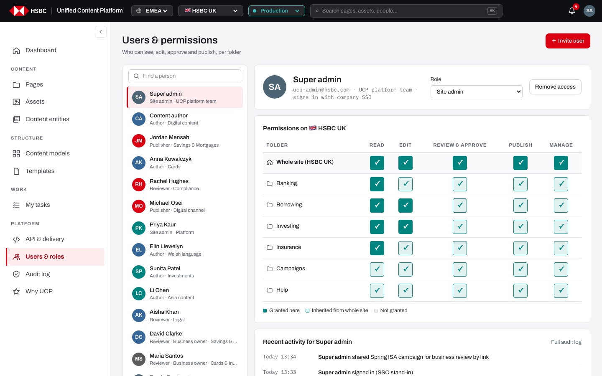
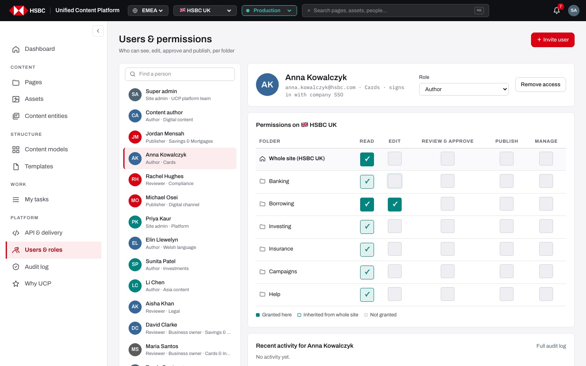
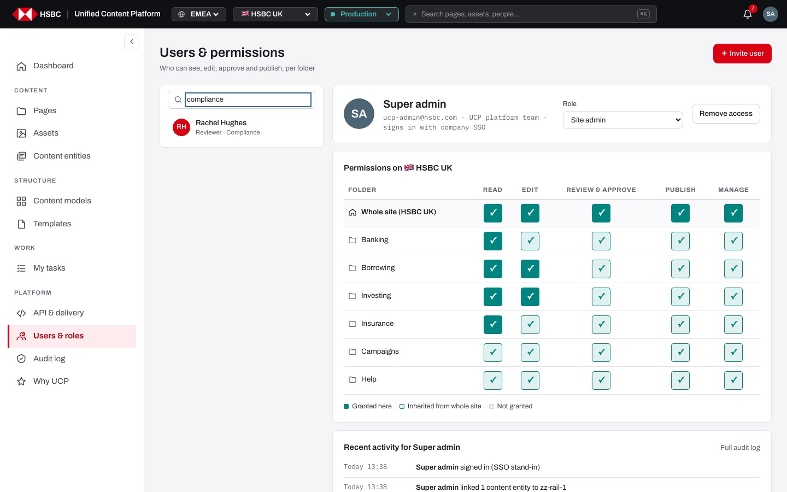
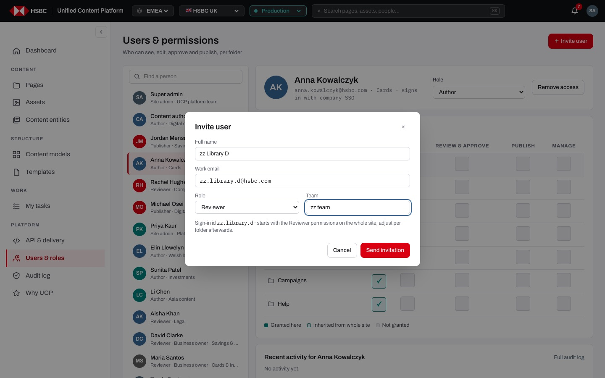
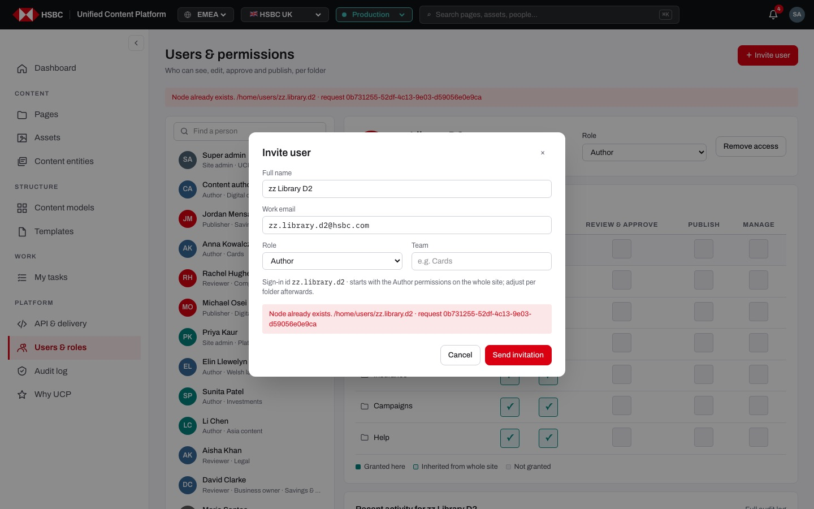
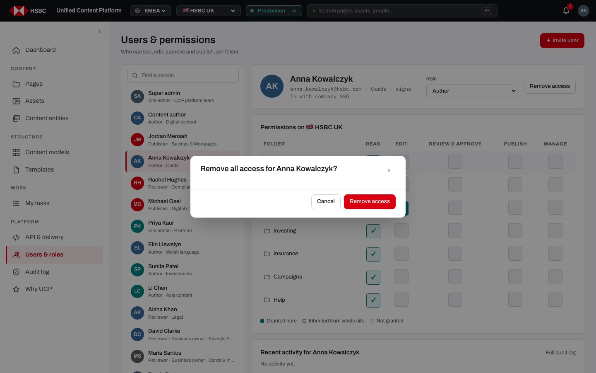
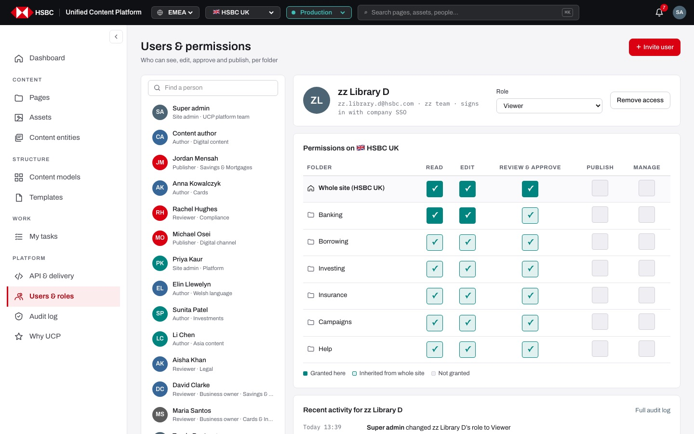
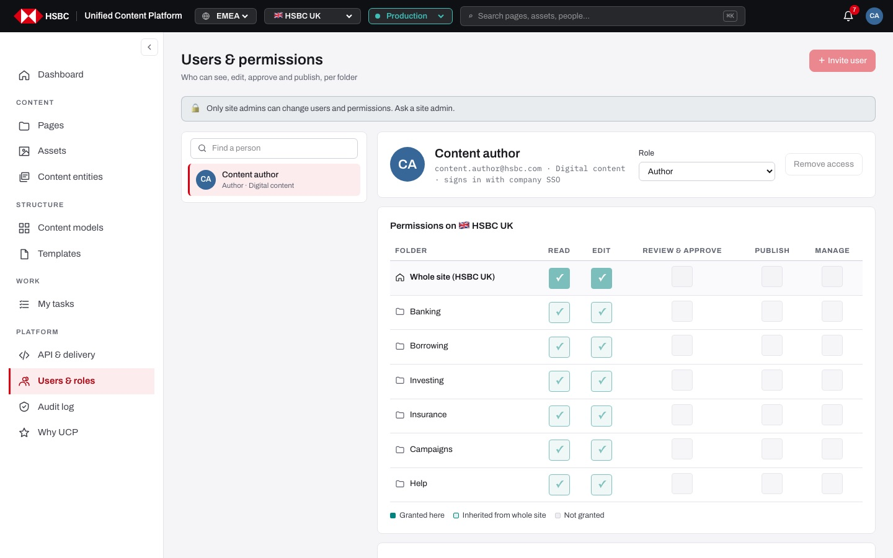

# EP-17 · Users & roles

**Epic:** EP-17 · Users & roles

**Business benefit:** The bank controls who can read, edit, approve and publish content folder by folder, which enforces segregation of duties on customer-facing pages. Every invitation, role change and grant lands in the audit log, so access reviews and regulatory audits need no manual evidence gathering.

**Scope:** The "Users & permissions" screen at `/<market>/<env>/users`: the people directory, each person's profile and role, the per-folder permissions grid, invitations, removing access and recent activity, plus the server rules that stop anyone but a site admin from changing them.

**The view:**



- **Header** · title "Users & permissions", subtitle "Who can see, edit, approve and publish, per folder" and the "＋ Invite user" button (site admins only).
- **Admin notice** · for anyone who is not a site admin, a lock banner "Only site admins can change users and permissions. Ask …" replaces all editing.
- **People list (left)** · "Find a person" search over name, team and role; one row per person with avatar, name and "Role · Team"; the selected person is highlighted and kept in the URL (`?user=<id>`).
- **Profile card** · avatar, name, "e-mail · team · signs in with company SSO", the "Role" drop-down and "Remove access".
- **Permissions grid** · "Permissions on 🇬🇧 HSBC UK": one row for "Whole site (HSBC UK)" and one per top-level folder (Banking, Borrowing, Investing, Insurance, Campaigns, Help); columns Read, Edit, Review & approve, Publish, Manage; each cell is a toggle that is granted here (solid green), inherited from whole site (light green) or not granted (grey), with a legend underneath.
- **Recent activity** · the person's last five audit events with a "Full audit log" link filtered to that person.
- **Invite user dialog** · full name, work e-mail, role and team, with the generated sign-in id.



*Anna Kowalczyk: Read on the whole site is inherited by every folder (light green), Read and Edit on Borrowing are granted explicitly (solid green).*

**Stories (10):**

1. [US-17.01 · Permissions model: role defaults and the permission each workflow step needs](#us-1701--permissions-model-role-defaults-and-the-permission-each-workflow-step-needs)
2. [US-17.02 · People list: browse and find a person by name, team or role](#us-1702--people-list-browse-and-find-a-person-by-name-team-or-role)
3. [US-17.03 · User profile: select a person and share a direct link to them](#us-1703--user-profile-select-a-person-and-share-a-direct-link-to-them)
4. [US-17.04 · Permissions grid: grant and remove permissions per folder, explicit or inherited (site admin)](#us-1704--permissions-grid-grant-and-remove-permissions-per-folder-explicit-or-inherited-site-admin)
5. [US-17.05 · Role: change a person's role from the profile card](#us-1705--role-change-a-persons-role-from-the-profile-card)
6. [US-17.06 · Invite user: add a person with a role, team and generated sign-in id](#us-1706--invite-user-add-a-person-with-a-role-team-and-generated-sign-in-id)
7. [US-17.07 · Remove access: take all access away from a person after confirmation](#us-1707--remove-access-take-all-access-away-from-a-person-after-confirmation)
8. [US-17.08 · Recent activity: a person's last actions with a link to the full audit log](#us-1708--recent-activity-a-persons-last-actions-with-a-link-to-the-full-audit-log)
9. [US-17.09 · My access: non-admins see only their own profile and permissions, read-only](#us-1709--my-access-non-admins-see-only-their-own-profile-and-permissions-read-only)
10. [US-17.10 · Access control: only site admins can change users and permissions, enforced by the server](#us-1710--access-control-only-site-admins-can-change-users-and-permissions-enforced-by-the-server)

---

## US-17.01 · Permissions model: role defaults and the permission each workflow step needs

**Business benefit:** Approval rights follow the bank's segregation-of-duties rules, which supports regulatory compliance. Sensible defaults also cut the admin effort of setting up each new person.

**User story:**

As a business owner  
I want each role to come with sensible defaults and each workflow step to need its permission  
So that only qualified people edit, approve and publish content  

**Persona:** business owner · **Depends on:** —

**Acceptance criteria:**

**Background** (applies to every scenario below)

```gherkin
Given the permissions are Read, Edit, Review & approve, Publish and Manage
And they are granted on the whole site or on a top-level folder
```

**Scenario 1 · Role defaults** *(one run per row of the table)*

```gherkin
Given a person is invited with the role "<role>"
Then they start with <permissions> on the whole site

Examples:
  | role       | permissions                                   |
  | Author     | Read and Edit                                 |
  | Reviewer   | Read, Edit and Review & approve               |
  | Publisher  | Read, Review & approve and Publish            |
  | Site admin | Read, Edit, Review & approve, Publish, Manage |
  | Viewer     | Read                                          |
```

**Scenario 2 · Status changes** *(one run per row of the table)*

```gherkin
When someone moves a page to "<status>"
Then they need <permission> on the page's folder or on the whole site

Examples:
  | status                    | permission         |
  | Build the page (draft)    | Edit               |
  | Waiting for review        | Edit               |
  | In author's review        | Review & approve   |
  | Ready to publish          | Review & approve   |
  | Scheduled / Published     | Publish            |
```

**Scenario 3 · Folder grants add to whole-site grants**

```gherkin
Given "Elin Llewelyn" has Read on the whole site and Edit on "Banking"
Then she can edit pages under Banking
But she cannot edit pages under Borrowing
```

**Scenario 4 · Site admins can do everything**

```gherkin
Given a person has the role "Site admin" or Manage on the whole site
Then every permission check passes for them on every folder
```

---

## US-17.02 · People list: browse and find a person by name, team or role

**Business benefit:** Admins find the right person in seconds instead of scrolling a directory, which shortens every access request. Seeing role and team next to each name reduces the risk of granting access to the wrong person.

**User story:**

As a site admin  
I want to see everyone with access and filter the list as I type  
So that I can open the right person quickly  

**Persona:** site admin · **Depends on:** US-01.01 · **Note:** site admin only

**Acceptance criteria:**

**Background** (applies to every scenario below)

```gherkin
Given I am signed in as a site admin
And I open "Users & roles"
```

**Scenario 1 · Everyone is listed**

```gherkin
Then the list shows every person with avatar, name and "<Role> · <Team>"
And "Rachel Hughes" shows "Reviewer · Compliance"
And the first person is selected when no one is chosen in the URL
```

**Scenario 2 · Find a person** *(one run per row of the table)*

```gherkin
When I type "<text>" in "Find a person"
Then the list shows only "<person>"

Examples:
  | text       | person         |
  | rachel     | Rachel Hughes  |
  | compliance | Rachel Hughes  |
  | viewer     | Tunde Boateng  |
```

**Scenario 3 · No match**

```gherkin
When I type "xyzzy" in "Find a person"
Then the list says "No one matches “xyzzy”."
```



*Typing "compliance" narrows the list to Rachel Hughes; the profile on the right stays on the selected person.*

---

## US-17.03 · User profile: select a person and share a direct link to them

**Business benefit:** A link straight to one person's access makes access reviews and helpdesk hand-offs faster. Showing that everyone signs in with company SSO reassures auditors that no local passwords exist.

**User story:**

As a site admin  
I want to select a person and see their identity, team and role, with the selection kept in the URL  
So that I can review or share exactly one person's access  

**Persona:** site admin · **Depends on:** US-17.02 · **Note:** site admin only

**Acceptance criteria:**

**Scenario 1 · Selecting a person**

```gherkin
Given I am a site admin on "Users & roles"
When I click "Anna Kowalczyk" in the list
Then her row is highlighted
And the URL becomes "/uk/prod/users?user=anna.kowalczyk"
And the profile shows "anna.kowalczyk@hsbc.com · Cards · signs in with company SSO"
And the "Role" drop-down shows "Author"
```

**Scenario 2 · Opening a direct link**

```gherkin
When I open "/uk/prod/users?user=rachel.hughes"
Then Rachel Hughes is selected and her profile and permissions are shown
```

---

## US-17.04 · Permissions grid: grant and remove permissions per folder, explicit or inherited (site admin)

**Business benefit:** Access can be tailored per folder, so teams work independently without over-privileged accounts. Every grant is logged, which makes access reviews and audits straightforward.

**User story:**

As a site admin  
I want to grant and remove each permission on the whole site or on a single top-level folder  
So that everyone has exactly the access their job needs  

**Persona:** site admin · **Depends on:** US-17.01, US-17.03 · **Note:** site admin only

**Acceptance criteria:**

**Background** (applies to every scenario below)

```gherkin
Given I am a site admin on "Users & roles"
And the grid "Permissions on 🇬🇧 HSBC UK" has the rows "Whole site (HSBC UK)", Banking, Borrowing, Investing, Insurance, Campaigns and Help
And the columns Read, Edit, Review & approve, Publish and Manage
```

**Scenario 1 · Three states of a cell** *(one run per row of the table)*

```gherkin
Given I select "Anna Kowalczyk"
Then the "<folder>" / "<permission>" cell is <state> with the tooltip "<tooltip>"

Examples:
  | folder               | permission | state                  | tooltip                                                    |
  | Whole site (HSBC UK) | Read       | solid green with ✓     | Granted. Click to remove.                                  |
  | Banking              | Read       | light green with ✓     | Inherited from whole site. Click to grant here explicitly. |
  | Borrowing            | Edit       | solid green with ✓     | Granted. Click to remove.                                  |
  | Banking              | Edit       | grey                   | Not granted. Click to grant.                               |
```

**Scenario 2 · Granting a permission also grants Read**

```gherkin
Given a person has no Edit on "Banking"
When I click the "Banking" / "Edit" cell
Then Edit and Read on Banking become "Granted here"
And a toast says "Granted Edit on Banking"
And the audit log says "gave <name> Edit on Banking"
```

**Scenario 3 · Granting explicitly over an inherited permission**

```gherkin
Given a person has Review & approve on the whole site
When I click the light-green "Banking" / "Review & approve" cell
Then it becomes "Granted here" on Banking
And it stays granted on Banking if the whole-site grant is later removed
```

**Scenario 4 · Removing a permission**

```gherkin
When I click a solid-green cell on "the whole site"
Then the grant is removed and folder rows that only inherited it turn grey
And a toast says "Removed <permission> on the whole site"
And the audit log says "removed <name>’s <permission> on the whole site"
```

**Scenario 5 · Column help**

```gherkin
When I hover the column headings
Then they explain "See pages and content", "Change drafts", "Approve for publishing", "Push to production" and "Permissions and settings"
```

**Scenario 6 · A failed save is shown**

```gherkin
Given the server refuses the change
Then a red banner shows the reason and the request id
And the grid keeps the previous state
```

---

## US-17.05 · Role: change a person's role from the profile card

**Business benefit:** Moving someone between Author, Reviewer, Publisher, Site admin and Viewer takes one click when their job changes. Each change is logged with who made it, which keeps role reviews auditable.

**User story:**

As a site admin  
I want to change a person's role in the "Role" drop-down  
So that their role matches their current job  

**Persona:** site admin · **Depends on:** US-17.03 · **Note:** site admin only

**Acceptance criteria:**

**Scenario 1 · Changing the role**

```gherkin
Given I am a site admin and a person with the role "Reviewer" is selected
When I choose "Viewer" in the "Role" drop-down
Then the role is saved straight away, without a confirmation
And a toast says "Role changed to Viewer"
And the list row shows "Viewer · <team>"
And the audit log says "changed <name>’s role to Viewer"
```

**Scenario 2 · The folder grants stay as they are**

```gherkin
Given a person with Read, Edit and Review & approve on the whole site
When I change their role to "Viewer"
Then the permissions grid still shows Read, Edit and Review & approve
And I adjust the grid myself if their access should shrink
```

**Scenario 3 · Choosing the same role does nothing**

```gherkin
When I choose the role the person already has
Then nothing is saved and nothing is logged
```

---

## US-17.06 · Invite user: add a person with a role, team and generated sign-in id

**Business benefit:** New starters get working access on day one with the right role defaults, without a ticket to the platform team. A predictable sign-in id and a logged invitation keep the joiner process consistent and auditable.

**User story:**

As a site admin  
I want to invite a person with their name, work e-mail, role and team  
So that they can sign in with company SSO and start work with the right access  

**Persona:** site admin · **Depends on:** US-17.01, US-17.02 · **Note:** site admin only

**Acceptance criteria:**

**Background** (applies to every scenario below)

```gherkin
Given I am a site admin on "Users & roles"
And I click "＋ Invite user"
```

**Scenario 1 · The dialog**

```gherkin
Then the "Invite user" dialog shows "Full name", "Work email", "Role" (default "Author") and "Team"
And "Send invitation" is disabled while the name is empty
```

**Scenario 2 · Sign-in id and e-mail are generated from the name**

```gherkin
When I type "Sam Taylor" in "Full name"
Then the dialog says "Sign-in id sam.taylor · starts with the Author permissions on the whole site; adjust per folder afterwards."
And "Work email" is filled with "sam.taylor@hsbc.com" unless I typed my own
```

**Scenario 3 · Sending the invitation**

```gherkin
Given I chose the role "Reviewer" and the team "Savings"
When I click "Send invitation"
Then the dialog closes and the toast says "Invitation sent to Sam Taylor"
And Sam Taylor is added to the list and selected
And the grid shows Read, Edit and Review & approve on the whole site
And the audit log says "invited Sam Taylor as Reviewer"
```

**Scenario 4 · The sign-in id already exists**

```gherkin
Given someone with the sign-in id "sam.taylor" already exists
When I send the invitation again
Then the dialog stays open and shows "Node already exists. /home/users/sam.taylor · request <id>"
```

**Scenario 5 · Closing without inviting**

```gherkin
When I click "Cancel", the "×" or outside the dialog
Then the dialog closes and nobody is added
```



*The sign-in id is generated from the full name; the chosen role sets the starting permissions on the whole site.*



*Inviting a name whose sign-in id already exists keeps the dialog open with the server's message and request id.*

---

## US-17.07 · Remove access: take all access away from a person after confirmation

**Business benefit:** Leavers and movers lose access in one step, closing a common audit finding. The confirmation and the log entry protect against accidental removals and prove when access ended.

**User story:**

As a site admin  
I want to remove all access for a person after confirming  
So that people who no longer need the platform cannot use it  

**Persona:** site admin · **Depends on:** US-17.03 · **Note:** site admin only

**Acceptance criteria:**

**Scenario 1 · Confirmation**

```gherkin
Given I am a site admin and "Anna Kowalczyk" is selected
When I click "Remove access"
Then a dialog asks "Remove all access for Anna Kowalczyk?" with "Cancel" and a red "Remove access"
```

**Scenario 2 · Cancelling**

```gherkin
When I click "Cancel" in the dialog
Then nothing changes and Anna Kowalczyk stays in the list
```

**Scenario 3 · Removing**

```gherkin
When I click "Remove access" in the dialog
Then the person disappears from the list and the first person in the list is selected
And a toast says "Access removed"
And the audit log says "removed all access for <name>"
```



*Removing access always asks first; Cancel leaves the person untouched.*

---

## US-17.08 · Recent activity: a person's last actions with a link to the full audit log

**Business benefit:** Admins see at a glance what a person did and what was changed for them before adjusting access. The jump to the filtered audit log saves time in investigations.

**User story:**

As a site admin  
I want to see a person's latest actions and the changes made to their access  
So that I understand their recent work before changing their permissions  

**Persona:** site admin · **Depends on:** US-17.03, US-18.01

**Acceptance criteria:**

**Scenario 1 · Last five events**

```gherkin
Given a person is selected
Then "Recent activity for <name>" lists up to five audit events, newest first
And each shows when it happened (for example "Today 13:38") and "<who> <what>"
And it includes events they did and permission changes made to them by others
```

**Scenario 2 · No activity**

```gherkin
Given the selected person has no events
Then the card says "No activity yet."
```

**Scenario 3 · Links**

```gherkin
When I click an event about a page
Then that page opens in the page builder
When I click "Full audit log"
Then the audit log opens filtered to that person ("?who=<id>")
```



*Recent activity shows both the person's own actions and the invitation, grant and role change made by the admin.*

---

## US-17.09 · My access: non-admins see only their own profile and permissions, read-only

**Business benefit:** Staff can check their own access without raising a ticket, while colleagues' access stays private. Locking every control for non-admins removes the chance of accidental changes.

**User story:**

As a content author  
I want to see my own role, permissions and recent activity  
So that I know what I can do and whom to ask for more  

**Persona:** content author · **Depends on:** US-01.01, US-17.03

**Acceptance criteria:**

**Background** (applies to every scenario below)

```gherkin
Given I am signed in as "content.author"
And I open "Users & roles"
```

**Scenario 1 · Only me**

```gherkin
Then the list shows only "Content author"
And opening "/uk/prod/users?user=rachel.hughes" still shows only my own profile
```

**Scenario 2 · Everything is read-only**

```gherkin
Then I see "Only site admins can change users and permissions. Ask a site admin."
And "＋ Invite user" is disabled with the tooltip "Only site admins can invite users"
And the "Role" drop-down, "Remove access" and every grid cell are disabled
```

**Scenario 3 · My grants and activity**

```gherkin
Then the grid shows my Read and Edit on the whole site and inherited on every folder
And "Recent activity for Content author" lists my latest actions
```



*A content author sees only their own profile; the lock banner explains why nothing can be changed.*

---

## US-17.10 · Access control: only site admins can change users and permissions, enforced by the server

**Business benefit:** Server-side enforcement closes a privilege-escalation risk that would otherwise undermine every other control. It gives security and audit teams evidence that access rules cannot be bypassed.

**User story:**

As a business owner  
I want only site admins to change users and permissions, enforced on screen and on the server  
So that nobody can grant themselves more than they should have  

**Persona:** business owner · **Depends on:** US-17.04, US-17.09

**Acceptance criteria:**

**Scenario 1 · Non-admins see only themselves**

```gherkin
Given I am signed in as "content.author"
When I open "Users & roles"
Then I see only my own profile
And "Only site admins can change users and permissions"
```

**Scenario 2 · The server refuses user changes from non-admins** *(one run per row of the table)*

```gherkin
Given I am signed in as "<person>", who is not a site admin
When I call "<method> /api/repo/node" on a path under "/home/users"
Then the answer is 403 "Only site admins can change users and permissions"
And the detail says "Signed in as <name>"
And the response carries an "X-Request-Id" header

Examples:
  | person         | method |
  | content.author | PATCH  |
  | content.author | POST   |
  | content.author | DELETE |
  | tunde.boateng  | PATCH  |
```

**Scenario 3 · The server refuses page changes without the permission**

```gherkin
Given I am a viewer
When I save components of a page
Then the answer is 403 "You don't have Edit on <folder>" with a request id
```
