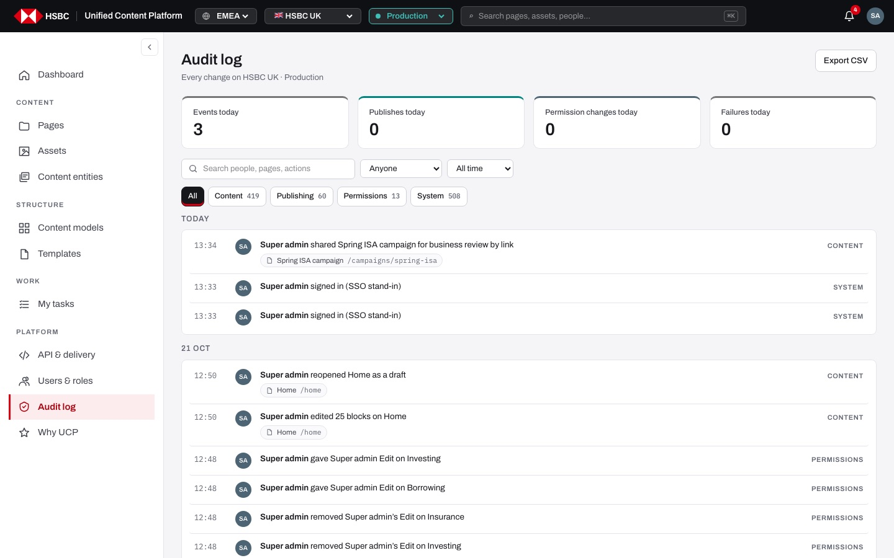
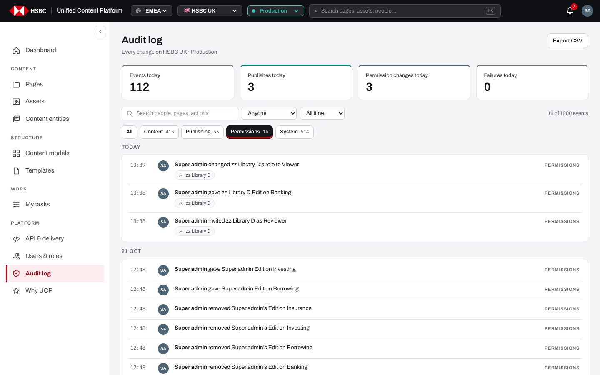
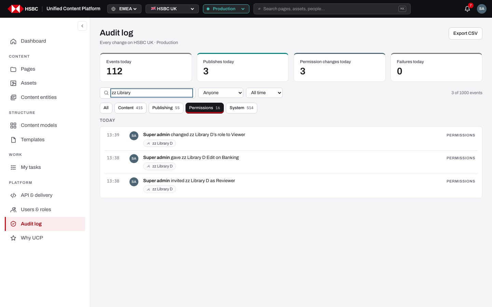
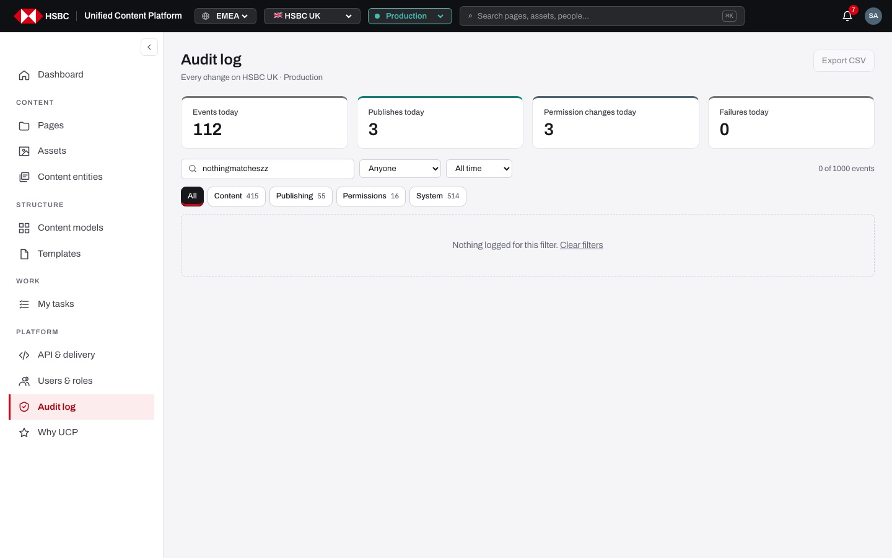
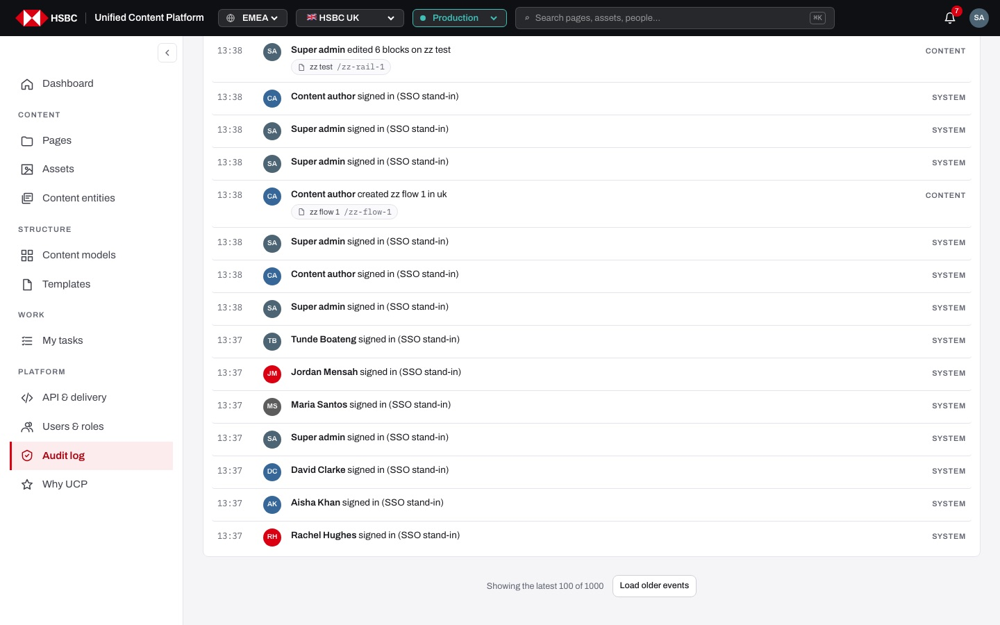
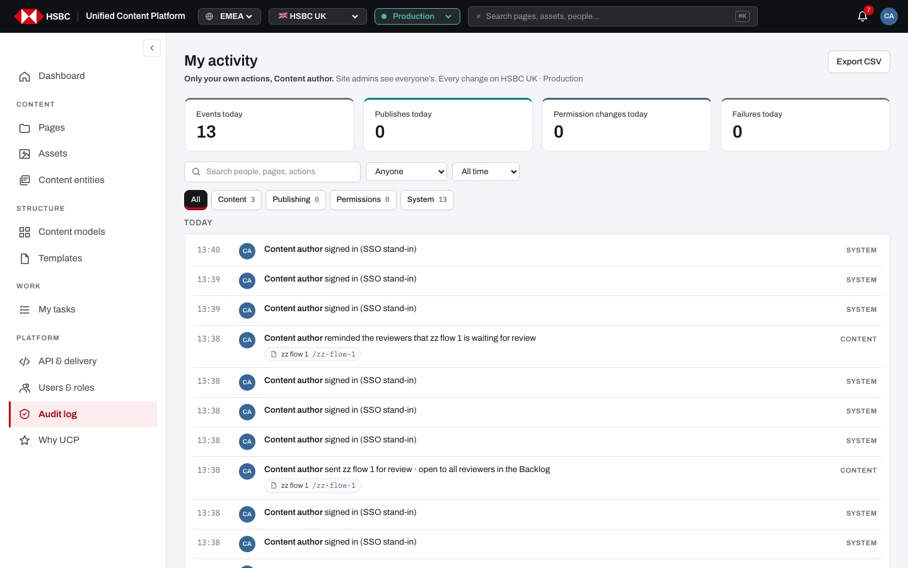

# EP-18 · Audit log

**Epic:** EP-18 · Audit log

**Business benefit:** The bank can show auditors and regulators who changed, approved, published or re-permissioned any content, when, and under which request id. Filters and CSV export turn evidence gathering for a compliance review from days of manual work into minutes.

**Scope:** The "Audit log" screen at `/<market>/<env>/audit`: today's KPIs, type tabs, search, person and period filters, day-grouped events with links to what changed, paging to older events and CSV export, plus the "My activity" version that non-admins see.

**The view:**



- **Header** · title "Audit log" (or "My activity" for non-admins), subtitle "Every change on HSBC UK · Production" and the "Export CSV" button.
- **KPI tiles** · "Events today", "Publishes today", "Permission changes today" and "Failures today" (turns red when above zero).
- **Filter bar** · "Search people, pages, actions", the person drop-down ("Anyone" + everyone in the log), the period drop-down ("All time", "Today", "Last 2 days") and an "X of Y events" counter when a filter is active.
- **Type tabs** · All, Content, Publishing, Permissions and System, each with its event count.
- **Event list** · events grouped under day headings (Today, Yesterday, "21 Oct"); each row shows the time, the person's avatar (a coloured dot for System), "<person> <what happened>", a chip for the page, person or section it touched, and the type on the right ("failed" in red for failures).
- **Footer** · "Showing the latest 100 of N" with "Load older events".



*The Permissions tab lists invitations, grants and role changes; the person chip links to that user in Users & roles.*

**Stories (11):**

1. [US-18.01 · Audit trail: every change recorded with who, what, when and request id](#us-1801--audit-trail-every-change-recorded-with-who-what-when-and-request-id)
2. [US-18.02 · Today's KPIs: events, publishes, permission changes and failures](#us-1802--todays-kpis-events-publishes-permission-changes-and-failures)
3. [US-18.03 · Type tabs: All, Content, Publishing, Permissions and System with counts](#us-1803--type-tabs-all-content-publishing-permissions-and-system-with-counts)
4. [US-18.04 · Search: find events by person, page, action, path or request id](#us-1804--search-find-events-by-person-page-action-path-or-request-id)
5. [US-18.05 · Person and period filters: one person's events, today or the last two days](#us-1805--person-and-period-filters-one-persons-events-today-or-the-last-two-days)
6. [US-18.06 · Shareable filters: filters kept in the URL, result counter and clear filters](#us-1806--shareable-filters-filters-kept-in-the-url-result-counter-and-clear-filters)
7. [US-18.07 · Event list: events grouped by day with time, person, action and type](#us-1807--event-list-events-grouped-by-day-with-time-person-action-and-type)
8. [US-18.08 · Event links: open the page, person or section an event is about](#us-1808--event-links-open-the-page-person-or-section-an-event-is-about)
9. [US-18.09 · Load older events: show the latest 100 and page back in steps of 100](#us-1809--load-older-events-show-the-latest-100-and-page-back-in-steps-of-100)
10. [US-18.10 · Export CSV: download the filtered events for auditors](#us-1810--export-csv-download-the-filtered-events-for-auditors)
11. [US-18.11 · My activity: non-admins see only their own audit entries](#us-1811--my-activity-non-admins-see-only-their-own-audit-entries)

---

## US-18.01 · Audit trail: every change recorded with who, what, when and request id

**Business benefit:** The bank can answer auditors and regulators with complete evidence of who changed what and when. A request id on every entry ties each line to the exact server call for investigations.

**User story:**

As a site admin  
I want every change recorded with who, what, when and a request id, and to see everyone's events  
So that the bank can prove who did what to auditors and regulators  

**Persona:** site admin · **Depends on:** US-17.01 · **Note:** site admin only

**Acceptance criteria:**

**Scenario 1 · Audit entries**

```gherkin
When anyone saves, sends for review, reviews, signs off, publishes, archives, deletes or changes permissions
Then the audit log gets a line with the person, the action, the page and a request id
And the line is appended under the market it belongs to and is never edited afterwards
```

**Scenario 2 · Event types** *(one run per row of the table)*

```gherkin
When "<action>" happens
Then it is logged with the type "<type>"

Examples:
  | action                                         | type        |
  | Super admin edited 6 blocks on a page          | content     |
  | Super admin published a page or a model        | publishing  |
  | Super admin gave Anna Kowalczyk Edit on Banking | permissions |
  | Content author signed in (SSO stand-in)        | system      |
```

**Scenario 3 · Admins see everyone**

```gherkin
Given I am signed in as a site admin
When I open "Audit log"
Then it is titled "Audit log" and shows events by every person and by System
And the list holds the latest 1000 events of the market
```

---

## US-18.02 · Today's KPIs: events, publishes, permission changes and failures

**Business benefit:** Admins spot unusual activity, such as a burst of permission changes or failed publishes, the moment they open the log. Early detection shortens incident response on customer-facing content.

**User story:**

As a site admin  
I want today's totals at the top of the log  
So that I see at a glance whether anything unusual happened  

**Persona:** site admin · **Depends on:** US-18.01

**Acceptance criteria:**

**Scenario 1 · Tiles count today's events** *(one run per row of the table)*

```gherkin
Then the tile "<tile>" shows the number of today's events that are <rule>

Examples:
  | tile                     | rule                         |
  | Events today             | of any type                  |
  | Publishes today          | of type publishing           |
  | Permission changes today | of type permissions          |
  | Failures today           | marked as failed             |
```

**Scenario 2 · Failures stand out**

```gherkin
Given a publish failed today
Then "Failures today" shows the number in red with a red top border
But with no failures it stays grey and shows 0
```

**Scenario 3 · Tiles ignore the filters**

```gherkin
When I search, filter or switch tabs
Then the KPI tiles keep showing today's totals
```

---

## US-18.03 · Type tabs: All, Content, Publishing, Permissions and System with counts

**Business benefit:** Reviewers jump straight to the category an auditor asks about, such as access changes. Counts on the tabs show the size of each category before anyone reads a line.

**User story:**

As a site admin  
I want to switch between event types  
So that I only read the kind of events I am reviewing  

**Persona:** site admin · **Depends on:** US-18.01

**Acceptance criteria:**

**Scenario 1 · Tabs and counts**

```gherkin
Then I see the tabs "All", "Content", "Publishing", "Permissions" and "System"
And every tab except "All" shows how many loaded events have that type
```

**Scenario 2 · Switching tab**

```gherkin
When I click "Permissions"
Then the tab is highlighted and only permission events are listed
And the URL becomes "/uk/prod/audit?type=permissions"
And the counter shows "16 of 1000 events"
```

---

## US-18.04 · Search: find events by person, page, action, path or request id

**Business benefit:** An investigator pastes a request id from an error report or a page name from a complaint and gets the matching events instantly. That makes incident and complaint handling faster and cheaper.

**User story:**

As a site admin  
I want to search the log as I type  
So that I find the events about one page, person or request  

**Persona:** site admin · **Depends on:** US-18.01

**Acceptance criteria:**

**Scenario 1 · Matching** *(one run per row of the table)*

```gherkin
When I type "<text>" in "Search people, pages, actions"
Then only events whose <field> contains it are listed

Examples:
  | text                                   | field                        |
  | Rachel                                 | person name                  |
  | Cash ISA                               | page title                   |
  | published                              | action text                  |
  | /content/uk/savings                    | target path                  |
  | 4b0c59af-1c18-4f28-9128-63bd7ad5ffe9   | request id                   |
```

**Scenario 2 · Search combines with the tab**

```gherkin
Given the "Permissions" tab is selected
When I search "zz Library"
Then only permission events about "zz Library" are listed
And the URL keeps both "type=permissions" and "q=zz+Library"
```



*Search narrows the Permissions tab to one person's invitation, grant and role change; the counter shows "3 of 1000 events".*

---

## US-18.05 · Person and period filters: one person's events, today or the last two days

**Business benefit:** Access reviews and leaver checks focus on one person's actions without exporting everything. Short periods make daily operational checks quick.

**User story:**

As a site admin  
I want to filter by person and by period  
So that I review what one person did recently  

**Persona:** site admin · **Depends on:** US-18.01

**Acceptance criteria:**

**Scenario 1 · Person filter**

```gherkin
When I open the person drop-down
Then it lists "Anyone" and every person who appears in the loaded log, sorted by name
When I choose "Rachel Hughes"
Then only her events are listed
And the URL becomes "/uk/prod/audit?who=rachel.hughes"
```

**Scenario 2 · Period filter** *(one run per row of the table)*

```gherkin
When I choose "<period>"
Then only events from <days> are listed
And the URL has "<param>"

Examples:
  | period      | days                  | param         |
  | All time    | any day               | (none)        |
  | Today       | today                 | period=today  |
  | Last 2 days | today and yesterday   | period=2d     |
```

**Scenario 3 · Coming from Users & roles**

```gherkin
Given I clicked "Full audit log" on a person in Users & roles
Then the log opens with that person already chosen
```

---

## US-18.06 · Shareable filters: filters kept in the URL, result counter and clear filters

**Business benefit:** An admin can send a colleague or auditor a link that opens exactly the same filtered view, which avoids misunderstandings in reviews. A clear empty state with one-click reset stops people mistaking a filter for missing data.

**User story:**

As a site admin  
I want my filters kept in the link and an easy way to reset them  
So that I can share a view and never get stuck on an empty list  

**Persona:** site admin · **Depends on:** US-18.03, US-18.04, US-18.05

**Acceptance criteria:**

**Scenario 1 · Opening a filtered link**

```gherkin
When I open "/uk/prod/audit?type=permissions&q=zz+Library"
Then the "Permissions" tab is selected and the search box contains "zz Library"
```

**Scenario 2 · Result counter**

```gherkin
Given any filter is active
Then the filter bar shows "<shown> of <loaded> events"
And with no filter the counter is hidden
```

**Scenario 3 · Nothing matches**

```gherkin
When I open "/uk/prod/audit?q=nothingmatcheszz"
Then the list says "Nothing logged for this filter. Clear filters"
And "Export CSV" is disabled
When I click "Clear filters"
Then the tab is "All", search and person are empty, the period is "All time"
And the URL is "/uk/prod/audit"
```



*A search with no matches explains itself and offers "Clear filters".*

---

## US-18.07 · Event list: events grouped by day with time, person, action and type

**Business benefit:** Grouping by day lets reviewers reconstruct a timeline of changes quickly, which is what auditors ask for first. Clear failure marking draws attention to events that may need follow-up.

**User story:**

As a site admin  
I want events grouped by day, newest first, each with time, person, action and type  
So that I can read the log as a timeline  

**Persona:** site admin · **Depends on:** US-18.01

**Acceptance criteria:**

**Scenario 1 · Day headings**

```gherkin
Then events are grouped under "Today", "Yesterday" or the date such as "21 Oct"
And days and times are shown in UK time (Europe/London)
And the newest event is at the top
```

**Scenario 2 · Event row**

```gherkin
Then each row shows the time "13:38", the person's avatar, "<person> <what happened>" and the type in capitals on the right
And events by "System" show a coloured dot instead of an avatar
```

**Scenario 3 · Failures**

```gherkin
Given an event is marked as failed
Then the type column says "failed" in red
And a System event of that kind gets a red dot
```

---

## US-18.08 · Event links: open the page, person or section an event is about

**Business benefit:** Investigators move from a log line to the affected page or person in one click. Fewer manual lookups mean faster answers to auditors and complaint handlers.

**User story:**

As a site admin  
I want each event to link to what it changed  
So that I can check the current state straight away  

**Persona:** site admin · **Depends on:** US-18.07

**Acceptance criteria:**

**Scenario 1 · Target chips** *(one run per row of the table)*

```gherkin
Given an event about <target>
Then its chip shows <chip>
And clicking the row or the chip opens <destination>

Examples:
  | target              | chip                                   | destination                          |
  | an existing page    | page icon, title and path "/zz-rail-1" | the page in the page builder         |
  | a person            | person icon and name                   | "/uk/prod/users?user=<id>"           |
  | a section           | the section name, e.g. "templates"     | that section, e.g. "/uk/prod/templates" |
  | a deleted page      | its path only                          | nothing (the row is not clickable)   |
```

**Scenario 2 · No chip for oneself**

```gherkin
Given the event's target is the person who did it
Then no chip is shown
```

**Scenario 3 · A removed person**

```gherkin
Given a person's access was removed
Then older events about them show their sign-in id in the chip instead of the name
```

---

## US-18.09 · Load older events: show the latest 100 and page back in steps of 100

**Business benefit:** The log opens fast even with thousands of events, so admins are not slowed down in daily use. Older evidence stays reachable without leaving the screen.

**User story:**

As a site admin  
I want to see the latest events first and load older ones on demand  
So that the log stays quick but complete  

**Persona:** site admin · **Depends on:** US-18.07

**Acceptance criteria:**

**Scenario 1 · First 100**

```gherkin
Given more than 100 events match the filters
Then the list shows the latest 100
And the footer says "Showing the latest 100 of 1000" with "Load older events"
```

**Scenario 2 · Loading more**

```gherkin
When I click "Load older events"
Then 100 more are added below and the footer says "Showing the latest 200 of 1000"
And when every matching event is shown the footer disappears
```

**Scenario 3 · Changing a filter starts again**

```gherkin
When I change the tab, search, person or period
Then the list goes back to the latest 100 matching events
```



*The footer pages back through the log 100 events at a time.*

---

## US-18.10 · Export CSV: download the filtered events for auditors

**Business benefit:** Auditors receive evidence in a format they can analyse in their own tools without screen captures. Exporting exactly the filtered view keeps what is shared limited to what was asked for.

**User story:**

As a site admin  
I want to export the events I filtered to a CSV file  
So that I can hand evidence to auditors and regulators  

**Persona:** site admin · **Depends on:** US-18.06

**Acceptance criteria:**

**Scenario 1 · Download**

```gherkin
Given the Permissions tab is filtered to "zz Library"
When I click "Export CSV"
Then a file "audit-hsbc-uk-<yyyy-mm-dd>.csv" is downloaded
And it has the columns "time,type,who,text,target,requestId"
And it holds every matching event, also those not loaded on screen yet
```

**Scenario 2 · Content of a line**

```gherkin
Then each value is quoted, the time is ISO 8601 in UTC and "who" is the person's name
And a failed event has the type "<type> (failed)"
```

**Scenario 3 · Nothing to export**

```gherkin
Given no event matches the filters
Then "Export CSV" is disabled
```

---

## US-18.11 · My activity: non-admins see only their own audit entries

**Business benefit:** Staff can check their own work without seeing colleagues' activity, respecting need-to-know access. Fewer support requests to admins lowers operating cost.

**User story:**

As a content author  
I want to see a log of my own actions only  
So that I can check what I did without seeing other people's activity  

**Persona:** content author · **Depends on:** US-18.01

**Acceptance criteria:**

**Background** (applies to every scenario below)

```gherkin
Given I am signed in as "content.author", who is not a site admin
And I open "Audit log"
```

**Scenario 1 · Admins see everyone, others see themselves**

```gherkin
Then it is titled "My activity"
And it says "Only your own actions, Content author. Site admins see everyone’s."
And it shows only my actions
```

**Scenario 2 · Filters and KPIs cover only me**

```gherkin
Then the person drop-down offers only "Anyone" and "Content author"
And the KPI tiles and tab counts count only my events
And "Export CSV" exports only my events
```



*A content author sees only their own sign-ins and page actions under the title "My activity".*
