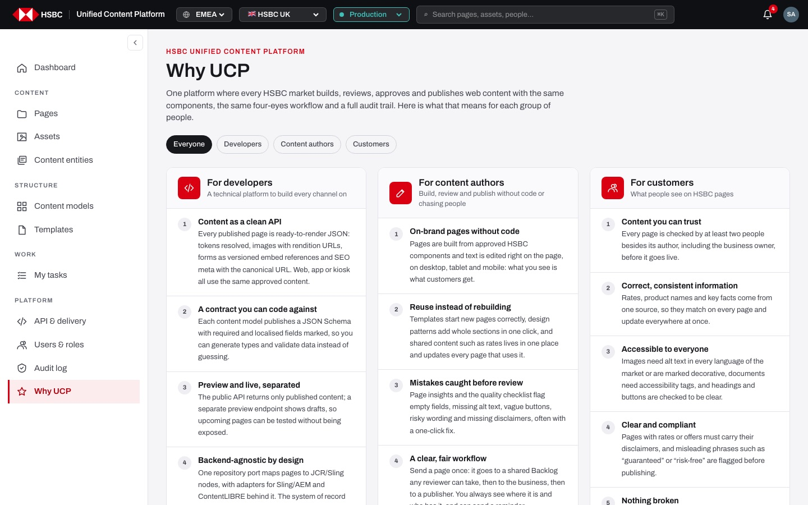
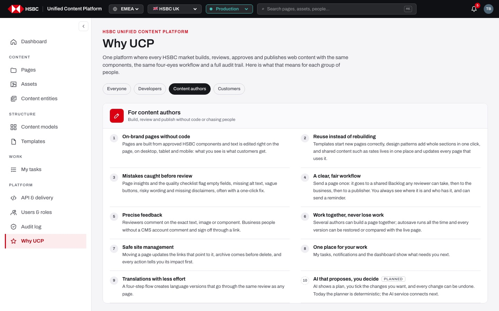

# EP-19 · Why UCP

**Epic:** EP-19 · Why UCP

**Business benefit:** Everyone who uses the platform can see in plain words what it does for developers, content authors and customers, which helps adoption across markets. Being honest about what is planned and what works today keeps expectations realistic in steering and budget discussions.

**Scope:** The "Why UCP" page in the main navigation: the benefits per audience, the audience tabs and the marks for planned items with the link to the roadmap.

**The view:**



- **Intro:** the label "HSBC Unified Content Platform", the title "Why UCP" and one paragraph on what the platform is.
- **Audience tabs:** "Everyone", "Developers", "Content authors" and "Customers"; the chosen tab is dark.
- **Audience cards:** one card per audience with an icon, "For <audience>", a tagline and a numbered list of benefits; on "Everyone" the three cards sit side by side, on a single audience the list runs in two columns.
- **Footer note:** "Written from what the platform does today. Items marked Planned are on the roadmap." with a link to the roadmap.


*With one audience chosen, its benefits run in two columns.*

**Stories (3):**

1. [US-19.01 · Why UCP: see the platform's benefits for developers, content authors and customers](#us-1901--why-ucp-see-the-platforms-benefits-for-developers-content-authors-and-customers)
2. [US-19.02 · Why UCP: show the benefits of one audience with a link I can share](#us-1902--why-ucp-show-the-benefits-of-one-audience-with-a-link-i-can-share)
3. [US-19.03 · Why UCP: mark planned benefits and link to the roadmap](#us-1903--why-ucp-mark-planned-benefits-and-link-to-the-roadmap)

---

## US-19.01 · Why UCP: see the platform's benefits for developers, content authors and customers

**Business benefit:** A single page explains the value of the platform to every group, so markets and stakeholders get the same message. It reduces the time spent on explaining the platform in onboarding and steering meetings.

**User story:**

As anyone who uses the platform  
I want to read what the platform does for each group of people  
So that I understand why the bank uses it and what it gives me  

**Persona:** any signed-in user · **Depends on:** —

**Acceptance criteria:**

**Scenario 1 · Opening Why UCP**

```gherkin
Given I am signed in, with any role
When I click "Why UCP" in the main navigation or choose it in the command palette
Then I see the title "Why UCP" and the intro starting "One platform where every HSBC market builds, reviews, approves and publishes web content"
And the tab "Everyone" is selected
```

**Scenario 2 · One card per audience** *(one run per row of the table)*

```gherkin
Then I see the card "<card>" with the tagline "<tagline>" and <n> numbered benefits

Examples:
  | card                  | tagline                                                 | n  |
  | For developers        | A technical platform to build every channel on          | 10 |
  | For content authors   | Build, review and publish without code or chasing people | 10 |
  | For customers         | What people see on HSBC pages                           | 7  |
```

**Scenario 3 · A benefit**

```gherkin
Then every benefit shows its number, a short title such as "Content as a clean API" and one or two sentences of explanation
```

---

## US-19.02 · Why UCP: show the benefits of one audience with a link I can share

**Business benefit:** Presenters can show one group exactly the benefits that matter to them, which makes the case for the platform more convincing. A shareable link lets the same view be sent to developers, authors or business teams.

**User story:**

As anyone who presents the platform  
I want to show the benefits of only one audience and share that view  
So that each group sees what matters to them  

**Persona:** any signed-in user · **Depends on:** US-19.01

**Acceptance criteria:**

**Scenario 1 · Choosing an audience** *(one run per row of the table)*

```gherkin
When I click the tab "<tab>"
Then the address ends with "<address>"
And only the card "<card>" is shown, with its benefits in two columns on wide screens
And the tab "<tab>" is marked as the current one

Examples:
  | tab             | address         | card                |
  | Developers      | ?for=developers | For developers      |
  | Content authors | ?for=authors    | For content authors |
  | Customers       | ?for=customers  | For customers       |
```

**Scenario 2 · Back to everyone**

```gherkin
Given only one audience is shown
When I click "Everyone"
Then all three cards are shown side by side again
```

**Scenario 3 · Unknown audience in the link**

```gherkin
When I open the page with "?for=" and a value that is not an audience
Then all three cards are shown
```

---

## US-19.03 · Why UCP: mark planned benefits and link to the roadmap

**Business benefit:** Readers can tell at once what works today and what is still to come, which avoids over-promising to markets and stakeholders. The link to the roadmap gives a single place to follow planned work.

**User story:**

As anyone who reads the benefits  
I want planned items to be clearly marked and linked to the roadmap  
So that I do not mistake future work for something I can use today  

**Persona:** any signed-in user · **Depends on:** US-19.01

**Acceptance criteria:**

**Scenario 1 · Planned items**

```gherkin
Then "API keys, publish webhooks, environment promotion" for developers and "AI that proposes, you decide" for content authors carry the tag "Planned"
And their number is shown in a dashed circle instead of a filled one
And all other benefits describe what the platform does today
```

**Scenario 2 · Roadmap link**

```gherkin
Then under the cards I see "Written from what the platform does today. Items marked Planned are on the roadmap."
When I click "roadmap"
Then the roadmap opens in a new tab
```
